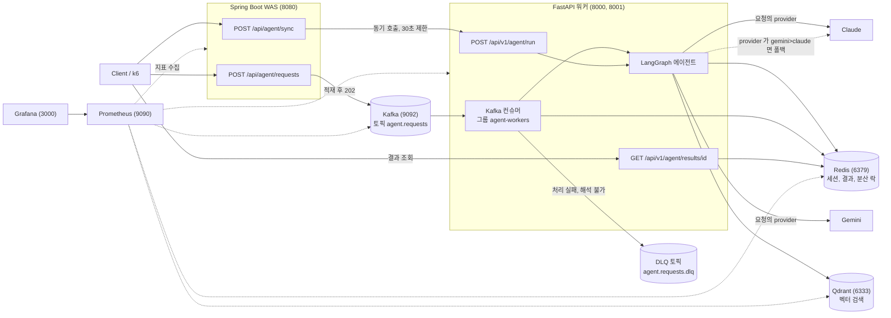
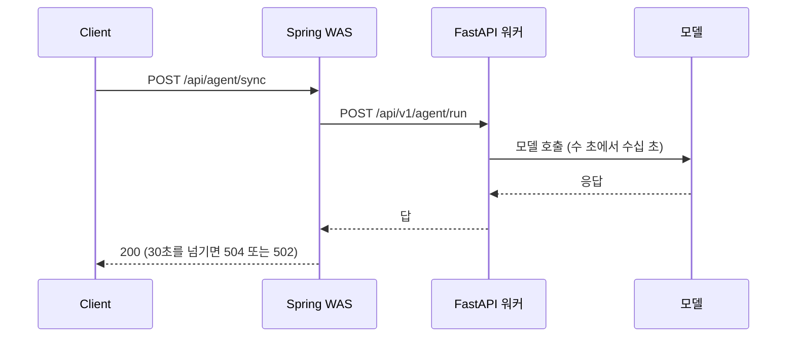
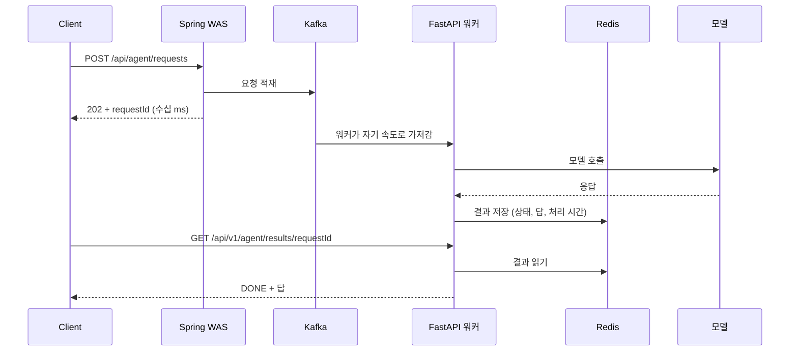
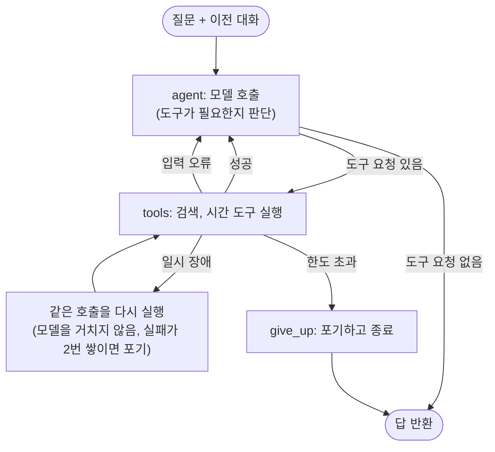
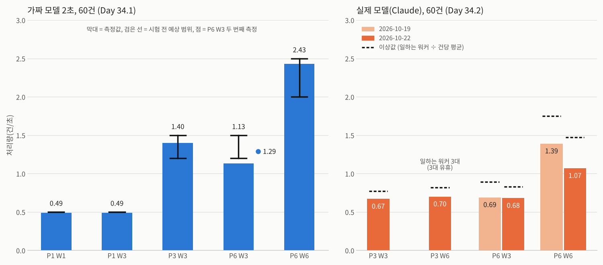
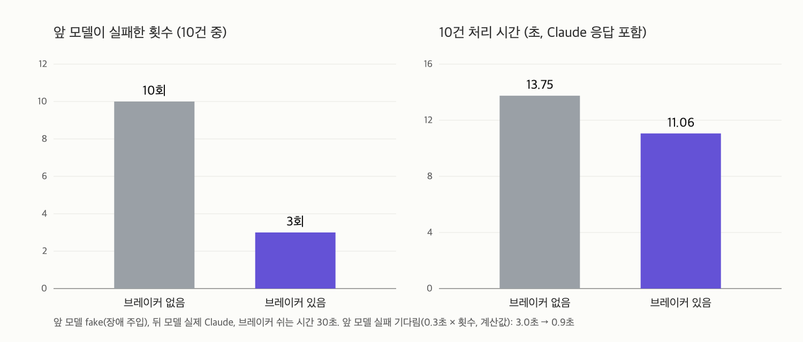
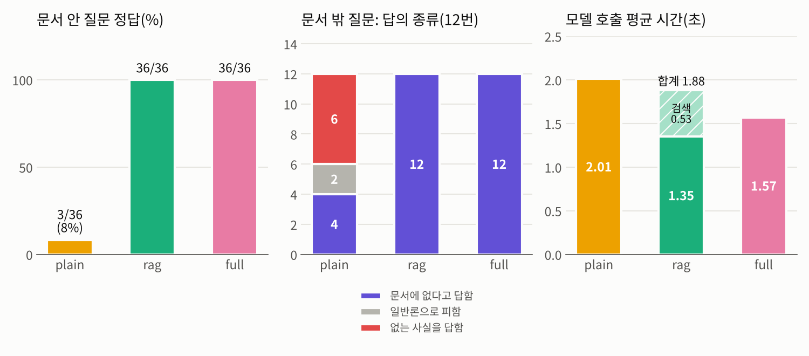
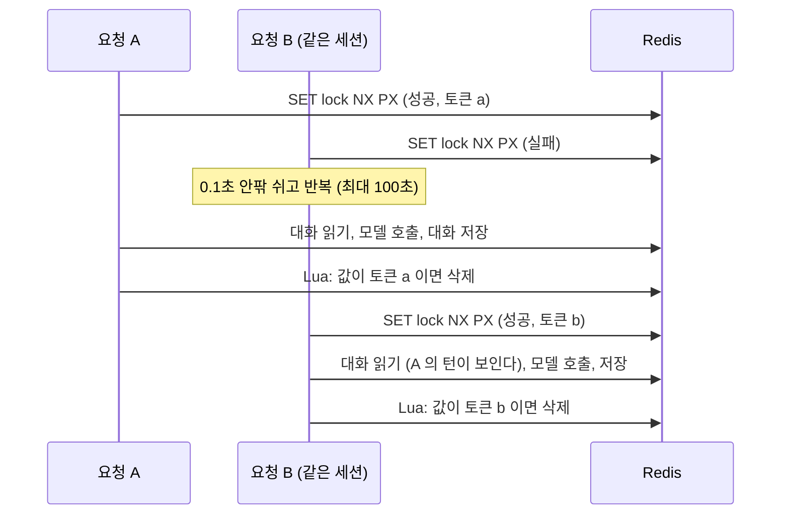
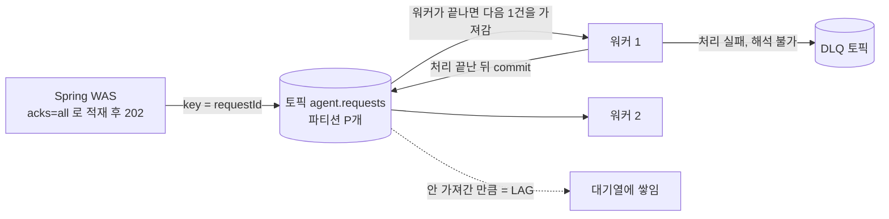

# AI 에이전트 서빙 인프라 — 느리고 불안정한 AI 호출을 큐, 캐시, 락으로 제어하기

**전체 목적:** AI 에이전트 호출은 느리고(수 초에서 수십 초), 외부 API라 불안정하고, 호출 한도가 있다. 이런 작업을 그대로 요청 경로에 붙이면 서버가 무너진다. 이 프로젝트는 메시지 큐(Kafka), 캐시와 분산 락(Redis), 벡터 검색(Qdrant), 부하 시험(k6), 모니터링(Prometheus, Grafana)으로 이를 제어하고 방어하는 구조를 만들고, 동기 구조와 비동기 구조를 같은 부하로 비교해 숫자로 확인한다.

**처음부터 실행하려면:** [RUN_GUIDE.md](RUN_GUIDE.md)

## 핵심 결과

| 질문                                                     | 결과                                                                                                                                                  | 자세히 |
| -------------------------------------------------------- | ----------------------------------------------------------------------------------------------------------------------------------------------------- | ------ |
| 같은 부하(VU 20)에서 동기와 비동기 중 어느 쪽이 버티는가 | 동기는 요청의 75%(가짜 모델), 56.75%(실제 Claude)가 504, 502 로 실패했다. 비동기는 접수 실패 0 이다                                                   | 4-2    |
| 비동기 접수 경로는 어디까지 버티는가                     | VU 800 까지 접수 성공 100%, 접수 p(95) 93ms 이하. 요청 속도는 VU 600 의 2.61만 건/초에서 더 늘지 않았다                                               | 4-3    |
| 처리량은 무엇으로 정해지는가                             | 일하는 워커 수 `min(파티션, 워커)` 다. 실제 Claude 에서 P3W3(0.67건/초)와 P3W6(0.70건/초)이 같았고, P6W6 만 1.07~1.39건/초로 올랐다                   | 4-4    |
| 같은 세션의 동시 요청을 락이 막아 주는가                 | 락이 없으면 N=4~8 동시 요청 10라운드 모두 대화가 유실됐고, 락을 걸면 유실 0 이다                                                                      | 5-1    |
| 벡터 검색 설정은 무엇으로 정하는가                       | `hnsw_ef` 64 에서 recall@10 0.991, 그 뒤로는 거의 오르지 않고 처리량만 떨어졌다                                                                       | 4-5    |
| 문서 검색(RAG)을 붙이면 답이 정확해지는가                | 문서 안 질문 정답이 3/36(검색 없음)에서 36/36 으로 늘었다. 문서 밖 질문에서 없는 사실을 답한 수는 6/12 에서 0 이 됐다                                 | 4-7    |
| 앞 모델이 실패하면 다음 모델로 넘어가는가                | 가짜 모델에서는 넘어가고 연속 실패 시 건너뛴다. 실제 Gemini 는 실패하지 않고 느렸다(질문당 최대 1170초). 지금의 폴백은 오류만 다뤄 지연은 막지 못한다 | 4-6    |

**용어:** VU 는 k6 가 동시에 흉내 내는 사용자 수, P3W3 은 Kafka 파티션 3개와 워커 3대, p(95) 는 요청의 95% 가 그 시간 안에 끝났다는 뜻, recall@10 은 정확한 검색의 상위 10개 중 근사 검색이 찾은 비율이다.

## 1. 문제 정의

### 1-1. AI 호출의 특성

| 특성                           | 이 프로젝트에서 잰 값                                                                                          | 그대로 두면 생기는 일                                |
| ------------------------------ | -------------------------------------------------------------------------------------------------------------- | ---------------------------------------------------- |
| 한 번에 오래 걸린다            | Gemini 에이전트 한 건 22~29초(Day 17), Claude 한 건 평균 3.4~4.1초(Day 34.2)                                   | 요청 스레드를 오래 붙잡아 서버가 금방 포화된다       |
| 시간이 일정하지 않다           | 같은 Gemini 로 질문 20개를 보냈을 때 중앙값 31.09초, 최대 1170.21초(Day 36). Claude 는 3.73초 안팎으로 고른 편 | 처리 시간을 예측해 서버 크기를 정하기 어렵다         |
| 외부 API라 불안정하다          | 임베딩 호출 중 무료 한도(Gemini) 초과(429)가 실제로 났다(Day 12, 58초 쉬고 재시도해 성공)                      | 방어가 없으면 한 번의 429 가 그 요청의 실패로 끝난다 |
| 한 번에 한 건씩 처리한다(워커) | 워커 1대가 건당 약 5초(가짜 모델)면 초당 0.2건                                                                 | 요청이 몰리면 처리하지 못한 요청이 쌓인다            |

### 1-2. 동기 구조는 어떻게 무너지는가

요청이 들어오면 에이전트가 답을 만들 때까지 연결을 붙잡고 기다리는 구조(동기)로 같은 부하를 보냈다.

| 시험                       | 결과                                                          | 출처                                        |
| -------------------------- | ------------------------------------------------------------- | ------------------------------------------- |
| 동기, VU 20, 가짜 모델 5초 | 요청 32건 중 200 8건, 504 22건, 502 2건(에러율 75%)           | [DAY26_RESULT.md](docs/DAY26_RESULT.md)     |
| 동기, VU 20, 실제 Claude   | 요청 37건 중 200 16건, 504 18건, 502 3건(에러율 56.75%)       | [DAY34_2_RESULT.md](docs/DAY34_2_RESULT.md) |
| 처리 중인 워커의 `/health` | 동기 요청 하나가 처리되는 동안 `/health` 응답이 3.09초 막혔다 | [DAY26_RESULT.md](docs/DAY26_RESULT.md)     |

동기 요청 하나가 그 워커의 모든 요청을 멈추게 하고, 대기 시간이 Spring 의 30초 제한을 넘으면 504(또는 502)로 끝난다.

### 1-3. 이 보고서가 답하려는 질문

| 번호 | 질문                                                                                           | 확인한 방법                                                         |
| ---- | ---------------------------------------------------------------------------------------------- | ------------------------------------------------------------------- |
| 1    | 요청을 Kafka 에 넣고 바로 202 로 응답하는 비동기 구조는 같은 부하에서 에러 없이 버티는가       | 같은 조건의 동기, 비동기 부하 시험(k6)                              |
| 2    | 비동기 접수 경로는 어디까지 버티는가                                                           | 접수 경로의 한계 탐색                                               |
| 3    | 처리량은 무엇으로 정해지고 어떻게 늘리는가                                                     | Kafka 파티션 수와 워커 수를 바꿔 처리량 측정                        |
| 4    | 느리고 불안정한 AI 호출의 실패(일시 장애, 입력 오류, 모델 장애, 동시 요청)를 어떻게 방어하는가 | 재시도와 정정, DLQ, 분산 락, 모델 폴백                              |
| 5    | 문서 검색(RAG)을 붙이면 문서에 있는 내용을 정확히 답하는가, 느려지는가                         | 같은 질문을 검색 없이, 검색 결과를 붙여, 문서 전체를 붙여 물어 비교 |

### 1-4. 시험 방식

부하 시험은 비용과 호출 한도 때문에 대부분 가짜 모델(고정 지연 2~5초)로 했다. 가짜 모델은 구조와 부하를 보기 위한 것이라 실제 모델의 응답 시간 분포는 반영하지 못한다. 그래서 Day 34.2 에서는 실제 운영 구성(Spring, Kafka, FastAPI 워커, Redis 에 실제 Claude, Qdrant 검색, Gemini 임베딩)을 모두 구동해 동기·비동기 부하 시험과 파티션·워커 처리량 시험을 다시 했다. 한계는 6번에서 정리한다.

## 2. 시스템 아키텍처

### 2-1. 전체 구성

| 구성 요소                 | 역할                                                                                                                                                                                                                                                           | 만든 Day          |
| ------------------------- | -------------------------------------------------------------------------------------------------------------------------------------------------------------------------------------------------------------------------------------------------------------- | ----------------- |
| Spring Boot WAS (8080)    | 요청을 받는 입구. 비동기는 Kafka 에 넣고 202, 동기는 FastAPI 를 호출해 답을 기다린다(30초 제한)                                                                                                                                                                | Day 14, 17, 26~27 |
| Kafka (9092)              | 요청을 쌓아 두고 워커가 처리 속도에 맞춰 가져가게 한다(throttling). 처리 실패 메시지는 DLQ(처리하지 못한 메시지를 따로 두는 토픽)에 보관                                                                                                                       | Day 13~18, 32     |
| FastAPI 워커 (8000, 8001) | Kafka 에서 요청을 가져와 LangGraph 에이전트를 실행하고 결과를 저장. 동기 호출도 받는다                                                                                                                                                                         | Day 2, 15~16      |
| LangGraph 에이전트        | - 모델 호출: 질문과 대화를 AI 모델(Gemini, Claude 등)에 보내 모델이 답을 바로 쓸지 도구를 쓸지 판단  - 도구 호출: 검색(Gemini 임베딩 + Qdrant) 또는 시간 조회를 실행해 결과를 모델에 돌려줌  - 실패 처리: 재시도, 입력 수정 후 재요청, 한도 초과 시 포기 | Day 3, 6, 11, 31  |
| Redis (6379)              | 대화 세션, 결과(TTL), 같은 세션의 동시 요청을 막는 분산 락                                                                                                                                                                                                     | Day 19~24, 33     |
| Qdrant (6333)             | 문서 검색(RAG). HNSW(근사 벡터 검색) 설정 튜닝                                                                                                                                                                                                                 | Day 7~12, 29      |
| Prometheus, Grafana       | 지표 수집과 시각화                                                                                                                                                                                                                                             | Day 30            |
| k6                        | 부하 시험                                                                                                                                                                                                                                                      | Day 25~28         |

provider 는 요청마다 정한다. `gemini`, `claude`처럼 하나를 쓰면 그 모델만 부르고, `gemini>claude`처럼 `>`로 이으면 앞 모델이 실패할 때 다음 모델로 넘어간다(Day 36). 검색 도구의 임베딩은 어느 경우에도 Gemini 를 쓴다.

### 2-2. 동기와 비동기의 요청 흐름

**동기:** 답이 나올 때까지 연결을 붙잡는다.

**비동기:** 접수와 처리를 나눈다.

두 구조의 차이는 기다림이 어디에 있는가다. 동기는 기다림이 HTTP 연결에 있어서 시간이 길어지면 연결이 끊긴다. 비동기는 기다림이 Kafka 대기열로 옮겨가서 접수는 항상 빠르고, 처리가 밀린 요청은 유실되지 않고 뒤에서 이어서 처리된다. 대기 시간 자체가 줄어드는 것은 아니다.

### 2-3. 에이전트 내부 흐름

| 실패 종류             | 처리                                                                                                   | Day           |
| --------------------- | ------------------------------------------------------------------------------------------------------ | ------------- |
| 도구의 일시 장애      | 그래프가 같은 호출을 다시 실행한다. 한도를 넘으면 포기한다                                             | Day 6, 31     |
| 도구의 입력 오류      | 오류 안내를 모델에게 돌려줘서 모델이 입력을 고쳐 다시 부르게 한다(Self-Correction)                     | Day 31        |
| 처리할 수 없는 메시지 | 버리지 않고 DLQ 토픽에 원본과 실패 정보를 붙여 보관한다. 확인과 재처리 도구가 있다                     | Day 32        |
| 같은 세션의 동시 요청 | Redis 분산 락으로 한 번에 한 건만 처리한다                                                             | Day 21~22, 33 |
| 모델 장애             | provider 에 `>`로 이은 다음 모델로 넘어가고, 연속 실패하면 그 모델을 일정 시간 건너뛴다(서킷 브레이커) | Day 36        |

## 3. 실험 설계

### 3-1. 공통 조건

| 항목        | 내용                                                                                                                                                                                  |
| ----------- | ------------------------------------------------------------------------------------------------------------------------------------------------------------------------------------- |
| 실행 환경   | 개인 PC 한 대. • docker compose: Kafka, Redis, Qdrant, Prometheus, Grafana • 직접 실행: Spring(8080), FastAPI 워커(8000, 8001. 파티션 시험은 8000~8005, 최대 6대) • 부하: k6 |
| 모델        | 부하 시험은 가짜 모델(고정 지연 2초 또는 5초). Day 34.2 는 실제 운영 구성을 모두 구동하고 실제 모델(Claude)로 동기·비동기(E1)와 파티션·워커(E4) 시험을 다시 했다                      |
| 부하 모양   | k6 `ramping`. VU 20 은 30초 올리고 30초 유지하고 10초 내림, 요청 사이 1초 쉼. 접수 경로 한계 시험은 계단식으로 올리고 쉬지 않고 보냄                                                  |
| 동기 구조   | Spring `/api/agent/sync` 가 FastAPI `/api/v1/agent/run` 을 호출해 답이 올 때까지 대기(Spring 제한 30초)                                                                               |
| 비동기 구조 | Spring `/api/agent/requests` 가 Kafka(`agent.requests`)에 넣고 202, 워커가 처리해 Redis 에 결과 저장, 결과 조회 API 로 확인                                                           |
| 판정 기준   | 접수 응답 p(95) 2초 미만, 성공 99% 초과(접수 경로 한계 시험). 그 밖의 시험은 시험 전에 적어 둔 예상과 비교                                                                            |
| 측정 횟수   | 대부분 한 번씩 쟀다. 반복한 것: • Day 22 락(라운드 10번) • Day 27 ②(3회) • Day 34.1 P6W3(2회) • Day 34.2 P6W3·P6W6(2026-10-19, 10-22 각 2회)                              |

### 3-2. 실험 목록

| 번호 | 알고 싶은 것                                        | 바꾼 것                                                                 | 잰 것                                                                    | 모델                                          | Day          |
| ---- | --------------------------------------------------- | ----------------------------------------------------------------------- | ------------------------------------------------------------------------ | --------------------------------------------- | ------------ |
| E1   | 같은 부하에서 동기와 비동기 중 어느 쪽이 버티는가   | 구조(동기, 비동기). VU 20, 워커 1대 고정                                | 200, 504, 502 건수, 에러율, 접수 p(95), 완료 건수, 완료까지 시간         | 가짜 5초, 실제 Claude                         | 26, 27, 34.2 |
| E2   | 비동기 접수 경로는 어디까지 버티는가                | VU 10 에서 800(1000)까지 단계적으로                                     | 접수 p(95), 접수 성공률, 요청 속도, CPU                                  | 가짜(접수는 모델과 무관)                      | 25, 28       |
| E3   | 워커를 늘리면 완료 건수가 느는가                    | 워커 1대, 2대                                                           | 완료 건수, 접수 p(95)                                                    | 가짜 5초                                      | 27           |
| E4   | 처리량은 파티션 수와 워커 수 중 무엇으로 정해지는가 | 파티션(P) 1, 3, 6 × 워커(W) 1, 3, 6, 60건                               | 처리량(TPS), 전체 시간, 이론 하한, 놀고 있던 워커                        | 가짜 2초, 실제 Claude(P6W3, P6W6, P3W3, P3W6) | 34.1, 34.2   |
| E5   | 같은 세션의 동시 요청을 락이 막아 주는가            | 락 유무, 동시 요청 수 N(4~200), 연결 풀                                 | 대화 유실, 앞 대화 반영률, 시간, 락 시도 횟수, 락 우회                   | 가짜                                          | 22, 33       |
| E6   | 벡터 검색 설정(HNSW)이 정확도와 속도에 미치는 영향  | `hnsw_ef`, `m`, `ef_construct`                                          | recall@10, p50, p95, qps, 인덱스 만드는 시간, 디스크                     | 합성 벡터 10만 개(모델 없음)                  | 29           |
| E7   | 문서 검색(RAG)을 붙이면 답이 정확해지는가           | 방식 3가지(plain, rag, full). 문서 안 질문 12개, 문서 밖 4개, 각 3번 | 정답 수, 문서 밖 질문에서 없는 사실을 답한 수, 모델 호출 시간, 검색 시간 | 실제 Claude Haiku, Gemini 임베딩              | 41.1         |

방어 기능은 가설이 아니라 동작 확인으로 다뤘다.

| 번호 | 확인한 것                                                                    | 방법                                                                      | Day |
| ---- | ---------------------------------------------------------------------------- | ------------------------------------------------------------------------- | --- |
| D1   | 도구 실패를 일시 장애(같은 호출 재실행)와 입력 오류(모델이 정정)로 나눠 처리 | 가짜 모델로 시나리오 7개, 워커 경유 전체 경로, 실제 모델                  | 31  |
| D2   | 처리 실패, 해석 불가 메시지를 DLQ 에 보관하고 워커가 멈추지 않음             | 실패 요청과 깨진 메시지를 직접 넣어 확인                                  | 32  |
| D3   | 앞 모델이 실패하면 다음 모델로 넘어가고, 연속 실패하면 일정 시간 건너뜀      | 앞 모델 가짜 + 뒤 모델 실제 Claude 점검 7개(통과), 실제 모델은 단계마다 20건(폴백은 일어나지 않음) | 36  |
| D4   | 이 모든 것이 합쳐진 전체 시스템이 한 줄로 이어짐                             | 통합 재검증 스크립트(1, 2단계 가짜, 3단계 실제)                           | 35  |

## 4. 가설과 결과

가설은 각 실험 전에 가이드에 "확인 전 예상"으로 적어 둔 값이다. 결과는 실제로 잰 값이다.

### 4-1. 가설 대 결과

| 번호 | 실험                         | 시험 전 예상                                                                                                                                | 실제                                                                                                                                                                                                                                    | 판정      |
| ---- | ---------------------------- | ------------------------------------------------------------------------------------------------------------------------------------------- | --------------------------------------------------------------------------------------------------------------------------------------------------------------------------------------------------------------------------------------- | --------- |
| H1   | E1 동기 (Day 26)          | 동기 VU 20: 200 은 십여 건, 504 다수, 502 는 0, 접수 50% 미만, p(95) 30초 부근                                                              | 200 8건, 504 22건, 502 2건, p(95) 30.01초                                                                                                                                                                                               | 일부 틀림 |
| H2   | E1 비동기 (Day 27)        | 비동기 VU 20: 접수 100%, 접수 p(95) 수십 ms 이하, 5xx 0                                                                                     | 접수 32/32, p(95) 24.79ms, 5xx 0 (3회 반복 21.63~26.43ms)                                                                                                                                                                               | 맞음      |
| H3   | E1 비동기 (Day 27)        | 비동기여도 완료 건수는 늘지 않고 약 14건, 완료까지 5~70초                                                                                   | 완료 12~14건, 완료까지 평균 30.38초, 최대 57.23초                                                                                                                                                                                       | 맞음      |
| H4   | E3 워커 2대 (Day 27)      | 워커 2대면 파티션이 2:1 로 나뉘어 처리량은 약 1.5배                                                                                         | 완료 26건(1대는 12~14건). 약 2배                                                                                                                                                                                                        | 틀림      |
| H5   | E2 접수 경로 (Day 28)     | 접수 경로는 VU 1000(초당 약 1,000건)까지 한계가 없다. 계단 300 이후는 VU 에 비례해 3만~8만 건/초                                            | VU 1000 접수 p(95) 20.1ms. 쉬지 않고 보낼 때 VU 600 에서 2.61만 건/초가 최고, VU 800 은 2.12만으로 줄고 p(95) 92.62ms. 모든 계단 접수 성공 100%                                                                                         | 일부 틀림 |
| H6   | E4 파티션·워커 (Day 34.1) | 처리량은 일하는 워커 수(`min(P, W)`)로 정해진다. P1W1(0.5건/초), P1W3(0.5건/초), P3W3(1.2~1.5건/초), P6W3(1.2~1.5건/초), P6W6(2.0~2.5건/초) | • 가짜 모델(Day 34.1): P1W1(0.49건/초), P1W3(0.49건/초), P3W3(1.40건/초), P6W3(1.13·1.29건/초), P6W6(2.43건/초) • 실제 Claude(Day 34.2): P3W3(0.67건/초), P3W6(0.70건/초, 워커 3대 유휴), P6W3(0.69·0.68건/초), P6W6(1.39·1.07건/초) | 맞음      |
| H7   | E4 파티션·워커 (Day 34.2) | 가짜 모델의 결론이 실제 모델에서도 유지된다                                                                                                 | 동기 504 18건, 502 3건. 비동기 접수 100%. P3W3(0.67건/초), P3W6(0.70건/초), P6W3(0.69·0.68건/초), P6W6(1.39·1.07건/초)                                                                                                               | 맞음      |
| H8   | E6 HNSW (Day 29)          | `hnsw_ef` 가 커질수록 recall 이 오르다 포화한다                                                                                             | 8 에서 0.706, 64 에서 0.991, 이후 0.996~0.999                                                                                                                                                                                           | 맞음      |
| H9   | E6 HNSW (Day 29)          | `m` 이 클수록 recall 이 높고 인덱스 시간이 길다                                                                                             | m 8 에서 16 으로 recall 크게 오름(`hnsw_ef` 64: 0.939 에서 0.9945). 인덱스 시간 m 8 에서 64 까지 8.6초에서 15.2초                                                                                                                       | 맞음      |
| H10  | E6 HNSW (Day 29)          | `ef_construct` 가 클수록 recall 이 높다                                                                                                     | recall 은 오르지 않음(오차 범위). 인덱스 시간만 8.2초에서 31.0초                                                                                                                                                                        | 틀림      |
| H11  | E5 분산 락 (Day 33)       | 같은 세션 요청 N 개일 때 락 시도 횟수는 N 의 제곱에 가깝게 늘고, 연결 풀 100 이 모자라면 락이 우회된다                                      | N=100 에서 락 때문에 Redis 명령이 건당 약 29번 늘었다. N=200 에서 풀 100 이면 락이 우회됐고 응답은 모두 성공이었다                                                                                                                      | 맞음      |
| H12  | E7 RAG (Day 41.1)         | plain 은 문서 안 질문에서 정답이 적다(대략 3분의 1 이하)                                                                                    | 3/36(8%). 맞은 3번은 일반 상식과 겹친 추측                                                                                                                                                                                              | 맞음      |
| H13  | E7 RAG (Day 41.1)         | rag 는 대부분 맞는다(대략 90% 이상), 틀리면 검색이 놓친 질문에 몰린다                                                                       | 36/36, 검색은 12/12 질문에서 정답 문단을 가져옴                                                                                                                                                                                         | 맞음      |
| H14  | E7 RAG (Day 41.1)         | full 도 rag 와 비슷하게 맞는다                                                                                                              | 36/36                                                                                                                                                                                                                                   | 맞음      |
| H15  | E7 RAG (Day 41.1)         | 문서 밖 질문에서 rag, full 은 모른다고 답한다                                                                                               | rag, full 12/12 "문서에 없다". plain 은 6/12 에서 없는 사실을 답함                                                                                                                                                                      | 맞음      |
| H16  | E7 RAG (Day 41.1)         | 시간은 plain < rag < full 이고 rag 는 plain 보다 검색만큼 더 걸린다                                                                         | 모델 호출 시간 평균 plain 2.01초, full 1.57초, rag 1.35초(중앙값 1.68, 1.28, 1.20초). rag 는 검색 0.53초를 더하면 평균 1.88초                                                                                                           | 일부 틀림 |

**판정 메모**

| 번호 | 메모                                                                                            |
| ---- | ----------------------------------------------------------------------------------------------- |
| H1   | 502 가 0 일 것이라는 예상이 틀렸다(2건). 504 다수, p(95) 30초 부근은 맞았다                     |
| H3   | 기다림이 HTTP 연결에서 Kafka 대기열로 옮겨갔다                                                  |
| H4   | 예상(약 1.5배)보다 좋았다(약 2배)                                                               |
| H5   | 한계가 없다는 것은 맞았다. VU 에 비례해 늘 것이라는 예상은 틀렸다(VU 600 부터 정체)             |
| H6   | P6W3 첫 측정만 범위 아래(1.13건/초). 실제 모델에서도 일하는 워커가 3대인 조합은 처리량이 같았다 |
| H7   | 건당 처리 시간이 평균 3.4~4.1초로 측정마다 달라 같은 조합의 처리량도 달라졌다                   |
| H10  | 클수록 높을 것이라는 예상과 달리 recall 은 오르지 않고 인덱스 시간만 늘었다                     |
| H12  | 예상보다 더 적었다                                                                              |
| H16  | rag < full 은 맞았다. plain 이 가장 빠르지 않았고, 검색을 더한 rag 와 plain 은 거의 같았다      |

H1~H16 은 같은 방식(시험 전에 적고, 시험 뒤에 맞춰 본 것)으로 정리했다. 틀린 예상(H1 의 502, H4, H5 의 정체, H10, H16 의 시간 순서)은 숨기지 않고 그대로 남긴다.

### 4-2. E1. 동기와 비동기

| 항목               | 동기 (가짜)       | 동기 (실제)    | 비동기 (가짜) | 비동기 (실제) |
| ------------------ | ----------------- | -------------- | ------------- | ------------- |
| 요청 수            | 32                | 37             | 32            | 39            |
| 성공(200 또는 202) | 8                 | 16             | 32            | 39            |
| 504                | 22                | 18             | 0             | 0             |
| 502                | 2                 | 3              | 0             | 0             |
| 응답 p(95)         | 30.01초(완료까지) | 30초(완료까지) | 24.79ms(접수) | 34.67ms(접수) |
| 완료 건수          | 8                 | 16             | 14            | 21            |

동기는 연결을 붙잡고 기다리다 30초를 넘기면 504 로 끝나고, 비동기는 접수가 항상 빨라 에러가 없다. 완료 건수는 크게 다르지 않다(가짜 모델: 동기 8건, 비동기 12~14건). 비동기가 처리를 더 빨리 끝내는 것이 아니라, 기다림을 연결에서 대기열로 옮겨 요청이 버려지지 않게 한다.

### 4-3. E2. 접수 경로의 한계

모든 계단에서 접수 성공은 100%였고 기준(p(95) 2초 미만, 성공 99% 초과)을 넘지 않았다. 다만 VU 600 의 2.61만 건/초 이후에는 요청 속도가 늘지 않았고 접수 p(95)가 올랐다. 이 PC 에서 접수 경로의 처리량이 이 부근에서 정체한다는 뜻이며, 이 PC 의 코어 수를 확인하지 않아 자원이 포화됐다고는 말할 수 없다. 접수된 요청은 처리하지 못한 만큼 Kafka 에 쌓인다(Day 28 ① 뒤 LAG, 즉 아직 처리되지 않고 쌓인 메시지 153,247건).

### 4-4. E4. 파티션과 워커

일하는 워커 수는 `min(파티션, 워커)` 이다. 가짜 모델(Day 34.1)에서 P1 에 워커를 1대에서 3대로 늘려도 처리량은 같았고(P1W1(0.49건/초), P1W3(0.49건/초)), P6 에 워커를 3대에서 6대로 늘리자 P6W3(1.13건/초)에서 P6W6(2.43건/초)으로 2.2배가 됐다. 파티션만 6개로 늘린 P6W3(1.13·1.29건/초)는 P3W3(1.40건/초)보다 오히려 낮았다. 이 차이가 파티션 수 때문이라고 확정하지는 않는다. 같은 조합에서도 60건이 파티션에 고르지 않게 나뉘어 가장 많이 받은 워커가 전체 시간을 정했다.

실제 모델(Claude, Day 34.2)에서도 일하는 워커가 3대인 조합은 파티션이 3개든 6개든, 워커가 3대든 6대든 처리량이 같았다(P3W3(0.67건/초), P3W6(0.70건/초), P6W3(0.69·0.68건/초)). P3W6 은 워커 6대 중 3대가 유휴였다. 파티션과 워커를 둘 다 6으로 늘린 P6W6(1.39·1.07건/초)만 처리량이 올랐다. 같은 P6W6 이라도 건당 처리 시간 평균이 3.43초와 4.07초로 달라 처리량이 갈렸다.

### 4-5. E6. HNSW 검색 설정

정확도를 가장 크게 좌우한 것은 검색 때의 `hnsw_ef` 였고, 64 부근에서 recall 이 0.99 에 닿은 뒤로는 거의 오르지 않으면서 처리량은 계속 떨어졌다. 인덱스 설정에서는 `m` 이 8 일 때만 부족했고, `ef_construct` 는 시간만 늘렸다. 이 프로젝트의 기본값은 `m`=16, `ef_construct`=100, `hnsw_ef`=64 로 정했고, 코드(`qdrant_setup.py`, `qdrant_search.py`)에 이 값을 적었다.

### 4-6. D3. 모델 폴백

| 시험 | 결과 |
| --- | --- |
| 앞 모델 가짜 + 뒤 모델 실제 Claude `fake>claude` | 앞 모델은 항상 실패하게 만들고(장애 주입) 뒤 모델은 실제 Claude 로 둠. 10건 모두 뒤 모델이 답함(10/10). • 브레이커 없음: 앞 모델 실패 10회, 13.75초(Claude 응답 시간 포함) • 브레이커 있음: 앞 모델 실패 3회, 10건 처리 11.06초 브레이커는 연속 3번 실패하면 4번째 건부터 앞 모델을 부르지 않고 바로 뒤 모델에 보냄(건너뜀 7회). 복구와 재시도 동작, 7개 모두 PASS |

| 시험 | 결과 |
| --- | --- |
| ① 가짜 모델 → Claude `fake>claude` (20건) | 20/20 성공, 질문당 평균 4.27초, 중앙값 4.01초, 최대 6.97초. 앞 모델 fake 실패 5회, 건너뜀 36회(`served:claude` 41) |
| ② 실제 Gemini 만 (20건)       | 20/20 성공, 질문당 평균 105.16초, 중앙값 31.09초, 최대 1170.21초                                                                                         |
| ③ 실제 Claude 만 (20건)       | 20/20 성공, 질문당 평균 3.73초, 최대 5.60초                                                                                                              |
| ④ 실제 Gemini → Claude `gemini>claude` (20건) | 20/20 성공, 질문당 평균 36.39초, 최대 130.05초. Gemini 호출 40번이 모두 성공해 폴백은 일어나지 않음(`served:gemini` 40)                                  |

첫 번째 표는 모델을 직접 불러 브레이커 동작을 본 시험(10건)이고, 두 번째 표와 그래프는 에이전트 전체로 질문당 시간을 비교한 시험(20건)이다. 넘어가는 동작과 브레이커는 앞 모델을 장애 주입으로 실패시킨 시험(뒤 모델은 실제 Claude)에서만 확인했다. ① 가짜 모델 → Claude 는 앞 모델이 항상 실패해도 브레이커가 건너뛰어, 평균 4.27초로 ③ 실제 Claude 만(3.73초)과 비슷했고 30초를 넘긴 질문이 없었다. 실제 모델에서는 Gemini 가 오류를 내지 않아 Claude 로 넘어가는 동작을 확인하지 못했다. Gemini 는 실패하는 대신 느렸고(질문당 최대 1170.21초. 위 그래프 오른쪽처럼 30초 이상이 ② 에서 10건, ④ 에서 8건, 100초 이상이 ② 에서 4건, ④ 에서 2건), 지금의 폴백은 오류만 다루므로 이 지연은 막지 못한다. ③ 실제 Claude 만은 20건 모두 평균 3.73초로 안정적이었다.

### 4-7. E7. RAG 유무 비교

쇼핑몰 문서 4개(15문단)를 두고 같은 질문을 세 방식으로 물었다. 답은 Claude Haiku, 질문 숫자화(임베딩)는 Gemini 이고 질문마다 3번 물었다.

| 방식  | 모델에 주는 것      | 문서 안 질문 정답 (36번) | 문서 밖 질문 "문서에 없다" (12번) | 모델 호출 시간 평균 (중앙값) | 검색 시간 |
| ----- | ------------------- | ------------------------ | --------------------------------- | ---------------------------- | --------- |
| plain | 질문만              | 3 (8%)                   | 4. 나머지는 피함 2, 없는 사실 6   | 2.01초 (1.68)                | 없음      |
| rag   | 질문 + 검색한 3문단 | 36 (100%)                | 12                                | 1.35초 (1.20)                | 0.53초    |
| full  | 질문 + 문서 전체    | 36 (100%)                | 12                                | 1.57초 (1.28)                | 없음      |

| 본 것            | 결과                                                                                             |
| ---------------- | ------------------------------------------------------------------------------------------------ |
| plain 의 틀린 답 | 맞힌 3번도 일반 상식이 겹친 추측이다. 틀린 값을 사실처럼 답했다(카드 환불 "3~7일", 문서는 3~5일) |
| 없는 내용 질문   | plain 은 "매장 수령 가능"처럼 없는 정책을 6번 답했다. rag, full 은 12번 모두 "문서에 없다"       |
| 검색             | 정답 문단이 12개 질문 모두 상위 3개 안에 있었다                                                  |
| 시간             | rag 는 검색 0.53초를 더해도 1.88초로 plain(2.01초)보다 짧다                                      |
| 알 수 없는 것    | 문서가 15문단뿐이라 rag 와 full 의 차이(정확도, 비용)는 이 실험으로 알 수 없다                   |

문서 밖 질문은 자동 채점이 plain 을 1/12 로 셌지만 답을 직접 읽어 나눈 값을 썼다. 자세한 내용은 [DAY41_1_RESULT.md](docs/DAY41_1_RESULT.md).

## 5. Technical Deep Dive

앞의 4번이 "무엇을 재서 어떤 결과가 나왔는가"였다면, 여기서는 그 결과를 만든 세 가지 설계(Redis 분산 락, Kafka 처리 속도 제어, HNSW 검색 설정)를 왜 그렇게 만들었고 어떤 근거로 정했는지 쓴다.

### 5-1. Redis 분산 락: 같은 세션의 동시 요청

**문제.** 같은 `sessionId` 로 요청이 동시에 오면 워커 둘이 같은 대화를 읽고, 각자 모델을 부른 뒤 저장하면서 서로의 턴을 덮어쓴다. 유실만이 아니라, 뒤 요청이 앞 요청의 답을 모른 채 답하는 일이 더 흔하다(Day 21, 22).

**방식.** 세션마다 락을 걸어 "대화 읽기, 모델 호출, 저장"을 한 번에 한 요청만 하게 한다. 직접 만들었다(`redis_lock.py`).

| 동작       | 구현                                                                                             | 이유                                                                                     |
| ---------- | ------------------------------------------------------------------------------------------------ | ---------------------------------------------------------------------------------------- |
| 잡기       | `SET agent:lock:conversation:{sessionId} {토큰} NX PX {만료}`. 토큰은 락마다 새로 만든 무작위 값 | `NX` 는 키가 없을 때만 저장되므로 저장에 성공한 쪽이 락을 잡은 것이다                    |
| 기다리기   | 못 잡으면 0.1초 안팎(0.5~1.5배로 흔듦)으로 쉬고 다시 시도, 최대 100초. 넘으면 `LockTimeout`      | 여러 워커가 같은 순간에 몰리지 않게 하고, 전체 처리 제한(120초) 안에서 끝나게 한다       |
| 만료       | 150초(`REDIS_LOCK_TTL_SEC`)                                                                      | 락을 쥔 워커가 죽어도 키가 영원히 남지 않는다. 에이전트 한 건 최대 120초보다 길게 잡았다 |
| 풀기       | Lua 스크립트로 "값이 내 토큰이면 삭제"를 한 번에 실행                                            | 내 락이 만료된 뒤 다른 워커가 새로 잡았는데 늦게 끝난 내가 지우면 남의 락을 지우게 된다  |
| Redis 오류 | `run_agent` 는 `fail_open=True`. Redis 오류로 락을 못 잡으면 락 없이 계속한다                    | 대화 이어가기도 Redis 라서 어차피 같이 안 된다는 판단                                    |

**근거.**

| 시험                                         | 락 없음                                           | 락 있음                                                 | Day |
| -------------------------------------------- | ------------------------------------------------- | ------------------------------------------------------- | --- |
| 스레드 20개, 같은 세션                       | 저장된 턴 4개                                     | 20개                                                    | 21  |
| 모델이 받은 이전 대화 수                     | 0, 0, 0, 0                                        | 0, 2, 4, 6                                              | 21  |
| 같은 순간에 끝나는 요청 N=4, 6, 8 (10라운드) | 10라운드 모두 유실, 남은 턴 평균 1.20, 1.40, 2.10 | 유실 0, 반영률 1.00                                     | 22  |
| 같은 세션 100개                              | 100개가 모두 겹침, 저장된 대화 유실(10턴 중 8턴)  | 한 번에 하나씩 실행, 순서와 저장이 맞음                 | 33  |
| 다른 세션의 요청                             | -                                                 | 락이 세션별이라 늦춰지지 않음(한 건 시간 0.41초 그대로) | 22  |

**대가와 한계.**

- 같은 세션 N건은 차례로 처리되므로 시간이 약 N배가 된다(Day 22). 모델 한 건이 수 초에서 수십 초면 그만큼 기다린다.
- 기다리는 요청이 모두 폴링하므로 락 시도는 N 의 제곱에 가깝게 늘었다. N=100 에서 락 때문에 Redis 명령이 건당 약 29번 늘었다(Day 33). 선착순도 보장하지 않는다.
- 일이 락 만료(150초)보다 오래 걸리면 락이 풀려 요청이 겹친다. 만료 연장 기능은 없다(Day 33 ④).
- N=200 에서 Redis 연결 풀(기본 100)이 모자라면 락이 우회되고 대화 읽기, 저장이 실패하는데 응답은 성공으로 나간다. `fail_open=True` 의 대가이며, 풀을 300 으로 늘리면 정상이었다. 이 부분은 코드를 고치지 않았고, 고칠지는 결정하지 않았다(Day 33).
- Redis 서버 한 대 기준이다. 복제나 장애 조치 환경의 안전성(Redlock 논쟁)은 다루지 않았다.

### 5-2. Kafka: 요청을 받는 속도와 처리 속도를 떼어 놓기

**문제.** 에이전트 한 건은 수 초에서 수십 초 걸리고, 요청은 그보다 훨씬 빠르게 몰려온다. 받는 즉시 처리하면 동기 구조처럼 연결이 쌓여 504 가 난다(4-2).

**방식.** 요청은 Kafka 에 넣기만 하고 바로 202 를 돌려준다. 워커는 자기 속도로 가져가 처리한다. 속도를 제어하는 것은 별도의 제한 장치가 아니라 가져가는 방식(pull)이다.

| 설계                        | 구현                                                                                                                          | 효과                                                                                                                   |
| --------------------------- | ----------------------------------------------------------------------------------------------------------------------------- | ---------------------------------------------------------------------------------------------------------------------- |
| 접수는 Kafka 에 넣고 202    | 브로커가 저장했다고 응답할 때까지(`acks=all`) 짧게 기다린 뒤 반환. 5초 안에 못 넣으면 503                                     | 202 가 "Kafka 에 들어갔다"는 뜻이 된다. 접수는 수 ms 로 끝난다                                                         |
| 워커는 한 번에 한 건        | `async for record in consumer:` 안에서 한 건 처리가 끝나야 다음을 가져온다                                                    | 처리 속도보다 빠르게 들어온 요청은 브로커에 쌓인다(LAG). 워커가 터지지 않는다                                          |
| 처리가 끝난 뒤 commit(수동) | 성공, 실패로 건너뜀, 해석 불가 모두 끝난 뒤 commit. 처리 중에 죽으면 같은 메시지를 다시 받는다                                | 요청이 유실되지 않는다. 대신 같은 요청이 두 번 처리될 수 있다(처리 중 리밸런싱으로 파티션을 잃으면 commit 이 거절된다) |
| 한 건의 시간 제한           | 에이전트 호출에 120초 제한. 넘으면 실패로 기록하고 다음 메시지로                                                              | 한 건 때문에 뒤의 메시지가 모두 막히지 않는다                                                                          |
| 실패한 메시지 보관          | 건너뛴 메시지는 DLQ 토픽(`agent.requests.dlq`)에 원본과 실패 정보와 함께 보관한 뒤 commit. 보관에 실패하면 commit 하지 않는다 | 손실보다 재처리를 택한다                                                                                               |
| 같은 요청은 같은 파티션     | 메시지 key = `requestId`                                                                                                      | 파티션이 여러 개일 때 요청이 해시로 흩어진다. 고르게 나뉘지는 않는다(아래)                                             |

**근거.**

- 접수 경로는 쉬지 않고 보내도 모든 계단에서 접수 성공 100% 였다(4-3). 접수가 처리 속도와 떨어져 있다는 직접 증거다.
- 처리하지 못한 요청은 유실되지 않고 대기열에 남았다. VU 20 시험 직후 Kafka 에 15건이 남았다가 약 2분 뒤 0 이 됐다(Day 27). 동기 구조에서는 같은 요청이 504 로 버려졌다.
- 접수 속도가 처리 속도보다 훨씬 빨라 대기열이 크게 쌓인다. 접수 경로 한계 시험 뒤 LAG 는 153,247건(① 뒤)이었고 ② 로 1,915,854건이 더 접수됐다(Day 28). 워커 1대는 건당 약 5초(가짜 모델)라 초당 0.2건이다.
- 처리량은 일하는 워커 수(`min(파티션, 워커)`)로 정해진다. 파티션 1개에 워커 3대를 둬도 0.49건/초 그대로였고, 파티션 6개에 워커를 3대에서 6대로 늘리자 2.2배가 됐다(4-4, 가짜 모델). 실제 모델에서도 일하는 워커가 3대인 조합은 0.67~0.70건/초로 같았고, 파티션 3개에 워커 6대를 띄우면 3대가 유휴였다(Day 34.2).
- 요청 id 의 해시는 파티션을 고르게 나누지 못한다. 같은 P6W3 조합이 두 번 재서 1.13, 1.29건/초로 달랐고, 전체 시간은 가장 많이 받은 워커의 건수로 정해졌다(Day 34.1). 실제 모델에서는 건당 처리 시간도 측정마다 달라, 가장 많이 받은 워커가 13건으로 같았던 P6W6 이 1.39·1.07건/초로 갈렸다(건당 평균 3.43초, 4.07초, Day 34.2).

**한계.**

- 접수 경로가 Kafka 에 넣기만 하므로 처리가 얼마나 밀렸는지는 응답으로 알 수 없다. 클라이언트는 결과 조회 API 로 완료를 확인한다.
- 같은 요청이 두 번 처리될 수 있다(at-least-once). 결과는 `requestId` 로 저장되므로 덮어쓰인다. 모델 호출이 두 번 나가는 비용은 막지 않는다.
- 처리 순서는 파티션 안에서만 지켜진다. 이 프로젝트는 요청마다 독립이라 전체 순서는 필요로 하지 않는다.
- 120초 제한은 워커가 기다리는 것만 끊는다. 별도 스레드 안의 모델 호출은 멈추지 못하고 결과만 버려지므로(`agent_handler.py` 주석), 그 호출이 끝날 때까지 세션 락도 쥐고 있다(만료 150초에 풀린다).

### 5-3. HNSW: 벡터 검색 설정을 정한 근거

**문제.** 질문을 벡터로 바꿔 가장 가까운 문서를 찾을 때 모든 벡터와 비교하면 문서가 많아질수록 느려진다. Qdrant 는 근사 검색(HNSW 그래프)을 쓰고, 이때 정확도와 속도가 설정 세 개로 갈린다. 이 값을 기본값 그대로 두지 않고 측정해서 정했다(Day 29).

| 설정           | 언제 쓰이는가    | 뜻(일반적인 정의)                 | 올리면                                   |
| -------------- | ---------------- | --------------------------------- | ---------------------------------------- |
| `m`            | 인덱스를 만들 때 | 각 노드가 가지는 연결의 수        | 정확도 상승, 인덱스와 검색이 무거워짐    |
| `ef_construct` | 인덱스를 만들 때 | 연결을 고를 때 살펴보는 후보의 수 | 인덱스 품질 상승(기대), 만드는 시간 증가 |
| `hnsw_ef`      | 검색할 때        | 검색 중 살펴보는 후보의 수        | 정확도 상승, 검색이 느려짐               |

**실험.** 합성 벡터 10만 개(768차원, 코사인), 질의 200건, 상위 10개. 정답은 전수 비교(`exact=True`)의 상위 10개이고, recall@10 은 그것과 겹치는 비율이다. 설정을 하나씩 바꿔 가며 recall@10, 지연, 인덱스 만드는 시간, 디스크를 쟀다.

| `m` | recall@10 (`hnsw_ef`=64) | qps (`hnsw_ef`=64) | 인덱스 만드는 시간 | 디스크 |
| --- | ------------------------ | ------------------ | ------------------ | ------ |
| 8   | 0.9390                   | 343.2              | 8.6초              | 352MB  |
| 16  | 0.9945                   | 306.4              | 13.8초             | 363MB  |
| 32  | 0.9955                   | 259.0              | 14.3초             | 368MB  |
| 64  | 0.9965                   | 207.4              | 15.2초             | 374MB  |

| `ef_construct` | recall@10 (`hnsw_ef`=64) | 인덱스 만드는 시간 |
| -------------- | ------------------------ | ------------------ |
| 50             | 0.9920                   | 8.2초              |
| 100            | 0.9935                   | 11.7초             |
| 200            | 0.9915                   | 20.3초             |
| 400            | 0.9905                   | 31.0초             |

**결정.** `m`=16, `ef_construct`=100, `hnsw_ef`=64. 이때 recall@10 이 약 0.99 이고 qps 는 약 290~310 이었다. 더 높은 정확도가 필요하면 인덱스를 다시 만들지 않고 검색 때의 `hnsw_ef` 만 키우면 된다(128 에서 약 0.997, 지연은 p50 기준 1.1~1.4배).

**근거가 말해 주는 것과 아닌 것.**

- 이 데이터에서 정확도를 가장 크게 좌우한 것은 검색 때의 `hnsw_ef` 였다. 8 에서 0.706, 64 에서 0.991 이고 그 뒤로는 거의 오르지 않으면서 처리량만 떨어졌다.
- `m` 은 8 일 때만 부족했고 16 부터는 차이가 작았다. `m` 이 클수록 인덱스는 늦게 만들어지고 검색은 느렸다.
- `ef_construct` 는 올려도 recall 이 오르지 않았고(오차 범위) 시간만 늘었다. 시험 전 예상(클수록 높다)과 달랐다.
- 숫자는 합성 벡터 10만 개의 한 번 측정이다. 같은 설정의 qps 도 표마다 다르게 나와(예: `ef_construct` 가 검색 속도와 무관한데도 표마다 qps 가 다름) 지연과 qps 의 작은 차이는 해석하지 않았다. 같은 설정(m=16, ef_construct=100)으로 인덱스를 세 번 만들었을 때 `hnsw_ef`=64 의 recall 도 0.9910, 0.9945, 0.9935 로 ±0.004 정도 흔들렸다(그래서 4-1 의 H8 과 H9 의 값이 다르다).
- 이 프로젝트의 실제 문서는 4개(청크 15~18개)라 이 컬렉션에서는 검색 설정이 결과를 바꾸지 못한다. 위 결정은 문서가 많아졌을 때를 위한 값이다. 검색 코드(`qdrant_search.py`)에는 `hnsw_ef`=64 를, 컬렉션 생성 코드(`qdrant_setup.py`)에는 `m`=16, `ef_construct`=100 을 적었다. 이미 만든 컬렉션은 그대로이고 새로 만들 때부터 적용된다.

## 6. 실험의 한계와 멀티모델 구조

### 6-1. 멀티모델 구조

요청마다 쓸 모델을 고를 수 있고, 모델 하나가 실패해도 다음 모델로 이어 갈 수 있다.

| 항목          | 내용                                                                                                                                                           |
| ------------- | -------------------------------------------------------------------------------------------------------------------------------------------------------------- |
| 모델 고르기   | 요청의 `provider` 값으로 고른다(`agent_graph.get_model`). `gemini`, `claude`, 시험용 `fake`, `fake-agent`, `fake-b`. 기본값은 `gemini`                         |
| 폴백          | `gemini>claude` 처럼 `>` 로 이으면 왼쪽부터 시도하고, 예외가 나면 다음 모델로 넘어간다. 마지막 모델은 건너뛰지 않는다                                          |
| 서킷 브레이커 | 모델마다 연속 3번 실패하면 30초 동안 건너뛰고, 그 뒤 한 번 시험해 성공하면 다시 쓴다. 장애가 난 모델에 매번 먼저 요청해 실패를 기다리는 시간을 줄이기 위해서다 |
| 지표          | `agent_model_served_total{model}`(`>` 로 이은 요청에서 실제로 답한 모델), `agent_model_fallbacks_total{from_model,reason}`(넘어간 횟수)                        |
| 임베딩        | 폴백과 상관없이 항상 Gemini(`gemini-embedding-001`)다. 저장된 문서 벡터를 이 모델로 만들었으므로 질문도 같은 모델로 바꿔야 비교할 수 있다                      |

폴백이 하는 일과 못 하는 일은 Day 36 결과로 나뉜다([DAY36_RESULT.md](docs/DAY36_RESULT.md)).

- 앞 모델(가짜)을 항상 실패하게 만들고 뒤 모델을 실제 Claude 로 두었다. 10건 모두 뒤 모델이 답했다. 브레이커가 있으면 앞 모델이 3번 실패한 뒤 4번째 건부터 앞 모델을 건너뛰어 실패가 3회였고, 없으면 10건 모두 앞 모델을 먼저 불러 10회였다. 10건 처리 시간은 11.06초 대 13.75초로, Claude 응답 시간(호출당 약 1초)이 섞여 차이가 작다. 쉬는 시간을 Claude 응답보다 짧은 1초로 두면 쉬는 도중에 앞 모델을 다시 불러 실패가 8회로 늘어, 쉬는 시간은 호출 시간보다 길게 둬야 한다(30초에서는 3회).
- 실제 모델에서는 Gemini 가 20건 모두 성공해 폴백이 일어나지 않았다. 대신 Gemini 는 질문당 평균 105.16초, 최대 1170.21초로 느렸고 Claude 는 평균 3.73초였다. 폴백은 오류만 보고 넘어가므로 이 지연은 막지 못한다. 막으려면 호출마다 제한 시간을 두어 시간 초과를 실패로 세어야 하는데, 이 프로젝트에서는 만들지 않았다.

### 6-2. 실험의 한계

| 구분      | 한계                                                                                                                                                                                                                                                                           | 그래서 말할 수 없는 것                                              |
| --------- | ------------------------------------------------------------------------------------------------------------------------------------------------------------------------------------------------------------------------------------------------------------------------------ | ------------------------------------------------------------------- |
| 모델      | 부하 시험 대부분이 가짜 모델(고정 2초, 5초)이다. 실제 모델은 E1, E4(Day 34.2, 운영 구성 전체 구동, 요청 수는 실험마다 37~60건)와 Day 35, 36 만 쟀다                                                                                                                            | 실제 응답 시간 분포에서의 한계 수치                                 |
| 실행 환경 | 개인 PC 한 대에 모든 구성 요소와 k6 가 같이 돌았다. 코어 수나 자원 한도를 고정하지 않았다                                                                                                                                                                                      | 서로 다른 서버에 나눴을 때의 한계, 다른 장비에서의 절대 수치        |
| 측정 횟수 | 대부분 한 번씩 쟀다. 반복한 것은 Day 27 ②(3회), Day 34.1 P6W3(2회), Day 34.2 P6W3·P6W6(각 2회), Day 22 락(10라운드)뿐이다. • 파티션 분배는 실행마다 달라진다(가짜 P6W3 1.13·1.29건/초) • 실제 모델은 건당 처리 시간도 측정마다 달라 처리량이 갈렸다(P6W6 1.39·1.07건/초) | 작은 차이의 우열, 같은 조건에서의 오차 범위                         |
| Redis 락  | Redis 한 대에 거는 락이다. • N=200 에서는 연결 풀(기본 100개)이 모자라 락 우회가 57번 났다(실행마다 달랐다. 풀을 300 개로 늘리면 사라졌다, Day 33 ⑤ ⑥) • Redis 가 죽으면 `fail_open` 으로 락 없이 실행한다                                                               | Redis 가 여러 대이거나 장애일 때의 동시 요청 보호                   |
| Kafka     | 브로커 한 대, 소비자 설정(`max.poll.interval` 등)이 긴 처리에 주는 영향은 보지 않았다                                                                                                                                                                                          | 브로커 장애 시 재처리, 매우 긴 처리 중의 리밸런싱                   |
| RAG 비교  | 문서 4개(15문단), 질문 16개, 모델 하나의 한 번 실행이다. • 문서를 늘리면 full 의 토큰 비용이 커져 작게 잡았다 • 정답은 글자 규칙으로 판정했다(문서 밖 질문은 직접 읽고 분류했다)                                                                                         | 문서가 많을 때의 검색 실패, rag 와 full 의 토큰 비용 차이           |
| 벡터 검색 | HNSW 설정은 합성 벡터 10만 개로 쟀다. 이 프로젝트의 실제 컬렉션은 문서 4개(청크 15~18개)라 설정이 결과를 바꾸지 못한다                                                                                                                                                         | 실제 문서 규모에서의 검색 설정 효과                                 |
| 모델 폴백 | 넘어가는 동작은 앞 모델을 장애 주입으로 실패시킨 시험(뒤 모델은 실제 Claude)에서만 확인했다. 실제 모델에서는 Gemini 가 실패하지 않았다. 느린 응답은 폴백이 못 막는다                                                                                                                                                              | 실제 장애(429, 5xx, 연결 실패) 때의 전환 시간, 지연 상황에서의 보호 |

이 한계는 결과의 방향(구조가 한계를 어떻게 바꾸는가)을 흔들지는 않지만, 수치를 다른 환경에 그대로 가져가면 안 된다는 뜻이다.

## 7. 문서 안내

**처음부터 실행하려면:** [RUN_GUIDE.md](RUN_GUIDE.md) (준비물, 컨테이너, 키 입력, 워커와 Spring 켜기, 요청 보내기, 확인).

`docs/` 에는 Day 마다 문서가 있다. 종류는 네 가지다.

| 종류                  | 담긴 것                                                                          |
| --------------------- | -------------------------------------------------------------------------------- |
| `DAYNN_GUIDE.md`      | 그날 할 일, 실행 순서, 시험 전 예상                                              |
| `DAYNN_CODE_GUIDE.md` | 그날 만든 코드가 어떤 순서로 도는지                                              |
| `DAYNN_RESULT.md`     | 실제로 잰 값, 화면, 해석                                                         |
| `DAYNN_REPORT.md`     | 이 README 를 쓰고 고친 기록(Day 37~42, 45), 코드 정리(Day 43), 실행 준비(Day 44) |

### 7-1. README 의 결과와 근거 문서

| README        | 내용                                             | 근거 문서                                                                                                                           |
| ------------- | ------------------------------------------------ | ----------------------------------------------------------------------------------------------------------------------------------- |
| 4-2 (E1)      | 동기와 비동기                                    | [DAY26_RESULT.md](docs/DAY26_RESULT.md), [DAY27_RESULT.md](docs/DAY27_RESULT.md), [DAY34_2_RESULT.md](docs/DAY34_2_RESULT.md)       |
| 4-3 (E2)      | 비동기 접수 경로의 한계                          | [DAY28_RESULT.md](docs/DAY28_RESULT.md)                                                                                             |
| 4-1 H4 (E3)   | 워커 2대                                         | [DAY27_RESULT.md](docs/DAY27_RESULT.md)                                                                                             |
| 4-4 (E4)      | 파티션과 워커                                    | [DAY34_0_GUIDE.md](docs/DAY34_0_GUIDE.md), [DAY34_1_RESULT.md](docs/DAY34_1_RESULT.md), [DAY34_2_RESULT.md](docs/DAY34_2_RESULT.md) |
| 5-1 (E5)      | 분산 락                                          | [DAY21_RESULT.md](docs/DAY21_RESULT.md), [DAY22_RESULT.md](docs/DAY22_RESULT.md), [DAY33_RESULT.md](docs/DAY33_RESULT.md)           |
| 4-5, 5-3 (E6) | HNSW 검색 설정                                   | [DAY29_RESULT.md](docs/DAY29_RESULT.md)                                                                                             |
| 4-7 (E7)      | RAG 유무 비교                                    | [DAY41_1_RESULT.md](docs/DAY41_1_RESULT.md)                                                                                         |
| 3-2 D1        | 도구 실패 재시도                                 | [DAY31_RESULT.md](docs/DAY31_RESULT.md)                                                                                             |
| 3-2 D2        | DLQ                                              | [DAY32_RESULT.md](docs/DAY32_RESULT.md)                                                                                             |
| 4-6 (D3)      | 모델 폴백                                        | [DAY36_RESULT.md](docs/DAY36_RESULT.md)                                                                                             |
| 3-2 D4        | 전체 시스템 통합 재검증                          | [DAY35_RESULT.md](docs/DAY35_RESULT.md)                                                                                             |
| 고친 기록     | README 검토와 수정 목록                          | [DAY41_and_42_REPORT.md](docs/DAY41_and_42_REPORT.md)                                                                               |
| 코드 정리     | 폴더 나누기, 주석과 로그 정리, 정리 뒤 확인 방법 | [DAY43_REPORT.md](docs/DAY43_REPORT.md), [DAY43_GUIDE.md](docs/DAY43_GUIDE.md)                                                      |
| 실행 준비     | `.env.example`, 실행 가이드, 저장소 정리         | [DAY44_REPORT.md](docs/DAY44_REPORT.md), [RUN_GUIDE.md](RUN_GUIDE.md)                                                               |

### 7-2. Day 별 흐름

| Day   | 주제                                                       | 주요 문서                                                                                                                                                                                                     |
| ----- | ---------------------------------------------------------- | ------------------------------------------------------------------------------------------------------------------------------------------------------------------------------------------------------------- |
| 2~6   | 에이전트(FastAPI, LangGraph), 도구 실패 재시도             | [DAY3_GUIDE.md](docs/DAY3_GUIDE.md), [DAY6_GUIDE.md](docs/DAY6_GUIDE.md)                                                                                                                                      |
| 7~12  | Qdrant, 임베딩, 검색, RAG, 청크 나누기                     | [DAY9_GUIDE.md](docs/DAY9_GUIDE.md), [DAY10_GUIDE.md](docs/DAY10_GUIDE.md), [DAY12_RESULT.md](docs/DAY12_RESULT.md)                                                                                           |
| 13~18 | Kafka(Spring 접수, FastAPI 워커, commit 시점, 컨슈머 그룹) | [DAY14_RESULT.md](docs/DAY14_RESULT.md), [DAY16_RESULT.md](docs/DAY16_RESULT.md), [DAY18_RESULT.md](docs/DAY18_RESULT.md)                                                                                     |
| 19~24 | Redis(대화 저장, 분산 락, 결과 저장소, TTL)                | [DAY20_RESULT.md](docs/DAY20_RESULT.md), [DAY21_RESULT.md](docs/DAY21_RESULT.md), [DAY24_RESULT.md](docs/DAY24_RESULT.md)                                                                                     |
| 25~29 | 부하 시험(k6), 동기와 비동기, 접수 한계, HNSW              | [DAY26_RESULT.md](docs/DAY26_RESULT.md), [DAY27_RESULT.md](docs/DAY27_RESULT.md), [DAY28_RESULT.md](docs/DAY28_RESULT.md), [DAY29_RESULT.md](docs/DAY29_RESULT.md)                                            |
| 30~36 | 모니터링, 재시도, DLQ, 락 스트레스, 파티션, 통합, 폴백     | [DAY30_RESULT.md](docs/DAY30_RESULT.md), [DAY33_RESULT.md](docs/DAY33_RESULT.md), [DAY34_0_GUIDE.md](docs/DAY34_0_GUIDE.md), [DAY35_RESULT.md](docs/DAY35_RESULT.md), [DAY36_RESULT.md](docs/DAY36_RESULT.md) |
| 37~41 | 보고서(이 README) 작성과 검토, RAG 비교                    | [DAY37_REPORT.md](docs/DAY37_REPORT.md), [DAY40_REPORT.md](docs/DAY40_REPORT.md), [DAY41_1_RESULT.md](docs/DAY41_1_RESULT.md), [DAY41_and_42_REPORT.md](docs/DAY41_and_42_REPORT.md)                          |
| 42~45 | 최종 형식, 코드 정리, 실행 준비, 최종 검토                 | [DAY41_and_42_REPORT.md](docs/DAY41_and_42_REPORT.md), [DAY43_REPORT.md](docs/DAY43_REPORT.md), [DAY44_REPORT.md](docs/DAY44_REPORT.md), [DAY45_REPORT.md](docs/DAY45_REPORT.md)                              |

개념 정리: [CONCEPTS_KAFKA.md](docs/CONCEPTS_KAFKA.md), [CONCEPTS_RAG.md](docs/CONCEPTS_RAG.md), [CONCEPTS_LANGCHAIN_VS_LANGGRAPH.md](docs/CONCEPTS_LANGCHAIN_VS_LANGGRAPH.md). API: [API.md](docs/API.md).

### 7-3. 코드 위치

| 위치                            | 담긴 것                                                                                                                           |
| ------------------------------- | --------------------------------------------------------------------------------------------------------------------------------- |
| `d3-was-spring/`                | Spring WAS(8080). 요청을 Kafka 에 넣고 202 로 응답(`api/`), 동기 비교용 프록시(`sync/`). 설명은 [README](d3-was-spring/README.md) |
| `d2-ai-python/`                 | FastAPI 워커(8000). `d2-ai-python` 폴더에서 `uvicorn app.main:app` 으로 켠다. 설명은 [README](d2-ai-python/README.md)             |
| `d2-ai-python/app/routers/`     | FastAPI 엔드포인트(에이전트 직접 실행, RAG 비교, 결과 조회, 대화 기록, /health)                                                   |
| `d2-ai-python/app/services/`    | 서버에서 도는 코드: 에이전트(`agent_graph.py`), Kafka 워커, Redis 락과 저장소, Qdrant 검색, 모델 폴백, 지표                       |
| `d2-ai-python/app/checks/`      | 확인 스크립트(PASS/FAIL). 통합 재검증은 `python -m app.checks.system_verify`                                                      |
| `d2-ai-python/app/experiments/` | 실험 스크립트(E4~E7 의 측정): 청크, HNSW, 락 경쟁과 스트레스, 파티션 처리량, RAG 비교                                             |
| `d2-ai-python/app/data/`        | 검색 실험용 문서와 질문                                                                                                           |
| `scripts/`                      | k6 부하 시나리오(`k6/`), 파티션 시험용 워커 띄우기(`bench-workers.sh`)                                                            |
| `monitoring/`                   | Prometheus 설정, Grafana 대시보드                                                                                                 |
| `archive/`                      | 지금은 쓰지 않는 초기 파일([archive/README.md](archive/README.md))                                                                |

