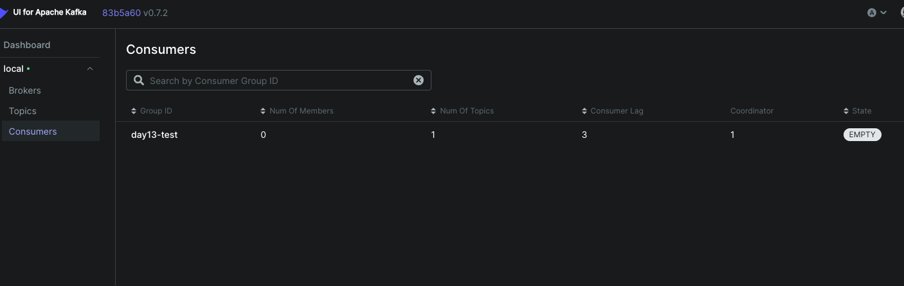
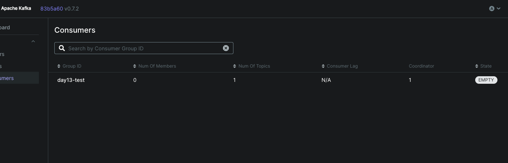
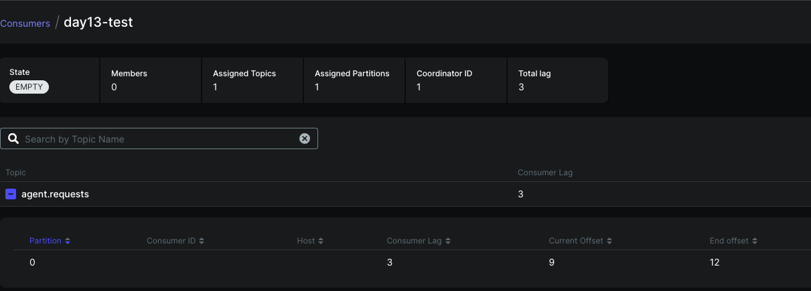
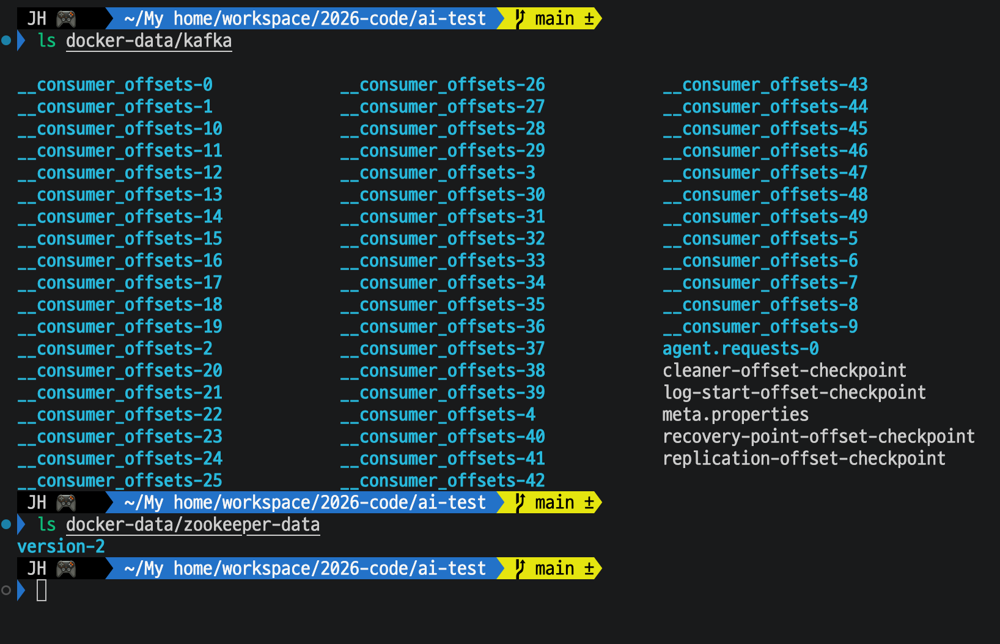
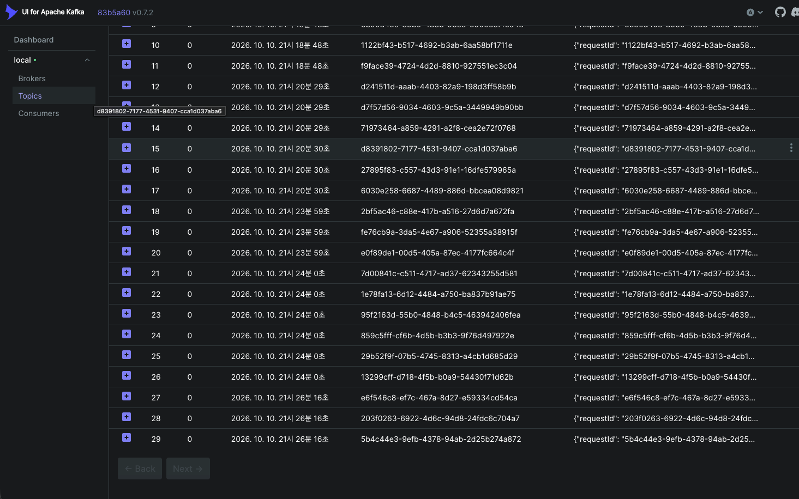

# Day 13 결과 — aiokafka 단독 테스트

> 실험 방법과 명령어는 [DAY13_GUIDE.md](DAY13_GUIDE.md), 개념은 [CONCEPTS_KAFKA.md](CONCEPTS_KAFKA.md). 이 문서는 실행 결과와 해석, 실제 사용 예시를 담는다.
> 상태: 완료(2026-10-10). 확인하지 않은 항목은 6장에 적었다.

## 1. 실행 환경

| 항목 | 값 |
| --- | --- |
| Kafka | `confluentinc/cp-kafka:7.6.0` + ZooKeeper, 루트 `docker-compose.yml`, 데이터는 `docker-data/` |
| 클라이언트 | `aiokafka==0.12.0` (가이드에 적은 버전. 실제 설치된 버전은 `pip freeze` 로 확인하지 않음) |
| 토픽 | `agent.requests` (자동 생성, 파티션 1개) |
| UI | kafka-ui v0.7.2, `http://localhost:8090` |

## 2. 실행한 커맨드

모두 `d2-ai-python` 에서 가상환경을 켜고 실행했다.

| 커맨드 | 목적 |
| --- | --- |
| `python -m app.checks.kafka_producer_test` | 메시지 3건을 토픽에 전송 (여러 번 실행) |
| `python -m app.checks.kafka_consumer_test` | 그룹 `day13-test` 로 수신 (여러 번 실행) |
| `python -m app.checks.kafka_consumer_test --group g2 --max 100 --timeout 10` | 다른 그룹으로 처음부터 수신, 같은 명령을 한 번 더 실행해 이어서 읽기 확인 |
| `ls docker-data/kafka`, `ls docker-data/zookeeper-data` (`ai-agent-serving-infra`) | 데이터 폴더 생성 확인 |

## 3. 확인된 결과

### 3-1. 첫 실행: Producer, Consumer 동작

```
[sent] partition=0 offset=0 ...
[sent] partition=0 offset=1 ...
[sent] partition=0 offset=2 ...
[recv] partition=0 offset=0 ... offset=1 ... offset=2
[consumer] 총 3건 수신
```

| 로그 | 의미 |
| --- | --- |
| Producer: `Topic agent.requests is not available during auto-create initialization` (2회) | 토픽이 없어 브로커가 자동 생성하는 중. 클라이언트가 재시도해 해결. 처음에만 나옴 |
| Consumer: `GroupCoordinatorNotAvailableError (Error 15)` (6회) | 그룹 offset 을 저장하는 내부 토픽 `__consumer_offsets` 가 처음 만들어지는 중. 재시도로 해결. 처음에만 나옴 |
| `partition=0 offset=0, 1, 2` | 파티션 1개라 모두 0번. offset 이 0 부터 증가 |
| `key=b'...'` | `key_deserializer` 를 지정하지 않아 key 가 바이트로 출력됨. 동작에는 문제 없음 |

### 3-2. 같은 그룹으로 이어서 받기

여러 번 Producer 와 Consumer 를 실행한 뒤의 두 실행:

```
[recv] partition=0 offset=15 ... 16 ... 17
[consumer] 총 3건 수신
(다시 실행)
[consumer] 시간 초과, 새 메시지 없음
```

- 첫 실행이 offset 15 부터 시작한 것은 그룹의 책갈피가 15 였다는 뜻이다. 앞선 실행에서 읽은 위치가 저장되어 있었다.
- 두 번째 실행에서 같은 메시지를 다시 받지 않았다. `enable_auto_commit=True` 가 동작했고, 프로세스를 종료해도 책갈피가 남았다.
- `시간 초과, 새 메시지 없음` 은 오류가 아니라 정상 종료다.

### 3-3. Producer 와 Consumer 가 따로 동작

```
[sent] partition=0 offset=27, 28, 29     (Producer)
[recv] partition=0 offset=27, 28, 29     (Consumer, 이어서 새 3건만)
```

Producer 가 쓴 메시지를 나중에 켠 Consumer 가 가져갔다. Consumer 는 Producer 가 켜져 있는지와 무관하게 토픽에 쌓인 메시지를 읽는다.

### 3-4. kafka-ui 에서 본 그룹 상태

| 시점 | 목록 화면 Consumer Lag | State / Members |
| --- | --- | --- |
| Producer 로 3건 쓴 직후, 아직 안 읽음 | **3** | EMPTY / 0 |
| Consumer 로 읽은 뒤 | **N/A** | EMPTY / 0 |

- 그룹 상세 화면의 한 시점: Current offset 9, End offset 12, Consumer Lag 3, State EMPTY, Members 0.

| 화면 | 캡처 |
| --- | --- |
| 목록: 안 읽은 메시지가 있을 때 (Lag 3) |  |
| 목록: 다 읽은 뒤 (Lag N/A) |  |
| 그룹 상세 (Current 9, End 12, Lag 3) |  |
- 안 읽은 메시지가 있으면 목록에 숫자, 다 읽으면 `N/A` 로 보였다. 둘 다 Members 가 0 이라서, N/A 의 원인이 "멤버가 없어서"는 아니다. 이 UI(v0.7.2)의 목록은 남은 건이 없으면 Lag 을 `N/A` 로 표시하는 것으로 해석된다. 상세 화면의 Current / End offset 일치로 확정하는 확인은 아직 하지 않았다.
- Consumer 가 종료되어 Members 가 0 이어도 그룹과 책갈피는 남아 있다.

### 3-5. 다른 그룹(g2)으로 처음부터 수신

```
[recv] partition=0 offset=23 ... 29 (붙여 받은 끝부분)
[consumer] 시간 초과, 새 메시지 없음
[consumer] 총 30건 수신
```

- `day13-test` 가 이미 다 읽은 뒤에도 `g2` 가 토픽의 30건(offset 0~29)을 처음부터 전부 받았다.
- 맨 앞 `[recv]` 줄이 `offset=0` 인지는 로그에서 직접 보지 못했고, `총 30건` 으로 판단했다.

### 3-6. 같은 그룹(g2)으로 한 번 더 실행

```
[consumer] topic=agent.requests group=g2 bootstrap=localhost:9092 (최대 100건, 10.0초 대기)
[consumer] 시간 초과, 새 메시지 없음
[consumer] 총 0건 수신
```

- `g2` 가 30건을 다 읽은 뒤라서 새 메시지가 없었고 수신은 0건이었다. 새 그룹에서도 책갈피가 저장되어 이어서 읽는다.
- Producer 는 실행하지 않았다.

### 3-7. 데이터 폴더 (`ai-agent-serving-infra` 에서 `ls`)

`ls docker-data/kafka` 에서 확인된 항목:

| 항목 | 의미 |
| --- | --- |
| `__consumer_offsets-0` ~ `__consumer_offsets-49` (50개) | 그룹의 책갈피를 저장하는 내부 토픽. 파티션이 50개이고 폴더 하나가 파티션 하나다. 파티션 수 50 은 Kafka 의 기본값으로 알려져 있으며 이번 compose 에서 바꾸지 않았다 |
| `agent.requests-0` | 토픽 `agent.requests` 의 파티션 0. 폴더 이름이 `토픽-파티션번호` 이고 하나뿐이라 파티션이 1개라는 것이 폴더로도 확인됨 |
| `meta.properties` | 브로커 id 와 클러스터 id 를 담은 파일 |
| `cleaner-offset-checkpoint`, `log-start-offset-checkpoint`, `recovery-point-offset-checkpoint`, `replication-offset-checkpoint` | 브로커가 로그 정리, 시작 위치, 복구 지점, 복제 위치를 기록하는 체크포인트 파일 |

`ls docker-data/zookeeper-data` 에서는 `version-2` 하나가 보였다. ZooKeeper 의 데이터 폴더다.



- 데이터가 컨테이너 안이 아니라 호스트의 `docker-data/` 에 생겼다. 바인드 마운트가 동작한다.
- `meta.properties` 때문에 `docker-data/kafka` 와 `docker-data/zookeeper-*` 는 **같이** 지워야 한다. 한쪽만 지우면 클러스터 id 가 어긋나 기동이 실패할 수 있다.
- 그룹의 책갈피(offset)는 `__consumer_offsets` 50개 중 하나에 저장된다. 어느 폴더인지는 확인하지 않았다.

### 3-8. kafka-ui Messages 탭 (Topics → `agent.requests` → Messages)

화면에서 보인 범위는 offset 10~29이고, 위쪽 0~9는 스크롤 밖이라 이 화면에서는 보지 못했다. Partition 은 전부 0, Back / Next 버튼은 모두 비활성이었다.

| 확인한 것 | 화면 근거 |
| --- | --- |
| 읽은 메시지가 그대로 남아 있다 | offset 15 의 key `d8391802-...` 는 `day13-test` 가 15번으로 받았던 메시지, offset 23 의 key `95f2163d-...` 는 `g2` 가 23번으로 받았던 메시지다. 둘 다 읽힌 뒤에도 목록에 있다 |
| offset 이 끊기지 않고 이어진다 | 10부터 29까지 빠진 번호가 없다. 소비로 인한 삭제가 없다 |
| Producer 로그와 일치 | offset 27, 28, 29 의 key `e6f546c8-...`, `203f0263-...`, `5b4c44e3-...` 가 Producer 출력의 requestId 와 같다 |
| key 는 requestId, value 는 JSON | Key 열에 UUID, Value 열에 `{"requestId": "..."` 로 시작하는 JSON |



Timestamp 열(2026-10-10, 한국 시간)은 Producer 를 실행한 시각 단위로 묶여 있다. 같은 초에 3건씩 들어간 묶음이 한 번의 Producer 실행이다.

| offset | 시각 | 비고 |
| --- | --- | --- |
| 10, 11 | 21시 18분 48초 | 이 화면에는 두 건만 보임 (세 건 중 앞 하나는 0~9 쪽) |
| 12~14 | 21시 20분 29초 | 한 번의 실행 |
| 15~17 | 21시 20분 30초 | 한 번의 실행. 이 3건을 `day13-test` 가 이어서 받았다 (3-2) |
| 18~20 | 21시 23분 59초 | |
| 21~26 | 21시 24분 0초 | 6건. 이 화면에서는 1초 안에 Producer 가 두 번 실행된 것으로 보이며 초 단위로는 구분되지 않음 |
| 27~29 | 21시 26분 16초 | 3-3 의 Producer 출력과 같은 묶음 |

## 4. 해석

### 4-1. 읽어도 메시지가 지워지지 않는다

| 확인된 사실 | 근거 |
| --- | --- |
| 읽은 뒤에도 메시지가 남아 있다 | `day13-test` 가 다 읽은 뒤 `g2` 가 30건을 다시 받음 |
| 읽은 위치는 그룹별 숫자(책갈피)다 | 같은 그룹 재실행에서 15 부터 이어서 받음 |
| 그룹마다 책갈피가 따로다 | `day13-test` 는 새 건이 없고 `g2` 는 처음부터 받음 |

### 4-2. 그룹과 서버(소비자)의 관계

| 상황 | 결과 |
| --- | --- |
| 그룹이 다르다 (a, b) | 둘 다 같은 메시지를 **전부** 받는다. 오늘 `day13-test` 와 `g2` 로 확인 |
| 그룹이 같다 (서버 a, b) | 메시지를 **나눠** 받는다. 파티션 단위로 배정되어, 한 파티션은 같은 그룹 안에서 서버 하나만 읽는다. **아직 실험하지 않음 (Day 18)** |

```
같은 그룹 (서버 a, b) 파티션 2개          파티션 1개이면
 파티션 0 ──▶ 서버 a                        파티션 0 ──▶ 서버 a
 파티션 1 ──▶ 서버 b                                    서버 b 는 배정받지 못해 대기
```

- 서버가 몇 대든 `group_id` 가 같아야 한 그룹이다. 서버 이름이나 개수가 아니라 `group_id` 문자열로 그룹이 정해진다.
- 서버 a 가 죽으면 a 의 파티션이 b 에게 넘어가고(리밸런싱), b 는 a 가 마지막으로 **저장한** 책갈피부터 읽는다. a 가 읽었지만 저장하지 못한 메시지는 b 가 다시 받아 중복 처리될 수 있다.
- "다른 그룹이 읽는 것"은 Kafka 에서 막을 수 없다. 막으려면 접근 권한(ACL) 이나 토픽 분리가 필요하다.

### 4-3. 소비와 삭제

- 소비(consume)는 책갈피를 앞으로 옮기는 것이지 메시지를 지우는 것이 아니다.
- 메시지는 보관 기간이 지나야 지워진다. 읽었는지와 무관하다.
- 읽는 것(consume)과 책갈피를 저장하는 것(commit)은 별개다. 에이전트 처리 중 서버가 죽으면 "읽었다고 기록됐지만 처리는 안 된" 메시지가 생길 수 있다. Day 16 에서 처리 후 수동 commit 을 쓸지 정한다.

## 5. 어디에 어떻게 쓰나: 케이스별 실제 예시

질문에서 나온 케이스를 실제 사용 방식에 대입한 것이다. 아래 예시 중 "이 프로젝트" 열을 제외한 서비스 예시는 일반적인 사용 방식을 설명하기 위한 가정이며, 이 프로젝트에서 구현한 것은 아니다.

| 케이스 | 설정 | 일반적인 사용 예 | 이 프로젝트에서 |
| --- | --- | --- | --- |
| **다른 그룹은 각자 전부 받는다** | 용도마다 다른 `group_id` | 주문 이벤트 토픽 하나를 결제 서비스, 재고 서비스, 알림 서비스, 통계 서비스가 각자 별도의 그룹으로 읽는다. 한 서비스가 느리거나 멈춰도 다른 서비스에 영향이 없다 | 에이전트 처리용 그룹과 이력/통계용 그룹을 따로 둘 수 있다 (구현 계획 없음) |
| **같은 그룹은 나눠 받는다 (한 번만 처리)** | 여러 서버가 같은 `group_id` | 이메일 발송 요청을 워커 여러 대가 같은 그룹으로 읽어서, 한 요청이 한 워커에서만 발송되게 한다. 워커를 늘리면 처리량이 늘어난다 | FastAPI 인스턴스를 여러 개 띄워도 같은 `group_id` 로 에이전트 요청이 중복 처리되지 않게 한다. Day 18 에서 실험 |
| **서버를 늘려도 파티션이 1개면 한 대만 일한다** | 파티션 수 < 소비자 수 | 처리량이 안 늘면 소비자를 늘리기 전에 파티션 수부터 확인한다 | 파티션을 늘리며 TPS 를 재는 Day 34.1 실험의 전제 |
| **서버가 죽으면 다른 서버가 이어받는다** | 같은 그룹의 리밸런싱 | 워커 한 대가 죽어도 다른 워커가 그 파티션을 이어받아 처리를 계속한다. 중복 방지를 위해 처리가 idempotent 여야 한다 | 에이전트 호출이 중복돼도 결과가 같아지게 `requestId` 로 중복을 걸러야 할 수 있다 (Day 16~) |
| **책갈피를 되돌려 다시 읽는다 (재처리)** | offset 리셋 또는 새 그룹 | 버그가 있던 처리 로직을 고친 뒤 새 그룹으로 과거 이벤트를 처음부터 다시 처리해 데이터를 바로잡는다 | 에이전트 호출이 실패한 요청을 다시 처리하거나 DLQ 에서 재시도 (Day 32) |
| **Lag 을 본다 (안 읽은 건수)** | 목록/상세 화면의 Lag | Lag 이 계속 늘면 소비가 생산을 못 따라가는 것이므로 소비자를 늘리거나 처리 속도를 점검한다 | k6 부하 테스트(Day 25~30)에서 Consumer 가 얼마나 밀리는지 지표로 사용 |
| **소비해도 남아 있다 (이력 보존)** | 보관 기간 | 장애가 났을 때 과거 이벤트를 다시 읽어 원인을 추적한다 | 요청 이력 추적 |

## 6. 확인하지 않은 것

| 항목 | 이유 / 시점 |
| --- | --- |
| kafka-ui 그룹 상세 화면의 Current = End, Lag 0 | 필요하지 않다고 판단해 확인하지 않음. 그룹 상세의 Lag 3 한 시점(3-4)과 목록 표시만 확인 |
| 실행 중 Consumer 의 STABLE, Members 1 표시 (선택) | 하지 않음. 지금까지 본 화면은 모두 Consumer 가 종료된 EMPTY 상태 |
| 같은 그룹 안에서 나눠 받기 | 파티션 2개 이상 + 소비자 2개 필요. Day 18 에서 실험 |

확인 완료: 다른 그룹 처음부터 수신(3-5), 새 그룹 재실행 시 0건(3-6), 데이터 폴더 생성(3-7), Messages 탭에서 읽은 메시지가 그대로 남아 있음(3-8, offset 10~29 범위), 옛 d1 컨테이너 종료.

## 7. 한계

- 단일 브로커, 파티션 1개다. 파티션 배정과 리밸런싱은 실험하지 않았고 4-2 의 해당 설명은 개념 설명이다.
- 앞쪽 로그와 UI 화면 일부는 직접 보지 못했고, 사용자가 전달한 출력과 화면을 기준으로 정리했다.
- 보관 기간 동작은 확인하지 않았다.
- 모든 kafka-ui 화면은 Consumer 가 종료된 상태(EMPTY)에서 본 것이다. 실행 중(STABLE) 표시는 보지 않았다.
- `aiokafka` 설치 버전은 확인하지 않았다.
