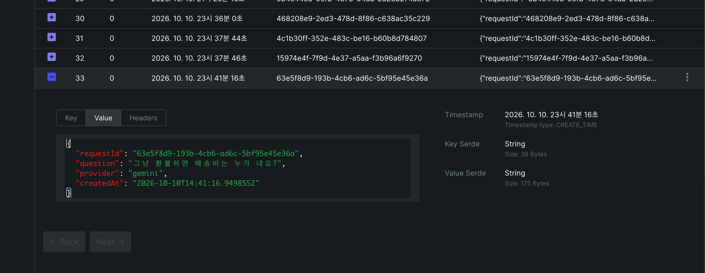
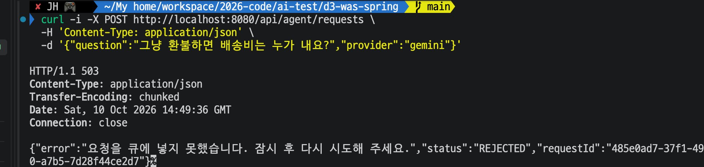

# Day 14 결과 — Spring Boot WAS + Kafka Producer

> 구현과 실행 방법은 [DAY14_GUIDE.md](DAY14_GUIDE.md), Kafka 개념은 [CONCEPTS_KAFKA.md](CONCEPTS_KAFKA.md). 이 문서는 실행 결과와 해석을 담는다.
> 상태: 완료(2026-10-10). 확인하지 않은 항목은 6장에 적었다.

## 1. 실행 환경

| 항목 | 값 |
| --- | --- |
| WAS | Spring Boot 4.1.1, Java 21.0.8, Gradle wrapper 9.7.1, Tomcat 11.0.24, 포트 8080 |
| 프로젝트 | `d3-was-spring` (Initializr 로 받은 뼈대 + 직접 작성한 소스). 패키지 `com.test.aiserving.was` |
| Kafka | Day 13 과 같은 컨테이너(`docker-compose.yml`), 토픽 `agent.requests`(파티션 1개), 클라이언트 라이브러리 로그상 Kafka 4.2.1 |
| Producer 설정 | `acks=all`(로그 `acks = -1`), 멱등성 `enable.idempotence = true`(로그에서 확인), `StringSerializer` |
| 전송 대기 | `app.kafka.send-timeout-ms=5000`, 수정 후 `max.block.ms=5000` |

## 2. 실행한 커맨드

| 위치 | 커맨드 | 목적 |
| --- | --- | --- |
| `d3-was-spring` | `./gradlew test` | 단위 테스트와 컨텍스트 로딩 확인 (수정 전, 수정 후 두 번) |
| `d3-was-spring` | `./gradlew bootRun` | WAS 기동 |
| 아무 곳 | `curl -i -X POST http://localhost:8080/api/agent/requests -H 'Content-Type: application/json' -d '{"question":"단순 변심으로 환불하면 배송비는 누가 내요?","provider":"gemini"}'` | 정상 요청 |
| 아무 곳 | 위와 같은 curl 에 `-d '{"question":""}'` | 검증 오류 |
| `d2-ai-python` | `python -m app.checks.kafka_consumer_test --group day14 --max 100 --timeout 10` | 토픽에 들어간 메시지 확인 |
| 아무 곳 | `curl -i -w '\n%{time_total}s\n' -X POST ...` (정상 질문 `Kafka 중단 테스트`) | 응답 시간 측정. 정상, Kafka 중단, Kafka 재기동 후 세 번 |
| `d3-was-spring` | `docker compose stop kafka` / `docker compose start kafka` | Kafka 중단과 재기동 |

## 3. 확인된 결과

### 3-1. 테스트 (`./gradlew test`)

`build/test-results/test/*.xml` 에서 확인했다.

| 테스트 | 개수 | 결과 |
| --- | --- | --- |
| `WasApplicationTests` (`contextLoads`, 앱 전체 로딩) | 1 | 통과 (1.18초) |
| `AgentRequestMessageTest` (JSON 변환, 이스케이프) | 2 | 통과 |

위는 `max.block.ms` 설정과 Producer 예외 처리를 고치기 **전** 코드의 결과다. 고친 뒤 다시 돌린 `./gradlew test` 도 `BUILD SUCCESSFUL` 이었고, `build/test-results` 의 XML 에서 같은 3개가 실패 0, 에러 0 으로 통과한 것을 확인했다(`WasApplicationTests` 1.30초, `AgentRequestMessageTest` 0.004초).

### 3-2. 기동

| 로그 | 의미 |
| --- | --- |
| `Tomcat started on port 8080`, `Started WasApplication in 0.772 seconds` | Kafka 가 켜진 상태에서 0.8초 만에 기동 |
| `AdminClientConfig` 후 곧바로 `Metrics reporters closed` | 시작 시 토픽 확인용 Admin 클라이언트가 접속하고 종료 |

### 3-3. 정상 요청: 202

```
HTTP/1.1 202
{"requestId":"15974e4f-7f9d-4e37-a5aa-f3b96a6f9270","status":"ACCEPTED"}
```

첫 요청 때 WAS 로그에 `Cluster ID: fceknS0o...`(브로커 접속)와 `published requestId=468208e9-... partition=0 offset=30` 이 찍혔다.

### 3-4. 빈 `question`: 400

```
HTTP/1.1 400
{"timestamp":"2026-10-10T14:37:51.951Z","status":400,"error":"Bad Request","path":"/api/agent/requests"}
```

- 서버 로그에 `MethodArgumentNotValidException ... 'question' ... question 은 비어 있을 수 없습니다` 가 WARN 으로 남았다.
- 응답 본문에는 사유가 없다. 사유는 서버 로그에만 있다.
- 이 요청은 Kafka 에 들어가지 않았다(3-5).

### 3-5. Kafka 에 들어갔는지 (Python Consumer, 새 그룹 `day14`)

처음부터 읽어 offset 0~33 이 나왔다. 0~29 는 Day 13 의 테스트 메시지, 30~33 이 이번 WAS 가 넣은 메시지다.

| offset | requestId | 시각(KST) | 비고 |
| --- | --- | --- | --- |
| 30 | `468208e9-...` | 23:36:00 | WAS 로그의 `offset=30` 과 일치 |
| 31 | `4c1b30ff-...` | 23:37:44 | WAS 가 넣은 메시지. 이 요청의 curl 출력은 받지 못했다 |
| 32 | `15974e4f-...` | 23:37:46 | 3-3 의 202 응답 requestId 와 일치 |
| 33 | `63e5f8d9-...` | 23:41:16 | 질문이 "그냥 환불하면 배송비는 누가 내요?" 로 다른 요청 |

- 400 을 받은 시각(23:37:51)에 해당하는 메시지는 없다. offset 32(23:37:46) 다음이 33(23:41:16)이다.
- Day 13 의 Python Consumer 가 Spring 이 보낸 메시지를 그대로 읽었다.

### 3-6. kafka-ui 에서 본 메시지



| 항목 | 값 |
| --- | --- |
| offset 33 의 Value | `requestId`, `question`, `provider`, `createdAt` 순서의 JSON. 한글 그대로 |
| `createdAt` | `2026-10-10T14:41:16.949855Z`. 목록 시각 23:41:16(KST)과 일치. 소수점 6자리가 붙는다 |
| Key Serde / Value Serde | 둘 다 `String` |
| 크기 | Key 36 Bytes(UUID), Value 175 Bytes |

### 3-7. Kafka 중단과 복구 (응답 시간 포함)

WAS 를 Kafka 가 켜진 상태에서 기동한 뒤, 같은 curl 에 `-w '\n%{time_total}s\n'` 를 붙여 세 번 보냈다.

| 순서 | 상태 | 응답 | 걸린 시간 |
| --- | --- | --- | --- |
| 1 | Kafka 켜짐 | `202`, `ACCEPTED` (requestId `78ac1349-...`) | **0.108초** |
| 2 | `docker compose stop kafka` 직후 | `503`, `REJECTED` (requestId `4eb0e37d-...`) | **5.021초** |
| 3 | `docker compose start kafka` 직후 | `202`, `ACCEPTED` (requestId `c4bb9738-...`) | **1.308초** |



- 503 의 본문은 `{"error":"요청을 큐에 넣지 못했습니다. 잠시 후 다시 시도해 주세요.","status":"REJECTED","requestId":"..."}`. 접수하지 못한 요청도 `requestId` 가 응답에 포함된다.
- 2번이 5.02초인 것은 `max.block.ms=5000`, `send-timeout-ms=5000` 설정과 맞는다.
- 3번에서 WAS 를 다시 띄우지 않았는데도 정상 접수됐다. Producer 가 Kafka 에 재접속했다.
- 위 캡처는 시간 측정 전의 첫 503 확인 화면이다.

## 4. 실행하며 발견해 고친 것

| 번호 | 발견 | 원인 | 조치 |
| --- | --- | --- | --- |
| 1 | Kafka 를 끄고 curl 을 보내자 응답이 오래 걸렸다(사용자가 `Ctrl+C` 로 중단, 수정 전 응답 코드는 확인하지 못함) | `KafkaTemplate.send()` 는 Future 를 돌려주기 전에 메타데이터를 받으려고 `max.block.ms`(기본 60초, 실행 로그의 `ProducerConfig` 에서 확인)만큼 호출 스레드를 막는다. 내가 `get(5000ms)` 로 5초만 기다린다고 적은 설계는 이 대기를 줄이지 못했다 | `spring.kafka.producer.properties.max.block.ms=5000` 추가 |
| 2 | 위와 같은 상황에서 `send()` 가 직접 던지는 예외는 기존 `catch` 에 걸리지 않아 503 이 아니라 500 이 될 수 있었다(코드 읽고 추정, 실제 응답은 보지 못함) | `ExecutionException`, `TimeoutException` 만 잡고 있었다 | `RuntimeException` 도 `PublishFailedException` 으로 감싸도록 변경 (`[OLD]`/`[NEW]` 주석으로 남김) |
| 3 | Kafka 가 꺼진 채 `bootRun` 하면 기동이 끝나지 않았다 | 시작 시 `NewTopic` 빈 때문에 Admin 클라이언트가 브로커에 접속하려고 재시도 (로그에 `Rebootstrapping` 반복) | 코드는 고치지 않았다. 가이드에 "Kafka 를 켠 뒤 기동하고 나서 끈다" 순서를 적고 한계에 기록 |

## 5. 해석

| 확인한 것 | 의미 |
| --- | --- |
| 202 응답한 requestId 가 토픽의 offset 32 에 있음 | `acks=all` 로 브로커 저장을 기다린 뒤 202 를 돌려주는 설계가 의도대로 동작 |
| 400 요청이 토픽에 없음 | 검증 실패는 Kafka 전송 전에 걸러짐 |
| Python Consumer 가 Java Producer 의 메시지를 읽음 | JSON 문자열이라는 약속만 지키면 언어가 달라도 된다. Kafka 는 바이트만 전달하고 해석은 양쪽 코드가 맡는다 |
| 직접 만든 JSON 이 kafka-ui 에서 정상 표시 | Jackson 3 에 의존하지 않고도 필드 4개 스키마는 동작 |
| Kafka 중단 시 503 | 클라이언트가 "접수 안 됨" 을 알 수 있다. 유실을 숨기지 않는 쪽을 택한 결과 |
| 장애 시 요청 스레드가 기본 60초까지 묶일 수 있었음 | 동기 전송 대기는 부하가 높을 때 요청 스레드를 점유한다. 5초로 줄여 503 응답이 5.02초에 왔다. 5초라는 값의 적정성은 k6 실험(Day 25~)에서 다시 본다 |
| Kafka 정상 시 0.108초 | 응답에 브로커 저장 확인(`acks=all`)이 포함된 시간. LLM 호출(수 초 이상)을 기다리지 않는다는 비교의 기준값. 한 번 잰 값이라 평균이 아니다 |
| 재기동 직후 첫 요청 1.308초 | 정상 때(0.108초)보다 느렸다. 재접속 비용으로 보이지만 원인을 따로 확인하지는 않았다 |

## 6. 확인하지 않은 것

| 항목 | 내용 |
| --- | --- |
| 503 때의 서버 로그 | 받지 못했다 |
| offset 31 의 요청 | 사용자가 보낸 요청이라고 보지만 curl 출력이 없어 확인하지 못했다 |
| 재기동 후 첫 요청이 느린 이유 | 1.308초의 원인을 확인하지 않았다 |
| 응답 시간의 반복 측정 | 각 상황에서 한 번씩만 쟀다. 평균이나 분포가 아니다 |
| 파티션 2개 이상 | 파티션 수 설정(`requests-partitions`)을 바꿔 보지 않았다. 지금은 1개 |
| `acks=all` 의 효과 | 브로커가 1대라 `acks=1` 과 차이를 확인할 수 없다 |
| 파이썬에서 `createdAt` 파싱 | 소수점 6자리 형식을 파이썬 버전별로 파싱해 보지 않았다 (Day 15) |

## 7. 한계

| 항목 | 내용 |
| --- | --- |
| 400 본문에 사유 없음 | 필드별 오류 메시지를 클라이언트에 주려면 별도 예외 처리가 필요 |
| Kafka 가 꺼진 채 기동 불가 | 시작 단계의 토픽 확인이 브로커 접속을 기다림. 대기 시간은 재지 않음 |
| 요청 스레드 대기 | 응답 전에 브로커 저장을 기다림. 대기 없이 응답하는 방식과의 비교는 k6 실험에서 |
| JSON 직접 변환 | 필드가 늘면 JSON 라이브러리로 교체 |
| 상태 조회 API 없음 | Day 17 이후 |
| 인증, 요청 제한 없음 | 범위 밖 |
