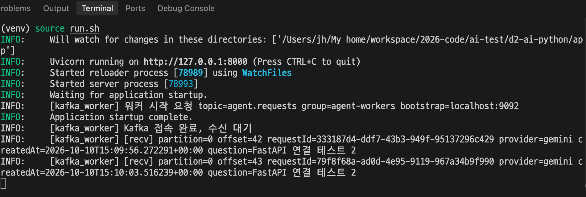
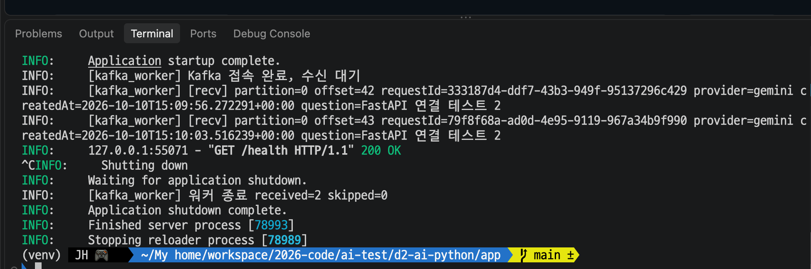
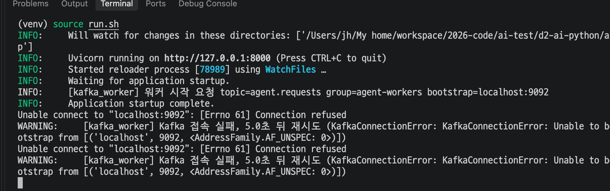
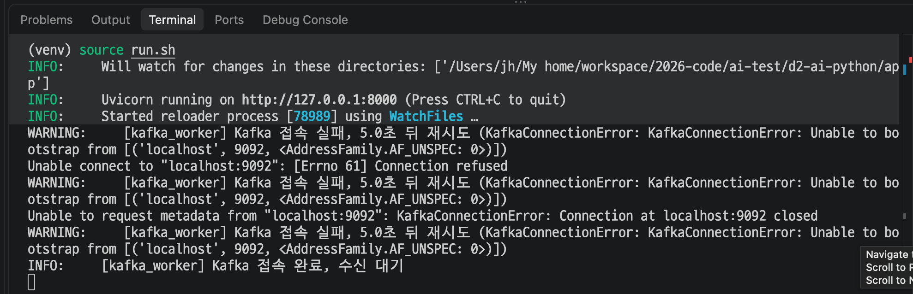

# Day 15 결과 — FastAPI lifespan 에 Kafka Consumer 연동

> 구현과 실행 방법은 [DAY15_GUIDE.md](DAY15_GUIDE.md). 이 문서는 실행 결과와 해석을 담는다.
> 상태: 완료(2026-10-11). 확인하지 않은 항목은 6장에 적었다.

## 1. 실행 환경

| 항목 | 값 |
| --- | --- |
| FastAPI | `d2-ai-python` 의 `source run.sh` (`uvicorn main:app --reload --port 8000`), 가상환경 사용 |
| 파이썬 | 3.11.9 (Day 16 실행 로그의 경로 `~/.pyenv/versions/3.11.9` 로 확인) |
| 라이브러리 | `requirements.txt` 에 고정한 `aiokafka==0.12.0`, `pydantic==2.13.5` (설치된 버전을 `pip freeze` 로 확인하지는 않음) |
| Kafka | Day 13/14 와 같은 컨테이너, 토픽 `agent.requests`(파티션 1개) |
| 컨슈머 그룹 | `agent-workers` (이번에 처음 사용) |
| Spring WAS | Day 14 의 `d3-was-spring`, 8080 |

## 2. 실행한 커맨드

| 커맨드 | 목적 |
| --- | --- |
| `source run.sh` (`d2-ai-python`) | FastAPI 기동 |
| `curl -s http://localhost:8000/health` | 워커 상태 확인 |
| `curl -i -X POST http://localhost:8080/api/agent/requests -H 'Content-Type: application/json' -d '{"question":"FastAPI 연결 테스트 2","provider":"gemini"}'` | Spring → Kafka → FastAPI 전달 확인 |
| `Ctrl+C` | 종료 처리 확인 |
| `docker compose stop kafka` 후 `source run.sh`, 이후 `docker compose start kafka` | Kafka 없이 기동하고 나중에 켰을 때의 재접속 확인 |

## 3. 확인된 결과

### 3-1. 기동과 수신



| 로그 | 의미 |
| --- | --- |
| `[kafka_worker] 워커 시작 요청 topic=agent.requests group=agent-workers bootstrap=localhost:9092` | lifespan 이 워커를 시작 |
| `Application startup complete.` 다음에 `[kafka_worker] Kafka 접속 완료, 수신 대기` | 서버 기동이 먼저 끝나고 워커가 그다음에 접속. 기동이 Kafka 접속을 기다리지 않음 |
| `[recv] partition=0 offset=42 requestId=333187d4-... question=FastAPI 연결 테스트 2` | Spring 이 넣은 메시지 수신 |
| `[recv] partition=0 offset=43 requestId=79f8f68a-... question=FastAPI 연결 테스트 2` | 한 건 더 수신 |
| `createdAt=2026-10-10T15:09:56.272291+00:00` | Spring 이 보낸 `...Z`(소수점 6자리)가 pydantic 으로 시간대 있는 datetime 으로 파싱됨. Day 14 에서 남긴 파싱 항목이 실제 환경에서 확인됨 |

이 서버는 새로 켠 것인데 offset 42, 43 만 나오고 그 앞의 메시지는 다시 나오지 않았다. 이전 실행에서 저장된 위치부터 이어서 받았다는 뜻이다(6장에 한계를 적음).

### 3-2. `/health`

```
{"status":"ok","kafka_consumer":{"state":"running","topic":"agent.requests","group":"agent-workers","received":2,"skipped":0,"last_error":null}}
```

| 필드 | 값 | 의미 |
| --- | --- | --- |
| `state` | `running` | 접속하여 수신 대기 중 |
| `received` | 2 | 이 서버 프로세스가 시작된 뒤 처리한 건수. 3-1 의 `[recv]` 두 줄과 일치. 서버가 다시 뜨면 0 부터 다시 센다 |
| `skipped`, `last_error` | 0, `null` | 건너뛴 메시지, 오류 없음 |

수정 전 서버에서 `received: 1` 이 나온 `/health` 응답도 있었으나 어느 메시지인지는 확인하지 못했다.

### 3-3. Spring ↔ FastAPI requestId 대조

| 확인 | 결과 |
| --- | --- |
| Spring 의 202 응답 | `{"requestId":"79f8f68a-ad0d-4e95-9119-967a34b9f990","status":"ACCEPTED"}` (캡처 윗부분이 잘려 있음) |
| FastAPI 의 offset 43 로그 | `requestId=79f8f68a-ad0d-4e95-9119-967a34b9f990` → 같은 ID |

offset 42(`333187d4-...`) 요청의 Spring 응답은 받지 못해 대조하지 못했다.

### 3-4. 종료



`Ctrl+C` 후 `Shutting down` → `Waiting for application shutdown.` → `[kafka_worker] 워커 종료 received=2 skipped=0` → `Application shutdown complete.` → `Finished server process`. 오류나 트레이스백 없이 종료됐고, 종료 로그의 `received=2` 가 `/health` 값과 같다.

### 3-5. Kafka 가 꺼진 채 기동한 뒤 Kafka 를 켠 경우

기동 직후(Kafka 꺼짐):



이후 Kafka 를 켠 뒤:



| 관찰 | 의미 |
| --- | --- |
| `Application startup complete.` 가 접속 실패 로그보다 앞에 나옴 | Kafka 가 없어도 서버는 기동 |
| `[kafka_worker] Kafka 접속 실패, 5.0초 뒤 재시도` 가 반복 | 재시도가 `KAFKA_RETRY_SEC`(5초) 간격으로 이어짐 |
| 접속 실패 사이에 aiokafka 자체의 `Unable connect to "localhost:9092": [Errno 61] Connection refused` 가 같이 찍힘 | 라이브러리 로그. 가이드에 적은 로그 소음 |
| 복구 직전 `Unable to request metadata ... Connection at localhost:9092 closed` | Kafka 컨테이너가 막 올라오는 중 연결은 됐지만 응답 전에 닫힌 것으로 보인다 |
| 마지막에 `[kafka_worker] Kafka 접속 완료, 수신 대기` | 복구됨. 로그에 서버 재시작 흔적(`Started server process`, `startup`)이 사이에 없다 |

서버를 다시 켜지 않고 워커가 스스로 붙었다.

## 4. 실행하며 발견해 고친 것

| 번호 | 발견 | 원인 | 조치 |
| --- | --- | --- | --- |
| 1 | 서버를 켜도 `워커 시작`, `Kafka 접속 완료`, `[recv]` 로그가 화면에 안 나왔다 (`/health` 의 `state` 는 `running`) | uvicorn 은 자기 로거(`uvicorn.*`)만 설정하고 루트 로거는 WARNING 이라, 이 모듈의 INFO 로그가 걸러짐. 작성 환경의 임시 앱 시험에서는 로깅을 따로 설정해서 드러나지 않았다 | `kafka_worker` 로거에 INFO 레벨과 출력 핸들러를 직접 설정 (`[OLD]`/`[NEW]` 주석). 수정 후 3-1 처럼 로그가 보임 |
| 2 | `last_error` 가 `KafkaConnectionError: KafkaConnectionError: ...` 로 이름이 두 번 나옴 | aiokafka 예외 메시지에 이름이 이미 들어 있음 | 이름을 중복해서 붙이지 않도록 수정. **수정 후 실행은 하지 않았다** |

## 5. 해석

| 확인한 것 | 의미 |
| --- | --- |
| Spring 이 넣은 메시지를 FastAPI 워커가 받고 requestId 가 같음 | Day 14 Producer 와 Day 15 Consumer 의 메시지 약속(JSON 스키마)이 맞음. 언어가 달라도 Kafka 는 바이트만 전달하고 양쪽 코드가 해석 |
| lifespan 에서 시작/종료 | 서버 생명주기에 워커가 묶여 별도 프로세스를 따로 관리하지 않아도 됨. 종료 때 `consumer.stop()` 까지 오류 없이 지나감 |
| Kafka 없이 기동 가능, 나중에 복구 | 서버 기동이 Kafka 에 묶이지 않음. Day 14 의 Spring 은 Kafka 가 꺼진 채 기동하면 멈췄다는 점과 대비됨 |
| 새 서버에서 이전 메시지가 다시 나오지 않음 | 자동 commit 으로 저장된 위치부터 이어서 읽음 |
| `/health` 의 `status` 는 `ok`, 워커 상태는 별도 필드 | 서버 생존과 Kafka 워커 상태를 구분해서 볼 수 있음 |

## 6. 확인하지 않은 것

아래는 모두 선택 항목이라 하지 않아도 Day 15 는 완료다(방법은 가이드의 "선택 확인 항목").

| 항목 | 내용 |
| --- | --- |
| 이전 실행에서 받은 범위 | 새 그룹이라 처음 켰을 때 토픽의 기존 메시지(0~)를 받았을 것으로 보지만, 그때는 로그가 안 보였고 건수를 확인하지 못했다. 3-1 은 "42 부터 이어서 받음" 까지만 확인 |
| offset 42 의 Spring 응답 | requestId 대조 불가 (3-3) |
| 서버 실행 중 Kafka 를 끄고 켜기 | 확인한 것은 "Kafka 없이 기동 → 나중에 켬" 이다. 이미 수신 중이던 워커가 도중에 끊겼다가 복구되는 경우는 시험하지 않았다 |
| Kafka 가 꺼진 동안의 `/health` | 꺼진 상태에서 `state: error` 가 보이는지는 사용자 환경에서 확인하지 않았다(로그의 접속 실패 경고만 확인). 작성 환경의 임시 앱에서만 확인 |
| 재접속에 걸린 시간 | 재지 않았다 |
| `KAFKA_CONSUMER_ENABLED=false` | 시험하지 않았다 (`kafka_consumer: null` 은 코드 기준 기대값) |
| `--reload` 로 코드를 고칠 때 워커 재시작 | 시험하지 않았다 |
| kafka-ui 에서 `agent-workers` 그룹 | 확인하지 않았다 |
| 4-2 의 수정 | 실행해 보지 않았다 |
| 실제 `main.py` 전체 기동 | 사용자의 환경에서 기동했다(캡처). 다른 라우터까지 모두 정상인지를 따로 점검하지는 않았다 |

## 7. 한계

| 항목 | 내용 |
| --- | --- |
| handler 예외 | 예외가 나면 워커가 재접속 루프로 들어간다. 자동 commit 이라 그 메시지가 건너뛰어질 수 있다. 정책은 Day 16 |
| 새 그룹 | 처음 켜면 토픽 전체를 읽는다. Day 16 에서 에이전트를 붙이면 오래된 메시지가 모두 LLM 호출이 되므로 시작 위치를 정해야 한다 |
| 같은 프로세스 | 에이전트 처리가 길어지면 HTTP 응답에 영향을 줄 수 있다 |
| dead letter 없음 | 해석 못 한 메시지는 건너뛰기만 한다 |
| 로그 소음 | Kafka 가 꺼져 있으면 aiokafka 의 오류 로그가 재시도마다 같이 찍힌다 |
