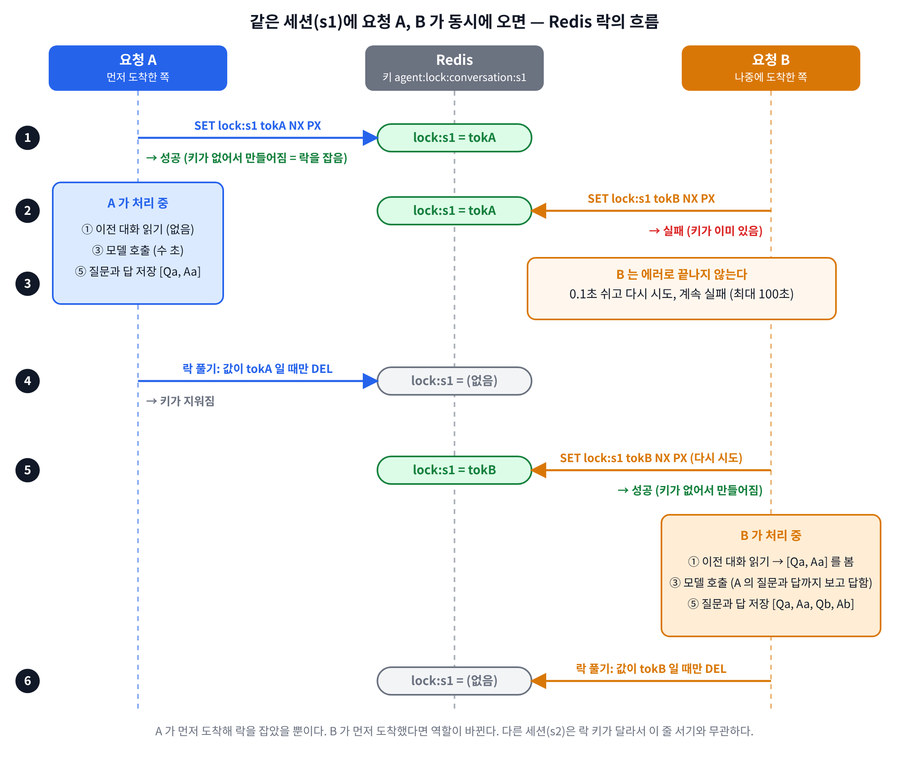

# Day 21 가이드 — 분산 락으로 같은 세션의 동시 요청을 막기

> 상태: 코드 작성 완료. 아래 "확인된 것"은 모두 **코드를 만든 쪽의 샌드박스**(실제 `redis-server` 7.0.15, 가짜 모델)에서 본 것이다(2026-10-13). ① 은 내 환경의 Redis 에서 실행해 21/21 통과했다(DAY21_RESULT 3-1, 가짜 모델). ② 는 내 환경(실제 Gemini)에서 락 키가 보이고 끝나면 사라지는 것을 확인했다(DAY21_RESULT 3-2). ③ 은 재실행에서 뒤 요청의 `이전 대화 6개`(DELETE 를 안 해 앞 기록 4개가 있었음)와 시간 합(12.39 + 8.01 ≈ 20.41초)으로 락 동작을 확인했다(DAY21_RESULT 3-3). ④ 는 내 환경이 아니라 샌드박스 시뮬레이션으로 409(3.12초), `FAILED` 기록을 확인했다(DAY21_RESULT 3-4). ⑤ 는 내 환경에서 실행해 두 워커의 `이전 대화` 가 모두 0개(락 없음 기대와 같음), `turns` 2 를 확인했다(DAY21_RESULT 3-5).
> 포트: **8080 = Spring WAS**, **8000 = FastAPI 워커(1번)**, **8001 = FastAPI 워커(2번)**, **6379 = Redis(redis1 컨테이너)**, 9092 = Kafka, 6333 = Qdrant.
> 코드 흐름과 줄 단위 설명은 [DAY21_CODE_GUIDE.md](DAY21_CODE_GUIDE.md).

**전체 목적:** Day 20 에서 대화를 Redis 에 저장하면서, 같은 `sessionId` 로 요청이 동시에 오면 두 워커가 같은 이전 대화를 읽고 서로의 턴을 덮어쓸 수 있다는 것을 코드로 읽었다(DAY20_RESULT 3-6, 내 환경에서는 한 번 실행해 유실을 보지 못했다). Redis 에 락을 걸어 같은 세션은 한 번에 한 요청만 "읽기 → 모델 호출 → 저장"을 하게 만들고, 락이 정말 동작하는지 확인한다. 락 있음/없음을 정식으로 비교하는 것은 Day 22 다.

## 1. 오늘 목표

| 확인할 것                                                                      | 실험 |
| ------------------------------------------------------------------------------ | ---- |
| 락 함수가 의도대로 동작하는가 (잡기, 풀기, 대기, 타임아웃, 만료, Redis 장애)   | ①    |
| 락이 Redis 에 어떤 모양으로 걸리는가                                           | ②    |
| 같은 세션의 동시 요청이 차례로 처리되고, 뒤 요청이 앞 대화를 보는가 (워커 2대) | ③    |
| 앞 요청이 오래 걸리면 뒤 요청이 어떻게 끝나는가 (409, FAILED)                  | ④    |
| (선택) 락을 끄면 Day 20 의 동작으로 돌아가는가                                 | ⑤    |

## 2. 개념

**문제.** `append_turn`(대화 저장)은 "읽기 → 붙이기 → 통째로 쓰기" 세 단계다. 그 사이에 다른 워커가 같은 키에 쓰면 한쪽 턴이 사라진다. 또 두 요청이 거의 동시에 오면 둘 다 빈 대화를 읽고 시작해서, 한쪽이 상대 질문을 모른 채 답한다. 둘 다 "같은 세션을 동시에 처리하는 것"이 원인이다.

**해결.** 세션마다 하나의 "열쇠"(락)를 Redis 에 두고, 열쇠를 잡은 요청만 그 세션을 처리한다. 다른 요청은 열쇠가 풀릴 때까지 기다린다.

| 용어                  | 설명                                                                                                                                                                  |
| --------------------- | --------------------------------------------------------------------------------------------------------------------------------------------------------------------- |
| 락 키                 | `agent:lock:conversation:<sessionId>`. 대화 키(`agent:conversation:<sessionId>`)와 다른 키다. 세션마다 따로라서 다른 세션은 서로 기다리지 않는다                      |
| `SET key token NX PX` | `NX` = 키가 없을 때만 저장. 저장에 성공한 요청이 락을 잡은 것이다. `PX` = 밀리초 단위 만료. 락을 쥔 워커가 죽어도 시간이 지나면 Redis 가 지워 락이 영원히 남지 않는다 |
| 토큰                  | 락을 잡을 때마다 새로 만드는 무작위 값. 락 키의 값으로 저장한다. "이 락은 내 것"임을 표시한다                                                                         |
| 안전한 해제           | 풀 때 키의 값이 **내 토큰일 때만** 지운다(Lua 스크립트로 "읽기 + 지우기"를 Redis 안에서 한 번에). 내 락이 만료된 뒤 다른 요청이 새로 잡았다면 남의 락을 지우지 않는다 |
| 락 범위               | 한 요청 안의 ① 이전 대화 읽기 ~ ⑤ 저장까지 전부(모델 호출 포함). 앞 요청이 저장까지 끝내야 다음 요청이 읽기 때문에 다음 요청이 앞 답을 본다                           |
| `fail_open`           | Redis 오류로 락을 못 잡으면 예외 대신 락 없이 계속한다. 대화 이어가기도 Redis 라서 같이 안 되는 상황이므로 답은 돌려준다는 Day 20 의 방침과 같다                      |
| `LockTimeout`         | 기다려도(기본 100초) 못 잡았을 때의 예외. 앞 요청이 너무 오래 걸린다는 뜻이다                                                                                         |

**두 요청이 같은 세션에 동시에 올 때의 락 흐름** (그림의 번호가 아래 표의 순서와 같다)



| 순서 | A                                                        | B                                                                          | Redis 의 `lock:s1` |
| ---- | -------------------------------------------------------- | -------------------------------------------------------------------------- | ------------------ |
| 1    | `SET lock:s1 tokA NX` → **성공**. 키가 없었으니 만들어짐 |                                                                            | `tokA`             |
| 2    |                                                          | `SET lock:s1 tokB NX` → **실패**. 키가 이미 있어서 `NX` 가 거절            | `tokA` (그대로)    |
| 3    | 처리 중 (대화 읽기, 모델 호출, 저장)                     | 0.1초 쉬고 다시 시도, 또 실패 (반복)                                       | `tokA`             |
| 4    | 저장을 마치고 락 풀기: 키가 내 토큰(`tokA`)이면 삭제     |                                                                            | (키 없음)          |
| 5    |                                                          | 다시 시도 → 키가 없으니 **성공**                                           | `tokB`             |
| 6    |                                                          | 이제 B 가 처리: 대화 읽기(A 가 저장한 `[Qa, Aa]` 가 보임), 모델 호출, 저장 | `tokB`             |
| 7    |                                                          | 락 풀기 (`tokB` 일 때만 삭제)                                              | (키 없음)          |

- 핵심은 `NX`("키가 없을 때만 만든다")다. A 가 키를 만들어 둔 동안에는 B 의 `SET` 이 실패한다.
- B 는 에러로 끝나는 것이 아니라 **풀릴 때까지 0.1초마다 다시 시도하며 기다린다**(최대 100초, `REDIS_LOCK_WAIT_SEC`). A 가 키를 지우는 순간 B 의 다음 시도가 성공한다.
- 먼저인 쪽은 A, B 이름이 아니라 **먼저 도착한 요청**이다. 그림은 A 가 먼저 도착한 경우이고, B 가 먼저 도착했다면 B 가 잡고 A 가 기다린다. 정확히 같은 순간에 보내도 Redis 가 명령을 한 줄로 처리하므로 하나만 성공한다.
- 락은 Redis 의 일반 키 하나다. 키가 있으면 잠긴 것, 없으면(지워졌거나 만료됐으면) 풀린 것이다. 다른 세션(`s2`)은 락 키(`agent:lock:conversation:s2`)가 달라서 이 줄 서기와 무관하다.
- 그림의 SVG 원본은 `images/day21/lock-sequence.svg` 에 있다.

**락 시간 설정 (환경변수)**

| 환경변수               | 기본값 | 의미                                                                                                                      |
| ---------------------- | ------ | ------------------------------------------------------------------------------------------------------------------------- |
| `REDIS_LOCK_TTL_SEC`   | 150    | 락 만료. 락을 잡은 일(모델 호출 포함)이 이 시간 안에 끝나야 한다. 에이전트 한 건 최대 120초(`AGENT_TIMEOUT_SEC`)보다 길게 |
| `REDIS_LOCK_WAIT_SEC`  | 100    | 락을 못 잡고 기다리는 최대 시간. 워커의 전체 제한(120초) 안에서 끝나게 그보다 짧게                                        |
| `REDIS_LOCK_RETRY_SEC` | 0.1    | 못 잡았을 때 다시 시도하기까지 쉬는 시간(0.5~1.5배로 흔듦)                                                                |
| `SESSION_LOCK_ENABLED` | true   | `false` 면 락을 쓰지 않는다. Day 22 에서 락 있음/없음을 비교하려는 스위치다                                               |

## 3. 만든/바꾼 파일

| 파일                                                | 내용                                                                                                         |
| --------------------------------------------------- | ------------------------------------------------------------------------------------------------------------ |
| `d2-ai-python/app/services/redis_lock.py` (새 파일) | `lock(name)` 컨텍스트 매니저, `try_acquire`, `release`, `LockTimeout`                                        |
| `d2-ai-python/app/checks/lock_check.py` (새 파일) | 락 확인 스크립트 (샌드박스에서 21개 항목 통과)                                                               |
| `d2-ai-python/app/services/agent_graph.py`          | `run_agent` 가 세션 락을 잡고 `_run_agent_turn`(Day 20 의 본문 그대로)을 부름. `SESSION_LOCK_ENABLED` 스위치 |
| `d2-ai-python/app/routers/agent.py`                 | `LockTimeout` 이면 500 대신 409                                                                              |

`agent_handler.py`, `conversation_store.py`, Spring 쪽은 바꾸지 않았다. `agent_handler` 는 예외가 나면 요청을 `FAILED` 로 기록하는 기존 처리(`except Exception`)로 `LockTimeout` 도 받는다고 코드를 읽고 판단했다(`aiokafka` 가 샌드박스에 없어 실행해 보지는 못했다).

## 4. 준비

| 항목             | 방법                                                                                                                      |
| ---------------- | ------------------------------------------------------------------------------------------------------------------------- |
| Redis            | `docker ps` 에 `redis1` 이 있고, `curl -s localhost:8000/health` 의 `redis.connected` 가 `true`                           |
| 워커 2대 (③, ④)  | 터미널 둘에서 8000 과 8001 로 각각 uvicorn 실행 (Day 18 방식). 8001 은 `KAFKA_WORKER_ID` 를 다르게 주면 구분하기 쉽다     |
| 이전 기록 지우기 | 같은 `session_id` 를 다시 쓰면 앞 실행의 대화가 섞인다(Day 20 트러블슈팅). 실험 전에 `DELETE .../sessions/<id>` 로 지운다 |

워커를 띄우는 명령 (터미널마다 하나, 가상환경을 켠 상태, Kafka·Qdrant·Redis 컨테이너가 떠 있어야 한다)

```bash
# 터미널 1: 8000 = 워커 1
cd d2-ai-python
export KAFKA_WORKER_ID=w1
uvicorn app.main:app --port 8000

# 터미널 2: 8001 = 워커 2 (포트와 이름을 다르게. 포트가 같으면 Address already in use)
cd d2-ai-python
export KAFKA_WORKER_ID=w2
uvicorn app.main:app --port 8001
```

실험마다 달라지는 환경변수(양쪽 워커에 모두 같은 값을 준다. ④ 는 8000 하나만 쓴다)

| 실험                       | 8000 / 8001 에 붙이는 것                                                    | 확인                                                                            |
| -------------------------- | --------------------------------------------------------------------------- | ------------------------------------------------------------------------------- |
| ③ 락 있음                  | 없음 (락은 기본으로 켜져 있다)                                              | 시작 로그 뒤 `curl -s localhost:8000/health`, `localhost:8001/health` 가 모두 응답 |
| ④ 대기 시간 초과           | 8000 에만 `REDIS_LOCK_WAIT_SEC=3 uvicorn app.main:app --port 8000`              | 8000 만 쓴다                                                                    |
| ⑤ 락 끔                    | 둘 다 `SESSION_LOCK_ENABLED=false uvicorn app.main:app --port 8000` (8001 도 같게) | 요청 뒤 두 워커 로그의 `이전 대화` 가 모두 0개                                    |

- 실험을 바꿀 때는 두 워커를 Ctrl+C 로 끄고 환경변수를 바꿔 다시 띄운다. 터미널에 `export` 한 값은 그 터미널에 남으므로, `SESSION_LOCK_ENABLED` 나 `REDIS_LOCK_WAIT_SEC` 를 `export` 로 줬다면 `unset` 하고 ③ 을 한다. 위처럼 명령 앞에 붙여 쓰면 그 한 번만 적용된다.
- 두 워커는 같은 Kafka 그룹(`agent-workers`)이라 켜고 끌 때 `Heartbeat failed ... rebalancing`, `파티션 회수/배정` 로그가 나온다. 실험과 무관하다.
- `[timing] 이전 대화 N개 메시지` 는 요청을 받은 워커의 터미널에 찍히므로 ③, ⑤ 에서는 두 터미널의 로그를 모두 본다.

## 5. 실행과 확인

### ① 락 확인 스크립트

**목적:** 락 함수가 실제 Redis 에서 기대대로 동작하는지 21개 항목으로 본다.

```bash
cd d2-ai-python
source venv/bin/activate
python -m app.checks.lock_check
```

기대(샌드박스에서 본 것, 내 환경 미실행): 마지막에 `== 결과: 21/21 통과` 와 `RESULT: PASS`. 중간의 `[INFO]` 두 줄(락 없이 동시 저장했을 때 남은 턴 수 등)은 판정이 아니라 참고 값이다.

### ② 락이 Redis 에 걸린 모양

**목적:** 요청이 처리되는 동안 락 키가 실제로 보이고, 끝나면 사라지는지 본다.

```bash
# 터미널 A: 요청 보내기 (모델 답에 몇 초 걸린다)
curl -s -X POST localhost:8000/api/v1/agent/run -H "Content-Type: application/json" \
  -d '{"query": "환불은 며칠 안에 신청해야 하나요?", "session_id": "d21-a"}'

# 터미널 B: 요청이 처리되는 동안 바로
docker exec redis1 redis-cli --scan --pattern 'agent:lock:*'
docker exec redis1 redis-cli GET agent:lock:conversation:d21-a
docker exec redis1 redis-cli TTL agent:lock:conversation:d21-a
```

기대(예상): 처리 중에는 `agent:lock:conversation:d21-a` 키가 보이고 값은 32자리 16진수 토큰, TTL 은 150 부근. 요청이 끝난 뒤 다시 조회하면 키가 없다.

### ③ 같은 세션의 동시 요청 (워커 2대)

**목적:** Day 20 의 ⑧ 과 같은 방식으로 두 워커에 같은 세션을 동시에 보내, 락이 있을 때 차례로 처리되고 뒤 요청이 앞 대화를 보는지 서버 로그로 확인한다.

```bash
curl -s -X DELETE localhost:8000/api/v1/agent/sessions/d21-race     # 이전 기록 지우기
curl -s -w "\n%{time_total}s\n" -X POST localhost:8000/api/v1/agent/run -H "Content-Type: application/json" \
  -d '{"query": "환불은 며칠 안에?", "session_id": "d21-race"}' &
curl -s -w "\n%{time_total}s\n" -X POST localhost:8001/api/v1/agent/run -H "Content-Type: application/json" \
  -d '{"query": "교환 배송비는 누가?", "session_id": "d21-race"}' &
wait
curl -s localhost:8000/api/v1/agent/sessions/d21-race
```

확인할 것

| 보는 곳                                          | 락 있음(기본) 기대                                 | 락 없음(`SESSION_LOCK_ENABLED=false`) 기대  |
| ------------------------------------------------ | -------------------------------------------------- | ------------------------------------------- |
| 두 워커 터미널의 `[timing] 이전 대화 N개 메시지` | 한쪽은 0개, 다른 쪽은 2개 (뒤 요청이 앞 대화를 봄) | 둘 다 0개                                   |
| 두 요청의 `time_total`                           | 늦게 끝나는 쪽이 대략 두 요청 시간의 합            | 둘 다 거의 한 건 시간                       |
| `sessions/d21-race` 의 `turns`                   | 2                                                  | 2 또는 1 (겹치면 1, 못 겹치면 2. 매번 다름) |

샌드박스(가짜 모델 0.4초, 락 없음)에서는 같은 세션 4개를 동시에 보냈을 때 4번 모두 저장이 1턴만 남고 모델이 받은 이전 메시지 수가 전부 0 이었다(2.의 설명과 맞는다). 실제 모델은 응답 시간이 서로 달라 이만큼 겹치지 않을 수 있다. 이 비교를 반복해서 숫자로 정리하는 것이 Day 22 다.

### ④ 앞 요청이 오래 걸리면 (타임아웃)

**목적:** 락을 못 잡고 기다리다 시간이 지나면 어떻게 끝나는지 본다. 앞 요청 대신 락을 수동으로 걸어 둔다.

기다리는 시간의 기본값은 100초(`REDIS_LOCK_WAIT_SEC`)이고, 수동으로 건 락은 60초 뒤 스스로 사라진다. 워커를 그대로 두고 하면 요청이 60초쯤 기다리다 락이 풀리는 순간 들어가 200 이 나오므로, **먼저 워커를 기다리는 시간 3초로 다시 띄워야 한다.**

1. 워커(8000)를 끄고(Ctrl+C) 환경변수를 붙여 다시 띄운다.

```bash
# d2-ai-python 에서. 평소 띄우던 명령 앞에 환경변수만 붙인다
REDIS_LOCK_WAIT_SEC=3 uvicorn app.main:app --port 8000
```

2. 다른 터미널에서 락을 수동으로 걸고, 걸렸는지 확인한다.

```bash
docker exec redis1 redis-cli SET agent:lock:conversation:d21-x manual NX EX 60
docker exec redis1 redis-cli TTL agent:lock:conversation:d21-x      # 60 부근이면 락이 걸린 것
```

3. 락이 걸린 상태에서 바로 요청한다. `-w` 로 걸린 시간도 본다.

```bash
curl -s -i -w "\n%{time_total}s\n" -X POST localhost:8000/api/v1/agent/run \
  -H "Content-Type: application/json" -d '{"query": "안녕", "session_id": "d21-x"}'
```

4. 락을 지우고 같은 요청을 다시 보낸다.

```bash
docker exec redis1 redis-cli DEL agent:lock:conversation:d21-x
curl -s -i -w "\n%{time_total}s\n" -X POST localhost:8000/api/v1/agent/run \
  -H "Content-Type: application/json" -d '{"query": "안녕", "session_id": "d21-x"}'
```

확인할 것

| 단계 | 기대                                                                                                                      | 어긋났을 때                                                                                                               |
| ---- | ------------------------------------------------------------------------------------------------------------------------- | ------------------------------------------------------------------------------------------------------------------------- |
| 2    | `SET` 이 `OK`, `TTL` 이 60 부근                                                                                           | `TTL` 이 `-2` 이면 키가 없다(다른 Redis 이거나 이미 만료)                                                                  |
| 3    | 약 3초 뒤 `HTTP/1.1 409` 와 `같은 세션의 앞 요청이 아직 처리 중이다: 3초 안에 락을 잡지 못함 ...`, `time_total` 약 3초       | 약 60초 뒤 200 이면 워커를 3초 설정으로 다시 띄우지 않은 것이다. 즉시 200 이면 락이 안 걸린 것이므로 `TTL` 출력과 워커 로그를 본다 |
| 4    | `DEL` 이 `1`, 요청은 200                                                                                                  |                                                                                                                           |

기대(샌드박스에서는 이 흐름을 가짜 모델로 확인했다. 내 환경 미실행): 3번은 약 3초 뒤 409, 4번은 200.

Spring → Kafka 경로(`POST localhost:8080/api/agent/requests` 에 `sessionId=d21-x`)로 같은 상황을 만들면 요청이 `FAILED`, 에러에 `LockTimeout` 이 적힐 것으로 예상한다(코드를 읽은 예상이고 실행해 보지 않았다). 워커의 처리 시간이 3초 이상 걸리므로 그동안 이 워커의 다른 메시지도 대기한다(7번).

### ⑤ (선택) 락을 끄면

**목적:** 스위치가 동작하고, 끄면 Day 20 의 동작으로 돌아가는지 본다.

```bash
SESSION_LOCK_ENABLED=false uvicorn app.main:app --port 8000   # d2-ai-python 에서, 8001 도 같게
```

③ 을 다시 하면 두 워커 로그의 `이전 대화` 가 모두 0개이고, 두 요청이 거의 동시에 끝난다고 예상한다. 이 비교의 반복과 정리는 Day 22 에서 한다.

```
curl -s -X DELETE localhost:8000/api/v1/agent/sessions/d21-race     # 이전 기록 지우기
curl -s -w "\n%{time_total}s\n" -X POST localhost:8000/api/v1/agent/run -H "Content-Type: application/json" \
  -d '{"query": "환불은 며칠 안에?", "session_id": "d21-race"}' &
curl -s -w "\n%{time_total}s\n" -X POST localhost:8001/api/v1/agent/run -H "Content-Type: application/json" \
  -d '{"query": "교환 배송비는 누가?", "session_id": "d21-race"}' &
wait
curl -s localhost:8000/api/v1/agent/sessions/d21-race

```

## 6. 확인한 것과 하지 않은 것

| 구분                                                                     | 내용                                                                                                                                                                                                                                                                                   |
| ------------------------------------------------------------------------ | -------------------------------------------------------------------------------------------------------------------------------------------------------------------------------------------------------------------------------------------------------------------------------------- |
| 확인함 (샌드박스, 실제 redis-server 7.0.15, redis-py 8.1.0, 파이썬 3.13) | `lock_check` 21개 항목이 4번 실행해 4번 모두 통과: 토큰 저장과 PX 만료, 이미 잡힌 락은 못 잡음, 남의 토큰으로는 안 풀림, 풀리면 다시 잡힘, 대기 후 획득(약 0.5초), `LockTimeout`(0.5초 대기), 만료된 락을 늦게 푸는 쪽이 남의 락을 지우지 않음, Redis 가 닫혀 있을 때 `fail_open` 동작 |
| 확인함 (샌드박스)                                                        | 락 없이 20개 스레드가 같은 세션에 동시에 `append_turn`: 4번 실행해 8, 8, 7, 5턴만 남음(유실 12~15). 락을 걸면 20턴 모두 남음. 이 숫자는 스레드 20개를 같은 순간에 시작시킨 극단적인 경우다                                                                                             |
| 확인함 (샌드박스, 가짜 모델 0.4초)                                       | `run_agent` 에 연결: 같은 세션 4개 동시 요청이 락 있음에서 1.73초(첫 실행에서 확인, 차례로 처리됨) 걸려 4턴 저장, 모델이 받은 이전 메시지 수 0, 2, 4, 6. 락 없음은 4번 모두 1턴 저장, 이전 메시지 수 0, 0, 0, 0. 다른 세션 2개는 서로 기다리지 않고 0.4초에 끝남                       |
| 확인함 (샌드박스, 가짜 모델)                                             | 모델 단계에서 예외가 나도 락이 풀림. 앞 요청이 락을 쥐고 있으면 `POST /api/v1/agent/run` 이 409(기다린 시간 0.68초), 락이 풀리면 200. Day 20 의 이어가기 확인(`t.py`)도 락을 붙인 뒤 통과                                                                                              |
| 확인하지 않음                                                            | 내 환경(`redis1`, Gemini, 워커 2대)에서의 ①~⑤ 전부. 실제 모델에서 락 있음/없음 차이가 어떻게 나오는지. 위 숫자들은 로컬 Redis 와 가짜 모델의 값이라 내 환경과 다를 수 있다                                                                                                             |
| 확인함 (샌드박스, `aiokafka` 는 가짜 모듈)                                | `agent_handler` 경로(`LockTimeout` → `FAILED` 기록): `REDIS_LOCK_WAIT_SEC=3` 에서 3.06초 뒤 `FAILED`, 에러 `LockTimeout: 3초 안에 락을 잡지 못함 ...` (DAY21_RESULT 3-4). 실제 Kafka 는 쓰지 않았다                                                                                                                                                               |
| 확인하지 않음                                                            | 락 만료(150초)보다 오래 걸리는 요청, 워커가 락을 쥔 채 죽었을 때 만료까지의 대기, Redis 가 중간에 죽었을 때의 `fail_open`(함수 수준의 닫힌 포트만 확인)                                                                                                                                |

## 7. 한계

| 항목                  | 내용                                                                                                                                                                                                                                                                                       |
| --------------------- | ------------------------------------------------------------------------------------------------------------------------------------------------------------------------------------------------------------------------------------------------------------------------------------------ |
| 락 연장(갱신) 없음    | 락 만료(`REDIS_LOCK_TTL_SEC`, 150초)보다 오래 걸리면 락이 풀려 다른 요청이 들어올 수 있다. 에이전트 한 건 제한(120초)보다 길게 잡아 두었을 뿐이다. 풀 때 토큰을 비교하므로 남의 락을 지우지는 않지만, 그 사이는 보호되지 않는다                                                            |
| 워커 하나가 막힌다    | Kafka 워커는 메시지를 한 건씩 처리한다. 락을 기다리는 요청이 있으면 그 워커 전체가 최대 100초 멈춰서, 같은 워커에 쌓인 다른 세션의 메시지도 기다린다(head-of-line blocking). 같은 세션 요청이 같은 파티션, 같은 워커로 가도록 Kafka 키를 `sessionId` 로 바꾸면 줄일 수 있다(만들지 않았다) |
| 직접 호출 경로        | `POST /api/v1/agent/run` 은 이벤트 루프에서 `run_agent` 를 직접 부르므로, 락을 기다리는 동안(`time.sleep`)에도 그 서버가 멈춘다. 개발용 경로라 두었다                                                                                                                                      |
| 같은 세션의 처리량    | 같은 세션은 일부러 차례로 처리한다. 한 세션에 요청이 몰리면 맨 뒤 요청의 응답 시간이 앞 요청 시간의 합만큼 길어진다                                                                                                                                                                        |
| Redis 한 대 기준      | Redis 복제나 장애조치 환경에서 락이 중복으로 잡힐 수 있는 문제(Redlock 논쟁)는 다루지 않았다                                                                                                                                                                                               |
| 락이 보호하지 않는 곳 | `DELETE /sessions/{id}`, 대화 조회는 락을 쓰지 않는다. 처리 중에 대화를 지우면 저장 시 다시 생길 수 있다                                                                                                                                                                                   |
| 임시 값               | 락 시간 설정은 임시 값이다. 실제 응답 시간 분포를 본 뒤 정한다(Day 22, 24)                                                                                                                                                                                                                 |

## 8. 체크리스트

- [x] 코드 작성 (`redis_lock.py`, `lock_check.py`, `agent_graph.py`, `routers/agent.py`)
- [x] 샌드박스에서 `lock_check` 21개 항목 통과 (4회)
- [x] 샌드박스에서 `run_agent` 연결 확인 (락 있음/없음, 다른 세션, 예외 시 해제, 409)
- [x] ① 내 환경에서 `python -m app.checks.lock_check` (21/21 통과, 결과는 DAY21_RESULT.md 3-1)
- [x] ② 락 키 보기 (`redis-cli`) (처리 중 키·토큰·TTL 139, 끝난 뒤 없음, 결과는 DAY21_RESULT.md 3-2)
- [x] ③ 워커 2대로 같은 세션 동시 요청 (락 있음) (재실행: 뒤 요청 `이전 대화 6개`, 12.39초/20.41초. 앞 요청의 `이전 대화` 줄은 캡처에 없음. 첫 실행은 11.90초/81.03초, 로그 없음)
- [ ] ④ 락을 수동으로 걸어 409 / `FAILED` 확인 (샌드박스 시뮬레이션만 함: 409 3.12초, `FAILED`. 내 환경 실행은 아직)
- [x] (선택) ⑤ `SESSION_LOCK_ENABLED=false` 비교 (둘 다 `이전 대화` 0개, turns 2, 6.93초/16.01초)
- [x] 결과를 `DAY21_RESULT.md` 에 기록 (①, ②, ⑤, ③ 의 응답 부분, ④ 의 샌드박스 시뮬레이션까지)
