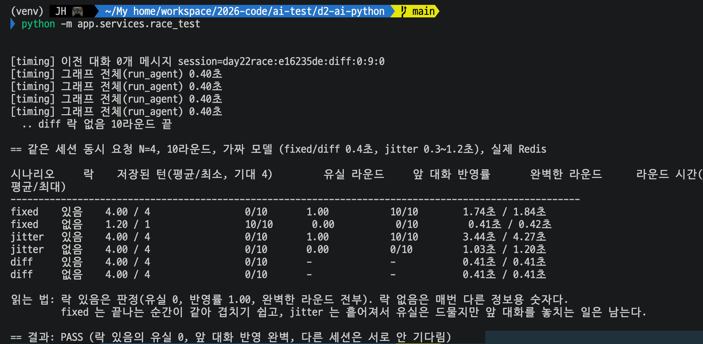
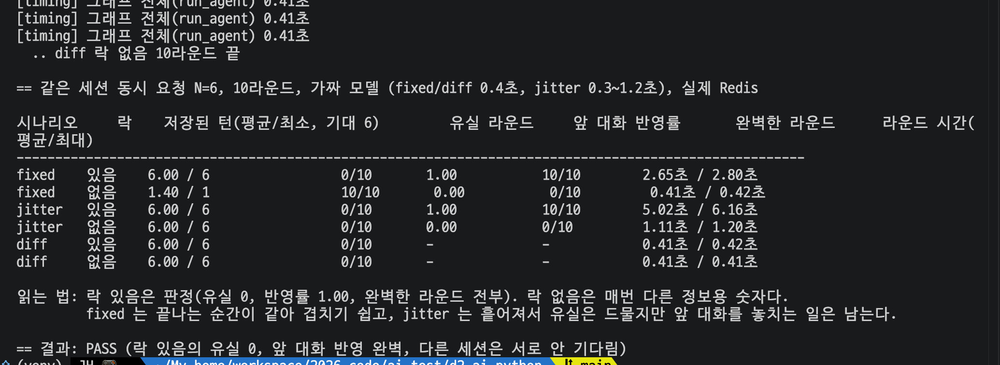
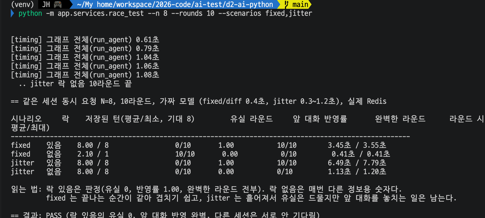
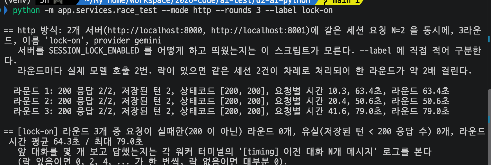
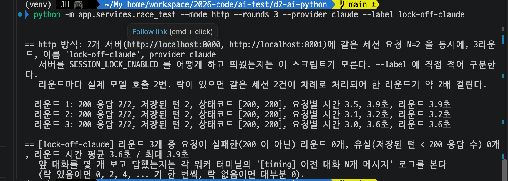

# Day 22 결과 — 같은 세션 동시 요청, 락 있음 / 없음 비교

> 사용법과 기대 숫자는 [DAY22_GUIDE.md](DAY22_GUIDE.md), 코드 흐름은 [DAY22_CODE_GUIDE.md](DAY22_CODE_GUIDE.md). 이 문서는 실행한 것과 확인한 결과를 담는다.
> 상태: 가이드 ① (N=4), ② (N=6, N=8)를 내 환경의 Redis 에서 실행해 기록함(2026-10-15). ③ 은 실제 서버 2대에서 Gemini(무료)와 Claude 로, ④ 는 Claude 로 실행해 기록함(5~8번). Gemini 로 하는 ④ 는 하지 않았다(9번).
> 포트: **8080 = Spring WAS**, **8000 = FastAPI 워커 1**, **8001 = FastAPI 워커 2**, **6379 = Redis**. 1~4번의 실험(inproc)은 서버를 켜지 않고 Redis 만 썼고, 5~8번(http)은 워커 2대(8000, 8001)를 켰다.

**전체 목적:** 같은 `sessionId` 로 요청 N 개가 동시에 올 때 세션 락이 있으면 무엇이 달라지는지를 한 번이 아니라 10라운드씩 반복해서 숫자로 비교한다. 락이 없을 때 대화 유실이 얼마나 자주 나는지, 앞 대화를 놓치는 일은 얼마나 흔한지, 락을 걸면 시간이 얼마나 늘고 다른 세션에는 영향이 없는지를 본다. 실제 서버와 실제 모델에서도 같은 동작이 나오는지 확인하고, 그 과정에서 Gemini 쪽에 생긴 문제를 기록한다(5~8번).

## 1. 실행 환경

1~4번은 서버 없이 가짜 모델로 한 실험(inproc)이다. 실제 서버와 실제 모델로 한 실험(http)은 5~8번이다.

| 항목          | 값                                                                                                                                  |
| ------------- | ----------------------------------------------------------------------------------------------------------------------------------- |
| 실행 위치     | 내 환경(`d2-ai-python`, 가상환경 켠 상태). 서버(워커, Spring, Kafka, Qdrant)는 켜지 않음                                              |
| Redis         | 실제 Redis (출력의 `실제 Redis`). 컨테이너 `redis1`, 6379                                                                            |
| 모델          | **가짜 모델**(정해진 시간만 자는 함수)이다. 실제 Gemini 가 아니다. fixed/diff 는 0.4초, jitter 는 0.3~1.2초(균등 무작위)              |
| 반복          | 시나리오 × 락 있음/없음마다 10라운드, 같은 세션 요청은 스레드 N 개가 `Barrier` 로 동시에 출발                                         |
| 실행 횟수     | 각 설정을 **한 번씩만** 실행했다. 락 없음의 숫자는 스레드 스케줄링에 따라 실행마다 달라질 수 있다                                    |

## 2. 실행한 것

| 순서 | 명령 (`d2-ai-python` 에서)                                                | 목적                                          |
| ---- | ------------------------------------------------------------------------- | --------------------------------------------- |
| 1    | `python -m app.experiments.race_test`                                        | N=4, 3개 시나리오 비교 (3-1)                   |
| 2    | `python -m app.experiments.race_test --n 6 --rounds 10`                      | N=6, 3개 시나리오 비교 (3-2)                   |
| 3    | `python -m app.experiments.race_test --n 8 --rounds 10 --scenarios fixed,jitter` | N=8, fixed 와 jitter 만 비교 (3-3)         |
| 4    | `python -m app.experiments.race_test --mode http --rounds 3 --label lock-on` | 실제 서버 2대, Gemini(무료), 락 있음 (6번)    |
| 5    | `python -m app.experiments.race_test --mode http --rounds 3 --provider claude --label lock-on-claude` | 실제 서버 2대, Claude, 락 있음 (8-1)   |
| 6    | `python -m app.experiments.race_test --mode http --rounds 3 --provider claude --label lock-off-claude` | 실제 서버 2대, Claude, 락 없음 (8-2)  |

1번은 가이드 ①, 2번과 3번은 가이드 ② 에 적힌 두 명령이다(N=6, N=8). 4번은 가이드 ③ 의 명령을 3라운드로 줄인 것이고, 5번과 6번은 가이드 ③, ④ 에 적은 Claude 용 명령이다(6번은 두 워커를 `SESSION_LOCK_ENABLED=false` 로 다시 띄운 뒤 실행).

## 3. 확인된 결과

3번과 4번은 가짜 모델(inproc) 결과다. 실제 서버와 실제 모델의 결과는 5~8번이다.

시나리오 설명: **fixed** = 같은 세션 N 개, 모델 대기 시간이 모두 같음 / **jitter** = 같은 세션 N 개, 대기 시간이 요청마다 다름 / **diff** = 서로 다른 세션 N 개. 숫자의 뜻은 DAY22_GUIDE.md 2번의 표와 같다.

### 3-1. 같은 세션 4개 동시 (N=4, 10라운드)

**목적:** 가장 기본 설정에서 락 있음/없음의 저장된 턴, 앞 대화 반영, 라운드 시간을 비교한다.

| 시나리오 | 락   | 저장된 턴(평균/최소, 기대 4) | 유실 라운드 | 앞 대화 반영률 | 완벽한 라운드 | 라운드 시간(평균/최대) |
| -------- | ---- | ---------------------------- | ----------- | -------------- | ------------- | ---------------------- |
| fixed    | 있음 | 4.00 / 4                     | 0/10        | 1.00           | 10/10         | 1.74초 / 1.84초        |
| fixed    | 없음 | **1.20 / 1**                 | **10/10**   | 0.00           | 0/10          | 0.41초 / 0.42초        |
| jitter   | 있음 | 4.00 / 4                     | 0/10        | 1.00           | 10/10         | 3.44초 / 4.27초        |
| jitter   | 없음 | 4.00 / 4                     | 0/10        | **0.00**       | 0/10          | 1.03초 / 1.20초        |
| diff     | 있음 | 4.00 / 4                     | 0/10        | -              | -             | 0.41초 / 0.41초        |
| diff     | 없음 | 4.00 / 4                     | 0/10        | -              | -             | 0.41초 / 0.41초        |

마지막 줄: `== 결과: PASS (락 있음의 유실 0, 앞 대화 반영 완벽, 다른 세션은 서로 안 기다림)`

### 3-2. 같은 세션 6개 동시 (N=6, 10라운드)

**목적:** 동시 요청 수를 늘렸을 때 락 없음의 유실과 락 있음의 시간이 어떻게 변하는지 본다.

| 시나리오 | 락   | 저장된 턴(평균/최소, 기대 6) | 유실 라운드 | 앞 대화 반영률 | 완벽한 라운드 | 라운드 시간(평균/최대) |
| -------- | ---- | ---------------------------- | ----------- | -------------- | ------------- | ---------------------- |
| fixed    | 있음 | 6.00 / 6                     | 0/10        | 1.00           | 10/10         | 2.65초 / 2.80초        |
| fixed    | 없음 | **1.40 / 1**                 | **10/10**   | 0.00           | 0/10          | 0.41초 / 0.42초        |
| jitter   | 있음 | 6.00 / 6                     | 0/10        | 1.00           | 10/10         | 5.02초 / 6.16초        |
| jitter   | 없음 | 6.00 / 6                     | 0/10        | **0.00**       | 0/10          | 1.11초 / 1.20초        |
| diff     | 있음 | 6.00 / 6                     | 0/10        | -              | -             | 0.41초 / 0.42초        |
| diff     | 없음 | 6.00 / 6                     | 0/10        | -              | -             | 0.41초 / 0.41초        |

마지막 줄: `== 결과: PASS`

### 3-3. 같은 세션 8개 동시 (N=8, 10라운드, fixed 와 jitter 만)

**목적:** N 을 더 키워서(8) 같은 경향이 이어지는지 본다.

| 시나리오 | 락   | 저장된 턴(평균/최소, 기대 8) | 유실 라운드 | 앞 대화 반영률 | 완벽한 라운드 | 라운드 시간(평균/최대) |
| -------- | ---- | ---------------------------- | ----------- | -------------- | ------------- | ---------------------- |
| fixed    | 있음 | 8.00 / 8                     | 0/10        | 1.00           | 10/10         | 3.45초 / 3.55초        |
| fixed    | 없음 | **2.10 / 1**                 | **10/10**   | 0.00           | 0/10          | 0.41초 / 0.41초        |
| jitter   | 있음 | 8.00 / 8                     | 0/10        | 1.00           | 10/10         | 6.49초 / 7.79초        |
| jitter   | 없음 | 8.00 / 8                     | 0/10        | **0.00**       | 0/10          | 1.13초 / 1.20초        |

마지막 줄: `== 결과: PASS`

### 3-4. N 에 따른 정리 (위 세 실행을 모은 표)

| N | fixed 락 없음 저장된 턴(평균) | fixed 락 있음 라운드 시간 | fixed 락 있음 시간 ÷ 한 건 시간(0.4초) | jitter 락 있음 라운드 시간 | jitter 락 없음 라운드 시간 |
| - | ----------------------------- | ------------------------- | --------------------------------------- | -------------------------- | -------------------------- |
| 4 | 1.20 / 4                      | 1.74초                    | 약 4.4배                                | 3.44초                     | 1.03초                     |
| 6 | 1.40 / 6                      | 2.65초                    | 약 6.6배                                | 5.02초                     | 1.11초                     |
| 8 | 2.10 / 8                      | 3.45초                    | 약 8.6배                                | 6.49초                     | 1.13초                     |

(시간 ÷ 한 건 시간은 이 문서에서 계산한 값이다.)

## 4. 해석

| 확인한 것                                                         | 의미                                                                                                                                                                               |
| ----------------------------------------------------------------- | ---------------------------------------------------------------------------------------------------------------------------------------------------------------------------------- |
| 락 있음: N=4, 6, 8 모두 유실 0, 반영률 1.00, 완벽한 라운드 전부    | 같은 세션 요청이 차례로 처리되고, 뒤 요청이 앞 요청의 저장 뒤에 읽는다. 이 가짜 모델 조건에서는 N 이 커져도 유지됐다                                                                |
| fixed 락 없음: 10라운드 모두 유실, 평균 1.20 / 1.40 / 2.10턴        | 끝나는 순간이 같으면 저장이 겹쳐 대부분의 턴이 사라진다. 요청이 많아질수록(N=8) 남는 턴은 늘지만 여전히 기대(8)의 약 1/4 이다. 이 값은 가짜 모델이 모두 같은 순간에 끝나는 최악의 경우다 |
| jitter 락 없음: 30라운드(N=4, 6, 8 각 10) 모두 유실 0              | 끝나는 시각이 흩어지면 저장이 겹치지 않아 `append_turn` 의 읽기-쓰기 사이에 다른 요청이 끼는 일이 드물다. 이번 실행에서는 한 번도 없었다                                          |
| jitter 락 없음: 그래도 반영률 0.00, 완벽한 라운드 0                | **유실이 없어도 앞 대화는 모른다.** 모두 같은 순간에 시작해 이전 대화를 읽기 때문에 모델이 받은 이전 대화가 전부 0개였다. 락이 막아 주는 것은 유실보다 이쪽이 더 흔하다               |
| 락 있음의 라운드 시간: 한 건 시간의 약 N 배(+0.1~0.25초)            | 같은 세션은 차례로 처리되므로 N 건 합만큼 걸린다. 대가는 응답 지연이다(실제 Gemini 는 한 건이 수 초~수십 초라 같은 세션 N 건이면 N 배가 된다). 덧붙는 소폭은 락 재시도 대기(0.1초 안팎)와 Redis 왕복으로 보이나 따로 재지 않았다 |
| diff: 락 있음/없음 모두 한 건 시간(0.41초)                         | 락이 세션별이라 다른 세션의 요청을 늦추지 않는다                                                                                                                                  |

## 5. 실제 서버(http) 실험 환경

| 항목               | 값                                                                                                                                                         |
| ------------------ | ---------------------------------------------------------------------------------------------------------------------------------------------------------- |
| 실행 위치          | 내 환경. 워커 2대: **8000 = FastAPI 워커 1(w1)**, **8001 = FastAPI 워커 2(w2)**, 각각 `uvicorn main:app`. Redis(6379, `redis1`), Qdrant(6333, 도구 검색), Kafka(9092)가 떠 있는 상태 |
| 요청               | 같은 세션 요청 2개(N=2)를 서버 하나에 하나씩 동시에(`Barrier`) 보낸다. 질문은 "환불은 며칠 안에 신청해야 하나요?", "교환 배송비는 누가 내나요?"               |
| 반복               | 설정마다 3라운드를 한 번씩. 라운드마다 새 세션                                                                                                              |
| 락                 | 락 있음은 기본(켬). 락 없음은 두 워커를 `SESSION_LOCK_ENABLED=false` 로 다시 띄움(가이드 ④)                                                                  |
| 모델               | Gemini: `gemini-3.1-flash-lite`(무료로 사용). Claude: `claude-haiku-5-5`(요청에 `--provider claude`)                                                         |
| Claude 모델명 수정 | `agent_graph.py` 의 Claude 모델명이 `claude-3-5-haiku-20241022` 일 때 404(`not_found_error`)가 나서 `claude-haiku-5-5` 로 고쳤다(기존 줄은 `[OLD]` 주석으로 남김) |
| 임베딩             | 도구 검색의 질문 임베딩은 어느 공급자(provider)를 쓰든 Gemini 임베딩이다                                                                                     |
| 모델 호출 수       | 도구 검색을 쓰는 요청은 모델을 2번 부른다. 라운드마다 요청 2개                                                                                              |

## 6. Gemini ③ 락 있음 결과 (실제 서버 2대, 무료)

**목적:** 실제 서버 2대와 실제 Gemini 에서, 같은 세션 요청 2개가 락 때문에 차례로 처리되는지와 시간이 얼마나 걸리는지 본다.

`python -m app.experiments.race_test --mode http --rounds 3 --label lock-on`

| 라운드 | 200 응답 | 저장된 턴 | 요청별 시간      | 라운드 시간 | 두 요청 시간 차 |
| ------ | -------- | --------- | ---------------- | ----------- | --------------- |
| 1      | 2/2      | 2         | 10.3초, 63.4초   | 63.4초      | 53.1초          |
| 2      | 2/2      | 2         | 20.4초, 50.6초   | 50.6초      | 30.2초          |
| 3      | 2/2      | 2         | 41.6초, 79.0초   | 79.0초      | 37.4초          |

마지막 줄: 라운드 3개 중 요청이 실패한(200 이 아닌) 라운드 0개, 유실 0개, 라운드 시간 평균 64.3초 / 최대 79.0초. (두 요청 시간 차는 큰 값에서 작은 값을 뺀, 이 문서에서 계산한 값이다.)

| 확인한 것                                          | 의미                                                                                                                                                         |
| -------------------------------------------------- | ------------------------------------------------------------------------------------------------------------------------------------------------------------ |
| 3라운드 모두 200 응답 2/2, 저장된 턴 2, 유실 0       | 락 있음에서 두 요청이 모두 정상 응답하고 대화 2턴이 저장됐다                                                                                                  |
| 두 요청의 시간 차 53.1 / 30.2 / 37.4초              | 두 요청이 같은 때에 끝나지 않고 한 쪽이 한참 늦게 끝난다. 차례로 처리되는 모양과 맞는다. 다만 한 건의 처리 시간이 라운드마다 크게 달라(10~50초대) "두 번째는 첫 번째의 약 2배"처럼 깔끔하게 나오지는 않는다 |
| 라운드 시간 50.6~79.0초(평균 64.3초)                | 가이드의 예상(라운드당 15~40초)보다 길었다. 원인은 확인하지 못했다(7번 3)                                                                                      |

Gemini ④(락 없음)는 실행하지 않았다. 락 있음/없음의 비교는 8번(Claude)에서 한다.

## 7. Gemini 쪽에서 생긴 문제 (트러블슈팅)

**목적:** ③ 을 Gemini 로 돌리는 동안 Gemini 쪽에서 생긴 문제와 대응을 남긴다.

| 번호 | 증상                                                                              | 에러                                                      | 원인                                                                                                                                                                                | 대응과 상태                                                                                                                                                                           |
| ---- | --------------------------------------------------------------------------------- | --------------------------------------------------------- | ----------------------------------------------------------------------------------------------------------------------------------------------------------------------------------- | ------------------------------------------------------------------------------------------------------------------------------------------------------------------------------------- |
| 1    | `/run` 이 약 40초 뒤 500 을 돌려줌. 스크립트에 `└ 상태 500: None` 으로 보임(본문이 JSON 이 아님) | `503 UNAVAILABLE ... high demand`(워커 로그의 모델 호출 에러) | Google 문서상 503 은 서비스가 일시적으로 과부하라는 뜻이다(재시도 권장). SDK 가 내부에서 재시도한 뒤 예외를 던지고 FastAPI 가 500 으로 응답한 것으로 보인다. API 키를 바꿔도 같은 503 이 나서 키 문제는 아니었다 | 시간을 두고 재시도했다. 이후 실행(6번)에서는 500 없이 끝났다. 수요 과부하는 Google 쪽이라 원인을 확인할 수 없다. 서버가 모델의 503 을 500 으로 내보내는 부분은 고치지 않았다                |
| 2    | 모델 호출이 계속 실패함                                                              | `402 RESOURCE_EXHAUSTED: Your prepayment credits are depleted` | Google 문서상 선불(Prepay) 잔액이 0 이면 그 결제 계정에 연결된 프로젝트의 키가 즉시 멈추고 402 가 나며, 무료 티어로 자동으로 내려가지 않는다. 쓰던 키의 프로젝트에 선불 결제가 연결된 상태로 보인다(잔액이 0 이 된 이유는 확인하지 못함) | 프로젝트를 무료로 전환했다(공식 문서는 결제 비활성화 또는 결제 계정 연결 해제를 안내). 전환은 내가 직접 했고 화면 단계는 이 문서에서 확인하지 않았다. 전환 뒤 ③ 이 200 으로 끝났다 |
| 3    | 요청이 느림                                                                          | 에러 없음(200)                                            | 같은 요청의 시간이 10.3~79.0초로 크게 달랐다(두 번째 요청은 앞 요청을 기다린 시간이 포함됨). Claude 는 같은 조건에서 1.2~3.9초였다. 무료 티어의 지연인지 Gemini 쪽 수요인지는 확인하지 못했다 | 락 효과 비교는 응답이 안정적인 Claude 로 했다(8번). 가이드의 예상 시간(라운드당 15~40초)은 Gemini 무료 기준으로는 맞지 않았다                                                             |

## 8. Claude 로 본 ③ 락 있음 vs ④ 락 없음

**목적:** Gemini 는 응답이 느리고 흔들려서(7번) 락 있음/없음을 같은 조건으로 비교하기 어렵다. 응답이 안정적인 Claude(`claude-haiku-5-5`)로 서버, 질문, 라운드 수는 그대로 두고 락 설정만 바꿔 3라운드씩 비교한다.

### 8-1. ③ 락 있음 (Claude)

`python -m app.experiments.race_test --mode http --rounds 3 --provider claude --label lock-on-claude`

| 라운드 | 200 응답 | 저장된 턴 | 요청별 시간    | 라운드 시간 | 두 요청 시간 차 |
| ------ | -------- | --------- | -------------- | ----------- | --------------- |
| 1      | 2/2      | 2         | 1.8초, 3.5초   | 3.5초       | 1.7초           |
| 2      | 2/2      | 2         | 1.2초, 2.9초   | 2.9초       | 1.7초           |
| 3      | 2/2      | 2         | 1.6초, 3.6초   | 3.6초       | 2.0초           |

마지막 줄: 라운드 3개 중 요청이 실패한 라운드 0개, 유실 0개, 라운드 시간 평균 3.3초 / 최대 3.6초. 이 실행은 스크린샷 없이 터미널 출력을 옮겼다.

### 8-2. ④ 락 없음 (Claude)

`python -m app.experiments.race_test --mode http --rounds 3 --provider claude --label lock-off-claude`

| 라운드 | 200 응답 | 저장된 턴 | 요청별 시간    | 라운드 시간 | 두 요청 시간 차 |
| ------ | -------- | --------- | -------------- | ----------- | --------------- |
| 1      | 2/2      | 2         | 3.5초, 3.9초   | 3.9초       | 0.4초           |
| 2      | 2/2      | 2         | 3.1초, 3.2초   | 3.2초       | 0.1초           |
| 3      | 2/2      | 2         | 3.0초, 3.6초   | 3.6초       | 0.6초           |

마지막 줄: 라운드 3개 중 요청이 실패한 라운드 0개, 유실 0개, 라운드 시간 평균 3.6초 / 최대 3.9초.

### 8-3. ③ 와 ④ 비교

| 비교                 | ③ 락 있음                          | ④ 락 없음                          |
| -------------------- | ---------------------------------- | ---------------------------------- |
| 200 응답             | 3라운드 모두 2/2                   | 3라운드 모두 2/2                   |
| 저장된 턴 / 유실     | 2 / 0                              | 2 / 0                              |
| 요청별 시간(3라운드) | 1.8·3.5, 1.2·2.9, 1.6·3.6          | 3.5·3.9, 3.1·3.2, 3.0·3.6          |
| 두 요청 시간 차      | 1.7, 1.7, 2.0초                    | 0.4, 0.1, 0.6초                    |
| 라운드 시간 평균/최대 | 3.3초 / 3.6초                      | 3.6초 / 3.9초                      |

(두 요청 시간 차는 이 문서에서 계산한 값이다.)

| 확인한 것                                         | 의미                                                                                                                                                                                          |
| ------------------------------------------------- | --------------------------------------------------------------------------------------------------------------------------------------------------------------------------------------------- |
| 유실 0 (③, ④ 모두)                                | 이 조건(같은 세션 2개 동시, 한 건 1~4초)에서는 락이 없어도 저장된 턴이 사라지지 않았다. 저장이 겹치는 구간이 좁았기 때문으로 추정한다(확인하지 못함). 가짜 모델 fixed 에서 락 없음이 전부 유실이었던 것(3번)과 다른 결과다 |
| 두 요청 시간 차: ③ 1.7~2.0초, ④ 0.1~0.6초        | 락 있음에서는 한 요청이 다른 요청보다 1.7~2.0초 늦게 끝나고, 락 없음에서는 거의 같은 때에 끝난다. 락 있음에서 차례로 처리되는 모양과 맞는다                                                          |
| 라운드 시간: ③ 평균 3.3초, ④ 평균 3.6초         | 락 없음이 더 짧지 않다. 가이드의 기대("락 없음은 ③ 의 절반 안팎")는 이 Claude 실행에서는 맞지 않았다. ③ 에서 한 건의 처리 시간이 약 1.2~2.0초로 ④ 의 약 3.0~3.9초보다 짧아서이며(이 문서의 계산), 한 건 시간이 왜 달랐는지는 확인하지 못했다 |
| 앞 대화 반영(락의 가장 큰 효과)                   | 이 문서의 결과 값(시간, 턴)만으로는 보이지 않는다. 워커 로그의 `이전 대화 N개` 로 보는 값이라 이 문서에는 싣지 않았다(9번)                                                                        |
| 결론                                              | Claude 결과의 시간 값만으로는 락 효과를 단정하기 어렵다. 차례 처리 모양(시간 차)은 보였지만 유실과 라운드 시간에서는 차이가 없었다. 락 효과는 가짜 모델 실험(3번, 4번)이 더 분명하게 보였다 |

## 9. 확인하지 않은 것

| 항목                                          | 내용                                                                                                                                              |
| --------------------------------------------- | ------------------------------------------------------------------------------------------------------------------------------------------------- |
| 가이드 ③ Gemini 락 있음 | 3라운드를 한 번 실행했다(6번). 가이드의 5라운드는 하지 않았다. 워커 로그의 `이전 대화 N개` 는 이 문서에 싣지 않았다                                                                         |
| 가이드 ④ Gemini 락 없음 | 하지 않았다. Gemini 는 응답이 느리고 오류가 있어 Claude 로 대신 비교했다(8번)                                                                        |
| Claude ③ 의 스크린샷, 워커 로그 | ③ 은 스크린샷이 없고 터미널 출력을 옮겼다. 두 실행(③, ④) 모두 워커 로그는 이 문서에 싣지 않았다                                                       |
| Claude 에서 한 건 시간이 ③ 과 ④ 에서 달랐던 이유 | ③ 은 약 1.2~2.0초, ④ 는 약 3.0~3.9초였다. 이유는 확인하지 못했다 |
| 실제 모델의 응답 시간 분포                    | 가짜 모델의 fixed(모두 같음)와 jitter(0.3~1.2초 균등)는 양 끝을 보는 설정이다. 실제 Gemini(4~80초까지 관찰됨)에서 락 없음의 유실이 어느 쪽에 가까운지는 모른다 |
| 같은 설정의 반복 실행                         | 각 설정을 한 번씩만 실행했다. 샌드박스에서 같은 fixed N=4 는 평균 2.00턴이었고 내 환경은 1.20턴이었다(DAY22_GUIDE 5번 표). 실행마다 달라진다는 뜻이지만 분포는 재지 않았다 |
| diff 시나리오의 N=8                           | `--scenarios fixed,jitter` 로 실행해 빠져 있다. N=10(상한)도 하지 않았다                                                                           |
| 락 없음에서 저장된 (질문, 답) 쌍의 짝 맞음    | 스크립트는 락 있음에서만 판정한다(락 없음은 정보용). 락 없음의 쌍이 어긋나는지는 보지 않았다                                                       |
| Kafka 경로                                    | Spring → Kafka → 워커 경로에서의 동시 요청은 보지 않았다                                                                                          |

## 10. 한계

| 항목                      | 내용                                                                                                                                      |
| ------------------------- | ----------------------------------------------------------------------------------------------------------------------------------------- |
| 가짜 모델                 | 모델 시간만 흉내 낸다. 실제 에이전트의 도구 호출, 재시도, 응답 시간 변동은 들어 있지 않다                                                  |
| 한 프로세스의 스레드      | 서로 다른 워커 프로세스가 아니라 한 프로세스 안의 스레드다. 락은 Redis 로 동작하므로 워커가 여러 대여도 같은 원리지만 이번에는 확인하지 않았다 |
| 락의 비용                 | 같은 세션은 차례로 처리하므로 요청이 몰리면 뒤 요청일수록 응답이 늦어진다. Kafka 워커는 락을 기다리는 동안 다른 세션의 메시지도 함께 기다린다(DAY21_RESULT 6번) |
| 공급자 차이               | Gemini(무료)와 Claude 는 응답 시간이 크게 달라(6번, 8번) 시간을 직접 비교할 수 없다. 8번의 비교는 같은 공급자 안에서만 의미가 있다                |
| 반복 횟수                 | http 실험은 설정마다 3라운드를 한 번씩만 했다. 통계로는 약하다                                                                              |
| 임베딩                    | Claude 로 해도 도구 검색의 질문 임베딩은 Gemini 라서 Gemini 와 완전히 분리된 실험은 아니다                                                  |
