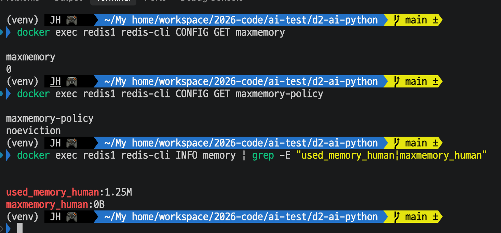

# Day 24 결과 — Redis TTL(만료) 정책

> 사용법과 기대 숫자는 [DAY24_GUIDE.md](DAY24_GUIDE.md), 코드 흐름은 [DAY24_CODE_GUIDE.md](DAY24_CODE_GUIDE.md). 이 문서는 실행한 것과 확인한 결과를 담는다.
> 상태: 가이드 ① (정책 확인 스크립트), ② (실제 요청의 TTL 변화), ③ (지금 Redis 의 키별 TTL), ④ (Redis 메모리 설정), ⑤ (대화 TTL 갱신)를 내 환경에서 실행해 기록함(2026-10-15).
> 포트: **8080 = Spring WAS**, **8000 = FastAPI 워커 1**, **8001 = FastAPI 워커 2**, **6379 = Redis(redis1 컨테이너)**. ① 은 서버(Spring, 워커) 없이 Redis 만 썼고, ② 는 Spring(8080) → Kafka → 워커를 거쳤다.

**전체 목적:** Day 20~23 의 임시 TTL 을 키 종류별 정책(결과는 상태별, 대화는 슬라이딩, 락은 그대로)으로 정리한 뒤, 정책대로 TTL 이 걸리고 만료되는지, TTL 없이 남은 키가 없는지를 내 환경의 실제 Redis 에서 확인한다. 실제 요청(②)에서 같은 동작이 나오는지를 확인하고, 지금 쌓인 키의 TTL(③), Redis 메모리 설정(④), Kafka 경로에서 같은 sessionId 로 다시 물을 때 대화 TTL 이 새로 시작되는지(⑤)를 본다.

## 1. 실행 환경

| 항목      | 값                                                                                          |
| --------- | ------------------------------------------------------------------------------------------- |
| 실행 위치 | 내 환경(`d2-ai-python`, 가상환경 켠 상태)                                                   |
| Redis     | 실제 Redis, 컨테이너 `redis1` 6379 (db 0)                                                   |
| ①         | 서버를 켜지 않고 스크립트만 실행. 정책 값은 기본값(환경변수 없음)                           |
| ②         | Spring(8080)에 `provider: claude` 로 요청 1건. 처리한 워커는 확인하지 않았다(8000 으로 띄운 워커 포함 가능) |
| ③         | `redis1` 컨테이너 안에서 `redis-cli` 로 `agent:*` 키를 훑어 키마다 TTL 을 읽음                  |
| ④         | `redis1` 컨테이너에서 `CONFIG GET` 과 `INFO memory` 로 메모리 설정을 읽기만 함(바꾸지 않음)    |
| ⑤         | Spring(8080)에 `provider: claude`, `sessionId: d24-a` 로 질문 2건(약 40초 간격)                  |
| 실행 횟수 | ①~⑤ 모두 한 번씩                                                                              |

## 2. 실행한 것

| 순서 | 명령                                                         | 목적                                |
| ---- | ------------------------------------------------------------ | ----------------------------------- |
| 1    | `python -m app.checks.ttl_check` (`d2-ai-python` 에서)     | 정책 확인 스크립트 (3-1)            |

| 2    | `curl -s -X POST localhost:8080/api/agent/requests ... -d '{"question":"환불은 며칠 안에 신청해야 하나요?","provider":"claude"}'` 의 requestId 를 `ID` 에 담고, `docker exec redis1 redis-cli TTL agent:result:$ID` 를 1초마다 10번 | 요청 한 건의 TTL 변화 (3-2) |

| 3    | `docker exec redis1 sh -c "redis-cli --scan --pattern 'agent:*' \| while read k; do echo ...TTL...; done"` | 지금 Redis 의 키별 TTL (3-3) |

| 4    | `docker exec redis1 redis-cli CONFIG GET maxmemory`, `CONFIG GET maxmemory-policy`, `INFO memory \| grep -E "used_memory_human\|maxmemory_human"` | Redis 메모리 설정 보기 (3-4) |

| 5    | 같은 `sessionId`(`d24-a`)로 질문 1건 → 10초 뒤 `GET .../sessions/d24-a` 의 `ttlSec` → 30초 뒤 질문 1건 → 10초 뒤 `ttlSec` → 세션 삭제 | 대화 TTL 갱신 (3-5) |

1번은 가이드 ①, 2번은 가이드 ②, 3번은 가이드 ③, 4번은 가이드 ④, 5번은 가이드 ⑤ 의 명령이다.

## 3. 확인된 결과

### 3-1. ① 정책 확인 스크립트

**목적:** 정책대로 TTL 이 걸리는지, 대화 TTL 이 새로 시작되는지, 락이 풀리는지, TTL 없는 키가 없는지를 한 번에 본다.

스크립트가 출력한 정책 값은 결과 PROCESSING 600초 / DONE 86400초 / FAILED 86400초, 대화 3600초, 락 150초였다.

| 항목                                              | 결과 | 값                                                          |
| ------------------------------------------------- | ---- | ----------------------------------------------------------- |
| 1) 연결                                           | PASS | 지연 9.7ms                                                  |
| 2) 정책 값끼리 어긋나지 않음                      | PASS | PROCESSING TTL > 에이전트 제한                              |
| 3) PROCESSING 은 PROCESSING TTL 로 저장           | PASS | 남은 600초                                                  |
| 4) DONE 이 되면 TTL 이 DONE 값으로 새로 시작      | PASS | 남은 86400초                                                |
| 5) FAILED 는 FAILED TTL 로 저장                   | PASS | 남은 86400초                                                |
| 6) PROCESSING 으로 남은 결과는 TTL 이 지나면 사라짐 | PASS | 만료 전 있음, 만료 후 None                                  |
| 7) 대화는 기본 TTL 로 저장                        | PASS | 남은 3600초                                                 |
| 8) 대화 TTL 은 저장할 때마다 새로 시작            | PASS | 다시 저장하기 전 3초 → 후 6초                               |
| 8) 마지막 저장 뒤 TTL 이 지나면 대화가 사라짐     | PASS | 만료 후 빈 목록                                             |
| 9) 락은 잡는 동안 TTL 이 걸려 있음                | PASS | 남은 150초                                                  |
| 9) 락을 풀면 키가 사라짐                          | PASS | -                                                           |
| 10) TTL 없는(영구) agent:* 키가 없음              | PASS | 점검한 키 13개                                              |

PASS 12개, FAIL 0개. 10번 항목을 위해 훑은 현재 Redis 에는 `agent:result:*` 키가 13개 있었고 남은 TTL 은 84530~85516초였다(다른 종류의 키는 없었다). 테스트 키 정리로 3개를 지웠다(나머지 테스트 키는 정리 전에 이미 만료됨).

### 3-2. ② 실제 요청에서 TTL 이 바뀌는 모양

**목적:** 요청 한 건이 PROCESSING 일 때와 DONE 이 된 뒤의 TTL 이 정책대로 다른지 본다.

요청을 보낸 직후부터 1초마다 그 결과 키의 TTL 을 10번 읽었다.

| 시각 (KST) | TTL (초) | 해석                     |
| ---------- | -------- | ------------------------ |
| 04:34:44   | 600      | PROCESSING               |
| 04:34:45   | 599      | PROCESSING               |
| 04:34:46   | 598      | PROCESSING               |
| 04:34:47   | 597      | PROCESSING               |
| 04:34:49   | 86399    | DONE 으로 바뀐 뒤        |
| 04:34:50   | 86398    | DONE                     |
| 04:34:51   | 86397    | DONE                     |
| 04:34:52   | 86396    | DONE                     |
| 04:34:53   | 86395    | DONE                     |
| 04:34:54   | 86393    | DONE                     |

04:34:48 줄은 없다(그 1초에 `docker exec` 가 늦어져 한 번 건너뛴 것으로 보인다). 첫 줄이 이미 600 이었고 `-2`(키 없음)는 나오지 않았다. 상태(PROCESSING, DONE)는 이 출력에 찍히지 않아, 위 표의 상태는 TTL 값에서 짐작한 것이다.

### 3-3. ③ 지금 Redis 의 키별 TTL

**목적:** 실제로 쌓인 `agent:*` 키가 모두 TTL 을 가지고 있는지 본다.

`agent:*` 키가 14개 나왔고 모두 `agent:result:<requestId>` 였다. 대화(`agent:conversation:*`)와 락(`agent:lock:*`) 키는 없었다.

| requestId (앞 8자리) | 남은 TTL (초) |
| -------------------- | ------------- |
| 05c00207             | 86350         |
| 66afb097             | 85453         |
| 78f7f6c2             | 85447         |
| 5d7d4b5b             | 85297         |
| 56309810             | 85290         |
| 20aa89ef             | 84657         |
| 32de9e59             | 84657         |
| 4b644861             | 84648         |
| 97583a82             | 84638         |
| c0cfe536             | 84600         |
| a5fd32f9             | 84596         |
| 30a01fd4             | 84594         |
| b1b690da             | 84594         |
| 20937977             | 84467         |

가장 작은 값은 84467초, 가장 큰 값은 86350초였고 `-1`(영구)인 줄은 없었다.

### 3-4. ④ Redis 메모리 설정

**목적:** 지금 Redis 에 메모리 한도와 삭제 정책이 걸려 있는지 본다. 설정은 바꾸지 않았다.

| 항목                | 값         |
| ------------------- | ---------- |
| `maxmemory`         | 0          |
| `maxmemory-policy`  | noeviction |
| `used_memory_human` | 1.25M      |
| `maxmemory_human`   | 0B         |

### 3-5. ⑤ 대화 TTL 이 새로 시작되는지

**목적:** Kafka 경로에서 같은 `sessionId` 로 다시 물으면 대화의 남은 TTL 이 처음 값으로 돌아오는지 본다.

| 순서 | 한 일                                             | 값                                                                  |
| ---- | ------------------------------------------------- | ------------------------------------------------------------------- |
| 1    | 첫 질문 전송 (`d24-a`)                            | requestId `58d0d898-08dd-412d-99bb-8c1bf3f55b0a`, ACCEPTED           |
| 2    | 10초 뒤 세션 조회                                 | `ttlSec` 3589                                                       |
| 3    | 30초 쉬고 둘째 질문 전송 (`d24-a`)                | requestId `80580b8c-bf06-442d-b8d5-04c47ab60a1a`, ACCEPTED           |
| 4    | 10초 뒤 세션 조회                                 | `ttlSec` 3585                                                       |

둘째 질문을 처음 보내려던 한 번은 `sleep` 중에 Ctrl+C 로 끊었다(그때는 질문이 전송되지 않았다). 같은 명령을 다시 실행해 3번, 4번을 했다.

둘째 조회의 `ttlSec` 가 3585 로, 첫 조회(3589)와 거의 같다. 끝나고 `curl -s -X DELETE localhost:8000/api/v1/agent/sessions/d24-a` 로 세션을 지웠고 `{"sessionId":"d24-a","deleted":true}` 가 돌아왔다.

끝난 뒤 두 요청의 결과를 8000 으로 조회했다.

| 항목                      | 첫 번째 `58d0d898…`                          | 두 번째 `80580b8c…`                          |
| ------------------------- | -------------------------------------------- | -------------------------------------------- |
| status                    | DONE                                         | DONE                                         |
| elapsedMs                 | 3227                                         | 4808                                         |
| worker, partition, offset | w1, 1, 12                                    | w1, 0, 87                                    |
| updatedAt (UTC)           | 2026-10-14T19:37:03.438760+00:00             | 2026-10-14T19:38:13.922463+00:00             |
| 답의 내용                 | 환불 신청 기한을 사유별로 안내(단순 변심 7일 이내, 하자 또는 오배송 30일 이내) | 기간이 지났을 때의 처리는 문서에 없다고 하고, "앞서 기간을 안내할 때는 검색을 거치지 않았습니다" 라며 앞 답변을 언급한 뒤 7일, 30일을 다시 안내 |

## 4. 해석

| 확인한 것                                                         | 의미                                                                                                                                          |
| ----------------------------------------------------------------- | --------------------------------------------------------------------------------------------------------------------------------------------- |
| ① 12개 항목 PASS (내 환경의 실제 Redis)                           | 상태별 결과 TTL, 대화 TTL 갱신과 만료, 락 TTL 이 정책대로 동작한다. 샌드박스에서 본 12/12 와 같은 결과다                                       |
| 3번 600초 → 4번 86400초                                           | 같은 결과 키가 PROCESSING 에서 DONE 으로 바뀌면 TTL 이 짧은 값에서 긴 값으로 새로 시작된다                                                     |
| 6번 만료 뒤 None                                                  | 워커가 죽어 PROCESSING 으로 남은 결과는 PROCESSING TTL 이 지나면 사라진다(TTL 을 1초로 줄여 시험한 것이고, 실제 600초를 기다린 것은 아니다)    |
| 8번 3초 → 6초                                                     | 대화를 다시 저장하면 남은 TTL 이 처음 값으로 돌아온다(슬라이딩). 대화 TTL 을 6초로 줄여 시험한 것이다                                         |
| ② TTL 이 597 까지 줄다가 86399 로 뛰고 다시 줄어듦 | 실제 요청(Spring → Kafka → 워커)에서도 PROCESSING 은 600초, DONE 이 되면 86400초로 새로 시작한다. 정책대로 동작한다 |
| ⑤ 두 요청 모두 DONE, 두 번째 답이 "앞서 기간을 안내할 때는 …" 라며 첫 답을 언급함 | 둘째 질문이 실제로 처리돼 저장됐고, Kafka 경로에서 같은 `sessionId` 의 이전 대화를 이어받았다. 두 `updatedAt` 은 70초 간격이라 40초 이상 띄운 것과 맞는다 |
| ⑤ 첫 조회 3589 → 둘째 조회 3585 | 둘째 조회는 첫 조회에서 최소 40초 뒤다(`sleep 30` 과 `sleep 10`). 대화 TTL 이 갱신되지 않았다면 3589 − 40 = 3549 이하여야 하는데 3585 였으므로, 둘째 질문을 저장할 때 TTL 이 3600 으로 새로 시작된 것이다(둘째 조회가 저장 15초 뒤라 3585). Kafka 경로에서도 대화 TTL 이 슬라이딩으로 동작한다 |
| ④ `maxmemory` 0, 정책 `noeviction` | 메모리 한도가 없고(0 은 한도 없음), 한도가 있었더라도 가득 차면 키를 지우지 않는 설정이다. 지금은 키가 TTL 로만 사라진다. 가이드 ④ 의 예상과 같다 |
| ④ 사용 메모리 1.25M | 키 14개가 있는 지금 Redis 가 쓰는 메모리다. 이 중 키가 차지하는 몫은 따로 재지 않았다(Redis 자체 기본 사용분이 포함된다) |
| ③ 결과 키 14개가 모두 양수 TTL (84467~86350초) | 지금 쌓인 결과 키 중 영구 키는 없다. 키마다 86400초(DONE)에서 줄어든 값이다 |
| ③ `20937977` 의 TTL 84467초 | 86400 − 84467 = 1933초(약 32분). 이 요청의 `updatedAt` 은 DAY23_RESULT 3-2 의 19:03:25 UTC 이고, 이번 조회는 그로부터 약 32분 뒤(04:35 KST = 19:35 UTC)라 서로 맞는다 |
| ③ 목록에 Day 23 ⑦ 의 요청(`dbbd8ea9`)이 없음 | 그 요청은 Redis 를 끈 동안 처리돼 메모리에만 있었으므로 Redis 에 없는 것이 맞다. Day 23 가이드 ⑦ 의 예상과 같다 |
| 10번 현재 Redis 의 결과 키 13개에 모두 TTL 이 있음                | 지금 쌓인 결과 키 중 영구 키는 없다. TTL 이 84530~85516초인 것은 86400초에서 약 15~31분 줄어든 값이라, 그 정도 전에 쓰인 결과들로 보인다(어떤 요청인지는 확인하지 않았다) |

## 5. 확인하지 않은 것

| 항목                                      | 내용                                                                                                                                  |
| ----------------------------------------- | ------------------------------------------------------------------------------------------------------------------------------------- |
| ② 의 requestId, 처리한 워커, 상태 | 출력에 찍히지 않았다(`ID` 변수에만 담김). TTL 값만 보았고 같은 키의 status 는 조회하지 않았다. DONE 으로 바뀐 정확한 시각도 모른다(04:34:47~49 사이) |
| ② 의 `-2` 구간                            | 보지 못했다. 첫 조회 전에 워커가 이미 받아 PROCESSING 으로 썼다                                                                       |
| ③ 의 키가 어떤 요청인지                   | `20937977`(Day 23 ②), `b1b690da`(Day 23 ③), `78f7f6c2`와 `66afb097`(Day 23 ⑥), 그리고 DAY23 ③ 의 두 번째 실행 4건은 id 로 알아볼 수 있다. `05c00207` 은 TTL 이 가장 커서 방금 쓴 ② 의 요청으로 보이지만 ② 에서 id 를 찍지 않아 단정하지 않는다. `5d7d4b5b`, `56309810` 은 무엇인지 확인하지 않았다 |
| ③ 의 status                               | TTL 만 읽었다. 키별 DONE/FAILED 여부는 보지 않았다                                                                                    |
| ④ 의 키당 메모리                          | 재지 않았다. 요청 수에 따른 메모리 증가량은 부하 테스트(Day 25 이후)에서 볼 일이다                                                    |
| ⑤ 의 세션 `turns`                         | 세션을 지운 뒤라 `turns` 는 조회하지 못했다. `ttlSec` 만 보았다                                                                       |
| 10번의 범위                               | 실행한 시점의 `agent:*` 키만 본 것이다. `agent:result:*` 외의 키(대화, 락)는 그 시점에 없어서 점검되지 않았다                           |
| 실제 만료 대기                            | 6번과 8번은 TTL 을 1~6초로 줄여서 시험했다. PROCESSING 600초, 대화 3600초를 실제로 기다려 확인하지 않았다                              |
| 값의 적정성                               | 600초, 86400초, 3600초는 설계값이다. 사용 패턴이나 메모리 사용량을 재서 정한 것이 아니다                                               |

## 6. 한계

| 항목             | 내용                                                         |
| ---------------- | ------------------------------------------------------------ |
| 한 번만 실행     | ①~⑤ 모두 한 번씩 실행했다                                    |
| 워커 로그        | 이 문서에 싣지 않았다                                        |
