# Day 26 결과 — 동기 구조로 전환 후 장애(504, 에러율) 재현

> 상태: 가이드 ① (동기 경로 한 건), ② (동시 5건), ③ (처리 중 `/health`), ④ (k6 VU 20, 동기), ⑤ (k6 VU 20, FastAPI 직접), ⑥ (시험 뒤 남은 처리)까지 기록했다(2026-10-16). ③~⑥ 은 아직 실행하지 않았다.
> 가이드는 [DAY26_GUIDE.md](DAY26_GUIDE.md), 코드 흐름은 [DAY26_CODE_GUIDE.md](DAY26_CODE_GUIDE.md).

**전체 목적:** 비동기 구조의 기준선(DAY25_RESULT)과 비교할 수 있도록, 같은 부하를 "답이 나올 때까지 요청을 붙잡는" 동기 구조(Spring `/api/agent/sync` → FastAPI `/api/v1/agent/run`)로 보냈을 때 나오는 응답 지연, 504, 에러율을 기록한다.

## 1. 환경

| 항목            | 값                                                                                                   |
| --------------- | ---------------------------------------------------------------------------------------------------- |
| 실행 날짜       | 2026-10-16                                                                                           |
| Spring WAS      | 8080. 새 클래스(`SyncAgentClient`, `SyncAgentController`)를 포함해 기동됨 (① 이 200 으로 응답)        |
| FastAPI 워커    | 8000 하나. 가이드 4번 준비(`KAFKA_CONSUMER_ENABLED=false`, `FAKE_LLM_ENABLED=true`, `FAKE_LLM_DELAY_SEC=5`)대로 띄웠는지는 실행 출력만으로는 확인하지 못함 (미확인) |
| 동기 timeout    | `app.sync.timeout-ms=30000` (기본 설정 그대로)                                                       |
| k6              | v1.4.2 (darwin/arm64)                                                                                |

## 2. 실행한 것

| 번호 | 명령                                                                                                   | 확인한 것                              |
| ---- | ------------------------------------------------------------------------------------------------------ | -------------------------------------- |
| ①    | `curl -X POST http://localhost:8080/api/agent/sync` (본문 `{"question":"환불은 며칠 안에?","provider":"fake"}`) | 동기 경로 한 건 (3-1)                  |
| ②    | 같은 curl 을 `for i in 1 2 3 4 5` 로 백그라운드(`&`) 동시에 5건, `wait`. Spring 경유 두 번(1차, 2차)과 FastAPI(8000) 직접 한 번(3차) | 동시 5건 (3-2)                         |
| ③    | 동기 요청(백그라운드) 1초 뒤 `curl http://localhost:8000/health` (한 터미널) | 처리 중 `/health` (3-3)                |
| ④    | `k6 run -e MODE=sync -e MAX_VUS=20 scripts/k6/ramping.js` (프로젝트 루트). 올리기 30초, 유지 30초, 내리기 10초, 요청 사이 1초 쉼. k6 요청 시간 제한 60초, Spring 의 timeout 30초 | VU 20 동기, 504 와 에러율 (3-4) |
| ⑤    | `k6 run -e MODE=sync-direct -e MAX_VUS=20 scripts/k6/ramping.js` (프로젝트 루트). ④ 와 같은 부하 곡선, Spring 을 거치지 않고 FastAPI(8000) `/api/v1/agent/run` 을 직접 호출. k6 요청 시간 제한 60초 | VU 20 동기, Spring 없이 (3-5) |
| ⑥    | k6 시험이 끝난 뒤 `curl http://localhost:8000/health` | 시험 뒤 남은 처리 (3-6)                |

## 3. 결과

### 3-1. ① 동기 경로 한 건

**목적:** Spring 의 `/api/agent/sync` 가 FastAPI 답을 그대로 돌려주는지 본다.

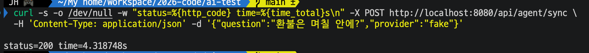

| 항목   | 기대값 (확인 전 예상) | 실제          |
| ------ | --------------------- | ------------- |
| status | 200                   | 200           |
| time   | 약 4~6초              | 4.318748초    |

기대 범위 안이다. 가짜 LLM 지연 5초(±20%, 즉 4~6초) 중 하한에 가깝다.

이 결과로 확인된 것: Spring 이 새 클래스와 함께 기동되고(컴파일 포함), Spring → FastAPI 호출과 200 전달이 동작한다. 응답 본문은 `-o /dev/null` 로 버려서 보지 않았다.

### 3-2. ② 동시 5건

**목적:** FastAPI 가 동시에 한 건씩만 처리하는지 본다.

**1차 실행**

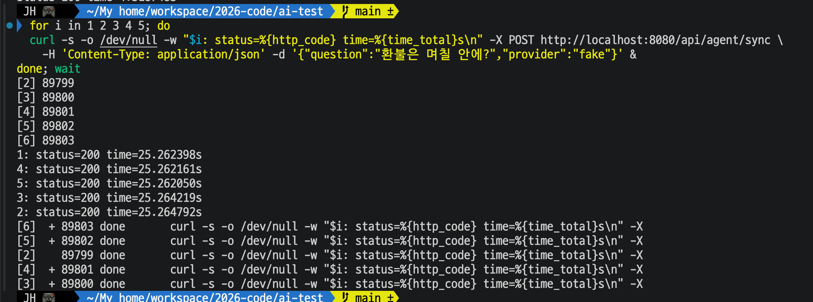

| 요청 | status | time (초) |
| ---- | ------ | --------- |
| 1    | 200    | 25.262398 |
| 2    | 200    | 25.264792 |
| 3    | 200    | 25.264219 |
| 4    | 200    | 25.262161 |
| 5    | 200    | 25.262050 |

| 항목   | 기대값 (확인 전 예상)                       | 실제                                              |
| ------ | ------------------------------------------- | ------------------------------------------------- |
| status | 모두 200                                    | 모두 200                                          |
| time   | 약 5, 10, 15, 20, 25초로 벌어진다           | **5건 모두 25.26초 (차이 0.003초 이내)**          |

예상과 다른 점: 5건이 모두 25초 지점에 한꺼번에 끝났다. 총 25초는 "한 건씩 5번 × 5초"와 맞아 처리 자체는 직렬로 보이지만, 먼저 끝난 요청의 응답도 마지막 처리가 끝날 때까지 나오지 않았다.

**2차 실행** (같은 명령, 10:25 경. Spring 로그의 `SyncAgentClient` 줄을 함께 확인)

| 요청      | status | curl time (초) | Spring 로그 `elapsedMs` (FastAPI 를 기다린 시간) |
| --------- | ------ | -------------- | ------------------------------------------------ |
| 1, 5      | 200    | 11.378         | 11359 (2건, 같은 시각 10:25:11.216)              |
| 2, 3, 4   | 200    | 25.919         | 25901 (3건, 같은 시각 10:25:25.759)              |

1차와 달리 두 묶음으로 나뉘어 나왔다. 처리한 총 시간은 약 25.9초(= 5건 × 약 5.2초)로 같다. 묶음 안에서는 응답이 같은 시각에 나왔고, 묶음 사이 간격은 약 14.5초(3건 × 약 4.8초)다.

**3차 실행: Spring 을 빼고 FastAPI 를 직접 호출** (`http://localhost:8000/api/v1/agent/run`, 본문 `{"query":"환불은 며칠 안에?","provider":"fake"}`)

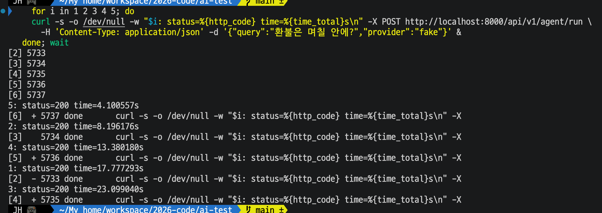

| 요청 | status | time (초) |
| ---- | ------ | --------- |
| 5    | 200    | 4.100557  |
| 2    | 200    | 8.196176  |
| 4    | 200    | 13.380180 |
| 1    | 200    | 17.777293 |
| 3    | 200    | 23.099040 |

응답이 약 4.1초, 8.2초, 13.4초, 17.8초, 23.1초에 **하나씩** 나왔다(건당 약 4.1~5.3초). 묶이지 않았다. 즉 FastAPI 를 직접 부르면 예상한 모양(순서대로 하나씩)이 나온다.

**참고: 환경변수를 빼고 워커를 다시 띄웠을 때 (결과로 쓰지 않음)**

Spring 경유 동시 5건이 모두 0.026초 만에 `500` 으로 끝났다. 8000번 워커를 다시 띄우면서 `FAKE_LLM_ENABLED=true` 를 빠뜨려 `provider: "fake"` 가 처리되지 않은 것으로 보인다(워커 터미널의 오류 메시지는 보지 못해 확인하지 못함). 가이드 4번에 워커를 한 번에 띄우는 명령을 넣은 계기다.

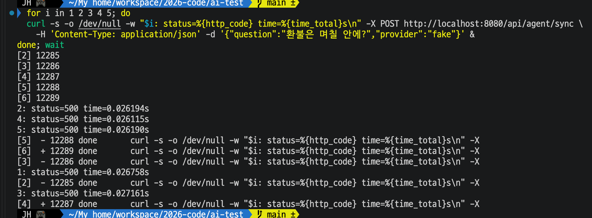

### 3-3. ③ 처리 중 `/health`

**목적:** 동기 요청이 처리되는 동안 같은 워커(8000)의 `/health` 가 응답하는지 본다.

동기 요청(① 의 curl)을 백그라운드로 보내고, 1초 뒤 `http://localhost:8000/health` 를 호출했다.

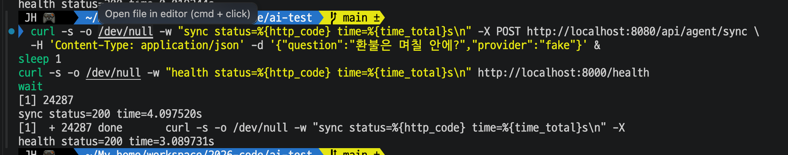

| 요청                      | status | time (초) |
| ------------------------- | ------ | --------- |
| sync (Spring 경유, 8080)  | 200    | 4.097520  |
| health (8000, 1초 뒤 호출) | 200    | 3.089731  |

| 항목        | 기대값 (확인 전 예상)                    | 실제                                                    |
| ----------- | ---------------------------------------- | ------------------------------------------------------- |
| health time | 처리가 끝날 때까지 기다렸다 답함, 수 초   | 3.09초 (1초 뒤 호출 + 3.09초 = 4.09초로 sync 와 같은 시각) |

예상대로다. `/health` 는 평소 0.02초 안에 응답하는데(처리 요청이 없을 때 0.019244초로 한 번 확인), 동기 요청이 처리 중일 때는 그 요청이 끝날 때까지 기다렸다가 응답했다.

참고: 처음에는 터미널 두 개에서 손으로 타이밍을 맞추다가 `/health` 가 0.019초로 나왔다. 요청이 이미 끝난 뒤에 호출한 것으로 보이며(확인하지는 못함) 결과로 쓰지 않고, 한 터미널에서 이어서 실행하는 위 방식으로 다시 했다.

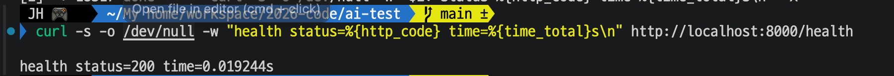

### 3-4. ④ k6 VU 20, 동기 (Spring 경유)

**목적:** 요청이 몰렸을 때 504 와 에러율이 나오는지 본다.

k6 요약(총 1분 15초). 요청 32건이 끝났고, 진행 중이던 반복 18건은 시험 종료로 중단됐다.

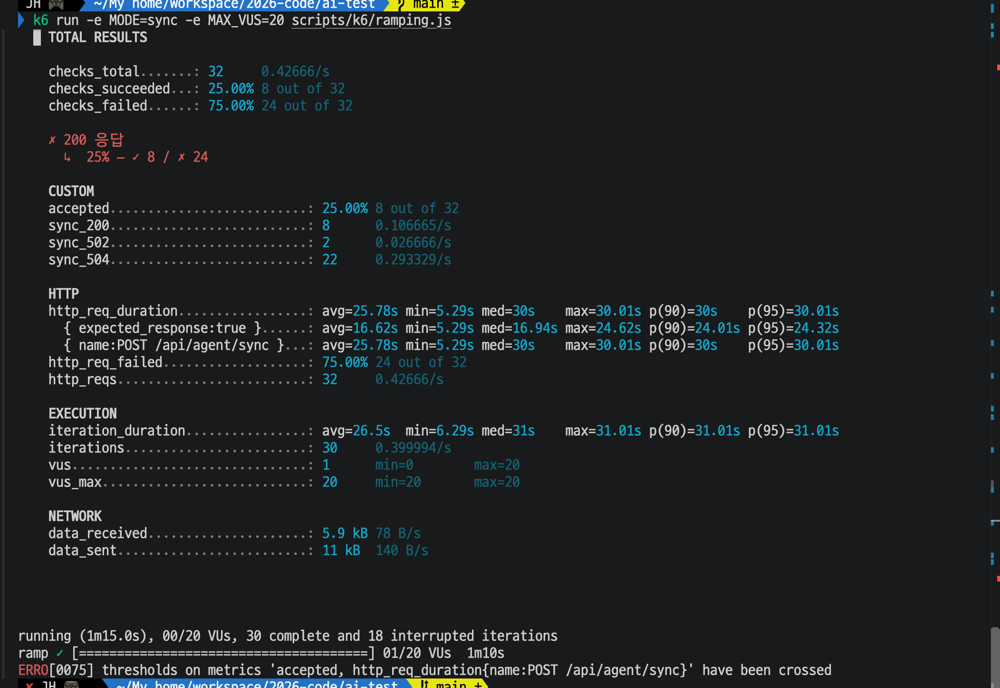

| 항목                                  | 기대값 (확인 전 예상)                  | 실제                                               |
| ------------------------------------- | -------------------------------------- | -------------------------------------------------- |
| `sync_200`                            | 십여 건                                | 8                                                  |
| `sync_504`                            | 다수                                   | 22                                                 |
| `sync_502`                            | 0                                      | **2**                                              |
| `sync_other_5xx`, `sync_other`        | 0                                      | 요약에 없음(0)                                     |
| `accepted` (200 비율)                 | 50% 미만                               | 25.00% (8 / 32)                                    |
| `http_req_failed`                     | 504 비율만큼 높음                      | 75.00% (24 / 32 = 504 22건 + 502 2건)              |
| `http_req_duration` (POST sync)       | p95 가 30초 부근                       | avg 25.78초, min 5.29초, med 30초, p(90) 30초, p(95) 30.01초, max 30.01초 |
| 임계값                                | 실패 표시                              | `accepted`, `http_req_duration{name:POST /api/agent/sync}` 둘 다 crossed |

성공한 200 만 보면(`expected_response:true`): avg 16.62초, min 5.29초, med 16.94초, p(90) 24.01초, p(95) 24.32초, max 24.62초.

그 밖의 값: `http_reqs` 32건(0.427/s), `iterations` 완료 30 + 중단 18, `iteration_duration` avg 26.5초(min 6.29초, med 31초, max 31.01초), `vus_max` 20, `data_received` 5.9 kB, `data_sent` 11 kB.

**502 가 2건 나왔다.** 기대는 0 이었다. 원인은 확인하지 못했다(502 는 `SyncAgentClient` 가 FastAPI 에 접속하지 못하거나 연결이 끊겼을 때 만든다). 같은 시각 Spring 로그의 `sync upstream` 경고 줄(`connect timeout` 또는 `failed … (예외 이름)`)을 보지 않았다.

### 3-5. ⑤ k6 VU 20, 동기 (FastAPI 직접)

**목적:** 같은 부하를 Spring 없이 보내 병목이 FastAPI 처리 방식에 있음을 확인한다. ④ 가 끝나고 약 12분 뒤에 실행했다.

k6 요약(총 1분 15초). 요청 16건이 끝났고, 진행 중이던 반복 18건은 시험 종료로 중단됐다.

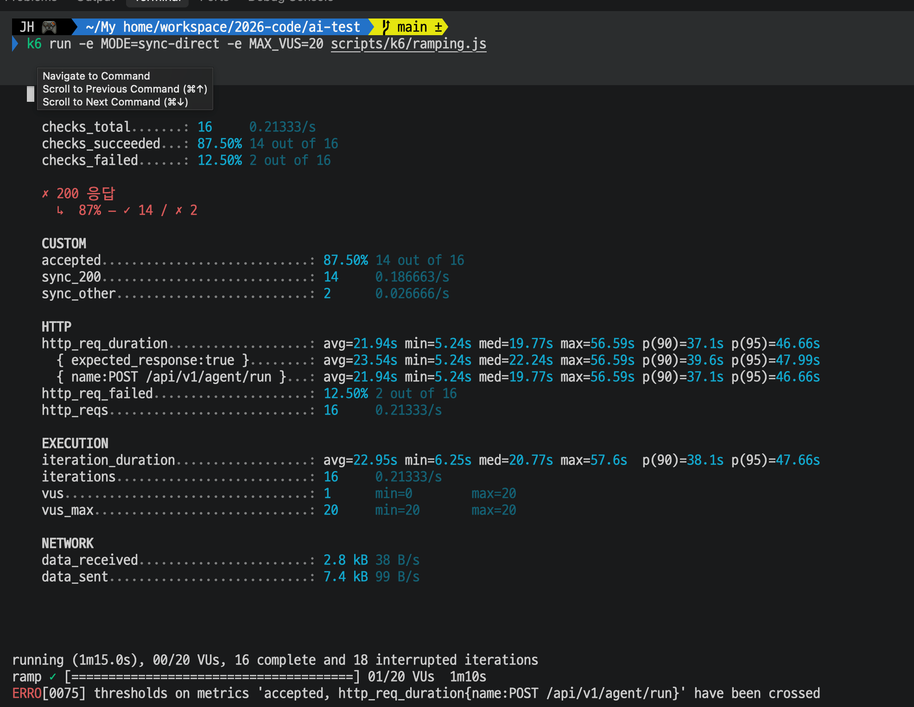

| 항목                              | 기대값 (확인 전 예상)                                  | 실제                                                |
| --------------------------------- | ------------------------------------------------------ | --------------------------------------------------- |
| `sync_504`                        | 0 (Spring 이 없으므로)                                 | 요약에 없음(0)                                      |
| `sync_200`                        | ④ 와 비슷                                              | 14 (④ 는 8)                                         |
| `sync_other`                      | k6 시간 초과(60초)로 일부                              | 2                                                   |
| `accepted` (200 비율)             | -                                                      | 87.50% (14 / 16)                                    |
| `http_req_failed`                 | -                                                      | 12.50% (2 / 16)                                     |
| `http_req_duration` (POST run)    | ④ 보다 오래 걸린다(줄을 선다)                          | avg 21.94초, min 5.24초, med 19.77초, p(90) 37.1초, p(95) 46.66초, max 56.59초 |
| 임계값                            | 실패 표시                                              | `accepted`, `http_req_duration{name:POST /api/v1/agent/run}` 둘 다 crossed |

성공한 200 만 보면(`expected_response:true`): avg 23.54초, min 5.24초, med 22.24초, p(90) 39.6초, p(95) 47.99초, max 56.59초.

그 밖의 값: `http_reqs` 16건(0.213/s), `iterations` 완료 16 + 중단 18, `iteration_duration` avg 22.95초(min 6.25초, med 20.77초, max 57.6초), `vus_max` 20, `data_received` 2.8 kB, `data_sent` 7.4 kB.

**`sync_other` 2건**: 기대한 "k6 시간 초과(60초)" 와 맞지 않는다. 가장 오래 걸린 요청이 56.59초(< 60초)이고, 전체 평균(21.94초)과 성공 건 평균(23.54초)으로 계산한 실패 2건의 평균은 약 10.7초다. 상태 코드가 200, 502, 504 가 아니고 500 이상도 아닌 응답(status 0 이거나 4xx)이라는 것까지만 알 수 있고, 원인은 확인하지 못했다. k6 의 경고 출력(WARN/ERRO 줄)을 보지 않았다.

### 3-6. ⑥ 시험 뒤 남은 처리

**목적:** 클라이언트가 포기한 요청을 서버가 계속 처리하는지 본다.

④ (k6 VU 20, 동기, Spring 경유)가 끝난 직후 `curl http://localhost:8000/health` 를 호출했다.

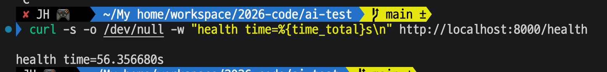

| 항목        | 기대값 (확인 전 예상)                                   | 실제                  |
| ----------- | ------------------------------------------------------- | --------------------- |
| health time | 수 초 이상(포기된 요청이 남아 있으면). 시간이 지나면 0.0x초로 복귀 | **56.356680초** (status 는 화면에서 보이지 않음) |

④ 직후라는 것은 사용자가 알려 준 것이다. k6 가 끝난 뒤 정확히 몇 초 만에 호출했는지와 `status` 값은 화면에서 확인하지 못했다.

### 3-7. ⑦ 실제 모델(Claude)로 재측정 (Day 34.2 ①)

**목적:** 가짜 모델(고정 5초)에서 나온 동기 구조의 504 장애가 실제 모델의 응답 시간에서도 나는지 본다. 4개 실험을 모은 문서는 [DAY34_2_RESULT.md](DAY34_2_RESULT.md), 이 실험과 짝인 비동기 쪽은 [DAY27_RESULT.md](DAY27_RESULT.md) 의 3-7.

**실행:** 프로젝트 루트에서 ④ 와 같은 부하 곡선(올리기 30초, 유지 30초, 내리기 10초, 요청 사이 1초 쉼)으로, 요청의 provider 만 `claude` 로 바꿨다. 워커 1대, Spring 경유, Spring timeout 30초. 한 번 측정했다(2026-10-19).

    k6 run -e MODE=sync -e PROVIDER=claude -e MAX_VUS=20 -e POLL_MAX_SEC=60 scripts/k6/ramping.js

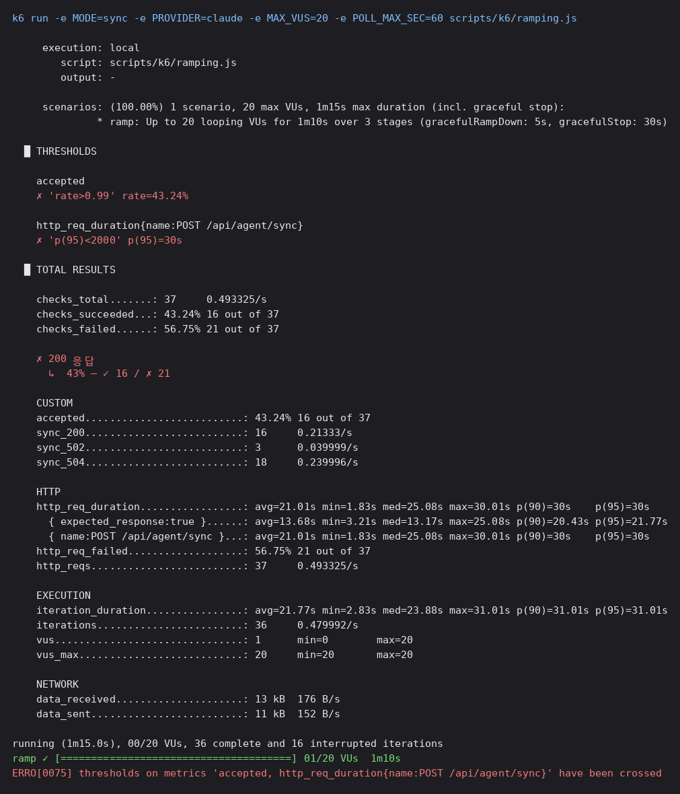

| 항목                                      | 가짜 모델 (④)                          | 실제 모델 (Claude)                                         |
| ----------------------------------------- | -------------------------------------- | ---------------------------------------------------------- |
| `http_reqs`                               | 32                                     | 37                                                         |
| 200 (`sync_200`)                          | 8건 (25%)                              | **16건 (43.24%)**                                          |
| 504 (`sync_504`)                          | 22건                                   | 18건                                                       |
| 502 (`sync_502`)                          | 2건                                    | 3건                                                        |
| `http_req_failed`                         | 75.00% (24 / 32)                       | 56.75% (21 / 37)                                           |
| `http_req_duration` 전체                  | med, p(90), p(95) 30초, max 30.01초    | avg 21.01초, min 1.83초, med 25.08초, p(90), p(95) 30초, max 30.01초 |
| 성공 건만 (`expected_response:true`)      | min 5.29초, avg 16.62초, max 24.62초   | min 3.21초, avg 13.68초, med 13.17초, p(90) 20.43초, p(95) 21.77초, max 25.08초 |
| `iteration_duration`                      | avg 26.5초, min 6.29초, med 31초, max 31.01초 | avg 21.77초, min 2.83초, med 23.88초, max 31.01초          |
| 반복 (완료 / 중단)                        | 30 / 18                                | 36 / 16                                                    |
| 임계값 (`accepted` > 0.99, 접수 p(95) < 2초) | 둘 다 넘김(✗)                       | 둘 다 넘김(✗)                                              |

**같은 점**
- 504 가 나고 전체 `http_req_duration` 의 p(90), p(95) 가 Spring 제한(30초)에 붙었다. 성공 건의 최대도 약 25초로 가짜 때(24.62초)와 거의 같다. 기다리는 요청이 쌓일수록 대기 시간이 건당 처리 시간의 배수로 늘다가 30초를 넘으면 504 가 된다는 설명이 실제 모델에서도 맞았다.
- 에러율이 50% 를 넘는다(56.75%). VU 20 만으로 동기 구조의 장애가 실제 모델에서도 재현됐다.

**다른 점**
- 200 비율이 25% 에서 43.24% 로 올랐다. 성공 건의 최소 시간이 5.29초에서 3.21초로 줄어, 이 측정에서 Claude 의 건당 처리 시간은 가짜 모델의 5초보다 짧은 쪽으로 보인다. 건당 시간을 직접 잰 값은 아니다.
- 전체 최소 응답 시간 1.83초는 성공 건의 최소(3.21초)보다 빠르다. 실패는 502 와 504 뿐이고 504 는 약 30초에서 끊기므로, 1.83초에 끝난 요청은 502 였다는 뜻이다.
- 502, 504 는 Claude 쪽에서 난 것으로 확인했다(Gemini 임베딩 쪽이 아님).

**확인하지 않은 것**
- 가짜 모델 쪽은 한 번 측정했고 이쪽도 한 번 측정했다. 같은 조건으로 반복하지 않았다.
- 504 로 끝난 요청을 FastAPI 가 계속 처리했는지, 시험 직후 `/health` 가 얼마나 막혔는지는 재지 않았다.

## 4. 해석

① 한 건은 가짜 LLM 지연(약 5초)만큼 걸려 정상 응답한다. ③ 에서 처리 중인 동안 `/health` 도 응답이 막히는 것을 확인했다(3.09초). 동기 `/run` 하나가 그 워커의 모든 요청을 멈춘다.

② 의 두 번 모두 동시 5건의 총 소요가 약 25초(= 5건 × 약 5초)였으므로, FastAPI 가 동시에 한 건씩만 처리한다는 예상은 맞다. 다만 응답은 5, 10, 15초에 하나씩 나오지 않고, 1차는 25초에 5건이, 2차는 11초에 2건과 26초에 3건이 묶여서 나왔다. 클라이언트 입장에서는 처리량이 같아도 같은 묶음의 요청이 묶음의 마지막 요청이 끝날 때까지 기다린다. 이 때문에 동시 요청이 많으면 Spring 의 30초 기준(`timeout-ms`)을 넘기는 요청이 한꺼번에 나올 수 있다(④ 에서 확인).

Spring 로그의 `elapsedMs` 도 같은 두 묶음(11359 두 건, 25901 세 건)으로 찍혔다. 즉 Spring 이 응답을 모았다가 내보낸 것이 아니라 **FastAPI 가 이미 묶음으로 응답한 것**이다. 이것은 확인된 사실이다.

묶음은 **Spring 경유일 때만** 생겼다. 3차(FastAPI 직접)에서는 하나씩 나왔고, 1~2차(Spring 경유)에서는 묶여 나왔다. 따라서 FastAPI 의 `async def` + 막히는 함수 구조 자체가 원인은 아니다. 샌드박스에서도 최소 FastAPI 앱(`time.sleep(1)`, uvicorn 0.53)에 curl 계열, 헤더와 본문을 나눠 보내는 raw 소켓, JDK `HttpClient`(HTTP/1.1)로 동시 5건을 보냈을 때 모두 1, 2, 3, 4, 5초에 하나씩 나왔다. 처음의 "같은 이벤트 루프 턴에서 묶인다"는 추정도 이 결과로 틀린 것이 됐다.

묶음의 위치는 두 가지 중 하나다(미확인). ① Spring → FastAPI 로 요청이 나가는 방식 때문에 FastAPI 가 묶음으로 응답한다. ② FastAPI 는 하나씩 응답하지만 Spring 의 `SyncAgentClient`(JDK `HttpClient`)가 받는 쪽에서 묶는다. Spring 로그의 `elapsedMs` 는 ② 와 ① 모두와 맞는다. 가르려면 FastAPI 의 접근 로그(응답이 나가는 시각)를 시간 표시와 함께 보면 된다.

**4차 실행: Spring 경유 + 진단 로그** (FastAPI 는 시각을 붙여 접근 로그를 봄)

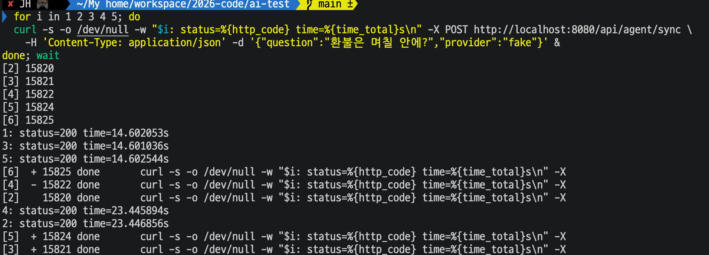

FastAPI(8000) 접근 로그의 시각은 시작(10:44:43.3) 기준 5.5, 10.2, 14.6, 18.7, 23.4초에 요청이 하나씩 `200 OK` 로 끝났다(Spring 경유 동시 5건). 같은 실행에서 curl 은 1~3번째를 14.60초에, 4~5번째를 23.45초에 받았다.

그다음 Spring 의 `SyncAgentClient` 에 임시 진단 로그(응답 헤더 도착 시각)를 넣고 다시 보냈더니, 5건의 `headers arrived` 가 모두 `elapsedMs=25458` 로 같은 1ms 안(10:49:00.593~594)에 찍혔다. 스레드는 `HttpClient-1-Worker-0, 1, 2, 4, 6` 로 서로 달랐고, `send()` 는 그 15ms 뒤(25474~25475ms)에 돌아왔다. 이 실행의 FastAPI 접근 로그는 보지 않았다.

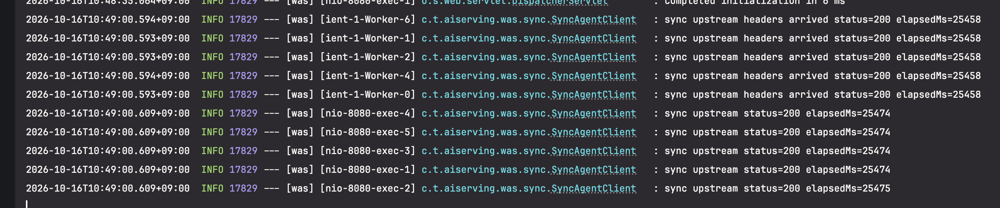

확인된 것: FastAPI 는 응답을 하나씩 내보냈고, 묶음은 JDK `HttpClient` 가 응답 헤더를 받는 시점에 이미 생겨 있다(`send()` 반환이나 Tomcat 단계가 아님). 이유는 모른다.

원인 추적은 여기서 멈췄다. 이 실험의 목적(동기 구조에서 504 와 에러율 재현)에는 쓰지 않는 현상이고, 처리량과 504 발생 여부도 바뀌지 않는다고 판단했다. 임시 진단 로그(`headers arrived`)와 진단 파일은 지웠다.

④ 에서 VU 20 만으로 동기 구조의 장애가 재현됐다. 70초 동안 요청 32건 중 200 은 8건(25%)뿐이고 22건은 504, 2건은 502 로, 에러율이 75% 였다. 504 는 `timeout-ms`(30초)에서 끊기므로 `http_req_duration` 의 med, p(90), p(95) 가 모두 30초에 붙었고(최대 30.01초), 성공한 요청도 최소 5.29초에서 최대 24.62초로 오래 걸렸다(평균 16.62초). 기다리는 요청이 쌓일수록 대기 시간이 한 건 처리 시간(약 5초)의 배수로 늘어나다가 30초를 넘으면 504 가 된다.

200 이 8건뿐인 점은 예상(십여 건)보다 적다. 아래는 추정이고 확인하지 않았다: 504 로 끝난 요청도 FastAPI 는 연결이 끊긴 뒤에 계속 처리하므로(⑥ 에서 확인 예정), 처리 시간 중 일부가 이미 포기된 요청에 쓰여 성공 건수가 줄었을 수 있다.

숫자 해석 시 주의: `http_reqs` 32건에는 시험 종료 때 중단된 반복 18건의 요청이 들어 있지 않다(응답을 못 받음). 그 요청들은 504 나 200 으로 세어지지 않았으므로, 위의 에러율 75% 는 실제 실패를 낮게 잡은 값일 수 있다.

⑤ 에서 Spring 을 빼면 504 가 없어지고(30초 제한이 없으므로) 응답이 더 오래 기다린 뒤 나온다(max 56.59초, p(95) 46.66초). 병목은 Spring 이 아니라 FastAPI 가 한 번에 한 건씩만 처리하는 방식이다. 200 건수는 ⑤ 14건, ④ 8건이다. ⑤ 의 14건은 75초 동안 5초짜리 요청을 한 건씩 처리했을 때의 최대치(약 14~15건)에 가깝다. ④ 가 8건이었던 것은 앞서 세운 추정(504 로 포기된 요청도 FastAPI 가 계속 처리해 처리 시간을 쓴다)과 방향이 맞고, ⑥ 에서 ④ 직후 `/health` 가 56.36초 막힌 것이 그 간접 증거다. 다만 ④ 와 ⑤ 를 같은 조건으로 번갈아 반복한 것은 아니다(각 한 번).

⑤ 의 에러율 12.5% 도 시험 종료 때 중단된 반복 18건의 요청이 포함되지 않은 값이다.

⑥ 에서 ④ 직후 `/health` 가 56.36초 만에 응답했다. 평소 0.02초인 요청이 이만큼 걸렸다는 것은 k6 가 끝난 뒤에도 FastAPI 가 이미 받아 둔 요청들을 계속 처리하고 있었다는 뜻이다. 클라이언트(k6, Spring)가 포기하거나 끝난 요청도 서버는 멈추지 않는다.

아래는 계산이고 측정한 값이 아니다. 한 건에 약 5.2초(⑤ 의 14건 / 75초 기준)로 보면, ④ 의 75초와 이후 56초를 합친 약 131초 동안 FastAPI 는 약 25건을 처리한 셈이다. 그런데 ④ 에서 제때(30초 안에) 응답받은 요청은 8건이다. 나머지 약 17건은 Spring 이 이미 504 로 포기했거나 k6 가 종료로 끊은 요청이라는 계산이 되어, ④ 에서 200 이 8건에 그친 이유("포기된 요청이 처리 시간을 쓴다")와 맞는다. 처리한 건수 자체는 FastAPI 쪽에서 세어 보지 않았다.

## 5. 확인하지 않은 것

| 항목                                   | 내용                                                         |
| -------------------------------------- | ------------------------------------------------------------ |
| ④ 에서 FastAPI 가 실제로 처리한 요청 수 | 세지 않았다 (위 약 25건은 처리 시간으로 계산한 값). 요청 수는 FastAPI 의 `[timing]` 로그 줄 수로 셀 수 있다 |
| ⑤ 의 `sync_other` 2건 원인              | 확인하지 않음 (k6 경고 줄을 보지 않음. 시간 초과(60초)는 아님) |
| ④ 의 502 2건 원인                       | 확인하지 않음 (Spring 로그의 `sync upstream` 경고 줄을 보지 않음) |
| ④ 에서 포기된 요청을 FastAPI 가 계속 처리했는지 | ⑥ 으로 간접 확인(④ 직후 56.36초 동안 처리 중). 건수는 세지 않음 |
| ② 에서 응답이 묶음으로 나온 원인 (조사 중단) | Spring 경유일 때만 묶이고, FastAPI 는 하나씩 응답하며, 묶음은 JDK `HttpClient` 가 헤더를 받는 시점에 이미 생겨 있음까지 확인했다. 그 이유는 모른다 |
| ② 1차 실행의 Spring 로그               | 보지 않았다 (2차에서만 확인)                                   |
| 워커 설정이 가이드 4번과 같은지         | 확인하지 않음                                                  |
| 응답 본문(`answer`, `provider`)         | 보지 않음                                                      |

## 6. 한계

| 항목             | 내용                                                           |
| ---------------- | -------------------------------------------------------------- |
| 한 번만 측정     | 4.32초는 한 번의 값이다. 지연이 ±20% 흔들리므로 평균이 아니다   |
