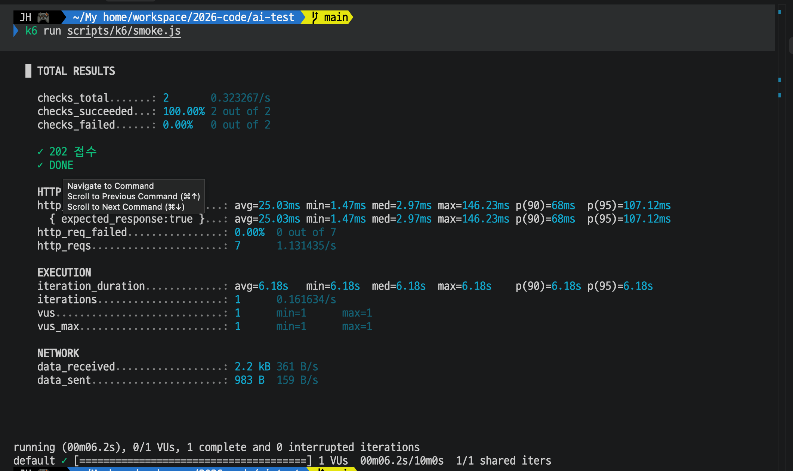
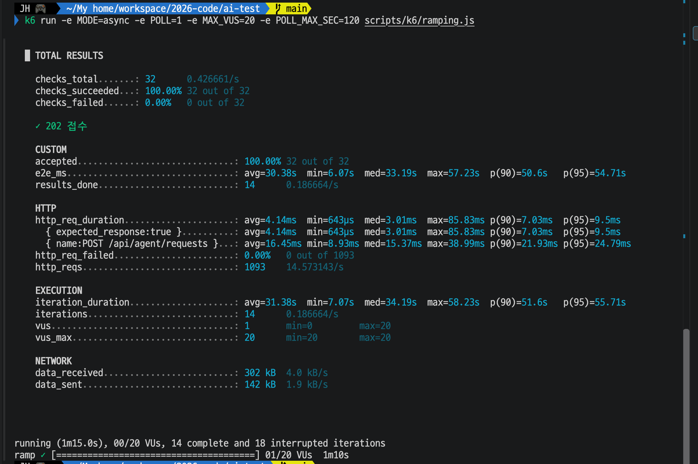
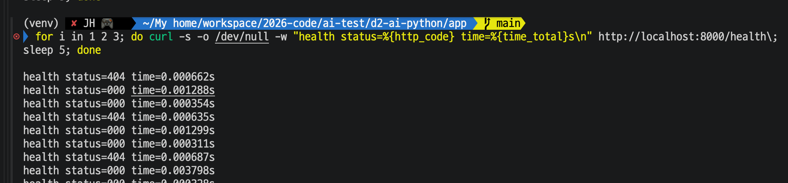
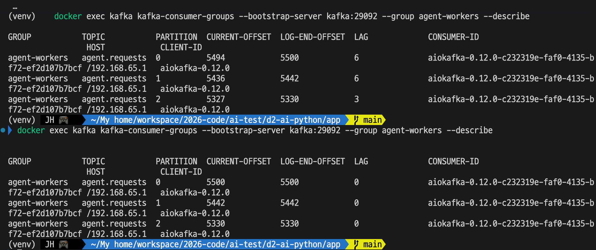
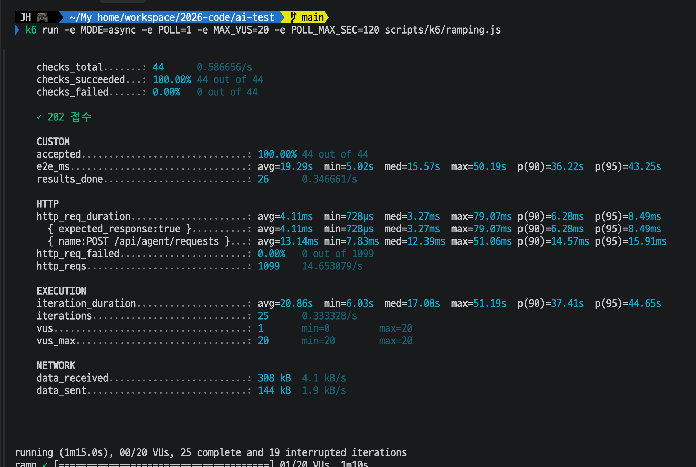
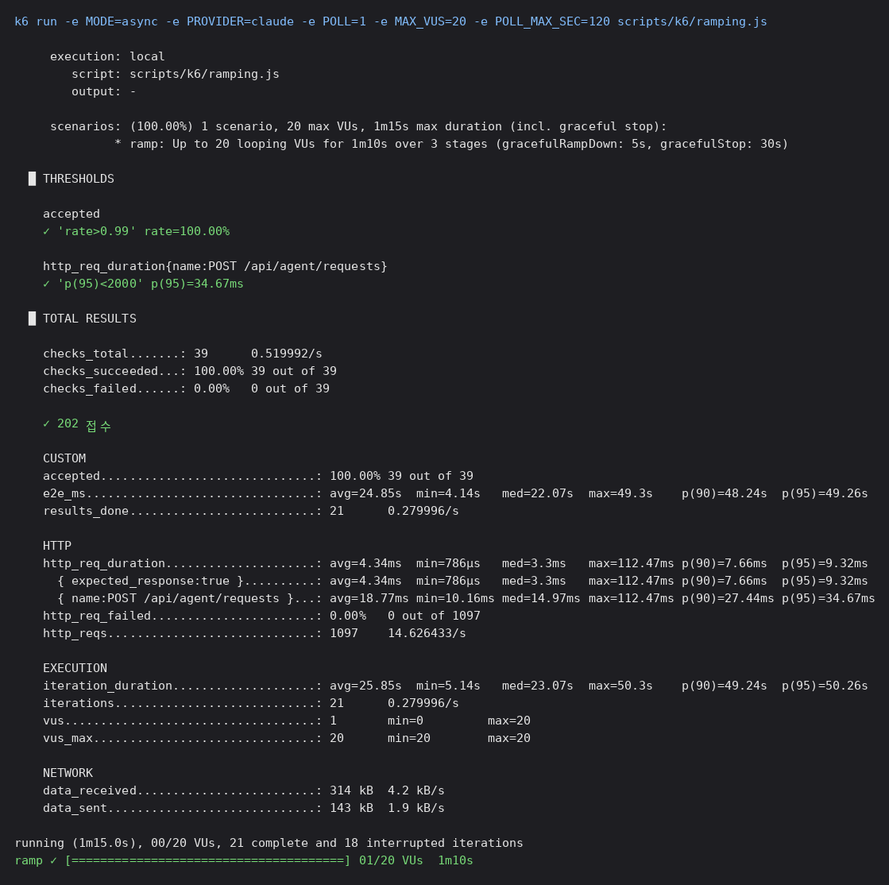

# Day 27 결과 — 비동기(Kafka) 구조로 같은 부하를 다시 재기

> 상태: 가이드 ① (스모크), ② (비동기 VU 20, 결과 조회까지, 3번 실행), ②-2 (처리 중 `/health`), ③ (남은 요청 LAG), ④ (워커 2대)와 1차 비교표(3-6)를 기록했다(2026-10-16).
> 가이드는 [DAY27_GUIDE.md](DAY27_GUIDE.md). 비교 대상은 [DAY26_RESULT.md](DAY26_RESULT.md)(동기).

**전체 목적:** Day 26 의 동기 구조(VU 20 에서 에러율 75%)와 같은 조건(VU 20, 가짜 LLM 5초, 워커 1대, 70초)에서 비동기 구조의 에러율, 접수 시간, 완료 시간, 완료 건수를 재서 1차 비교 데이터로 삼는다.

## 1. 환경

| 항목         | 값                                                                                                                                      |
| ------------ | --------------------------------------------------------------------------------------------------------------------------------------- |
| 실행 날짜    | 2026-10-16                                                                                                                              |
| Spring WAS   | 8080 (Day 26 과 같은 것)                                                                                                                |
| FastAPI 워커 | 8000 하나, Kafka 를 읽게 켬, 가짜 LLM 5초. 가이드 4번 준비(워커 끄기 → 비우기 → 워커 켜기)대로 했는지는 화면에서 확인하지 못함 (미확인) |
| k6           | v1.4.2 (darwin/arm64)                                                                                                                   |

## 2. 실행한 것

| 번호 | 명령                                                                                                                                            | 확인한 것                                                |
| ---- | ----------------------------------------------------------------------------------------------------------------------------------------------- | -------------------------------------------------------- |
| ①    | `k6 run scripts/k6/smoke.js`                                                                                                                    | 비동기 경로 한 건 끝까지 (3-1)                           |
| ②    | `k6 run -e MODE=async -e POLL=1 -e MAX_VUS=20 -e POLL_MAX_SEC=120 scripts/k6/ramping.js`. 올리기 30초, 유지 30초, 내리기 10초, 요청 사이 1초 쉼 | 비동기 VU 20, 결과 조회까지 (3-2)                        |
| ②    | (2차) ② 를 한 번 더 (`/health` 호출을 같은 줄에 붙였으나 명령이 잘못돼 무효)                                                                    | 비동기 VU 20 두 번째 측정 (3-2)                          |
| ②    | (3차) 비우기 후 ② 를 다시, `bash scripts/k6/health-probe.sh & k6 run … ; wait` 한 줄로 `/health` 호출을 곁들임                                  | 비동기 VU 20 세 번째 측정과 처리 중 `/health` (3-2, 3-3) |
| ②-2  | `/health` 를 20초 뒤부터 5초 간격 3번 호출. 앞의 두 번(1차, 2차)은 명령이 잘못 입력돼 무효                                                      | 처리 중 `/health` (3-3)                                  |
| ③    | 워커 끄기 → offset 비우기 → 워커 켜기 → ② 실행 → 끝난 직후와 약 2분 뒤에 `kafka-consumer-groups --describe`                                     | 부하 후 남은 요청(LAG) (3-4)                             |
| ④    | 워커 8001 을 추가로 띄운 뒤 ② 를 같은 명령으로 실행                                                                                             | 워커 2대의 완료 건수 (3-5)                               |

## 3. 결과

### 3-1. ① 스모크

**목적:** 비동기 경로가 한 건 끝까지 통과하는지 본다.

| 항목      | 기대값 (확인 전 예상) | 실제                                          |
| --------- | --------------------- | --------------------------------------------- |
| checks    | 2/2 통과              | 2/2 통과 (`202 접수`, `DONE`)                 |
| 완료 시간 | 약 4~6초              | 반복 1건이 6.18초 (접수 + 조회 + `DONE` 까지) |

`http_reqs` 는 7건(접수 1건 + 1초 간격 조회 6건), `http_req_failed` 0%. 반복 시간 6.18초는 예상 범위 상단이다. 조회가 1초 간격이라 완료를 최대 약 1초 늦게 알아챌 수 있고, 가짜 LLM 지연도 ±20% 흔들린다. 완료 시간(`worker`, `partition`, `answer` 출력)은 이 화면에 나오지 않았다.

### 3-2. ② 비동기 VU 20 (결과 조회까지)

**목적:** Day 26 의 동기와 같은 부하에서 비동기의 에러율, 접수 시간, 완료 시간, 완료 건수를 잰다.

k6 요약(총 1분 15초). 반복 14건이 끝났고, 진행 중이던 반복 18건은 시험 종료로 중단됐다.

| 항목                                     | 기대값 (확인 전 예상) | 실제                                                                            |
| ---------------------------------------- | --------------------- | ------------------------------------------------------------------------------- |
| `accepted` (202 비율)                    | 100%                  | 100.00% (32 / 32)                                                               |
| POST 접수 `http_req_duration`            | p(95) 수십 ms 이하    | avg 16.45ms, min 8.93ms, med 15.37ms, p(90) 21.93ms, p(95) 24.79ms, max 38.99ms |
| `http_req_failed`                        | 0%                    | 0.00% (0 / 1093)                                                                |
| 5xx 에러                                 | 0                     | 0                                                                               |
| `results_done`                           | 약 14건               | 14 (0.187/s)                                                                    |
| `e2e_ms` (완료까지)                      | 약 5초에서 70초 사이  | avg 30.38초, min 6.07초, med 33.19초, p(90) 50.6초, p(95) 54.71초, max 57.23초  |
| `results_failed`, `results_poll_timeout` | 0                     | 요약에 없음(0)                                                                  |
| 중단된 반복                              | 약 18건               | 18                                                                              |

그 밖의 값: `checks` 32/32(100%), `http_reqs` 1093건(14.57/s, 접수 32건 + 결과 조회 1061건), 전체 `http_req_duration` avg 4.14ms(조회 요청이 섞인 값), `iteration_duration` avg 31.38초(min 7.07초, med 34.19초, p(95) 55.71초, max 58.23초), `vus_max` 20, `data_received` 302 kB, `data_sent` 142 kB.

모든 기대값이 맞았다.

**2차 실행** (같은 명령으로 한 번 더, `/health` 호출을 곁들임. 이 화면은 텍스트로 받았다)

| 항목                     | 1차                    | 2차                                                                        |
| ------------------------ | ---------------------- | -------------------------------------------------------------------------- |
| `accepted`               | 100% (32 / 32)         | 100% (31 / 31)                                                             |
| POST 접수 p(95)          | 24.79ms                | 26.43ms (avg 15.26ms, min 10.29ms, med 13.6ms, p(90) 21.92ms, max 29.88ms) |
| `http_req_failed`        | 0 / 1093               | 0 / 1096                                                                   |
| `results_done`           | 14                     | **12** (0.160/s)                                                           |
| `e2e_ms` avg             | 30.38초                | 30.49초                                                                    |
| `e2e_ms` min / med / max | 6.07 / 33.19 / 57.23초 | **14.09** / 32.12 / 55.4초                                                 |
| `e2e_ms` p(90) / p(95)   | 50.6 / 54.71초         | 40.87 / 47.63초                                                            |
| 반복 (완료 / 중단)       | 14 / 18                | 12 / 19                                                                    |

2차의 임계값 두 개(`accepted` rate>0.99, 접수 `p(95)<2000`)는 통과(✓)했다. `checks` 31/31, `http_reqs` 1096건(14.61/s), `iteration_duration` avg 31.49초(min 15.09초, med 33.12초, p(95) 48.64초, max 56.4초).

2차는 `results_done` 이 12건으로 1차(14건)보다 적고, 가장 빠른 완료도 14.09초로 1차(6.07초)보다 늦다. 가장 빠른 완료가 14초라는 것은 시작 시점에 이미 대기열에 앞선 요청이 있었다는 뜻일 수 있다(한 건에 약 5초이므로 약 2건 앞서 있던 셈). 1차의 중단된 반복 18건이 비워지지 않았을 가능성이 있다. 확인한 것이 아니라 추정이다.

**3차 실행** (Kafka 를 비운 뒤 ② 를 다시, `/health` 호출을 곁들임. 이 화면은 텍스트로 받았다)

| 항목               | 3차                                                                             |
| ------------------ | ------------------------------------------------------------------------------- |
| `accepted`         | 100% (32 / 32)                                                                  |
| POST 접수          | p(95) 21.63ms (avg 13.95ms, min 9.4ms, med 12.05ms, p(90) 17.33ms, max 44.78ms) |
| `http_req_failed`  | 0 / 1097                                                                        |
| `results_done`     | 13 (0.173/s)                                                                    |
| `e2e_ms`           | avg 28.62초, min 6.08초, med 26.1초, p(90) 48.19초, p(95) 50.46초, max 52.41초  |
| 반복 (완료 / 중단) | 13 / 19                                                                         |
| 임계값             | `accepted`, 접수 `p(95)<2000` 둘 다 통과(✓)                                     |

그 밖의 값: `checks` 32/32, `http_reqs` 1097건(14.63/s), `iteration_duration` avg 29.62초(min 7.08초, med 27.1초, p(95) 51.46초, max 53.41초), `data_received` 303 kB, `data_sent` 142 kB.

3차는 가장 빠른 완료가 6.08초로 1차(6.07초)와 같아 대기열이 비워진 상태에서 시작한 것으로 보인다. 그렇다면 2차의 14.09초는 앞선 요청이 남아 있었다는 추정과 맞는다(여전히 직접 확인한 것은 아니다).

세 번 잰 완료 건수는 14, 12, 13건이다.

### 3-3. ②-2 처리 중 `/health`

**목적:** 비동기 워커는 처리 중에도 `/health` 가 막히지 않는지 본다.

**3차 시도(유효)**: `scripts/k6/health-probe.sh` 로 ② 의 3차 실행 20초 뒤부터 5초 간격 3번 호출했다.

| 호출 | status | time (초) |
| ---- | ------ | --------- |
| 1    | 200    | 0.003388  |
| 2    | 200    | 0.002355  |
| 3    | 200    | 0.002055  |

| 항목        | 기대값 (확인 전 예상)       | 실제                        |
| ----------- | --------------------------- | --------------------------- |
| health time | 3번 모두 0.0x초, status 200 | 3번 모두 0.002~0.003초, 200 |

예상대로다. 호출 시점(② 시작 20초, 25초, 30초 뒤)은 VU 가 13~20명까지 늘어 워커가 요청을 처리 중이던 때이고, Day 26 ③ 에서 동기는 이때 `/health` 가 3.09초 막혔다. 비동기 워커는 에이전트를 스레드에서 실행하므로 `/health` 가 막히지 않는다.

**아래는 앞의 두 번 시도(무효)이다.**

**1차 시도.** 화면의 명령은 `http://localhost:8000/health\;` 뒤에 줄이 바뀌어 `sleep 5; done` 이 이어진 모양이다. `curl` 이 주소를 `health\;`(404), `sleep`, `5`(연결 실패, status `000`) 세 개로 받아서 `404` 와 `000` 이 번갈아 찍혔고, 모두 0.0007초 이하였다. 실제 `/health` 호출이 아니므로 결과로 쓰지 않는다.

**2차 시도.** ② 와 한 줄로 이어 실행했는데 입력된 명령에 `http://localhost:8000/health\;` 가 또 들어 있었다(주소 뒤에 `\;`). 출력은 `404`(주소가 `health;` 가 됨), `000`, `000` 이 세 번 반복됐고 시간은 모두 0.004초 이하였다. 마지막에 `exit 7`(연결 실패) 이 찍혔다. 이것도 실제 `/health` 호출이 아니므로 결과로 쓰지 않는다.

두 번 모두 주소 뒤에 `\;` 가 붙은 것은 확인했지만, 그것이 터미널 붙여넣기에서 생기는지 입력 중 생기는지는 모른다. 그래서 명령 대신 파일 `scripts/k6/health-probe.sh` 로 호출하도록 바꿨고, 3차 시도에서 정상 호출이 됐다.

### 3-4. ③ 남은 요청(LAG)

**목적:** 부하 후에 Kafka 에 요청이 얼마나 쌓였는지, 시간이 지나면 줄어드는지 본다.

| 파티션 | 직후 CURRENT-OFFSET | 직후 LOG-END-OFFSET | 직후 LAG | 약 2분 뒤 CURRENT-OFFSET | 약 2분 뒤 LAG |
| ------ | ------------------- | ------------------- | -------- | ------------------------ | ------------- |
| 0      | 5494                | 5500                | 6        | 5500                     | 0             |
| 1      | 5436                | 5442                | 6        | 5442                     | 0             |
| 2      | 5327                | 5330                | 3        | 5330                     | 0             |
| 합계   |                     |                     | **15**   |                          | **0**         |

| 항목          | 기대값 (확인 전 예상)                    | 실제                 |
| ------------- | ---------------------------------------- | -------------------- |
| 직후 LAG 합계 | 10 이상                                  | 15                   |
| 약 2분 뒤 LAG | 1번보다 줄어 있다 (약 20~24건 감소 계산) | 0 (15건 모두 처리됨) |

LOG-END-OFFSET 은 두 번 사이에 변하지 않았다(5500, 5442, 5330). 새 요청이 들어오지 않았고 워커가 남은 15건을 처리한 것이다. 이 화면에서는 두 번 사이의 정확한 경과 시간을 알 수 없다(사용자가 "약 2분"으로 실행).

### 3-5. ④ 워커 2대

**목적:** 워커를 한 대 더 붙이면 같은 부하(VU 20)에서 완료 건수가 얼마나 늘어나는지 본다.

| 항목                 | 워커 2대 (④)                                                                    |
| -------------------- | ------------------------------------------------------------------------------- |
| `accepted`           | 100% (44 / 44)                                                                  |
| POST 접수            | p(95) 15.91ms (avg 13.14ms, med 12.39ms, p(90) 14.57ms, max 51.06ms)            |
| `http_req_failed`    | 0 / 1099                                                                        |
| `results_done`       | 26 (0.347/s)                                                                    |
| `e2e_ms`             | avg 19.29초, min 5.02초, med 15.57초, p(90) 36.22초, p(95) 43.25초, max 50.19초 |
| 반복 (완료 / 중단)   | 25 / 19                                                                         |
| `iteration_duration` | avg 20.86초, min 6.03초, med 17.08초, p(95) 44.65초, max 51.19초                |

그 밖의 값: `checks` 44/44, `http_reqs` 1099건(14.65/s), `data_received` 308 kB, `data_sent` 144 kB.

아래는 이때 두 워커 터미널(왼쪽 8000 = `worker=w1`, 오른쪽 8001 = `worker=w2`)이다. 두 워커가 동시에 요청을 받아 처리하고 있다.

| 항목           | 기대값 (확인 전 예상)         | 실제                        |
| -------------- | ----------------------------- | --------------------------- |
| `results_done` | 약 21건 (1대의 약 14건 x 1.5) | 26건 (1대 12~14건의 약 2배) |
| 5xx 에러       | 0                             | 0                           |

예상(약 1.5배)보다 많이 늘었다. 계산상 처리 한도는 워커당 5초에 1건이라 2대면 70초 중 최대 약 26~28건이고, 26건은 그 한도에 가깝다.

**판단:** 예상과 달랐지만 이상 징후는 없다. 에러 0, 접수율 100%이고, 26건은 계산상 한도(약 26~28건)를 넘지 않으며, 터미널에도 두 워커(w1, w2)가 모두 처리한 로그가 보인다. 예상이 빗나간 것은 결과가 이상해서가 아니라 "파티션 2:1 이라 약 1.5배"라는 계산이 이 부하에 맞지 않았기 때문일 가능성이 크다(이유는 미확인). 1회 측정이라 반복하면 24~28건 정도로 흔들릴 수 있다(추정).

### 3-6. 1차 비교표 (Day 26 동기 vs Day 27 비동기)

**목적:** 같은 부하(VU 20, 가짜 LLM 5초, 워커 1대, 70초)에서 요청이 지나가는 길만 다른 두 구조를 나란히 놓는다. 값은 이 문서와 [DAY26_RESULT.md](DAY26_RESULT.md)의 측정값이다. 동기는 Spring 경유(④, Day 26 3-4), 비동기는 ② (3-2)의 세 번 측정이다.

| 항목                                   | 동기 (Spring 이 FastAPI 답을 기다림)                                 | 비동기 (Kafka, 워커 1대)                       |
| -------------------------------------- | -------------------------------------------------------------------- | ---------------------------------------------- |
| 응답 성공 비율                         | 25% (200 8건 / 32건)                                                 | 100% (접수 202 가 32건 모두)                   |
| 에러 (`http_req_failed`)               | 75% (504 22건, 502 2건)                                              | 0%                                             |
| 요청 보낸 뒤 첫 응답까지 p(95)         | 30.01초 (Spring 의 30초 제한에서 끊김)                               | 21.63~26.43ms                                  |
| 완료 건수 (70초)                       | 클라이언트가 받은 성공 8건 (직접 호출은 14건)                        | 12~14건 (`results_done`)                       |
| 완료까지 시간                          | 성공 건 avg 16.62초 (Spring 경유), 직접 호출 성공 건 avg 23.54초     | `e2e_ms` avg 28.6~30.5초 (접수부터 DONE 까지)   |
| 처리 중 워커 `/health`                 | 3.09초 막힘                                                          | 0.002~0.003초 (200)                            |
| 시험 직후 남은 일                      | FastAPI 가 포기된 요청을 계속 처리 (④ 직후 `/health` 56.36초)         | LAG 15건이 약 2분 뒤 0, 요청은 유실되지 않음   |
| 중단된 반복 (시험 종료 시 처리 중)     | 18건                                                                 | 18~19건                                        |
| 워커 2대로 늘릴 때                     | 측정하지 않음                                                        | 완료 26건 (1대의 약 2배), 에러 0               |

읽는 법

- 워커가 처리하는 속도는 두 구조에서 같다(건당 약 5초). 직접 호출(Day 26 ⑤)의 14건과 비동기의 12~14건이 이를 보여 준다. 비동기가 처리를 빠르게 한 것이 아니다.
- 달라진 것은 기다림이 어디서 일어나는가이다. 동기는 HTTP 연결 안에서 기다리다 30초에 504 로 끊기고(에러 75%), 비동기는 Kafka 대기열에서 기다려 접수는 바로 끝나고 에러가 없다.
- 완료까지 시간은 서로 정의가 달라 단순 비교가 안 된다. 동기 평균은 성공한 건만(시간 안에 끝난 요청), 비동기 `e2e_ms` 는 대기열 대기 시간을 포함한다. 비동기가 더 길게 보이는 것은 기다린 요청까지 모두 완료로 세기 때문이다.
- 동기의 504 는 Spring 제한(30초)이라는 설정값 때문이다. 제한을 바꾸면 에러율도 달라진다(Day 26 한계).

### 3-7. ⑤ 실제 모델(Claude)로 재측정 (Day 34.2 ②)

**목적:** 가짜 모델(고정 5초)에서 확인한 비동기 구조의 특징(접수는 항상 빠르고 에러가 없으며 완료까지의 시간만 대기열만큼 늘어난다)이 실제 모델에서도 같은지 본다. 4개 실험을 모은 문서는 [DAY34_2_RESULT.md](DAY34_2_RESULT.md), 짝인 동기 쪽은 [DAY26_RESULT.md](DAY26_RESULT.md) 의 3-7.

**실행:** ② 와 같은 부하 곡선(올리기 30초, 유지 30초, 내리기 10초, 요청 사이 1초 쉼, 결과 조회 1초 간격)으로 provider 만 `claude` 로 바꿨다. 워커 1대(평소 토픽 `agent.requests`, 그룹 `agent-workers`), Spring 인자 없이. 한 번 측정했다(2026-10-19).

    k6 run -e MODE=async -e PROVIDER=claude -e POLL=1 -e MAX_VUS=20 -e POLL_MAX_SEC=120 scripts/k6/ramping.js

| 항목                          | 가짜 모델 (②, 3번 측정의 범위)       | 실제 모델 (Claude)                                                               |
| ----------------------------- | ------------------------------------ | -------------------------------------------------------------------------------- |
| `accepted` (202 비율)         | 100% (31~32건 모두)                  | **100% (39 / 39)**                                                               |
| POST 접수 p(95)               | 21.63~26.43ms                        | 34.67ms (avg 18.77ms, min 10.16ms, med 14.97ms, p(90) 27.44ms, max 112.47ms)    |
| `http_req_failed`             | 0% (0 / 1093~1097)                   | **0.00% (0 / 1097)**                                                             |
| `http_reqs`                   | 1093~1097                            | 1097 (접수 39건 + 결과 조회 1058건)                                              |
| `results_done`                | 12~14                                | **21**                                                                           |
| `e2e_ms` avg                  | 28.62~30.49초                        | 24.85초                                                                          |
| `e2e_ms` min / med / max      | 6.07~14.09 / 26.1~33.19 / 52.41~57.23초 | **4.14** / 22.07 / 49.3초                                                     |
| `e2e_ms` p(90) / p(95)        | 40.87~50.6 / 47.63~54.71초           | 48.24 / 49.26초                                                                  |
| `iteration_duration`          | avg 29.62~31.49초, p(95) 48.64~55.71초 | avg 25.85초, min 5.14초, med 23.07초, p(90) 49.24초, p(95) 50.26초, max 50.3초 |
| 반복 (완료 / 중단)            | 12~14 / 18~19                        | 21 / 18                                                                          |
| 임계값                        | 둘 다 통과(✓)                        | `accepted`, 접수 `p(95)<2000` 둘 다 통과(✓)                                      |

**같은 점**
- 접수는 모두 202 였고 실패(`http_req_failed`)가 0 이다. 같은 부하에서 동기(Day 26 ⑦)는 504 18건, 502 3건이 났지만 비동기는 접수가 막히지 않았다. 기다리는 곳이 HTTP 연결이 아니라 Kafka 대기열이라는 설명이 실제 모델에서도 맞았다.
- 완료까지 시간이 접수와 달리 길다(med 22.07초, p(95) 49.26초). 대기열이 쌓일수록 늘어나는 모양이 가짜 때와 같다.
- 시험 뒤 `agent-workers` 의 LAG 은 0 이 됐다. 시험 시간 안에 완료를 확인하지 못한 18건(접수 39 - 완료 21)도 처리됐고, 가짜 모델 때(LAG 15건이 약 2분 뒤 0)와 같다.

**다른 점**
- 완료 건수가 12~14건에서 21건으로 늘었다. 70초 안에 21건이 끝났으니 워커가 한 건에 약 3.3~3.6초(70~75초 ÷ 21건, 계산값)씩 처리한 셈이다. 가짜 모델은 5초라 14건 안팎이 나왔던 것과 맞아, Claude 의 건당 시간이 5초보다 짧은 쪽이라는 Day 26 ⑦ 의 관찰과 같은 방향이다.
- `e2e_ms` 의 최솟값이 4.14초다. 대기 없이 바로 처리된 한 건의 접수부터 완료까지(결과 조회 1초 간격 포함)이므로, 실제 모델의 한 건 처리 시간은 가짜 5초보다 짧은 3~4초대로 보인다. 직접 잰 값은 아니다.
- 접수 p(95) 는 34.67ms 로 가짜 때(21.63~26.43ms)보다 높고 max 가 112.47ms 다. 접수는 모델을 부르지 않는 경로라 모델 때문에 생긴 차이는 아닌 것으로 보이나, 한 번 측정이라 흔들림의 범위인지는 확인하지 않았다.

**확인하지 않은 것**
- `results_done` 21건은 시험 시간 안에 완료를 확인한 건이다. 나머지 18건이 DONE 이 됐는지 FAILED 가 됐는지는 세지 않았다(LAG 은 0 이 됨).
- `e2e_ms` 는 완료된 21건만의 값이다. 끝나지 못한 18건은 더 오래 기다렸으므로 실제 대기 시간은 표보다 길다.
- 실패(`FAILED`) 건수를 세는 지표가 k6 요약에 없다.
- 한 번 측정했다. 가짜 모델은 세 번 측정했으므로 같은 횟수의 비교는 아니다.

## 4. 해석

① 비동기 경로는 한 건 끝까지 통과한다(6.18초).

② (1차 기준) Day 26 의 동기와 같은 VU 20 에서 비동기는 에러가 없었다. 요청 32건이 모두 202 로 접수됐고(접수 p(95) 24.79ms), 5xx 와 `http_req_failed` 가 0 이었다. Day 26 ④ 에서는 같은 VU 20 이 에러율 75%(504 22건, 502 2건)였다. 완료는 둘 다 14건 안팎이다(비동기 `results_done` 14, Day 26 ⑤ 직접 호출 `sync_200` 14). Day 26 ④ 는 8건이었다. 워커가 한 건씩 처리하는 속도(건당 약 5초)가 같으니 완료 건수가 늘어나지 않는다는 예상이 맞았다.

완료까지 걸린 시간(`e2e_ms`)은 avg 30.38초, max 57.23초로, Day 26 ⑤(직접 호출)의 avg 21.94초(성공 건 23.54초), max 56.59초와 같은 규모다. 기다림이 HTTP 연결에서 Kafka 대기열로 옮겨갔을 뿐 대기 시간 자체는 줄지 않았다. 다만 비동기에서는 이 기다림 동안 연결이 끊기거나 504 가 나는 일이 없고, 응답을 기다리는 쪽(k6)이 조회를 이어갈 수 있었다.

세 번 잰 완료 건수는 14, 12, 13건이라 비교에는 "약 12~14건"으로 쓴다(2차는 대기열이 덜 비워진 상태에서 시작했을 가능성이 있다). 접수 p(95)는 세 번 모두 21.63~26.43ms였다.

②-2 에서 부하가 걸려 있는 동안 비동기 워커의 `/health` 는 0.002~0.003초(200)로 막히지 않았다. Day 26 ③ 의 동기는 같은 상황에서 3.09초 막혔다.

③ 에서 ② 직후 Kafka 에 15건이 남아 있었고(파티션 6, 6, 3) 약 2분 뒤 0 이 됐다. 접수(202)는 모두 끝났지만 처리는 뒤에 밀려 있었다는 뜻이고, 요청은 유실되지 않고 워커가 이어서 처리했다. 동기에서는 이런 요청이 504 로 버려졌다(Day 26 ④). 워커가 1대라 파티션 2:1 불균형은 여기서는 나타나지 않았다.

④ 워커 2대에서 같은 VU 20 의 완료는 26건으로, 1대(12~14건)의 약 2배였다. 에러는 여전히 0, 접수 p(95)는 15.91ms 로 오히려 비슷했다. 비동기 구조에서는 워커를 늘리면 완료 건수가 늘었고 클라이언트는 아무 변경이 없었다. 반면 동기 구조는 Spring 이 FastAPI 한 곳으로만 호출하는 구조라 같은 방식의 확장을 시도하지 않았다(Day 26 에서 하지 않음). 완료 시간은 `e2e_ms` avg 가 약 29초(1대)에서 19.29초로 줄었다. 대기열을 두 워커가 나눠 처리해서 기다림이 짧아진 것이다(원인은 추정).

예상한 1.5배가 맞지 않은 이유는 확인하지 못했다. 파티션 3개를 2대가 2:1 로 나눠 가져 한 워커가 병목이 된다는 계산이었는데 실제로는 약 2배가 나왔다. 터미널에는 w2 가 partition=0 의 메시지를 연달아 처리한 로그가 보이는데, 이 부하에서 파티션별 메시지 수와 양쪽 워커가 놀지 않았는지는 확인하지 않았다.

주의: `e2e_ms` 는 완료된 14건만 센 값이라 시험 종료 때 처리 중이던 18건(중단된 반복)의 완료 시간은 빠져 있어 실제보다 짧게 나온다. Day 26 의 수치도 같은 한계가 있다.

## 5. 확인하지 않은 것

| 항목                                            | 내용                                                                   |
| ----------------------------------------------- | ---------------------------------------------------------------------- |
| ④ 에서 1.5배 예상이 틀린 이유                   | 확인하지 않음. 파티션별 메시지 수, 양쪽 워커의 유휴 시간을 보지 않았다 |
| 1차 비교표 (3-6)                              | Day 26 과 Day 27 은 서로 다른 시각에 잰 값(동기 1번, 비동기 3번). 같은 환경(VU 20, 가짜 LLM 5초, 워커 1대)이라는 것은 두 문서의 환경 표에 따른 것이고, 시간대별 PC 상태 차이는 보지 않았다 |
| ④ 에서 시작 전 비우기와 파티션 배정             | 화면에 없음 (미확인)                                                   |
| ④ 를 한 번만 측정                               | 편차를 모름. 1대의 12~14건과 26건은 반복 측정이 아니다                 |
| ③ 의 두 시점 사이 경과 시간                     | 정확히 재지 않음 ("약 2분"). 2분 뒤 LAG 0 이 된 정확한 시각은 모름     |
| ③ 에서 비우기와 워커 설정을 지켰는지            | 화면에 비우기 출력은 없음. LAG 15 가 ② 의 남은 요청과 맞는지는 추정    |
| 시작 전에 Kafka 를 비웠는지, 워커 설정          | 화면에서 확인하지 못함                                                 |
| ① 의 완료 시간(`worker`, `partition`, `answer`) | 화면에 없음                                                            |

## 6. 한계

| 항목           | 내용                                                                                                  |
| -------------- | ----------------------------------------------------------------------------------------------------- |
| 한 번씩만 측정 | 반복 측정을 하지 않아 편차를 알 수 없다. 가짜 LLM 지연이 ±20% 흔들리므로 건수는 ±1~2건 달라질 수 있다 |
| 닫힌 모델      | 요청 수가 응답(완료) 속도에 묶인다. 동기와 같은 방식이라 공정하게 비교하려고 택했다                   |
