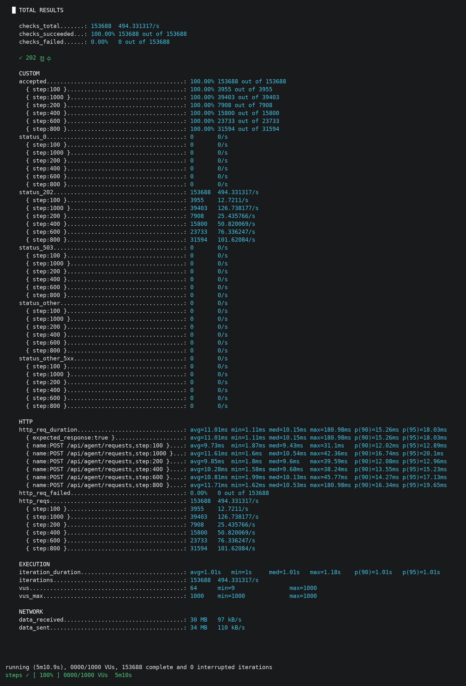
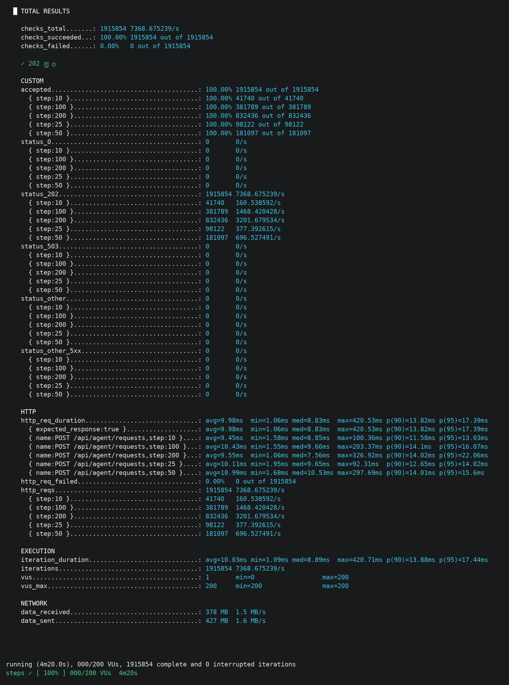
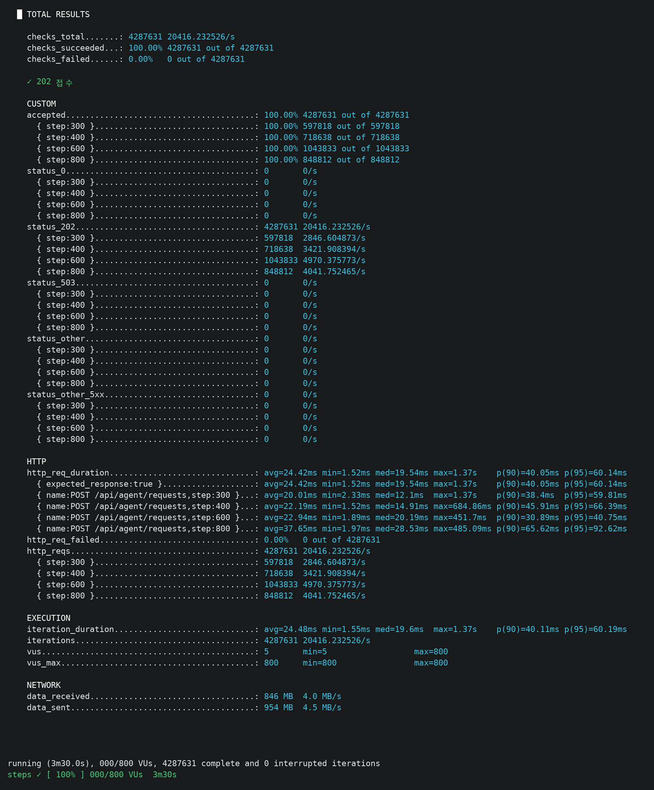
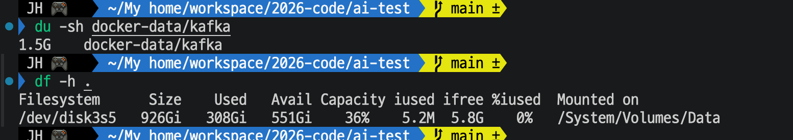

# Day 28 결과 — Breakpoint 탐색 (비동기 접수 경로)

> 상태: 가이드 ① (계단 부하 VU 100 → 1000, 요청 사이 1초 쉼)를 실행해 기록했다(2026-10-17). ③ 의 비우기 전 LAG 를 기록했고(비워지지 않았다), ② (쉬지 않고 보내기, VU 10 → 200)를 기록했다(3-2). ④ (선택, 계단 늘리기 VU 300 → 800)를 기록했다(3-3). ④ 뒤 Kafka 디스크 사용량도 기록했다. 쌓인 요청의 비우기는 하지 않기로 했다.
> 가이드는 [DAY28_GUIDE.md](DAY28_GUIDE.md). 앞선 결과는 [DAY25_RESULT.md](DAY25_RESULT.md)(VU 300 까지 한계 없음).
> 포트: **8080 = Spring WAS**, **8000 = FastAPI 워커 1**, **6379 = Redis(redis1 컨테이너)**, 9092 = Kafka.

**전체 목적:** 비동기 접수 경로(Spring → Kafka, 202 응답)를 VU 100 에서 1000 까지 계단식으로 올려, 접수 응답 시간 p(95) 2초 미만과 접수 성공 99% 초과 기준을 처음 넘는 계단(Breakpoint)을 찾고, 그때 자원 사용량을 함께 본다. 이 문서는 ① 의 결과를 기록한다.

## 1. 환경

| 항목      | 내용                                                                                                                                        |
| --------- | ------------------------------------------------------------------------------------------------------------------------------------------- |
| 대상      | Spring(8080) `POST /api/agent/requests`. 접수만 재고 결과 조회는 하지 않음                                                                  |
| 부하      | `breakpoint.js`, 계단 100, 200, 400, 600, 800, 1000. 계단마다 올리기 10초 + 머물기 40초, 마지막 내리기 10초. 요청 사이 1초 쉼               |
| 기준      | 계단별 접수 p(95) 2000ms 미만, 계단별 접수 성공(202) 비율 99% 초과 (기본값)                                                                 |
| 실행 명령 | `bash scripts/k6/run-breakpoint.sh step1`                                                                                                   |
| 같은 PC   | k6, Spring, FastAPI, docker(kafka 등)가 한 PC 에서 실행. kafka 컨테이너 메모리 한도 11.67GiB                                                |
| 워커      | 끄고 시험하는 것이 계획이었다. 그러나 시험 뒤 확인한 Kafka 그룹에 컨슈머 2개가 붙어 있었다(3-1-1 참고). 시험 중에도 켜져 있었을 가능성이 높다 |

## 2. 실행한 것

| 번호 | 명령                                                                                | 확인한 것                                                  |
| ---- | ----------------------------------------------------------------------------------- | ---------------------------------------------------------- |
| ①    | `bash scripts/k6/run-breakpoint.sh step1`                                           | 계단별 접수 p(95), 성공 비율, Breakpoint 유무 (3-1)        |
| ③    | 비우기 전 `kafka-consumer-groups --describe`                                        | 쌓인 요청과 컨슈머 (3-1-1). 비우기는 컨슈머가 붙어 있어 실패 |
| ②    | `bash scripts/k6/run-breakpoint.sh hammer -e STEPS=10,25,50,100,200 -e THINK_SEC=0` | 쉬지 않고 보내기에서 계단별 접수 p(95), 성공 비율 (3-2)    |
| ④    | `bash scripts/k6/run-breakpoint.sh hammer2 -e STEPS=300,400,600,800 -e THINK_SEC=0 -e ABORT=1` | 더 큰 계단에서 접수 p(95), 성공 비율, 처리량 (3-3) |

## 3. 결과

### 3-1. ① 계단 부하 VU 100 → 1000 (요청 사이 1초 쉼)

**목적:** 접수 경로가 VU 1000 까지 기준(p(95) 2초 미만, 성공 99% 초과)을 지키는지, 아니면 어느 계단에서 처음 넘는지 본다.

k6 요약(총 5분 10.9초). 요청 153,688건이 모두 끝났고 중단된 반복은 0건이다.

**계단별 결과**(머무는 40초 구간의 값)

| 계단(VU) | 요청 수 | 요청 수 ÷ 40초 (계산) | `accepted` | p(95)   | avg     | med     | p(90)   | max      | `status_503`, `status_0`, 그 밖의 5xx, 그 밖 |
| -------- | ------- | --------------------- | ---------- | ------- | ------- | ------- | ------- | -------- | -------------------------------------------- |
| 100      | 3,955   | 약 99                 | 100%       | 12.89ms | 9.73ms  | 9.43ms  | 12.02ms | 31.1ms   | 모두 0                                       |
| 200      | 7,908   | 약 198                | 100%       | 12.96ms | 9.85ms  | 9.6ms   | 12.08ms | 39.59ms  | 모두 0                                       |
| 400      | 15,800  | 약 395                | 100%       | 15.23ms | 10.28ms | 9.68ms  | 13.55ms | 38.24ms  | 모두 0                                       |
| 600      | 23,733  | 약 593                | 100%       | 17.13ms | 10.81ms | 10.13ms | 14.27ms | 45.77ms  | 모두 0                                       |
| 800      | 31,594  | 약 790                | 100%       | 19.65ms | 11.71ms | 10.53ms | 16.34ms | 180.98ms | 모두 0                                       |
| 1000     | 39,403  | 약 985                | 100%       | 20.1ms  | 11.61ms | 10.54ms | 16.74ms | 42.36ms  | 모두 0                                       |

전체: `accepted` 100%(153,688 / 153,688), `status_202` 153,688, `http_req_failed` 0 / 153,688, `checks` 153,688 / 153,688. 접수 응답 시간 avg 11.01ms, min 1.11ms, med 10.15ms, p(90) 15.26ms, p(95) 18.03ms, max 180.98ms. `iteration_duration` avg 1.01초(min 1초, max 1.18초), `vus_max` 1000, `data_received` 30 MB, `data_sent` 34 MB.

| 항목                                                | 기대값 (확인 전 예상)                                  | 실제                                             |
| --------------------------------------------------- | ------------------------------------------------------ | ------------------------------------------------ |
| 계단별 접수 p(95)                                   | 모두 수십 ms 이하. 1000 쪽에서 올라가기 시작할 수 있음 | 12.89ms (100) → 20.1ms (1000). 모두 수십 ms 이하 |
| 계단별 `accepted`                                   | 모두 100%                                              | 모두 100%                                        |
| Breakpoint                                          | 없을 가능성이 높음                                     | **없음** (VU 1000 까지 기준을 넘은 계단이 없다)  |
| 계단별 `status_503`, `status_0`, `status_other_5xx` | 0                                                      | 모두 0                                           |
| 계단별 요청 수                                      | 40초 × VU 수 정도 (VU 1000 계단 약 4만 건)             | 39,403건 (VU 1000)                               |

붙여 준 파일에는 임계값 표시(✓/✗)가 나오는 윗부분이 없다. 계단별 p(95)가 모두 2000ms 보다 훨씬 작고 `accepted` 가 모두 100% 이므로 기준을 넘은 계단이 없다고 판단했다.

**자원 기록**(5초마다 한 줄, `ps` 와 `docker stats` 값)

| 대상                  | 시험 중 범위                     | 가장 큰 값                                           |
| --------------------- | -------------------------------- | ---------------------------------------------------- |
| Spring(8080) CPU      | 대부분 8~40%, 시험 후반에 30~50% | 49.9% (09:07:08)                                     |
| Spring RSS            | 103~228MB                        | 228MB (09:07:23)                                     |
| k6 CPU                | 대부분 4~20%                     | 169.2% (09:02:35, 시작 시점), 그 뒤 58.0% (09:07:16) |
| k6 RSS                | 145~402MB                        | 402MB (09:07:37)                                     |
| kafka 컨테이너 CPU    | 2.6~14.3%                        | 14.33% (09:02:42)                                    |
| kafka 컨테이너 메모리 | 1.191~1.195GiB (거의 변화 없음)  | 1.195GiB                                             |
| FastAPI(8000)         | CPU 0.0~1.9%, RSS 14~37MB        | 1.9% (09:06:33)                                      |

| 항목   | 기대값 (확인 전 예상)                                                | 실제                                                        |
| ------ | -------------------------------------------------------------------- | ----------------------------------------------------------- |
| k6 CPU | 100% 미만이면 k6 가 병목이 아님 (1000 VU 에서 코어 하나 이상도 가능) | 시작 시점 한 줄(169.2%)만 100% 이상, 시험 중에는 58.0% 이하 |

**해석:** ① 접수 경로는 VU 1000(초당 약 985건)까지 기준을 넘지 않았다. 153,688건이 모두 202 로 접수됐고 503(Kafka 전송 5초 초과), 연결 실패, 5xx 가 없었다. Breakpoint 를 찾지 못했고, 가이드의 예상(한계가 없을 가능성이 높음)과 같다.

VU 가 10배(100 → 1000)가 돼도 p(95)는 12.89ms 에서 20.1ms 로 약 1.6배만 늘었다. 요청 수는 VU 수에 거의 비례했다(계단 100 의 약 99건/초, 계단 1000 의 약 985건/초). 요청 사이에 1초를 쉬고 접수가 약 10ms 로 끝나서 VU 하나가 초당 약 1건을 보냈다(Day 25 의 관찰과 같다). Day 25 ⑥ 의 300 VU(p(95) 14.71ms)와 이번 400 VU(15.23ms), 600 VU(17.13ms)는 같은 수준이다.

자원에는 여유가 남아 있었다. Spring 의 CPU 는 최대 49.9%(`ps` 값), kafka 컨테이너는 최대 14.33%, k6 도 시험 중 58.0% 이하였다. 어느 쪽도 100% 에 닿지 않았으므로 이 부하(초당 약 1000건)에서는 한계 근처가 아니다. 한계는 이보다 높은 요청 속도에 있고, 그래서 ② 에서 요청 속도를 더 올렸다.

가장 큰 응답 시간 max 180.98ms 는 계단 800 에서 한 번 나온 값이다. 원인은 확인하지 않았다. p(95), p(90)에는 영향이 없다.

k6 요약의 `status_202`, `http_reqs` 계단별 줄의 `/s` 값(예: 계단 1000 의 126.7/s)은 계단의 요청 수를 시험 전체 시간(약 311초)으로 나눈 값이라 그 계단의 실제 초당 요청 수가 아니다. 이 문서는 요청 수 ÷ 40초(머무는 시간)로 계산한 값을 쓴다.

### 3-1-1. ③ 쌓인 요청 비우기 전 LAG

**목적:** ① 에서 접수한 요청이 Kafka 에 얼마나 남아 있는지, 시험 중 워커가 읽었는지 본다. 비우기 전에 확인했다.

| 파티션 | CURRENT-OFFSET | LOG-END-OFFSET | LAG         | CONSUMER-ID (앞 8자리) |
| ------ | -------------- | -------------- | ----------- | ---------------------- |
| 0      | 5,561          | 56,903         | 51,342      | `38876623`             |
| 1      | 5,676          | 56,513         | 50,837      | `9bfa90fc`             |
| 2      | 5,521          | 56,589         | 51,068      | `38876623`             |
| 합계   | 16,758         | 170,005        | **153,247** | 컨슈머 2개             |

| 항목          | 기대값 (확인 전 예상)                                  | 실제                                                                    |
| ------------- | ------------------------------------------------------ | ----------------------------------------------------------------------- |
| 비우기 전 LAG | 접수 건수(약 15.4만 건)와 비슷하면 워커가 읽지 않은 것 | 153,247. 접수 건수 153,688 에 가깝지만 약 440건 적다                    |
| 컨슈머        | 없음 (워커를 껐다면)                                   | **2개가 붙어 있음** (파티션 0, 2 는 한 컨슈머, 파티션 1 은 다른 컨슈머) |

계산(추정): Day 27 마지막에 확인한 LOG-END 합 16,272(5,500 + 5,442 + 5,330)에서 지금 170,005 로 153,733건 늘었다. ① 의 접수 153,688건과 Day 27 ④ 의 44건, 시작 전 확인 curl 1건을 더한 153,733건과 정확히 같다. 읽은 위치(CURRENT-OFFSET)는 합이 16,272 에서 16,758 로 486 늘었다. 이 중 약 44건은 Day 27 ④ 에서 읽은 것으로 보면, 나머지 약 440건을 ① 시험 중과 그 뒤에 읽었다. 워커 2대가 건당 약 5초로 처리하면 약 19분(① 시작부터 이 확인까지) 동안 약 450건이라는 계산과 맞는다.

### 3-2. ② 쉬지 않고 보내기 (VU 10 → 200, 요청 사이 쉼 없음)

**목적:** ① 에서 한계가 안 나왔으므로, 요청 사이 쉬는 시간을 없애 VU 당 요청 속도를 크게 올려 한계가 Spring 인지, Kafka 인지, k6 자신인지 본다.

k6 요약(총 4분 20.0초). 요청 1,915,854건이 모두 끝났고 중단된 반복은 0건이다.

**계단별 결과**(머무는 40초 구간의 값)

| 계단(VU) | 요청 수 | 요청 수 ÷ 40초 (계산) | VU 당 초당 (계산) | `accepted` | p(95)   | avg     | med     | p(90)   | max      | `status_503`, `status_0`, 그 밖의 5xx, 그 밖 |
| -------- | ------- | --------------------- | ----------------- | ---------- | ------- | ------- | ------- | ------- | -------- | -------------------------------------------- |
| 10       | 41,740  | 약 1,044              | 약 104            | 100%       | 13.03ms | 9.45ms  | 8.85ms  | 11.58ms | 100.36ms | 모두 0                                       |
| 25       | 98,122  | 약 2,453              | 약 98             | 100%       | 14.02ms | 10.11ms | 9.65ms  | 12.65ms | 92.31ms  | 모두 0                                       |
| 50       | 181,097 | 약 4,527              | 약 91             | 100%       | 15.6ms  | 10.99ms | 10.53ms | 14.01ms | 297.69ms | 모두 0                                       |
| 100      | 381,789 | 약 9,545              | 약 95             | 100%       | 16.07ms | 10.43ms | 9.66ms  | 14.1ms  | 203.37ms | 모두 0                                       |
| 200      | 832,436 | 약 20,811             | 약 104            | 100%       | 22.06ms | 9.55ms  | 7.56ms  | 14.02ms | 326.92ms | 모두 0                                       |

전체: `accepted` 100%(1,915,854 / 1,915,854), `status_202` 1,915,854, `checks_failed` 0 / 1,915,854, `http_req_failed` 0 / 1,915,854. 접수 응답 시간 avg 9.98ms, min 1.06ms, med 8.83ms, p(90) 13.82ms, p(95) 17.39ms, max 420.53ms. `vus_max` 200, `data_received` 378 MB, `data_sent` 427 MB. 계단별 요청 수의 합은 1,535,184건이고, 나머지 380,670건은 올리는 구간(`ramp`)과 내리는 구간(`down`)의 요청이다.

| 항목                           | 기대값 (확인 전 예상)                                                      | 실제                                                              |
| ------------------------------ | -------------------------------------------------------------------------- | ----------------------------------------------------------------- |
| 계단별 `http_reqs`             | 계단이 커질수록 늘다가 어느 계단부터 증가가 둔해진다                       | VU 수에 거의 비례해 늘었다. 둔해진 계단 없음 (VU 당 약 91~104/초) |
| 계단별 접수 p(95)              | 낮은 계단은 수 ms~수십 ms, 처리량이 꺾이는 계단부터 올라간다               | 13.03ms (10) → 22.06ms (200). 모두 수십 ms 이하                   |
| 실패(`status_0`, `status_503`) | 한계가 나오면 처리량 정체 뒤에 나타날 가능성이 높다. 나오지 않을 수도 있다 | 모두 0                                                            |
| Breakpoint                     | -                                                                          | **없음** (VU 200, 초당 약 2만 건까지 기준을 넘은 계단이 없다)     |

**자원 기록**(5초마다 한 줄, `ps` 와 `docker stats` 값. `ps` 의 100% 는 코어 하나)

| 대상                  | 낮은 계단 (VU 10~50 때) | 마지막 계단 VU 200 때(09:29:09 ~ 09:29:52 부근) | 가장 큰 값                  |
| --------------------- | ----------------------- | ----------------------------------------------- | --------------------------- |
| Spring(8080) CPU      | 약 28~100%              | 241~317%                                        | 317.2% (09:29:38)           |
| Spring RSS            | 82~247MB                | 218~324MB                                       | 324MB (09:29:09)            |
| k6 CPU                | 약 13~58%               | 156~232%                                        | 231.7% (09:29:24, 09:29:38) |
| k6 RSS                | 68~177MB                | 249~379MB                                       | 379MB (09:29:45)            |
| kafka 컨테이너 CPU    | 약 7~15%                | 14~30%                                          | 30.10% (09:29:24)           |
| kafka 컨테이너 메모리 | 1.194~1.196GiB          | 1.196~1.197GiB                                  | 1.197GiB                    |
| FastAPI(8000)         | (없음)                  | (없음)                                          | 시험 내내 프로세스가 없었다 |

계단과 시각의 대응은 샘플러와 k6 의 시작 시각이 몇 초 다를 수 있어 대략이다(계단당 올리기 10초 + 머물기 40초로 계산).

**해석:** ② 쉬지 않고 보내기에서도 한계가 나오지 않았다. 5개 계단(VU 10~200, 초당 약 1,000~20,800건) 모두 `accepted` 100%, `status_0`, `status_503`, 5xx 가 0, `checks_failed` 가 0 / 1,915,854 였다. 요청 속도는 VU 수에 비례해 늘었고(VU 당 약 91~104/초) 둔해진 계단이 없었다. 접수 p(95)는 13.03ms 에서 22.06ms 로 늘어 VU 200 에서 처음 눈에 띄게 올랐지만 기준(2초)의 1% 수준이다.

가장 큰 응답 시간(max)은 계단 50 의 297.69ms, 계단 200 의 326.92ms, 전체 420.53ms 로 ① 의 180.98ms 보다 컸다. 어느 구간이 원인인지는 확인하지 않았다.

마지막 계단에서 Spring CPU 는 최대 317.2%, k6 는 231.7%, kafka 컨테이너는 30.1% 였다. 이 PC 의 코어 수를 확인하지 않아 "CPU 가 포화됐다"고는 말할 수 없다. 다만 요청 속도가 끝까지 VU 수에 비례해 늘었으므로 처리량이 천장에 닿은 흔적은 없다. k6 의 CPU 가 Spring 보다 낮았으므로 k6 가 먼저 한계에 닿았다는 근거도 없다. 이 시험에서는 한계가 VU 200(초당 약 2만 건)보다 높은 곳에 있다는 것까지만 말할 수 있다.

이 시험 중에는 자원 기록에 FastAPI(8000)가 없어, 워커가 꺼진 채로 접수 경로만 잰 값이다.

### 3-3. ④ (선택) 계단 늘리기 (VU 300 → 800, 쉬지 않고 보내기)

**목적:** ② 에서도 한계가 안 나왔으므로, 계단을 더 크게(VU 300, 400, 600, 800) 올려 한계를 찾는다. 기준(p(95) 2초 미만, 성공 99% 초과)을 처음 넘는 계단에서 시험이 멈추게 했다(`ABORT=1`).

k6 요약(총 3분 30.0초). 요청 4,287,631건이 모두 끝났고 중단된 반복은 0건이다. 기준을 넘은 계단이 없어 `ABORT=1` 로 멈추지 않고 끝까지 갔다.

**계단별 결과**(머무는 40초 구간의 값)

| 계단(VU) | 요청 수    | 요청 수 ÷ 40초 (계산) | VU 당 초당 (계산) | `accepted` | p(95)    | avg      | med      | p(90)    | max        | `status_503`, `status_0`, 그 밖의 5xx, 그 밖 |
| -------- | ---------- | --------------------- | ----------------- | ---------- | -------- | -------- | -------- | -------- | ---------- | -------------------------------------------- |
| 300      | 597,818    | 약 14,945             | 약 49.8           | 100%       | 59.81ms  | 20.01ms  | 12.1ms   | 38.4ms   | 1.37s      | 모두 0                                       |
| 400      | 718,638    | 약 17,966             | 약 44.9           | 100%       | 66.39ms  | 22.19ms  | 14.91ms  | 45.91ms  | 684.86ms   | 모두 0                                       |
| 600      | 1,043,833  | 약 26,096             | 약 43.5           | 100%       | 40.75ms  | 22.94ms  | 20.19ms  | 30.89ms  | 451.7ms    | 모두 0                                       |
| 800      | 848,812    | 약 21,220             | 약 26.5           | 100%       | 92.62ms  | 37.65ms  | 28.53ms  | 65.62ms  | 485.09ms   | 모두 0                                       |

전체: `accepted` 100%(4,287,631 / 4,287,631), `status_202` 4,287,631, `checks_failed` 0 / 4,287,631, `http_req_failed` 0 / 4,287,631. 접수 응답 시간 avg 24.42ms, min 1.52ms, med 19.54ms, p(90) 40.05ms, p(95) 60.14ms, max 1.37s. `vus_max` 800, `data_received` 846 MB, `data_sent` 954 MB. 계단별 요청 수의 합은 3,209,101건이고, 나머지 1,078,530건은 올리는 구간(`ramp`)과 내리는 구간(`down`)의 요청이다.

| 항목                    | 기대값 (확인 전 예상)                                                                                         | 실제                                                                                                   |
| ----------------------- | ------------------------------------------------------------------------------------------------------------- | ------------------------------------------------------------------------------------------------------ |
| 계단별 요청 속도        | VU 수에 비례, VU 당 약 91~104건/초. 계단 300 은 약 3만, 800 은 약 8만 건/초                                     | 약 1.49만, 1.80만, 2.61만, 2.12만 건/초 (VU 당 약 49.8, 44.9, 43.5, 26.5건/초). 예상보다 훨씬 낮고 800 에서 줄었다 |
| 전체 요청 수            | 약 1,000만 건                                                                                                 | 4,287,631건                                                                                            |
| Breakpoint              | 없을 가능성이 높다                                                                                            | **기준을 넘은 계단 없음** (p(95) 최대 92.62ms, 성공 100%). 다만 처리량이 800 에서 줄었다                  |
| 자원 (k6, Spring CPU)   | ② 마지막 계단(k6 231.7%, Spring 317.2%)보다 높다                                                               | Spring 최대 379.6%, k6 최대 299.5%. 예상대로 더 높다                                                    |
| Kafka 디스크 증가       | 약 2.7GB (약 1,000만 건 기준 계산)                                                                              | 약 0.94GB (아래 표). 접수가 428만 건으로 예상(약 1,000만 건)보다 적었다                                    |
| `ABORT=1`               | 기준을 넘으면 그 계단에서 멈춤                                                                                | 멈추지 않음 (기준을 넘은 계단이 없다)                                                                   |

**자원 기록**(5초마다 한 줄, `ps` 와 `docker stats` 값. `ps` 의 100% 는 코어 하나)

| 대상                  | 시험 중 범위                      | 가장 큰 값                    |
| --------------------- | --------------------------------- | ----------------------------- |
| Spring(8080) CPU      | 대부분 약 140~380%                | 379.6% (10:10:21)             |
| Spring RSS            | 241~326MB                         | 326MB (10:11:46)              |
| k6 CPU                | 대부분 약 90~300%                 | 299.5% (10:09:54)             |
| k6 RSS                | 190~947MB (시험 내내 증가)        | 947MB (10:11:53)              |
| kafka 컨테이너 CPU    | 약 8~25%                          | 24.54% (10:11:24)             |
| kafka 컨테이너 메모리 | 1.197~1.205GiB                    | 1.205GiB                      |
| FastAPI(8000)         | 시험 내내 프로세스 없음           | -                             |

시험을 시작할 때 Spring 의 RSS 는 46MB 로, ② 가 끝났을 때(최대 324MB)보다 낮았다.

**Kafka 디스크 사용량**(④ 가 끝난 뒤)

| 항목                          | ④ 전 (① 과 ② 뒤)         | ④ 뒤                   | 차이                          |
| ----------------------------- | ------------------------ | ---------------------- | ----------------------------- |
| `docker-data/kafka` 크기      | 562MB (파티션 3개 각 181MB) | 1.5GB                  | 약 0.94GB (`du` 가 1.5G 로 반올림해 오차가 있다) |
| 디스크 여유 (`df -h .`)       | 554GB (이전 측정)        | 551Gi 남음 (사용 36%)   | 약 3GB 줄었으나 측정한 곳이 달라 직접 비교하지 않는다 |

④ 에서 접수한 요청은 428만 건이므로 증가분 약 0.94GB 를 나누면 건당 약 220바이트다(계산. `du` 의 반올림 때문에 오차가 있다). 가이드에서 건당 약 270바이트로 계산한 것보다 작았다. 디스크 여유는 551Gi 로 충분했다.

**해석:** ④ 에서도 기준(p(95) 2초 미만, 성공 99% 초과)을 넘은 계단은 없었다. 4개 계단(VU 300~800) 모두 `accepted` 100%, `status_0`, `status_503`, 5xx 가 0, `checks_failed` 가 0 / 4,287,631 이었고 접수 p(95)는 최대 92.62ms(VU 800)였다. 그러나 처리량은 VU 수에 비례해 늘지 않았다. VU 당 초당 요청 수가 ② 의 91~104건에서 49.8건(VU 300), 44.9건(VU 400), 43.5건(VU 600), 26.5건(VU 800)으로 줄었고, 초당 요청 수는 VU 600 에서 약 2.61만 건으로 가장 컸고 VU 800 에서 약 2.12만 건으로 줄었다. VU 가 늘어도 처리량이 늘지 않는 것은 이 PC 의 처리 한계 부근에 닿았다는 신호라고 본다(추정. 원인이 Spring 인지 k6 인지 Kafka 인지 구분하지 않았다). 기준을 넘지는 않았으므로 "Breakpoint 를 찾았다"고는 말하지 않는다.

접수 p(95)는 계단 순서대로 늘지 않았다(300: 59.81ms, 400: 66.39ms, 600: 40.75ms, 800: 92.62ms). 600 이 300 보다 낮은 이유는 확인하지 않았다. 시작 때 Spring RSS 가 46MB 로 ② 때보다 낮아 Spring 을 새로 띄운 상태였을 가능성이 있고, 그렇다면 계단 300 의 max 1.37s 와 높은 p(95)는 시작 직후(JVM 을 데우는 구간)의 영향일 수 있다(추정. Spring 을 다시 띄웠는지 확인하지 않았다).

자원은 ② 마지막 계단보다 높아졌다(Spring 최대 379.6%, k6 최대 299.5%, kafka 컨테이너 최대 24.54%). 이 PC 의 코어 수를 확인하지 않아 "CPU 가 포화됐다"고는 말할 수 없다. 계단 800 때의 CPU 는 계단 600 때와 비슷했는데 처리량은 줄었다. k6 의 RSS 는 시험 내내 늘어 947MB 까지 갔다(VU 800 개의 메모리).

예상(계단 300~800 에서 초당 3만~8만 건, 전체 약 1,000만 건)은 틀렸다. 실제로는 1.49만~2.61만 건/초, 전체 428만 건이었다. 계산에 쓴 VU 당 약 91~104건/초가 ② 의 낮은 VU 에서만 맞는 값이었다.

## 4. 해석

① 과 ② 를 합쳐 보면, 비동기 접수 경로(Spring → Kafka, 202 응답)는 이 PC 에서 초당 약 2만 건(VU 200, 쉬지 않고 보낼 때)까지 기준(p(95) 2초 미만, 성공 99% 초과)을 넘지 않았다. Breakpoint 는 이번 시험 범위에서 찾지 못했다. ① 은 VU 1000(초당 약 985건), ② 는 VU 200(초당 약 2만 건)까지였고, 둘 다 실패(503, 연결 실패, 5xx)가 0 이었다.

접수 응답 시간은 부하가 커져도 수십 ms 수준이었다. Day 25 ⑥ 의 300 VU 에서 14.71ms, ① 의 VU 1000 에서 20.1ms, ② 의 VU 200(초당 약 2만 건)에서 22.06ms 였다. 요청 수가 VU 수에 거의 비례해 늘었고, 처리량이 둔해지는 계단이 없었다.

어느 자원도 한계에 닿았다는 근거는 없었다. ② 마지막 계단에서 Spring CPU 최대 317.2%, k6 231.7%, kafka 컨테이너 30.1% 였으나 이 PC 의 코어 수를 확인하지 않아 포화 여부는 말할 수 없다. 한계는 이 시험보다 높은 요청 속도에 있다.

접수는 Kafka 에 넣는 일까지만 하므로 요청이 몰려도 접수 실패로 이어지지 않았고, 대신 처리하지 못한 요청이 Kafka 에 쌓인다. ① 뒤에 LAG 153,247건이 남아 있었고(3-1-1), ② 로 접수된 1,915,854건이 더 쌓였다(접수 건수 기준). 워커 1대는 건당 약 5초(Day 27)로 처리하므로 접수 속도(초당 1,000~2만 건)와 처리 속도의 차이가 매우 크다. 이 구조에서 먼저 한계에 닿는 곳은 접수가 아니라 워커 처리 쪽이라고 본다(추정. ① 과 ② 에서 처리 속도를 따로 재지 않았다).

① 시험 중에는 워커 2대가 켜져 있었을 가능성이 높다(3-1-1). 접수 경로는 워커가 필요 없으므로 ① 결과에는 큰 영향이 없었다고 보지만, 워커가 Kafka 에서 읽는 부하가 섞여 있었을 수 있다. ② 는 자원 기록에 FastAPI 가 없어 워커가 꺼진 채였다.

④ 를 더하면, 기준(p(95) 2초 미만, 성공 99% 초과) 기준으로는 이번 시험 범위(VU 800, 쉬지 않고 보낼 때 초당 약 2.1만~2.6만 건)까지 Breakpoint 가 없었다. 다만 ④ 에서 처리량이 VU 600(약 2.61만 건/초)을 넘어 VU 800(약 2.12만 건/초)에서 줄었고 접수 p(95)가 92.62ms 로 올라, 이 PC 에서 접수 경로의 처리 한계는 초당 약 2만~3만 건 부근으로 보인다(추정. 병목이 Spring, k6, Kafka 중 어디인지는 구분하지 않았다). 앞의 "한계는 이 시험보다 높은 요청 속도에 있다"는 말은 ② 까지의 결론이고, ④ 에서 처리량이 꺾이는 모습이 처음 보였다.

## 5. 확인하지 않은 것

| 항목                                  | 내용                                                                                                                                                                    |
| ------------------------------------- | ----------------------------------------------------------------------------------------------------------------------------------------------------------------------- |
| ② 뒤의 비우기                         | 실행 전. ② 로 약 191만 건이 Kafka 에 더 쌓였다. ① 뒤의 비우기도 컨슈머가 붙어 있어 실패했고, ② 앞에서 비웠는지는 이 기록에 없다                                         |
| ② 시작 전 Kafka 에 남은 요청          | 확인하지 않음 (② 앞의 LAG 기록이 없다)                                                                                                                                  |
| ④ 뒤 디스크 증가가 `du` 반올림 오차 안인지                              | 1.5G 로만 표시돼 증가분 0.94GB 는 대략값이다. 정확한 바이트 수는 보지 않았다                                                                                       |
| ④ 에서 Spring 을 다시 띄웠는지                                          | 확인하지 않음. 시험 시작 때 Spring RSS 46MB 로 짐작할 뿐이다                                                                                                    |
| ④ 에서 처리량이 800 에서 줄어든 원인                                    | 확인하지 않음 (Spring, k6, Kafka 중 어디인지 구분하지 않았다)                                                                                                   |
| ② 에서 Kafka 디스크 사용량            | 재지 않음 (메모리는 1.19GiB 로 변화 없음)                                                                                                                               |
| 이 PC 의 코어 수                      | 확인하지 않음. 자원 기록의 CPU % 를 코어 수와 비교하지 못했다                                                                                                           |
| 시험 중 워커 2대가 켜져 있었는지      | 시험 뒤 LAG 확인에서 컨슈머 2개(CONSUMER-ID 2종류)가 보였다. 시험 중에도 있었는지는 직접 보지 않았다. 처리 건수(3-1-1)로 보면 시험 중에도 읽고 있었을 가능성이 높다(추정) |
| 계단별 임계값 표시(✓/✗)               | 붙여 준 파일에 없음. 값으로 판단함                                                                                                                                      |
| 자원 기록의 `%CPU` 가 어떤 값인지     | `ps` 의 `%cpu` 를 썼다. 순간값인지 평균인지 확인하지 않았다. 시작 한 줄의 k6 169.2% 도 그래서 해석하지 않았다(k6 시작 시 1000 VU 를 준비하는 구간으로 짐작할 뿐이다)    |
| 계단과 자원 기록 시각의 정확한 대응   | k6 시작 시각과 샘플러 시작 시각이 몇 초 다를 수 있어 어느 계단 때의 자원인지 정확히 맞추지 않았다                                                                       |
| Spring 로그 출력이 한계에 미치는 영향 | 이번 부하에서는 영향이 보이지 않았지만 로그 출력을 따로 재지는 않았다                                                                                                   |
| 180.98ms 한 건의 원인                 | 확인하지 않음                                                                                                                                                           |

## 6. 한계

| 항목             | 내용                                                                                                                         |
| ---------------- | ---------------------------------------------------------------------------------------------------------------------------- |
| 한 번씩만 측정   | 반복 측정을 하지 않아 편차를 알 수 없다                                                                                      |
| 계단마다 40초    | 느린 한계(메모리 증가, Kafka 디스크)는 보이지 않을 수 있다                                                                   |
| 한 PC 에서 실행  | 결과는 이 PC 의 값이다. 운영 서버의 한계가 아니다                                                                            |
| 접수 경로만 시험 | 결과 조회와 워커 처리는 대상이 아니다                                                                                        |
| 기준 한계 미발견 | ① 은 "VU 1000(초당 약 1,000건)", ② 는 "VU 200(초당 약 2만 건)", ④ 는 "VU 800(초당 약 2.1만 건)"까지 기준(p(95) 2초 미만, 성공 99% 초과)을 넘지 않았다. 다만 ④ 에서 처리량이 VU 600 뒤로 늘지 않았다 |
