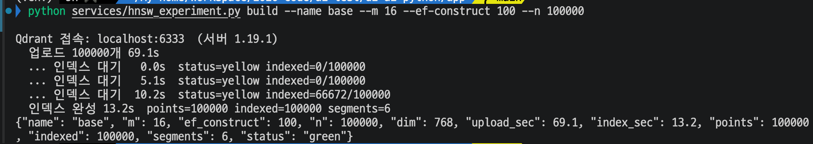
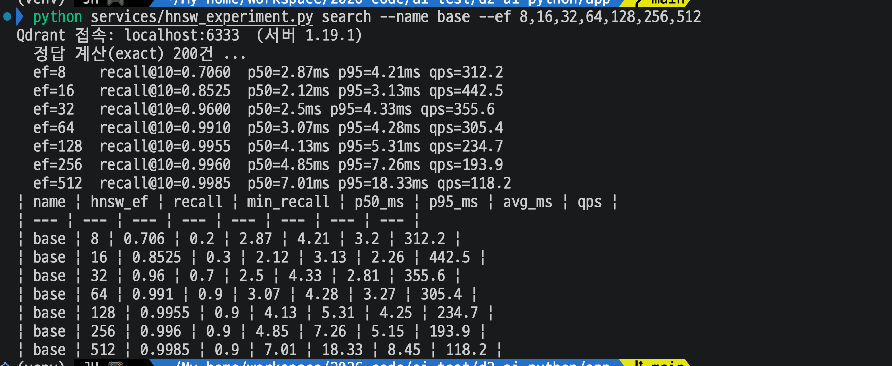
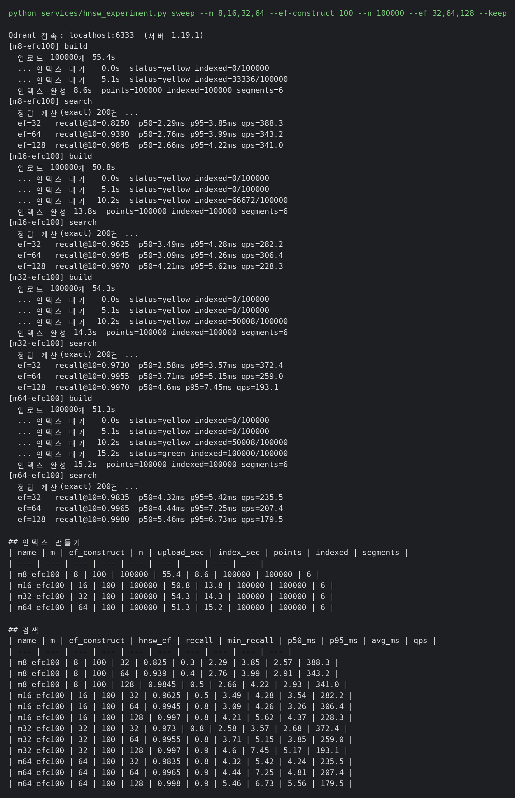
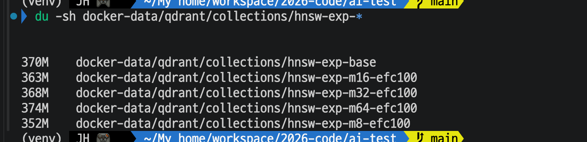
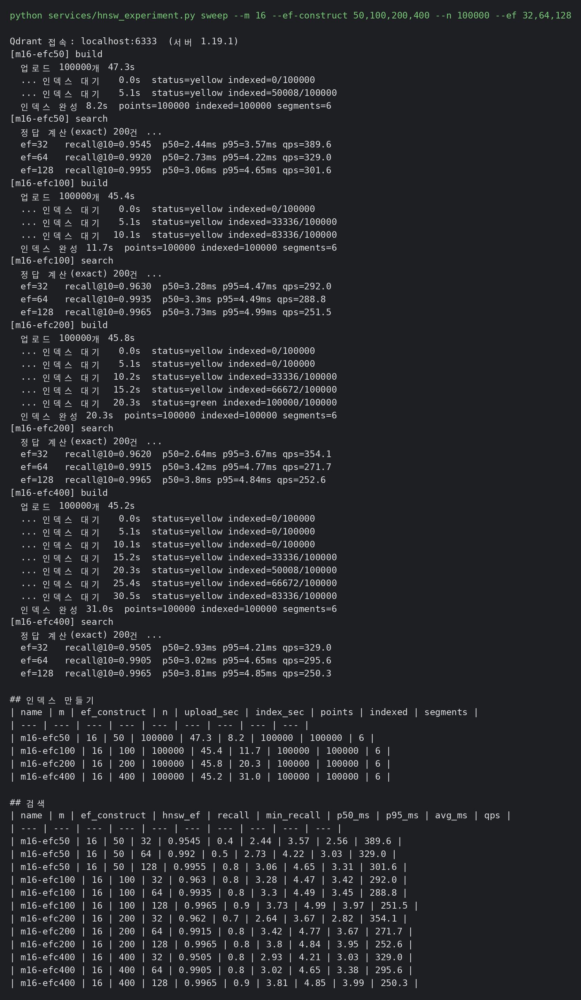

# Day 29 결과 — Qdrant HNSW 파라미터 튜닝

> 상태: 가이드 ① (기본 설정에서 `hnsw_ef` 바꾸기), ② (`m` 바꾸기)를 실행해 기록했다(2026-10-17). ③ (`ef_construct` 바꾸기)도 실행해 기록했다.
> 가이드는 [DAY29_GUIDE.md](DAY29_GUIDE.md). 앞선 결과는 [DAY28_RESULT.md](DAY28_RESULT.md).
> 포트: **6333 = Qdrant(REST)**, 6334 = Qdrant(gRPC). 이번 실험은 Qdrant 만 사용했다.

**전체 목적:** 합성 벡터 10만 개로 HNSW 인덱스 설정(`m`, `ef_construct`)과 검색 설정(`hnsw_ef`)을 바꿔 가며 검색 정확도(recall@10), 지연 시간, 인덱스 만드는 시간, 디스크 사용량이 어떻게 달라지는지 측정하고 이 프로젝트의 기본값을 정한다.

## 1. 환경

| 항목        | 내용                                                                                                           |
| ----------- | -------------------------------------------------------------------------------------------------------------- |
| 서버        | Qdrant 1.19.1 (Docker, localhost:6333)                                                                         |
| 클라이언트  | `d2-ai-python/app/experiments/hnsw_experiment.py`, qdrant-client 1.19.1, REST                                     |
| 데이터      | 합성 벡터 100,000개, 768차원, 코사인 거리. 중심점 100개 주변에 흩뿌림(noise 3.0, 시드 42)                          |
| 질의        | 합성 벡터 200건, 상위 10개(`limit`=10). 한 건씩 차례로 보냄(동시 요청 없음)                                      |
| 정답        | `exact=True`(전부 비교) 검색의 상위 10개. recall@10 은 이와 겹치는 비율의 평균                                  |
| 인덱스 만들기 | 벡터를 다 올린 뒤(`indexing_threshold`=0 으로 올리는 동안은 인덱스를 만들지 않음) 기준을 20000KB 로 되돌려 인덱스를 만들기 시작하고, green 이 되어 모든 벡터가 인덱스에 들어갈 때까지의 시간 |
| 같은 PC     | 스크립트와 Qdrant 가 한 PC 에서 실행. 코어 수는 확인하지 않음                                                  |

## 2. 실행한 것

| 번호 | 명령                                                                                                        | 확인한 것                                     |
| ---- | ----------------------------------------------------------------------------------------------------------- | --------------------------------------------- |
| ①    | `build --name base --m 16 --ef-construct 100 --n 100000`, `search --name base --ef 8,16,32,64,128,256,512`  | `hnsw_ef` 에 따른 recall, 지연 시간 (3-1)      |
| ②    | `sweep --m 8,16,32,64 --ef-construct 100 --n 100000 --ef 32,64,128 --keep`, `du -sh` 로 컬렉션 디스크 측정 | `m` 에 따른 recall, 지연 시간, 인덱스 시간, 디스크 (3-2) |
| ③    | `sweep --m 16 --ef-construct 50,100,200,400 --n 100000 --ef 32,64,128`                                      | `ef_construct` 에 따른 recall, 지연 시간, 인덱스 시간 (3-3) |

## 3. 결과

### 3-1. ① 기본 설정(m=16, ef_construct=100)에서 hnsw_ef 바꾸기

**목적:** 인덱스는 그대로 두고 검색 때의 `hnsw_ef` 만 바꿨을 때 recall 과 지연 시간의 관계를 본다. 이후 실험의 기준선이다.

인덱스 만들기(`build`). 업로드 69.1초, 인덱스 완성 13.2초, `segments`=6.

검색(`search`).

| hnsw_ef | recall@10 | min_recall | p50 (ms) | p95 (ms) | qps   |
| ------- | --------- | ---------- | -------- | -------- | ----- |
| 8       | 0.7060    | 0.2        | 2.87     | 4.21     | 312.2 |
| 16      | 0.8525    | 0.3        | 2.12     | 3.13     | 442.5 |
| 32      | 0.9600    | 0.7        | 2.50     | 4.33     | 355.6 |
| 64      | 0.9910    | 0.9        | 3.07     | 4.28     | 305.4 |
| 128     | 0.9955    | 0.9        | 4.13     | 5.31     | 234.7 |
| 256     | 0.9960    | 0.9        | 4.85     | 7.26     | 193.9 |
| 512     | 0.9985    | 0.9        | 7.01     | 18.33    | 118.2 |

**해석:**

- `hnsw_ef` 를 8 에서 64 로 올리면 recall 이 0.706 에서 0.991 로 크게 오르고, 그 뒤로는 오르는 폭이 작다(64 → 512 에서 +0.008).
- 지연 시간은 `hnsw_ef` 가 128 이상일 때부터 눈에 띄게 늘었다. 64 → 512 에서 p50 은 약 2.3배(3.07 → 7.01ms), p95 는 약 4.3배(4.28 → 18.33ms), qps 는 약 1/2.6(305 → 118)이 되었다.
- 이 데이터에서는 `hnsw_ef`=64 근처가 정확도와 속도의 균형점이다.
- `hnsw_ef` 8 의 p50(2.87ms)이 16(2.12ms)보다 큰 것은 한 건씩 잰 지연 시간의 흔들림으로 보인다. 원인은 확인하지 않았다.

### 3-2. ② m 바꾸기 (m = 8, 16, 32, 64 / ef_construct = 100)

**목적:** 인덱스의 `m` 을 바꿨을 때 정확도, 속도, 인덱스 만드는 시간, 디스크가 얼마나 달라지는지 본다.

`sweep` 출력 전체.

recall@10

| m  | hnsw_ef=32 | hnsw_ef=64 | hnsw_ef=128 |
| -- | ---------- | ---------- | ----------- |
| 8  | 0.8250     | 0.9390     | 0.9845      |
| 16 | 0.9625     | 0.9945     | 0.9970      |
| 32 | 0.9730     | 0.9955     | 0.9970      |
| 64 | 0.9835     | 0.9965     | 0.9980      |

검색 지연 시간 (p50 / p95 ms, qps)

| m  | hnsw_ef=32            | hnsw_ef=64            | hnsw_ef=128           |
| -- | --------------------- | --------------------- | --------------------- |
| 8  | 2.29 / 3.85, 388.3    | 2.76 / 3.99, 343.2    | 2.66 / 4.22, 341.0    |
| 16 | 3.49 / 4.28, 282.2    | 3.09 / 4.26, 306.4    | 4.21 / 5.62, 228.3    |
| 32 | 2.58 / 3.57, 372.4    | 3.71 / 5.15, 259.0    | 4.60 / 7.45, 193.1    |
| 64 | 4.32 / 5.42, 235.5    | 4.44 / 7.25, 207.4    | 5.46 / 6.73, 179.5    |

인덱스 만드는 시간과 디스크

| m  | 업로드 (초) | 인덱스 만드는 시간 (초) | 컬렉션 디스크 |
| -- | ----------- | ----------------------- | ------------- |
| 8  | 55.4        | 8.6                     | 352MB         |
| 16 | 50.8        | 13.8                    | 363MB         |
| 32 | 54.3        | 14.3                    | 368MB         |
| 64 | 51.3        | 15.2                    | 374MB         |

디스크는 `--keep` 으로 남긴 컬렉션을 `du -sh docker-data/qdrant/collections/hnsw-exp-*` 로 쟀다. ① 에서 만든 `base`(m=16, ef_construct=100)는 370MB 였다.

**해석:**

- recall 은 m=8 → 16 에서 가장 크게 오른다(`hnsw_ef`=64 기준 0.939 → 0.9945). m=16 이상에서는 `hnsw_ef`=64 의 recall 이 0.9945, 0.9955, 0.9965 로 거의 같다.
- m=8 은 `hnsw_ef` 를 128 로 올려도 0.9845 로 0.99 에 닿지 못했다. m 이 작으면 같은 recall 에 닿으려고 `hnsw_ef` 를 더 크게 해야 한다.
- `hnsw_ef`=32 에서는 m 이 클수록 recall 이 오르는 경향이 보인다(0.8250, 0.9625, 0.9730, 0.9835).
- m 이 클수록 대체로 느리다. `hnsw_ef`=64 의 qps 는 m=8, 16, 32, 64 순으로 343, 306, 259, 207 이다. 다만 `hnsw_ef`=32 의 p50 은 m=32(2.58ms)가 m=16(3.49ms)보다 빨라 한 건씩 잰 지연 시간에는 흔들림이 있다.
- 인덱스 만드는 시간은 m 이 클수록 길지만 8.6초에서 15.2초로 약 1.8배이고, 16 이후는 13.8, 14.3, 15.2초로 차이가 작다.
- 디스크는 m=8 → 64 에서 22MB(약 6%) 늘었다. 벡터 원본(10만 × 768 × 4바이트 ≈ 300MB)이 대부분이라 m 의 영향이 작다. 업로드 시간(51~55초)은 m 과 관계없었다.
- 같은 설정(m=16, ef_construct=100)인데 ① 의 `base` 와 ② 의 `m16-efc100` 은 디스크가 7MB 다르고(370MB, 363MB), `hnsw_ef`=64 의 recall 도 0.9910, 0.9945 로 달랐다. 인덱스를 다시 만들 때마다 조금씩 달라지는 것으로 보이며, recall 차이가 0.005 이하이면 m 때문인지 오차인지 구분하기 어렵다.
- 이 구간에서는 m=16 이 정확도와 속도의 균형이 좋다. m=8 은 recall 이 모자라고, m=32 이상은 recall 이 거의 오르지 않으면서 느려진다. 단 10만 개 합성 데이터 기준이다.

### 3-3. ③ ef_construct 바꾸기 (ef_construct = 50, 100, 200, 400 / m = 16)

**목적:** 인덱스를 만들 때의 `ef_construct` 를 바꿨을 때 정확도와 인덱스 만드는 시간의 관계를 본다.

`sweep` 출력 전체.

recall@10

| ef_construct | hnsw_ef=32 | hnsw_ef=64 | hnsw_ef=128 |
| ------------ | ---------- | ---------- | ----------- |
| 50           | 0.9545     | 0.9920     | 0.9955      |
| 100          | 0.9630     | 0.9935     | 0.9965      |
| 200          | 0.9620     | 0.9915     | 0.9965      |
| 400          | 0.9505     | 0.9905     | 0.9965      |

검색 지연 시간 (p50 / p95 ms, qps)

| ef_construct | hnsw_ef=32         | hnsw_ef=64         | hnsw_ef=128        |
| ------------ | ------------------ | ------------------ | ------------------ |
| 50           | 2.44 / 3.57, 389.6 | 2.73 / 4.22, 329.0 | 3.06 / 4.65, 301.6 |
| 100          | 3.28 / 4.47, 292.0 | 3.30 / 4.49, 288.8 | 3.73 / 4.99, 251.5 |
| 200          | 2.64 / 3.67, 354.1 | 3.42 / 4.77, 271.7 | 3.80 / 4.84, 252.6 |
| 400          | 2.93 / 4.21, 329.0 | 3.02 / 4.65, 295.6 | 3.81 / 4.85, 250.3 |

인덱스 만드는 시간

| ef_construct | 업로드 (초) | 인덱스 만드는 시간 (초) |
| ------------ | ----------- | ----------------------- |
| 50           | 47.3        | 8.2                     |
| 100          | 45.4        | 11.7                    |
| 200          | 45.8        | 20.3                    |
| 400          | 45.2        | 31.0                    |

**해석:**

- 인덱스 만드는 시간은 `ef_construct` 가 클수록 뚜렷하게 길어진다. 50 에서 400 으로 올리면 8.2초에서 31.0초로 약 3.8배다.
- recall 은 `ef_construct` 를 올려도 오르지 않았다. `hnsw_ef`=64 에서 0.9920, 0.9935, 0.9915, 0.9905 로 같은 설정을 다시 만들 때의 오차(3-2 해석, 약 0.004) 안에 있고, 방향도 일정하지 않다. `hnsw_ef`=32 에서 400 이 0.9505 로 가장 낮았지만(100 은 0.9630) 원인은 확인하지 않았다.
- 검색 지연 시간은 `ef_construct` 에 따른 일정한 경향이 없다. 가이드의 예상대로 `ef_construct` 는 검색 때 영향이 없는 것으로 보인다.
- 같은 설정(m=16, ef_construct=100)의 인덱스를 ①, ②, ③ 에서 세 번 만든 값은 인덱스 시간이 13.2초, 13.8초, 11.7초, `hnsw_ef`=64 의 recall 이 0.9910, 0.9945, 0.9935 였다. 인덱스 시간은 ±1~2초, recall 은 ±0.004 정도 흔들린다.
- 이 데이터에서는 `ef_construct` 50 이면 100 이상과 recall 이 같으면서 인덱스를 가장 빨리 만든다. 단 10만 개 합성 데이터 기준이며, 데이터가 커지거나 분포가 달라지면 달라질 수 있다.

## 4. 해석

| 실험 | 바꾼 것            | recall 에 미친 영향                                           | 속도(검색)에 미친 영향                            | 인덱스 만드는 시간 | 디스크      |
| ---- | ------------------ | ------------------------------------------------------------- | ------------------------------------------------- | ------------------ | ----------- |
| ①    | 검색 `hnsw_ef`     | 8 → 64 에서 0.706 → 0.991, 이후 거의 안 오름                  | 128 이상부터 눈에 띄게 느려짐                     | 해당 없음          | 해당 없음   |
| ②    | 인덱스 `m`         | 8 → 16 에서 크게 오르고(`hnsw_ef`=64: 0.939 → 0.9945), 이후 거의 같음 | `m` 이 클수록 느림(`hnsw_ef`=64 qps 343 → 207)    | 8.6초 → 15.2초     | 352 → 374MB |
| ③    | 인덱스 `ef_construct` | 오르지 않음(오차 범위)                                      | 영향 없음                                         | 8.2초 → 31.0초     | 측정 안 함  |

- 이번 데이터(합성 벡터 10만 개)에서 정확도를 가장 크게 좌우한 것은 검색 때의 `hnsw_ef` 였고, 인덱스 설정 중에서는 `m` 이 8 일 때만 부족했다.
- `ef_construct` 를 올리는 것은 인덱스 만드는 시간만 늘렸고 정확도 이득은 확인하지 못했다.
- 이 실험에서의 조합은 `m`=16, `ef_construct`=100(Qdrant 기본값), `hnsw_ef`=64 로 정한다. recall@10 이 약 0.99 이고 qps 는 약 290~310 이었다. `ef_construct` 를 50 으로 낮춰도 recall 이 같았지만 인덱스 시간 차이(11.7초와 8.2초)가 이 규모에서는 작아, 기본값을 바꿀 이유까지는 보지 못했다.
- 더 높은 정확도가 필요하면 인덱스를 다시 만들지 않고 `hnsw_ef` 만 키우면 된다(128 에서 약 0.997, 지연 시간은 p50 기준 1.1~1.4배).

## 5. 확인하지 않은 것

| 항목                          | 이유                                                                   |
| ----------------------------- | ---------------------------------------------------------------------- |
| 이 프로젝트 컬렉션(`documents-12`)의 HNSW 설정 | 실제 컬렉션은 확인하지 않았다. 문서가 수십 조각이라 설정을 바꿔도 차이가 보이지 않아 합성 벡터로 실험했다 |
| 실제 임베딩에서의 recall      | 합성 벡터를 썼다. 실제 문서 분포와 다를 수 있다                         |
| 양자화, 필터 검색, 동시 검색  | 범위 밖이다. 지연 시간은 한 건씩 보낸 값이다                           |
| 10만 개 초과 규모             | 데이터가 커지면 `m`, `ef_construct` 의 영향이 달라질 수 있다           |
| Qdrant 컨테이너 메모리 사용량 | 재지 않았다. 디스크만 기록했다                                         |

## 6. 한계

- 질의 200건의 평균이라 recall 소수점 셋째 자리 차이는 의미가 약하다.
- 지연 시간에는 파이썬 클라이언트와 REST 왕복 시간이 포함된다. 같은 PC 에서 돌려 네트워크 지연은 거의 없다.
- 같은 설정으로 인덱스를 다시 만들면 값이 조금 달라진다(3-2 해석). 설정마다 인덱스를 한 번씩만 만들었다(m=16, ef_construct=100 만 ①②③ 에서 세 번).
