# Day 30 결과 — Prometheus + Grafana 모니터링 대시보드

> 상태: 가이드 ① (지표가 모이는지 확인)을 실행해 기록했다(2026-10-17). ② (부하 중 대시보드 관찰)도 실행해 기록했다. ③ (부하 중 워커 하나 끄기)도 실행해 기록했다.
> 가이드는 [DAY30_GUIDE.md](DAY30_GUIDE.md). 앞선 결과는 [DAY28_RESULT.md](DAY28_RESULT.md).
> 포트: **8080 = Spring WAS**, **8000 = FastAPI 워커 1**(8001 = 워커 2, 이번에는 끔), **9090 = Prometheus**, **3000 = Grafana**, 9308 = kafka-exporter, 9121 = redis-exporter, 6333 = Qdrant.

**전체 목적:** Spring, Kafka, FastAPI 워커, Redis, Qdrant 의 지표를 Prometheus 가 5초마다 모으고 Grafana 대시보드로 시간 흐름에 따라 본다. 이후 Day 31~36 실험에서 부하를 걸 때 요청 처리량, 응답 시간, Kafka lag, 워커 처리 속도를 한 화면에서 보는 것이 목적이다. 이 문서는 ① 의 결과를 기록한다.

## 1. 환경

| 항목               | 내용                                                                                                                |
| ------------------ | ------------------------------------------------------------------------------------------------------------------- |
| 모니터링           | Prometheus(9090), Grafana(3000), kafka-exporter(9308), redis-exporter(9121). `docker compose up -d prometheus grafana kafka-exporter redis-exporter` |
| 컨테이너 이름      | `prometheus1`, `grafana1` (사용자가 `container_name` 을 바꿈. 서비스 이름은 `prometheus`, `grafana` 그대로)           |
| 대상 주소          | Spring `host.docker.internal:8080/actuator/prometheus`, FastAPI `host.docker.internal:8000/metrics`, 8001 (꺼 둠), `kafka-exporter:9308`, `redis-exporter:9121`, `qdrant:6333/metrics` |
| 워커               | ① 은 8000 한 개만 켬, ② 는 8000, 8001 두 개를 켬(`FAKE_LLM_ENABLED=true FAKE_LLM_DELAY_SEC=1`)                       |
| 부하               | ① 없음. ② ③ `k6 run -e MAX_VUS=5 -e RAMP_UP=10s -e HOLD=60s -e RAMP_DOWN=5s scripts/k6/ramping-async.js`           |
| 같은 PC            | Spring, FastAPI, docker 컨테이너가 한 PC 에서 실행                                                                  |

## 2. 실행한 것

| 번호 | 명령                                                                                  | 확인한 것                                        |
| ---- | ------------------------------------------------------------------------------------- | ------------------------------------------------ |
| ①    | `curl -s localhost:8080/actuator/prometheus \| head -20`                              | Spring 지표 주소 (3-1)                           |
| ①    | `curl -s localhost:8000/metrics \| grep -E '^(agent_worker\|http_requests_total)'`    | FastAPI 워커 지표 주소 (3-1)                     |
| ①    | 브라우저 `http://localhost:9090/targets`, `http://localhost:3000` 대시보드            | 대상 상태, 대시보드 (3-1)                        |
| ②    | `k6 run -e MAX_VUS=5 -e RAMP_UP=10s -e HOLD=60s -e RAMP_DOWN=5s scripts/k6/ramping-async.js` (워커 2개) | 부하 중 대시보드 (3-2)                           |
| ③    | ② 와 같은 k6 를 실행하고 부하 중 8001 워커를 Ctrl+C 로 끔(약 2분 뒤 다시 켬)           | 워커 하나가 사라졌을 때 대시보드 (3-3)           |

## 3. 결과

### 3-1. ① 지표가 모이는지 확인 (부하 없음)

**목적:** 각 시스템의 지표 주소가 열려 있고, Prometheus 가 모두 가져오며, Grafana 대시보드에 값이 나오는지 확인한다.

Spring 지표 주소. `application="was"` 태그가 붙은 지표가 나온다.

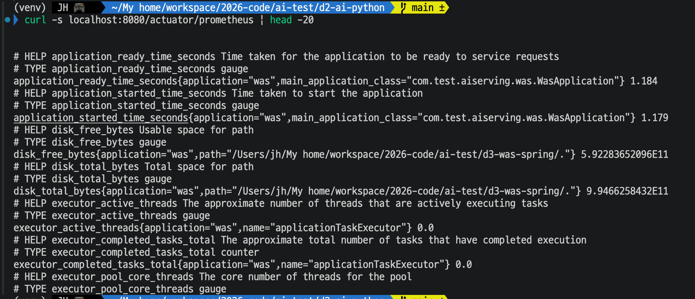

FastAPI 워커 지표 주소. `agent_worker_up` 은 1.0 이고, 처리한 메시지가 없어 `agent_worker_handle_seconds_count`, `agent_worker_commits_total` 은 0.0 이다. `http_requests_total` 줄은 출력에 없었다.

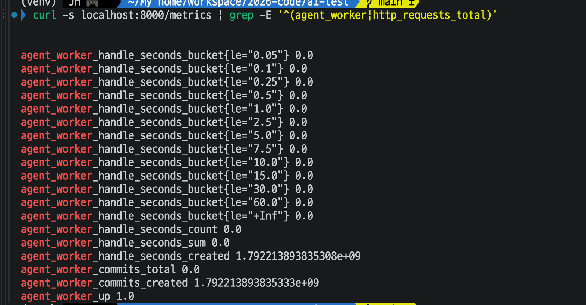

Prometheus `/targets`.

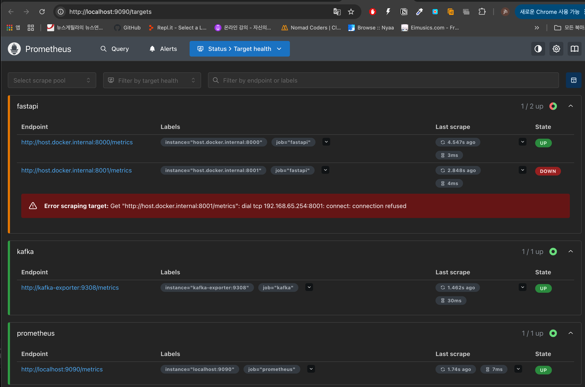

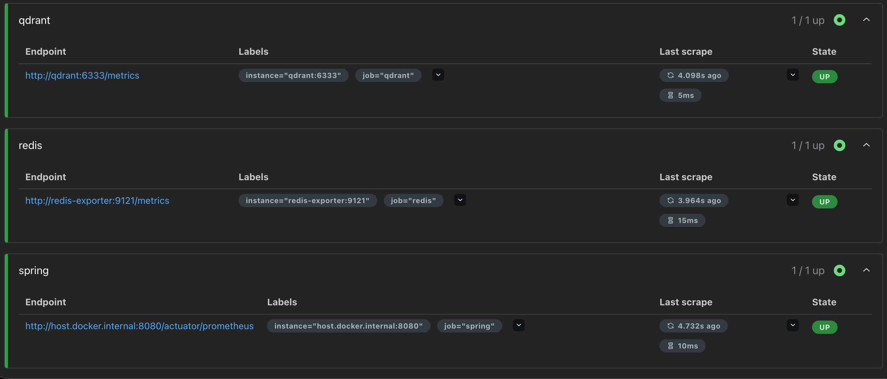

| 대상                         | 주소                                                | 상태                                                                 |
| ---------------------------- | --------------------------------------------------- | -------------------------------------------------------------------- |
| spring                       | host.docker.internal:8080/actuator/prometheus       | UP                                                                   |
| fastapi (8000)               | host.docker.internal:8000/metrics                   | UP                                                                   |
| fastapi (8001)               | host.docker.internal:8001/metrics                   | DOWN (`connection refused`. 8001 워커를 켜지 않았다)                 |
| kafka                        | kafka-exporter:9308/metrics                         | UP                                                                   |
| redis                        | redis-exporter:9121/metrics                         | UP                                                                   |
| qdrant                       | qdrant:6333/metrics                                 | UP                                                                   |
| prometheus                   | localhost:9090/metrics                              | UP                                                                   |

Grafana 대시보드 `AI 에이전트 서빙 개요`(부하 없음, 시간 범위 Last 15 minutes, 5초 새로고침).

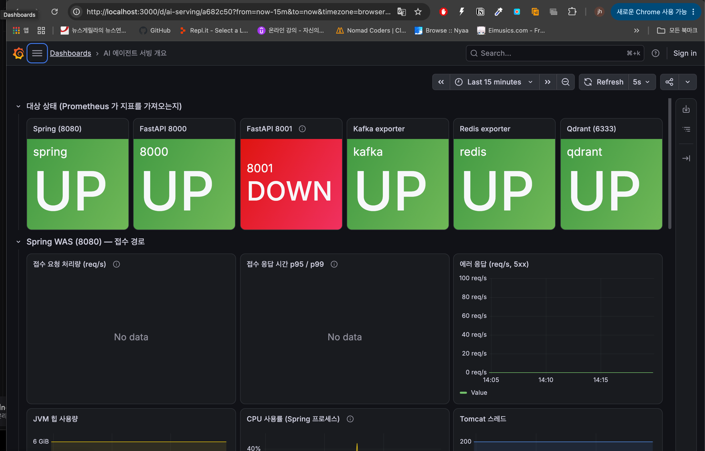

| 패널                       | 결과                                                                     |
| -------------------------- | ------------------------------------------------------------------------ |
| 대상 상태 6칸              | Spring, FastAPI 8000, Kafka exporter, Redis exporter, Qdrant 는 UP(초록), FastAPI 8001 만 DOWN(빨강) |
| 접수 요청 처리량           | No data                                                                  |
| 접수 응답 시간 p95 / p99   | No data                                                                  |
| 에러 응답(5xx)             | 0 (선 하나)                                                              |
| JVM 힙, CPU, Tomcat 스레드 | 값이 그려짐 (화면 아래쪽은 캡처에 일부만 보임)                           |

**해석:**

- 가이드의 예상과 같았다. 8001 만 DOWN 이고 나머지 대상은 모두 UP 이다. 8001 은 워커를 켜지 않아 `connection refused` 가 정상이다.
- 접수 처리량과 응답 시간 패널이 No data 인 것은 요청이 한 건도 없었기 때문이다. 해당 지표 줄은 요청이 들어온 뒤에 생긴다. 5xx 패널은 에러가 없을 때 0 을 보이게 해 둔 질의라 0 선이 그려졌다.
- Spring 에 actuator 와 `micrometer-registry-prometheus` 를 추가한 설정이 Spring Boot 4.1.1 에서 동작해 `/actuator/prometheus` 가 열렸다. Qdrant 의 `/metrics` 도 Prometheus 가 가져왔고, 컨테이너 안에서 `host.docker.internal` 로 Spring 과 FastAPI 에 접근할 수 있었다.

### 3-2. ② 부하를 거는 동안 대시보드 관찰 (워커 2개, 접수 초당 약 5건)

**목적:** 접수 처리량, 접수 응답 시간, Kafka 에 쌓인 요청(lag), 워커 처리 속도가 부하를 걸었을 때와 끝난 뒤에 어떻게 움직이는지 본다.

k6 요약(총 1분 15.2초). 요청 334건이 모두 202 로 접수됐고 중단된 반복은 0건이다.

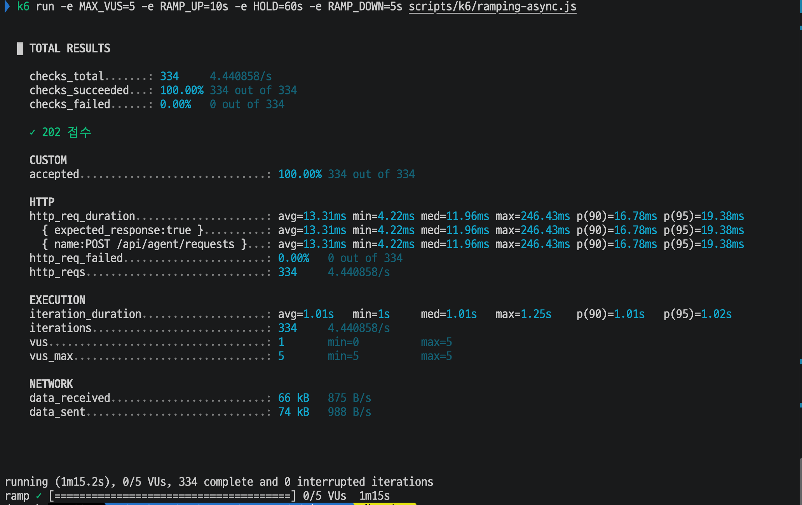

대시보드 캡처 3장(시간 범위 14:19 ~ 14:30, 부하는 14:21 경 시작. Kafka lag 패널은 `agent-workers` 그룹만 보도록 질의를 고친 뒤 같은 기간을 다시 캡처했다).

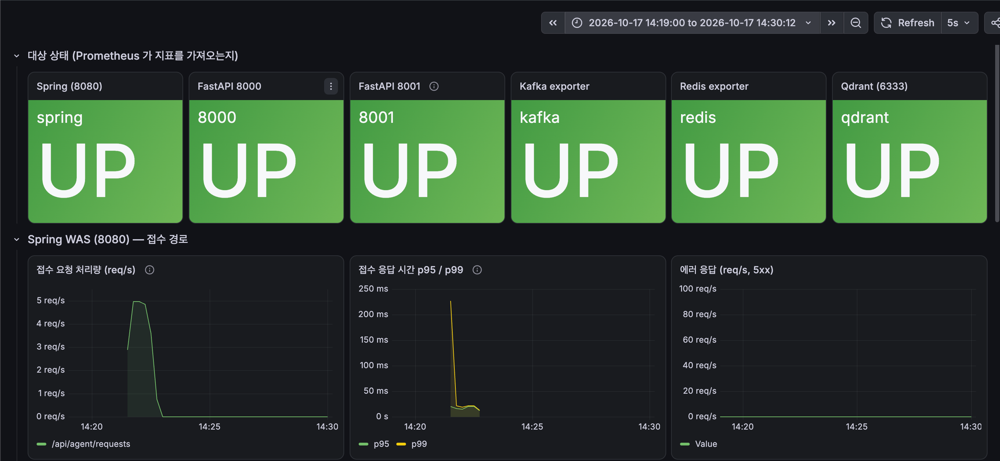

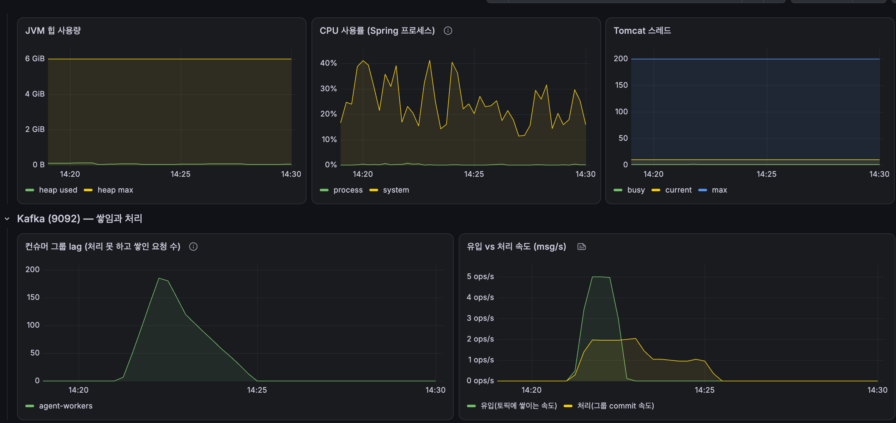

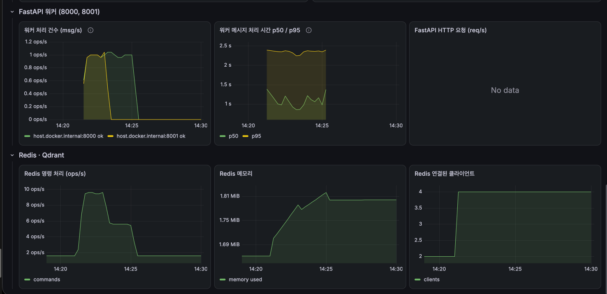

| 패널                         | 결과                                                                                                                                              |
| ---------------------------- | ------------------------------------------------------------------------------------------------------------------------------------------------- |
| 대상 상태 6칸                | 8001 도 UP 으로 바뀌어 6칸 모두 UP                                                                                                                |
| 접수 요청 처리량             | 14:21:45 경 5 req/s 에 도달해 14:22:15 경까지 유지, 14:22:40 경 0                                                                                         |
| 접수 응답 시간 p95 / p99     | 처음 한 점에서 p99 가 약 230ms, 이후 p95, p99 모두 약 20~25ms 에서 유지(그림에서 읽은 값). k6 는 p(95) 19.38ms, max 246.43ms                                                                           |
| 에러 응답(5xx)               | 0                                                                                                                                                 |
| JVM 힙                       | 사용량은 0 에 가까운 낮은 값(최대 6GiB)                                                                                                           |
| CPU 사용률                   | Spring 프로세스는 거의 0%. 시스템(PC 전체)은 부하 전후 모두 약 14~41% 로 오르내림                                                                  |
| Tomcat 스레드                | busy 는 0 에 가까움, current 약 10, max 200                                                                                                       |
| 컨슈머 그룹 lag              | 14:21 까지 0, 이후 늘어 14:22:30 경 최대 약 185건, 이후 거의 직선으로 줄어 14:24:30 경 0, 14:30 까지 0                                           |
| 유입 vs 처리 속도            | 유입은 14:21:30~14:22:15 에 약 5 msg/s, 14:22:45 경 0. 처리(commit)는 14:21:45 부터 약 2 msg/s, 14:23:00 경 약 1 msg/s 로 줄어 14:24:45 경까지 이어지다 14:25 경 0 |
| 워커 처리 건수               | 8000, 8001 모두 `ok` 약 1 msg/s. 8001 은 14:21:30 경 시작해 14:23:15 경 0, 8000 은 14:21:30 경 시작해 14:25:00 경 0 (8000 이 약 3.5분, 8001 이 약 1.7분)  |
| 워커 메시지 처리 시간        | p50 약 0.85~1.4초, p95 약 2.3~2.4초                                                                                                               |
| FastAPI HTTP 요청            | No data                                                                                                                                           |
| Redis 명령 처리              | 부하 전 약 1.7 ops/s, 14:22~14:23 최대 약 9.5 ops/s, 14:23:15~14:25 약 5.7 ops/s, 14:25:30 이후 다시 약 1.7 ops/s                                  |
| Redis 메모리, 연결 수        | 메모리 1.66 → 약 1.81 MiB 로 증가해 14:25 이후 유지, 연결된 클라이언트 2 → 4 (14:21 이후 14:30 까지 유지)                                         |

**해석:**

- 접수 경로는 정상이다. 대시보드의 접수 p95 약 20~25ms 는 k6 의 p(95) 19.38ms 와 비슷하고, Day 27 에서 k6 로 잰 값(약 22~26ms)과도 비슷하다. 5xx 는 0, k6 의 접수 성공은 334건 모두 202(100%)다. 요청 처리량의 최대값(5 req/s)은 k6 설정(VU 5, 요청 사이 1초 쉼)과 맞는다.
- 5 req/s 가 약 30초만 유지된 것으로 보인 것은 질의가 30초 구간의 변화율(`rate(...[30s])`)이라서다. 구간이 전부 유지 구간(60초) 안에 들어와야 최대값이 되므로 60초 유지는 약 30초의 평탄한 구간으로 보인다. k6 요약의 요청 수 334건도 60초 유지와 맞는다(유지 60초 약 297건 + 올리기, 내리기 구간).
- 처음 한 점의 p99 약 230ms 는 k6 의 max 246.43ms 와 비슷하다. 가장 느린 요청 한 건이 요청 수가 적은 첫 구간의 p99 로 보인 것으로 추정한다.
- 5 req/s 접수에 Spring 은 여유가 크다. 프로세스 CPU 와 Tomcat busy 스레드가 0 에 가깝다. 시스템 CPU 의 오르내림은 부하 전부터 있어 이 요청과 관련이 있다고 보기 어렵다.
- 유입(약 5 msg/s)이 처리(약 2 msg/s)보다 빨라 Kafka 에 요청이 쌓였고, lag 가 약 185건까지 늘었다가 유입이 끝난 뒤 약 2분에 걸쳐 0 으로 줄었다. 이 값은 가이드의 예상(최대 약 150~200건, 부하 뒤 1~2분에 걸쳐 0)과 같다.
- 처리 속도가 14:23:00 경 약 2 → 약 1 msg/s 로 줄어든 것은 8001 이 먼저 일을 마쳤기 때문이다("워커 처리 건수" 패널에서 8001 의 선이 14:23:15 경 0 으로 내려가고 8000 은 14:25:00 경까지 이어짐). 파티션이 3개이고 워커가 2개라 한 워커가 2개를, 다른 워커가 1개를 맡았고 각 워커가 한 번에 한 건씩 처리하므로, 8000 이 2개, 8001 이 1개를 맡아 8000 이 약 2배 오래 처리한 것으로 추정했다. ② 뒤에 두 워커의 `/health` 를 조회해 확인했다.

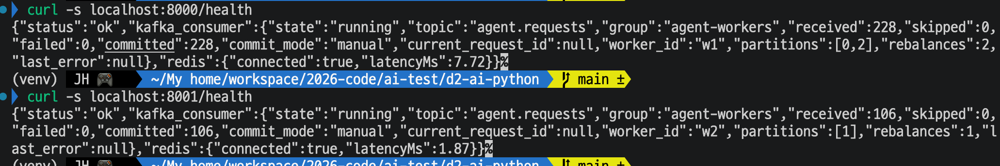

| 워커      | 담당 파티션 | received | committed | failed | skipped |
| --------- | ----------- | -------- | --------- | ------ | ------- |
| w1 (8000) | 0, 2        | 228      | 228       | 0      | 0       |
| w2 (8001) | 1           | 106      | 106       | 0      | 0       |

  8000 이 파티션 2개, 8001 이 1개를 맡았다. 두 워커가 처리한 합(334건)은 k6 가 보낸 요청 수(334건)와 같고 실패와 건너뜀은 0 이다. 처리 건수의 비(228 : 106)와 대시보드에서 읽은 처리 시간의 비(약 3.5분 : 1.7분)가 파티션 수의 비(2 : 1)와 비슷하다.
- 워커 처리 시간 p95 약 2.4초는 가짜 모델 지연(1초)보다 크게 보이는데, 히스토그램 버킷 경계가 1.0초와 2.5초라 1초를 조금 넘는 값들이 (1, 2.5] 구간에 모여 보간된 값으로 보인다. p50 이 0.85~1.4초로 흔들리는 것도 같은 이유로 추정한다.
- Redis 명령 처리와 메모리, 연결 수가 부하와 함께 늘었다. 워커가 결과를 Redis 에 쓰기 때문으로 보인다. 부하 전 약 1.7 ops/s 는 redis-exporter 가 5초마다 조회하는 명령으로 추정한다.
- FastAPI HTTP 요청 패널이 No data 인 것은 k6 가 Spring 만 호출하고 워커의 HTTP 엔드포인트는 호출하지 않아서로 추정했다. 이후 워커 8000 에 `/health` 요청을 20번 보내(`seq 1 20 \| xargs -I{} curl -s -o /dev/null localhost:8000/health`) 확인했다. 패널에 `host.docker.internal:8000 /health` 선이 나왔다. 워커는 Kafka 에서 읽어 처리하는 일이 HTTP 요청으로 잡히지 않으므로, 이 패널은 워커의 HTTP 엔드포인트를 호출할 때만 값이 생긴다.

### 3-3. ③ 부하 중 워커 하나 끄기 (8001 워커를 끄고 약 2분 뒤 다시 켬)

**목적:** 워커가 하나 사라졌을 때 대시보드에서 무엇이 어떻게 보이는지 확인한다. 장애를 대시보드로 알아차릴 수 있는지를 본다.

k6 요약(총 1분 15.9초). 요청 335건이 모두 202 로 접수됐고 중단된 반복은 0건이다.

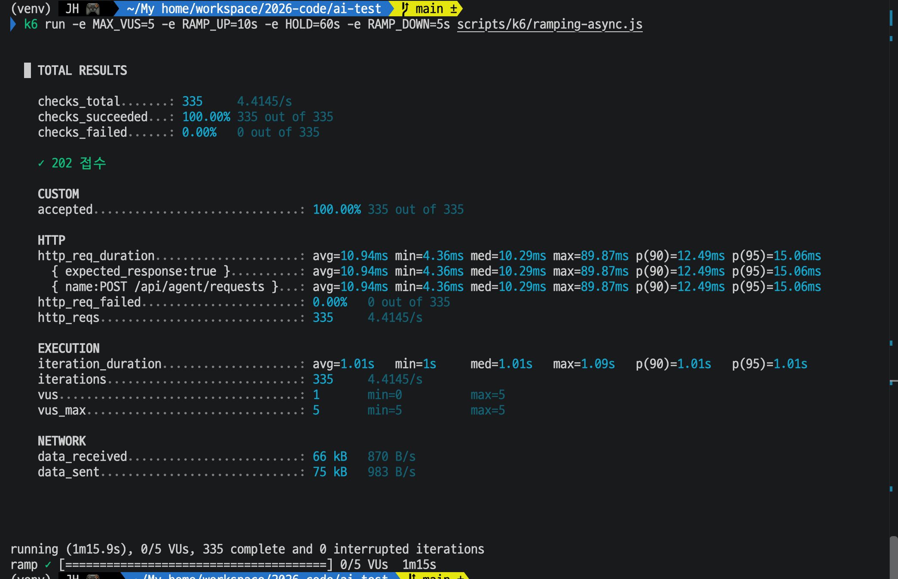

대시보드 캡처 3장(시간 범위를 14:43:00 ~ 14:49:00 으로 고정했다. 상태 6칸은 캡처한 14:51 의 현재 값이다).

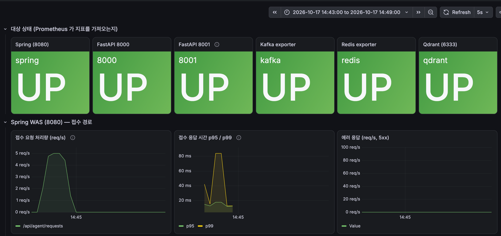

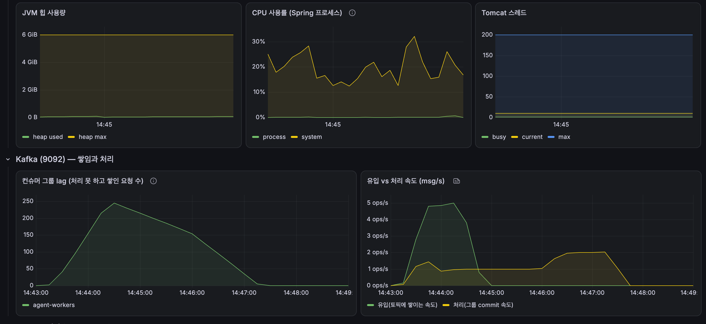

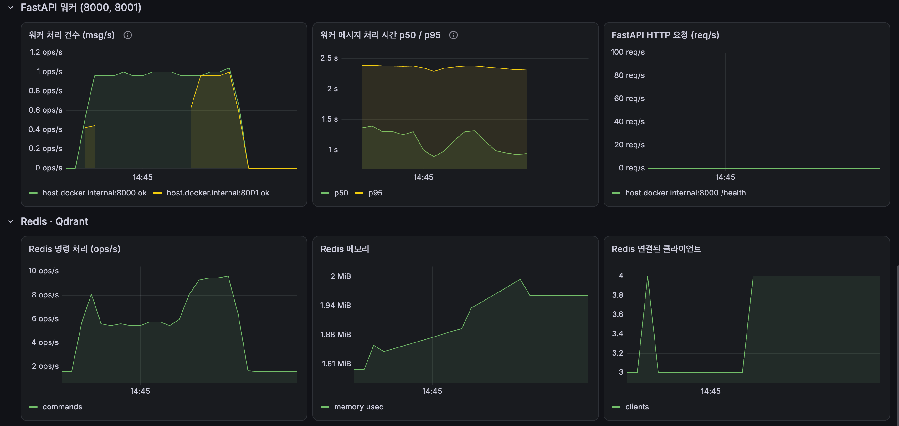

대시보드에서 읽은 흐름(아래 시각은 그림에서 읽은 값이다).

| 시각(약)        | 일어난 일                                                                                                                 |
| --------------- | ------------------------------------------------------------------------------------------------------------------------- |
| 14:43:20 ~ 14:43:30 | 부하 시작. 워커 둘이 처리 시작. Redis 연결된 클라이언트는 3 이다가 14:43:30 경 잠깐 4 가 됨                               |
| 14:43:40        | "워커 처리 건수" 패널에서 8001 의 선이 끊김(8001 을 끈 시각). Redis 연결된 클라이언트는 다시 3                              |
| 14:44~14:46:00  | 8000 이 혼자 약 1 msg/s 로 처리. lag 는 14:44:30 경 최대 약 245건, 이후 약 1건/초로 줄어 14:46:00 경 약 155건. Redis 명령 처리 약 5.5 ops/s |
| 14:44:55        | 유입(접수) 끝                                                                                                             |
| 14:46:00        | 8001 선이 다시 나타남(다시 켠 시각). Redis 연결된 클라이언트 3 → 4                                                         |
| 14:46~14:47:25  | 두 워커가 처리, 처리 속도 약 2 msg/s, Redis 명령 처리 약 9.5 ops/s. lag 가 약 155 → 0 으로 줄어 14:47:30 경 0              |
| 14:47:40        | 처리 속도 0                                                                                                               |

| 패널                          | 결과                                                                                                                       |
| ----------------------------- | -------------------------------------------------------------------------------------------------------------------------- |
| 대상 상태 6칸                 | 캡처 시점(14:51)에는 8001 포함 모두 UP. 8001 을 다시 켠 뒤라서 DOWN 이었던 구간은 이 칸에서 보이지 않는다                  |
| 접수 요청 처리량              | 약 5 req/s 까지 올랐다가 14:45:00 경 0                                                                                     |
| 접수 응답 시간 p95 / p99      | p95 약 12~18ms, p99 는 최대 약 85ms. k6 는 p(95) 15.06ms, max 89.87ms                                                      |
| 에러 응답(5xx)                | 0                                                                                                                          |
| 컨슈머 그룹 lag               | 14:43:00 에는 0, 14:43:45 경 약 40건을 지나 약 245건까지 늘고, 이후 줄어듦(위 표)                                                       |
| 유입 vs 처리 속도             | 유입 약 5 msg/s. 처리는 14:44 이후 약 1 msg/s, 14:46:30~14:47:10 에 약 2 msg/s, 14:47:40 에 0                              |
| 워커 처리 건수                | 8000 은 14:43:40 이후 14:47:15 경까지 약 1 msg/s. 8001 은 14:46:00 부터 14:47:15 경까지 약 1 msg/s, 그 사이에는 선이 없음   |
| 워커 메시지 처리 시간         | p50 약 0.9~1.4초, p95 약 2.3~2.4초 (② 와 같은 모양)                                                                        |
| Redis                         | 명령 처리와 연결 수는 위 표와 같다. 메모리는 1.81 → 약 2 MiB 로 늘었다가 약 1.96 MiB 에서 유지                              |

**해석:**

- 워커 하나가 사라진 것은 대시보드에서 알아볼 수 있다. 처리 건수 패널에서 8001 의 선이 끊기고, Redis 연결된 클라이언트는 8001 이 돌아오는 14:46:00 에 3 → 4 로 늘고(끄는 순간에는 잠깐 4 에서 3 으로 돌아온 모양이라 뚜렷하지 않다), 처리 속도가 약 2 → 약 1 msg/s 로 내려간다.
- 8001 이 없는 동안 8000 이 혼자 처리했고(약 1 msg/s) lag 는 줄어드는 속도가 느려졌다. 14:44:30 ~ 14:46:00 에 약 245 → 155건(약 1건/초), 8001 이 돌아온 뒤 14:46:00 ~ 14:47:25 에 약 155 → 0(약 1.8건/초)이다. 이 두 기울기는 처리 속도 약 1 msg/s 와 약 2 msg/s 와 맞는다.
- 가이드의 예상과 다른 점이 있다. 가이드는 lag 증가 기울기가 끄기 전보다 가팔라질 것으로 예상했다. 이번에는 8001 을 끈 시점(14:43:40)이 부하가 막 시작된 직후라 끄기 전 구간이 짧아서 증가 기울기 변화를 구분하기 어렵다. 최대 lag 는 ② 의 약 185건보다 큰 약 245건이다.
- 8001 을 끄고 다시 켜지 않으면 lag 가 0 이 되기까지 8000 혼자 약 245건 ÷ 1 msg/s 가 걸린다. 이번에는 약 2분 뒤 8001 을 다시 켜서 14:47:30 경 0 이 되었다.
- Spring 접수 경로는 워커 장애와 무관하게 정상이다. 접수 p95 약 12~18ms(k6 p(95) 15.06ms), 5xx 0, 335건 모두 202 다. 접수는 Kafka 에 넣는 데서 끝나기 때문이다.
- 대상 상태 6칸은 현재 값만 보여서 8001 이 DOWN 이었던 시간은 이 칸으로 알 수 없다. 장애 시간은 처리 건수 패널의 선 끊김으로 읽었다. Redis 연결 수는 끄는 순간이 뚜렷하지 않아 재기동 시점 확인에만 썼다. DOWN 이력을 보려면 `up` 지표를 시간 그래프로 그리는 패널이 필요하다.

## 4. 해석

| 실험 | 확인한 것                                  | 대시보드에서 읽은 값                                                                                           |
| ---- | ------------------------------------------ | -------------------------------------------------------------------------------------------------------------- |
| ①    | 지표가 모이는지                            | Spring, FastAPI 8000, kafka-exporter, redis-exporter, Qdrant, Prometheus 가 UP. 8001 만 DOWN(워커를 켜지 않음) |
| ②    | 접수 초당 약 5건 부하(워커 2개)             | 접수 p95 약 20~25ms, lag 최대 약 185건 후 약 2분에 0, 유입 약 5 / 처리 약 2 msg/s                              |
| ③    | 부하 중 워커 하나 끄기                     | 8001 의 선 끊김, 재기동 때 Redis 연결 3 → 4, 처리 약 1 msg/s, lag 최대 약 245건, 8001 재기동 후 약 2 msg/s                |

- Prometheus + Grafana 로 Spring, Kafka(lag 와 유입, 처리 속도), FastAPI 워커(처리 건수와 처리 시간), Redis 의 상태를 한 화면에서 시간 흐름에 따라 볼 수 있게 되었다. Day 31 이후 실험에서 이 대시보드를 쓴다.
- 접수 초당 약 5건 정도의 부하에서 접수 경로(Spring)는 여유가 크다(프로세스 CPU, Tomcat busy 스레드 0 에 가까움). 요청이 쌓이는 곳은 워커다. 처리 속도는 "워커 수 × 한 건 처리 시간(가짜 모델 1초)"로 정해지고, 워커 수가 파티션 수보다 적으면 파티션을 많이 맡은 워커가 더 오래 일한다(②에서 8000 이 파티션 2개를 맡아 8001 보다 약 2배 오래 처리).
- 워커 장애는 처리 건수 패널의 선 끊김, 재기동 때 Redis 연결 수 증가, 처리 속도와 lag 감소 기울기 변화로 알아볼 수 있다. 접수 경로에는 영향이 없다. 반면 대상 상태 칸은 현재 값만 보여서 장애가 있었는지는 남지 않는다.
- 이 대시보드로 Day 31~36 에서 볼 것: Day 31(재시도)은 워커 처리 건수의 `failed` 와 처리 시간, Day 32(DLQ)는 lag 와 `failed`, Day 34.1(파티션 수와 TPS)는 처리 속도와 워커별 처리 건수, Day 36(서킷 브레이커)은 `failed` 와 처리 시간.

## 5. 한계

- ① 은 부하가 없는 상태의 확인이다. ② 는 접수 초당 약 5건의 약한 부하 한 번이다.
- 5초 간격으로 가져오고 질의가 30초 구간의 변화율이라 몇 초 안에 끝나는 변화는 보이지 않는다.
- ③ 도 한 번만 실행했고, 8001 을 끈 시점이 부하 시작 직후라 끄기 전 구간이 짧다.
- 대시보드의 시각과 값은 그림에서 읽은 값이라 눈금 단위의 오차가 있다.
