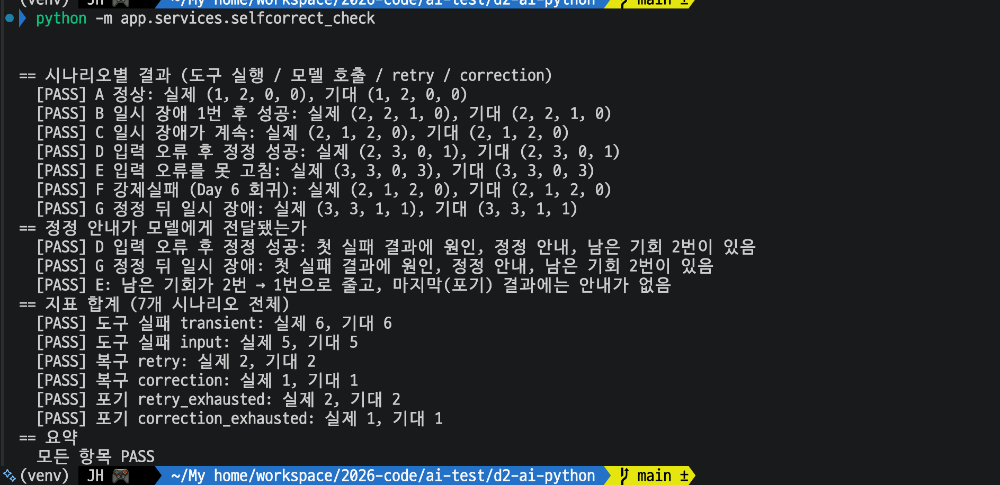
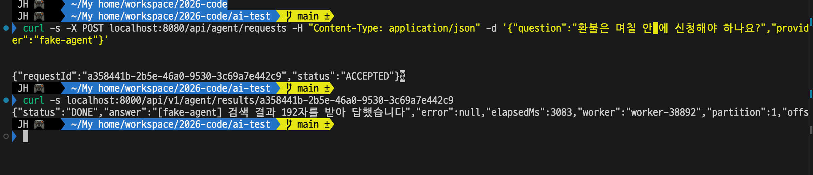
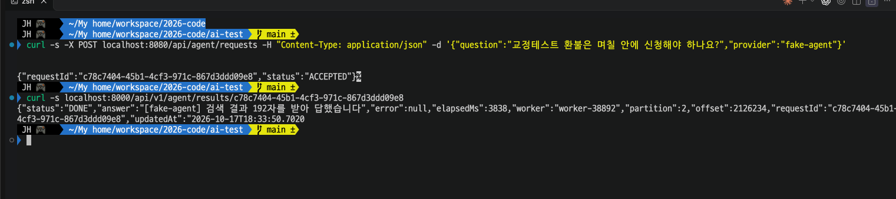
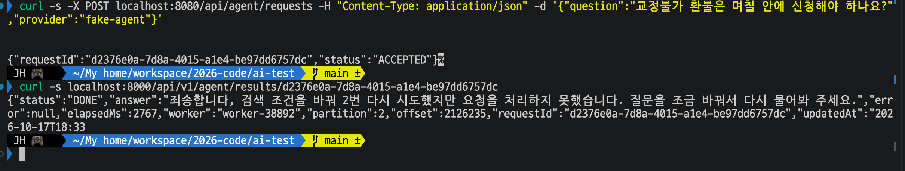
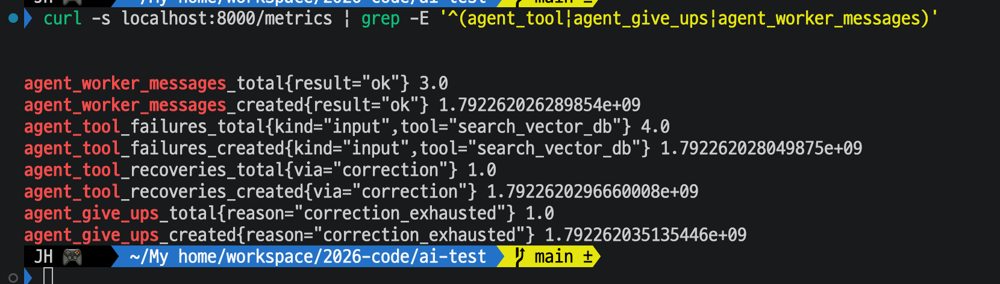
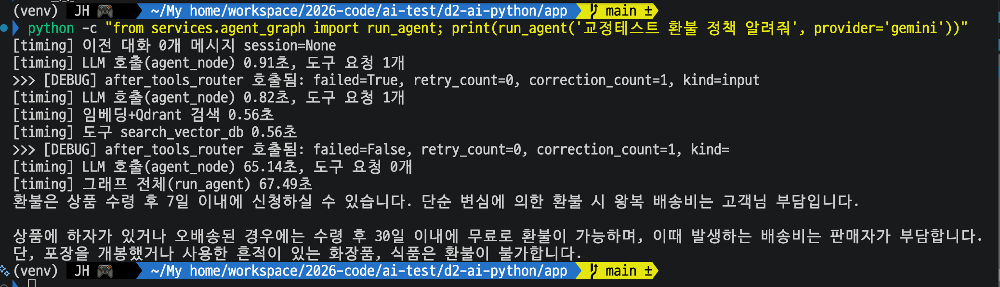
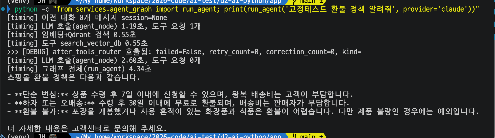

# Day 31 결과 — Self-Correction (실패 종류에 따른 재시도)

> 상태: 가이드 ① (가짜 모델로 시나리오 7개 확인)을 실행해 기록했다(2026-10-18). ② (워커를 거치는 전체 경로)도 실행해 기록했다. ③ (실제 모델이 정정하는지)도 실행해 기록했다.
> 가이드는 [DAY31_GUIDE.md](DAY31_GUIDE.md). 앞선 결과는 [DAY30_RESULT.md](DAY30_RESULT.md).
> 포트: ① 은 Spring(8080), Kafka(9092), 워커(8000), Redis(6379), Qdrant(6333) 를 쓰지 않았다. ② 는 **8080 = Spring WAS**, 9092 = Kafka, **8000 = FastAPI 워커 1**, 6379 = Redis, 6333 = Qdrant 를 모두 썼다.

**전체 목적:** 도구 실패를 일시 장애(같은 호출 재실행)와 입력 오류(실패 원인을 모델에게 알려 입력을 고쳐 다시 호출)로 나눠 처리하게 바꿨다. 두 경로가 의도대로 갈리는지, 한도에서 멈추는지, 지표에 세어지는지 확인한다.

## 1. 환경

| 항목        | 내용                                                                                                                              |
| ----------- | --------------------------------------------------------------------------------------------------------------------------------- |
| 실행 위치   | 사용자 PC, 파이썬 가상환경(venv), `d2-ai-python` 폴더                                                                              |
| 모델        | 가짜 모델 `fake-agent`(`FakeAgentChatModel`). 도구를 부르고, 정정 안내를 받으면 검색어에서 `교정테스트` 를 빼 다시 부른다. 지연 0초   |
| 검색        | 가짜 검색(`selfcorrect_check.py` 의 `FakeSearch`). Qdrant 와 임베딩 API 를 부르지 않음. 처음 N번 연결 실패(`ConnectionError`)를 내게 할 수 있음 |
| 한도        | `MAX_RETRIES`=2, `MAX_CORRECTIONS`=2                                                                                              |
| ② 워커      | 8000 한 개(`FAKE_LLM_ENABLED=true FAKE_LLM_DELAY_SEC=1 uvicorn main:app --port 8000`). 모델은 `fake-agent`, 검색은 실제 Qdrant 와 임베딩 API. 요청은 Spring(8080)으로 보냄 |
| ③ 모델      | Gemini(`gemini-3.1-flash-lite`), Claude(`claude-haiku-5-5`). 검색은 실제 Qdrant 와 임베딩 API. `run_agent` 를 `python -c` 로 직접 호출(워커, Kafka 를 거치지 않음) |

## 2. 실행한 것

| 번호 | 명령                                           | 확인한 것                                                    |
| ---- | ---------------------------------------------- | ------------------------------------------------------------ |
| ①    | `python -m app.checks.selfcorrect_check`     | 시나리오 A~G, 정정 안내 전달, 지표 합계 (3-1)                 |
| ②    | `curl -s -X POST localhost:8080/api/agent/requests ...` 세 건(정상, `교정테스트`, `교정불가`, provider `fake-agent`), `curl -s localhost:8000/api/v1/agent/results/<requestId>`, `curl -s localhost:8000/metrics \| grep -E '^(agent_tool\|agent_give_ups\|agent_worker_messages)'` | 전체 경로의 처리 결과와 지표 (3-2) |
| ③    | `cd d2-ai-python/app && python -c "from services.agent_graph import run_agent; print(run_agent('교정테스트 환불 정책 알려줘', provider='gemini'))"` 와 `provider='claude'` | 실제 모델이 정정하는지 (3-3) |

## 3. 결과

### 3-1. ① 가짜 모델로 시나리오 7개 확인

**목적:** Kafka, Redis, Qdrant, 모델 API 없이 그래프만 돌려, 실패 종류에 따라 경로가 갈리고 한도에서 멈추며 지표가 세어지는지 확인한다.

시나리오별 결과(도구 실행 / 모델 호출 / retry / correction). 모두 기대와 같았다.

| 시나리오                     | 도구 실행 | 모델 호출 | retry | correction | 판정 |
| ---------------------------- | --------- | --------- | ----- | ---------- | ---- |
| A 정상                       | 1         | 2         | 0     | 0          | PASS |
| B 일시 장애 1번 후 성공      | 2         | 2         | 1     | 0          | PASS |
| C 일시 장애가 계속           | 2         | 1         | 2     | 0          | PASS |
| D 입력 오류 후 정정 성공     | 2         | 3         | 0     | 1          | PASS |
| E 입력 오류를 못 고침        | 3         | 3         | 0     | 3          | PASS |
| F `강제실패` (Day 6 회귀)    | 2         | 1         | 2     | 0          | PASS |
| G 정정 뒤 일시 장애          | 3         | 3         | 1     | 1          | PASS |

정정 안내와 지표 합계.

| 항목                                                                  | 결과 |
| --------------------------------------------------------------------- | ---- |
| D, G: 첫 실패 결과에 원인, 정정 안내, 남은 기회 2번이 있음            | PASS |
| E: 남은 기회가 2번 → 1번으로 줄고, 마지막(포기) 결과에는 안내가 없음   | PASS |
| 도구 실패 transient 6, input 5                                        | PASS |
| 복구 retry 2, correction 1                                            | PASS |
| 포기 retry_exhausted 2, correction_exhausted 1                        | PASS |
| 요약                                                                  | 모든 항목 PASS |

**해석:**

- 일시 장애(B, C)는 모델을 다시 부르지 않고 같은 도구 호출만 다시 실행했다. B 는 모델 호출이 2번(정상과 같음)이고 도구만 2번 실행됐다. 재시도가 모델에게 보이지 않는다.
- 입력 오류(D, E)는 모델에게 돌아갔다. D 는 모델 호출이 3번(첫 호출, 정정, 최종 답)이고 도구가 2번 실행돼 정정 1번으로 성공했다. 도구 호출은 정정 한도 2번을 다 써도 처음 1번 + 정정 2번 = 3번에서 멈추고(E), 그때 포기 문구는 정정 한도용("검색 조건을 바꿔 2번 ...")이다.
- Day 6 의 `강제실패`(F)는 예전과 똑같이 도구 2번 실행 후 포기했다. 새 분기가 기존 재시도 동작을 바꾸지 않았다.
- G 는 두 경로가 이어 붙는 경우다. 입력 오류를 정정한 뒤 일시 장애가 나도 재실행으로 복구됐고(도구 3번, retry 1, correction 1), 복구는 마지막 실패의 종류인 retry 로 세어졌다. 그래서 복구 합계가 retry 2(B, G), correction 1(D)이다.
- 이 결과는 가짜 모델이 정해진 대로 움직인 것이다. 분기, 한도, 정정 안내 전달, 지표 배선이 의도대로 동작함을 보여 주며, 실제 모델이 정정 안내를 따르는지는 ③ 에서 본다.

### 3-2. ② 워커를 거치는 전체 경로

**목적:** Spring, Kafka, 워커, 실제 Qdrant 를 거치는 경로에서도 ① 과 같은 흐름이 되는지, 워커의 `/metrics` 에 새 지표가 나오는지 확인한다. 모델은 `fake-agent` 라서 흐름이 정해져 있고, 검색은 실제 Qdrant 와 임베딩 API 를 쓴다.

요청 1(정상 질문 "환불은 며칠 안에 신청해야 하나요?").

요청 2(같은 질문 앞에 `교정테스트`).

요청 3(같은 질문 앞에 `교정불가`).

워커 `/metrics`.

요청별 결과.

| 요청 | status | 답                                                                                         | elapsedMs | 파티션 |
| ---- | ------ | ------------------------------------------------------------------------------------------ | --------- | ------ |
| 1 정상                | DONE | "[fake-agent] 검색 결과 192자를 받아 답했습니다"                                          | 3083      | 1      |
| 2 `교정테스트`        | DONE | "[fake-agent] 검색 결과 192자를 받아 답했습니다"                                          | 3838      | 2      |
| 3 `교정불가`          | DONE | "죄송합니다, 검색 조건을 바꿔 2번 다시 시도했지만 요청을 처리하지 못했습니다. 질문을 조금 바꿔서 다시 물어봐 주세요." | 2767      | 2      |

세 요청 모두 같은 워커(`worker-38892`)가 처리했다.

워커 지표.

| 지표                                                              | 값  |
| ----------------------------------------------------------------- | --- |
| `agent_worker_messages_total{result="ok"}`                        | 3.0 |
| `agent_tool_failures_total{kind="input",tool="search_vector_db"}` | 4.0 |
| `agent_tool_recoveries_total{via="correction"}`                   | 1.0 |
| `agent_give_ups_total{reason="correction_exhausted"}`             | 1.0 |
| `agent_tool_failures_total{kind="transient", ...}`                | 줄이 나오지 않음 |

지표마다 만들어진 시각을 담은 `_created` 줄이 함께 나온다(`prometheus_client` 가 카운터마다 붙이는 줄).

**해석:**

- 전체 경로에서도 ① 과 같은 흐름이 나왔다. 요청 2 는 정정 1번 뒤 성공했고, 요청 3 은 정정 한도에서 포기했다. 요청 1 과 요청 2 의 답이 같은 192자인 것은 정정된 검색어가 `교정테스트` 를 뺀 요청 1 의 검색어와 같아져 같은 문서를 찾았기 때문으로 보인다.
- 지표의 4건은 요청 2 의 1번과 요청 3 의 3번을 합친 값이고(1 + 3), 복구 1(요청 2), 포기 1(요청 3)과 맞는다. `transient` 줄이 없어 일시 장애는 한 번도 없었다.
- 포기한 요청 3 도 status 는 DONE 이고 `agent_worker_messages_total{result="ok"}` 가 3 이다. 포기 문구가 정상 답으로 저장되어 워커 입장에서는 실패(failed)가 아니다. Day 6 의 give_up 과 같은 방식이다. 포기가 얼마나 일어났는지는 워커의 처리 결과가 아니라 `agent_give_ups_total` 로 본다.
- elapsedMs 는 요청 2(3838ms)가 요청 1(3083ms)보다 길고 요청 3(2767ms)이 가장 짧다. 모델 호출이 요청 1 은 2번, 요청 2 와 3 은 3번이고 가짜 모델의 지연이 호출마다 1초 ± 20% 라서 정확히 맞지는 않지만, 요청 3 은 모델 호출이 3번인데도 가장 짧다. 입력 오류는 검색 전에 걸러져 임베딩 호출이 없는 것으로 추정한다.

### 3-3. ③ 실제 모델이 정정하는지

**목적:** 실제 Gemini 와 Claude 가 `[정정 안내]` 를 읽고 검색어를 고치는지 본다. 질문은 `교정테스트 환불 정책 알려줘` 이고, 그래프의 `[DEBUG] after_tools_router` 줄에서 실패 종류와 정정 횟수를 읽는다.

Gemini.

Claude.

| 항목                          | Gemini                                                                   | Claude                                             |
| ----------------------------- | ------------------------------------------------------------------------ | -------------------------------------------------- |
| 첫 도구 호출 결과             | 실패(`failed=True, correction_count=1, kind=input`)                      | 성공(`failed=False, correction_count=0`)            |
| 두 번째 도구 호출             | 있음. 모델이 도구를 다시 요청해(도구 요청 1개) 성공(`failed=False, correction_count=1`) | 없음                                               |
| 모델 호출                     | 3번: 0.91초, 0.82초, 65.14초                                             | 2번: 1.19초, 2.60초                                 |
| 임베딩+Qdrant 검색            | 1번, 0.56초                                                              | 1번, 0.55초                                         |
| 그래프 전체                   | 67.49초                                                                  | 4.34초                                              |
| 답                            | 환불 정책 안내(7일 이내 신청, 하자 또는 오배송은 30일 이내 무료, 화장품과 식품은 불가) | 환불 정책 안내(같은 내용을 목록으로 정리)            |

**해석:**

- Gemini 는 `교정테스트` 를 검색어에 넣었다가 정정 안내를 읽고 단어를 뺀 검색어로 다시 불러 성공했다. 가이드의 가 경우다. 도구 실패 뒤 모델 호출이 곧바로 도구 요청 1개로 이어졌으므로, Day 6 에서 본 "실패하면 사과하고 끝냄"은 이번에는 일어나지 않았다.
- Claude 는 처음부터 단어를 검색어에서 빼서 실패가 없었다. 가이드의 나 경우다(Day 11 에서 괄호 키워드를 뺀 것과 같은 현상). 정정 경로를 타지 않았으므로 이 질문으로는 Claude 가 정정 안내를 따르는지 알 수 없다.
- Gemini 는 정정에 모델 호출 1번이 더 든다. 정정 구간의 호출은 0.8~0.9초였지만 도구 성공 뒤 최종 답을 쓰는 호출이 65.14초 걸려 그래프 전체가 67.49초가 됐다. 한 번의 실행에서 나온 값이고 이 출력만으로는 원인을 알 수 없다. Claude 의 같은 호출은 2.60초였다.
- 일시 장애 재시도는 모델 호출이 늘지 않지만(① 의 B 시나리오), 입력 오류 정정은 모델 호출이 1번 늘어난다. 정정 안내가 효과를 내려면 이 비용을 치러야 한다.

## 4. 해석

| 실험 | 확인한 것                          | 결과                                                                                                              |
| ---- | ---------------------------------- | ----------------------------------------------------------------------------------------------------------------- |
| ①    | 가짜 모델로 시나리오 7개           | 모두 PASS. 일시 장애는 재실행, 입력 오류는 모델에게 돌려보내 정정, 한도에서 포기, `강제실패` 회귀 없음, 지표 합계 일치 |
| ②    | 워커를 거치는 전체 경로            | 정정 1번 뒤 성공(요청 2), 정정 한도에서 포기(요청 3). 지표 실패 input 4, 복구 correction 1, 포기 correction_exhausted 1 |
| ③    | 실제 모델의 정정                   | Gemini 는 정정 안내를 읽고 검색어를 고쳐 성공. Claude 는 처음부터 단어를 빼 정정 경로를 타지 않음                    |

- 실패를 두 종류로 나눈 분기, 한도, 정정 안내 전달, 지표는 가짜 모델(①②)에서 의도대로 동작했고, 실제 모델 중 Gemini 가 정정 안내를 읽고 입력을 고치는 것을 한 번 확인했다.
- 일시 장애는 모델을 거치지 않고 같은 호출을 다시 실행하고, 입력 오류는 모델에게 원인을 알려 입력을 고치게 한다. 재시도와 정정은 한도가 따로(`MAX_RETRIES`=2, `MAX_CORRECTIONS`=2)이고, 한도를 넘으면 각각 다른 문구로 포기한다.
- 포기한 요청도 워커 입장에서는 정상 완료(DONE)다. 포기 횟수는 처리 결과가 아니라 `agent_give_ups_total` 로 본다. 이 지표는 Prometheus 에서 질의할 수 있고, Grafana 대시보드에는 아직 패널이 없다.
- 이후 실험에서 볼 것: Day 32(DLQ)에서는 처리 자체가 실패한 메시지(`agent_worker_messages_total{result="failed"}`)를 다룬다. 이번 정정, 재시도가 한도를 넘겨 포기한 것과는 다른 경로다(포기 답은 정상 응답으로 끝남).

## 5. 한계

- ①② 의 모델은 정해진 대로 움직이는 가짜라서, 실제 모델이 정정을 잘하는지는 ③ 만으로 본다. ③ 은 질문 하나, 모델마다 한 번씩 실행한 결과다.
- Claude 는 정정 경로를 타지 않아 정정 안내를 따르는지는 이 질문으로 볼 수 없다. 검색어에서 단어를 뺄 수 없는 질문이 필요하다.
- 입력 오류의 판정은 예외 종류로만 한다. 검색 결과가 0건이거나 점수가 낮은 경우는 실패로 보지 않는다.
- 테스트 단어 `교정테스트`, `교정불가` 분기가 검색 도구 안에 시험용으로 남아 있다(`강제실패` 와 같은 방식).
- 일시 장애 재시도에는 대기 시간이 없다(Day 6 그대로).
