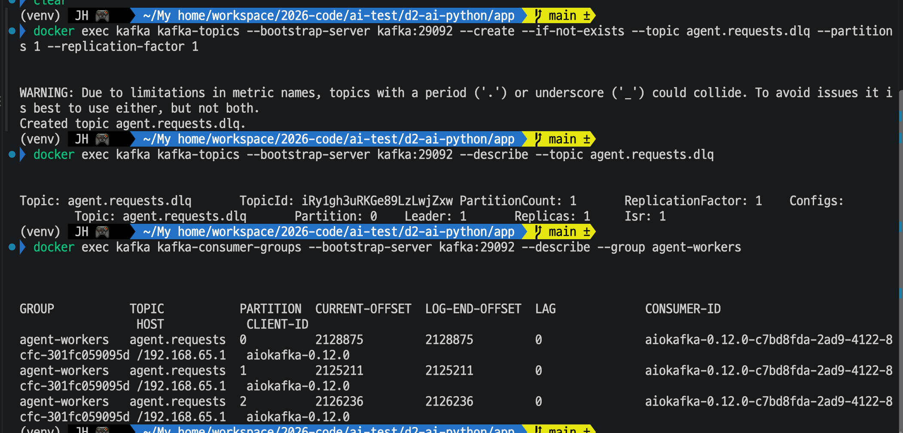
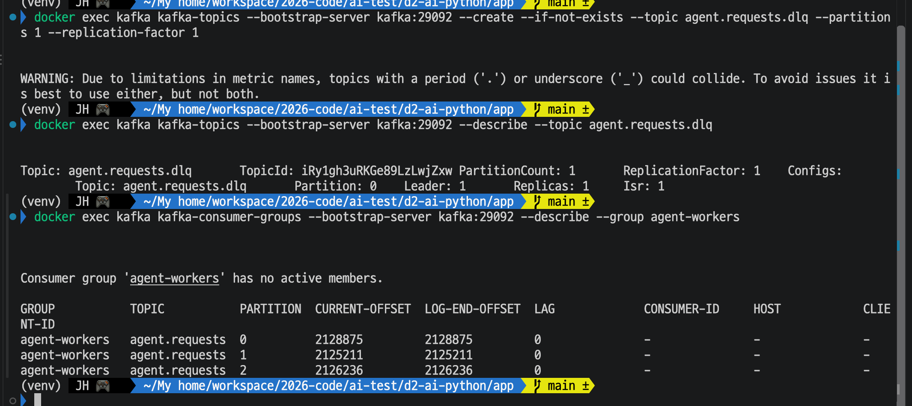
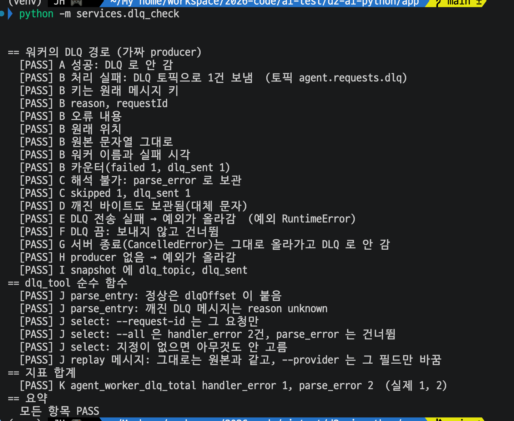
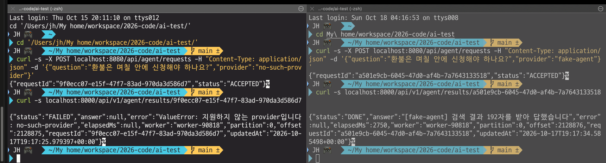
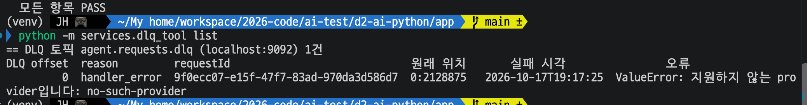
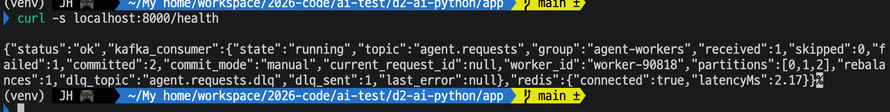
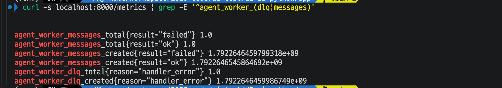
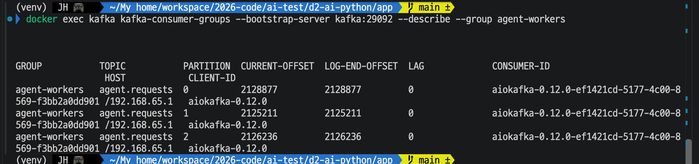
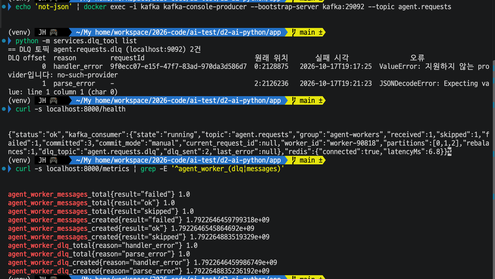
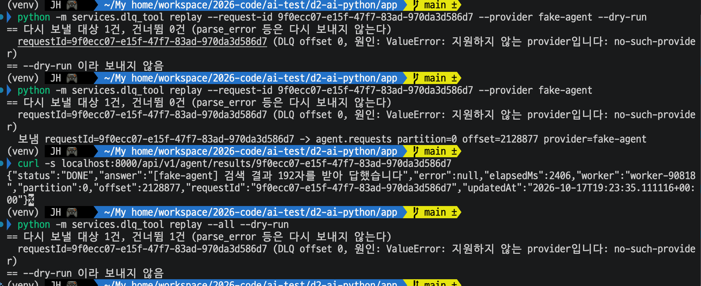

# Day 32 결과 — Kafka DLQ (처리하지 못한 요청 보관과 재처리)

> 상태: 가이드 ①②③④ 를 실행해 기록했다(2026-10-18).
> 가이드는 [DAY32_GUIDE.md](DAY32_GUIDE.md), 코드 설명은 [DAY32_CODE_GUIDE.md](DAY32_CODE_GUIDE.md). 앞선 결과는 [DAY31_RESULT.md](DAY31_RESULT.md).
> 포트: **8080 = Spring WAS**, **8000 = FastAPI 워커 1**, 9092 = Kafka(컨테이너 안은 `kafka:29092`), 6379 = Redis, 6333 = Qdrant. ① 은 이 중 아무것도 쓰지 않았다.
> 시각은 결과 JSON 과 DLQ 표에 UTC 로 찍힌 값이다(한국 시간은 +9시간).

**전체 목적:** 에이전트 처리가 실패하거나 해석할 수 없는 메시지를 로그만 남기고 버리지 않고 `agent.requests.dlq` 토픽에 원인과 함께 보관한다. 보관한 요청을 원인을 고친 뒤 다시 보낼 수 있는지 확인한다.

## 1. 환경

| 항목             | 내용                                                                                                                         |
| ---------------- | ---------------------------------------------------------------------------------------------------------------------------- |
| 실행 위치        | 사용자 PC, 파이썬 가상환경(venv), `d2-ai-python/app` 폴더. Spring(8080), Kafka, Redis, Qdrant 가 떠 있음                      |
| aiokafka         | 0.12.0 (그룹 조회의 `CLIENT-ID` 에 찍힌 값)                                                                                  |
| 토픽             | `agent.requests` 파티션 3개, `agent.requests.dlq` 파티션 1개(복제 1)                                                          |
| 워커             | 1개(`worker-90818`). `FAKE_LLM_ENABLED=true`, `FAKE_LLM_DELAY_SEC=1` 로 띄움. ②③④ 에서 같은 워커를 계속 썼다                    |
| 준비 상태        | 그룹 `agent-workers` 에 활성 컨슈머 없음, 파티션 0, 1, 2 모두 LAG 0 (아래 4-0)                                                |

## 2. 실행한 것

| 번호 | 하는 일                                                                  | 확인한 것                                   |
| ---- | ------------------------------------------------------------------------ | ------------------------------------------- |
| ①    | `python -m checks.dlq_check`                                           | 가짜 producer 로 워커의 DLQ 경로 (3-1)        |
| ②    | 실패 요청(잘못된 provider) 1건, 정상 요청 1건을 Spring 으로 보냄          | 처리 실패 보관, 뒤 요청이 막히지 않음 (3-2)   |
| ③    | `kafka-console-producer` 로 `not-json` 을 토픽에 직접 넣음                | 해석 불가 메시지 보관 (3-3)                   |
| ④    | `dlq_tool replay` 로 ② 의 실패 요청을 `provider=fake-agent` 로 다시 보냄  | 재처리, parse_error 는 다시 보내지 않음 (3-4) |

## 3. 결과

### 3-0. 준비: 워커가 꺼졌는지 확인

**목적:** 실험 전에 그룹에 컨슈머가 없고 쌓인 요청이 없는지 본다.

켜져 있을 때는 파티션 0, 1, 2 줄에 `CONSUMER-ID`(`aiokafka-0.12.0-c7bd8fda-...`), `HOST`, `CLIENT-ID` 가 채워져 있었다. 끈 뒤에는 `Consumer group 'agent-workers' has no active members.` 가 나오고 세 칸이 `-` 이다. 두 화면 모두 LAG 는 0 이고 `CURRENT-OFFSET` 은 2128875, 2125211, 2126236 으로 같았다. 판단 방법은 [DAY32_GUIDE.md](DAY32_GUIDE.md) 4절에 적었다.

### 3-1. ① 가짜 producer 로 DLQ 경로 확인

**목적:** Kafka 없이 워커의 메시지 처리(`_handle`)만 돌려, 무엇을 DLQ 로 보내고 언제 예외를 올리는지 확인한다.

항목 A~K 가 모두 PASS 였고 마지막 줄은 "모든 항목 PASS" 였다.

| 항목 | 확인한 것                                                                                                | 판정 |
| ---- | -------------------------------------------------------------------------------------------------------- | ---- |
| A    | 성공한 메시지는 DLQ 로 가지 않음                                                                         | PASS |
| B    | 처리 실패 → DLQ 토픽에 1건. 키, reason, requestId, 오류 내용, 원래 위치, 원본 문자열, 워커와 실패 시각, 카운터가 맞음 | PASS (8개 줄) |
| C    | 해석 불가 → `parse_error` 로 보관, skipped 1, dlq_sent 1                                                  | PASS |
| D    | 깨진 바이트도 보관됨(대체 문자)                                                                          | PASS |
| E    | DLQ 전송 실패 → 예외(`RuntimeError`)가 올라감                                                            | PASS |
| F    | DLQ 를 끄면 보내지 않고 건너뜀                                                                           | PASS |
| G    | 서버 종료(`CancelledError`)는 그대로 올라가고 DLQ 로 안 감                                               | PASS |
| H    | producer 가 없으면 예외가 올라감                                                                         | PASS |
| I    | `snapshot` 에 `dlq_topic`, `dlq_sent`                                                                     | PASS |
| J    | `parse_entry`, `select`(`--request-id`, `--all`, 지정 없음), replay 메시지(`--provider` 만 바뀜)          | PASS (6개 줄) |
| K    | `agent_worker_dlq_total` handler_error 1, parse_error 2                                                   | PASS |

**해석:** 사용자 PC 의 aiokafka 0.12.0 에서도 워커의 DLQ 판단 로직이 의도대로 동작했다. 이 단계는 가짜 producer 를 쓰므로 브로커 전송은 ②③④ 에서 본다.

### 3-2. ② 처리 실패한 요청이 DLQ 에 보관되는지

**목적:** 에이전트 처리가 예외로 끝난 요청이 DLQ 에 보관되고, 같은 파티션의 뒤 요청이 막히지 않으며, `/health` 와 지표에 잡히는지 본다.

| 요청 | provider           | 결과 조회                                                                                     |
| ---- | ------------------ | --------------------------------------------------------------------------------------------- |
| 1    | `no-such-provider` | `FAILED`, `ValueError: 지원하지 않는 provider입니다: no-such-provider`, 파티션 0, offset 2128875 |
| 2    | `fake-agent`       | `DONE`, "[fake-agent] 검색 결과 192자를 받아 답했습니다", 파티션 0, offset 2128876              |

두 요청은 같은 파티션 0 에 들어갔고, 실패한 요청이 먼저였다.

| 항목                                            | 기대값 (확인 전 예상)                         | 실제                                                                                  |
| ----------------------------------------------- | --------------------------------------------- | ------------------------------------------------------------------------------------- |
| 요청 1 결과                                     | `FAILED`, provider 오류                       | 같음                                                                                  |
| 요청 2 결과                                     | `DONE`, 막히지 않음                           | 같음                                                                                  |
| `dlq_tool list`                                 | `handler_error` 1건                           | 1건. requestId 가 요청 1 과 같고 원래 위치 `0:2128875`, 실패 시각 `2026-10-17T19:17:25`  |
| `/health` 의 `kafka_consumer`                   | `failed` 1, `dlq_sent` 1                      | `received` 1, `failed` 1, `committed` 2, `dlq_sent` 1, `dlq_topic` `agent.requests.dlq`, `state` running |
| `agent_worker_dlq_total{reason="handler_error"}` | 1.0                                           | 1.0                                                                                   |
| `agent_worker_messages_total`                   | `failed` 1.0, `ok` 1.0                        | 같음                                                                                  |
| 그룹 LAG                                        | 모든 파티션 0                                 | 0, 0, 0. 파티션 0 의 `CURRENT-OFFSET` 이 2128877 로 2 늘어남                           |

**해석:**

- 처리 실패한 메시지(offset 2128875)가 DLQ 에 보관됐고, DLQ 의 원래 위치 `0:2128875` 가 결과 조회의 `partition`, `offset` 과 일치한다. 원본을 추적할 수 있다.
- 바로 뒤 offset(2128876)의 정상 요청이 `DONE` 으로 처리됐다. 실패한 요청이 건너뛰어져 뒤 요청을 막지 않았다.
- 파티션 0 의 `CURRENT-OFFSET` 이 2 늘었고 `committed` 가 2 이므로, 실패한 메시지도 DLQ 에 보관한 뒤 commit 됐다.
- 지표(`dlq_total`, `messages_total`)와 `/health`(`failed`, `dlq_sent`)가 같은 건수를 가리킨다.

### 3-3. ③ 해석할 수 없는 메시지 보관

**목적:** JSON 이 아닌 메시지가 워커를 멈추지 않고 `parse_error` 로 보관되는지 본다. ② 의 워커를 그대로 썼다.

| 항목                                             | 기대값 (확인 전 예상)                         | 실제                                                                                              |
| ------------------------------------------------ | --------------------------------------------- | ------------------------------------------------------------------------------------------------- |
| `dlq_tool list`                                  | 2건, 새 행은 `parse_error`, requestId `-`      | 2건. 새 행은 `parse_error`, requestId `-`, 원래 위치 `2:2126236`, 실패 시각 `2026-10-17T19:21:23`, 오류 `JSONDecodeError: Expecting value: line 1 column 1 (char 0)` |
| `/health`                                        | `skipped` 1, `dlq_sent` 2, 계속 `running`      | `state` running, `received` 1, `skipped` 1, `failed` 1, `committed` 3, `dlq_sent` 2                |
| `agent_worker_dlq_total{reason="parse_error"}`   | 1.0 (handler_error 는 1.0 그대로)              | `parse_error` 1.0, `handler_error` 1.0                                                            |
| `agent_worker_messages_total{result="skipped"}`  | 1.0                                           | 1.0 (`failed` 1.0, `ok` 1.0 은 그대로)                                                            |

**해석:** 깨진 메시지가 워커를 멈추지 않고(`state` 가 계속 `running`) `parse_error` 로 보관됐다. 이 메시지는 requestId 가 없어서 DLQ 표의 requestId 칸이 `-` 이다. `committed` 가 2 에서 3 이 됐으므로 이 메시지도 보관 뒤 commit 됐다. 원래 위치 `2:2126236` 은 ② 의 그룹 조회에서 파티션 2 의 `LOG-END-OFFSET` 이던 값이다.

### 3-4. ④ DLQ 에서 다시 처리

**목적:** 보관한 요청을 원인(provider)을 고쳐 다시 보내 정상 처리되는지, `parse_error` 는 다시 보내지 않는지 본다.

| 단계                              | 기대값 (확인 전 예상)                                | 실제                                                                                                  |
| --------------------------------- | ---------------------------------------------------- | ----------------------------------------------------------------------------------------------------- |
| `--request-id ... --dry-run`      | 대상 1건, 건너뜀 0건. 보내지 않음                    | "다시 보낼 대상 1건, 건너뜀 0건", DLQ offset 0 의 요청 1, "--dry-run 이라 보내지 않음"                |
| `--request-id ... --provider fake-agent` | `보냄 requestId=... -> agent.requests partition=.. offset=.. provider=fake-agent` | `보냄 requestId=9f0ecc07-... -> agent.requests partition=0 offset=2128877 provider=fake-agent` |
| 같은 requestId 결과 조회          | `FAILED` 에서 `DONE` 으로 바뀜                       | `DONE`, "[fake-agent] 검색 결과 192자를 받아 답했습니다", 파티션 0, offset 2128877, `updatedAt` 19:23:35 |
| `replay --all --dry-run`          | 대상 1건, 건너뜀 1건                                 | "다시 보낼 대상 1건, 건너뜀 1건 (parse_error 등은 다시 보내지 않는다)", 대상은 요청 1                  |

**해석:**

- 같은 `requestId` 를 유지해 다시 보내 결과가 `FAILED`(② 에서 조회한 값)에서 `DONE` 으로 바뀌었다. 요청자는 같은 번호로 계속 조회하면 된다.
- 다시 보낸 메시지는 `agent.requests` 의 파티션 0, offset 2128877 에 들어갔다. ② 의 두 요청 다음 위치다.
- `replay --all --dry-run` 은 보낼 것 1건(handler_error)과 건너뛸 것 1건(parse_error)으로 나눴다. 재처리 뒤에도 handler_error 가 DLQ 에서 사라지지 않고 계속 대상으로 나온다. DLQ 는 지워지지 않는다.

## 4. 해석

- 건너뛰던 두 종류의 메시지(처리 실패, 해석 불가)가 모두 원인, 원래 위치, 원본과 함께 DLQ 에 남았다(②③). Day 16 까지는 로그 한 줄뿐이었던 정보다.
- 보관한 뒤 commit 했다. 두 번 모두 `committed` 가 처리한 메시지 수와 같고 LAG 가 0 이다.
- 실패 요청이 같은 파티션의 뒤 요청을 막지 않았다(②).
- 깨진 메시지가 워커를 멈추지 않았다(③).
- 원인을 고쳐 같은 `requestId` 로 다시 보내 결과를 덮어쓸 수 있고, `parse_error` 는 대상에서 빠진다(④).

## 5. 한계

- 워커 터미널의 로그(`처리 실패, 건너뜀`, `해석 불가 메시지 건너뜀`, 다시 보낸 메시지의 처리)는 캡처하지 않아 확인하지 못했다. 위 결론은 `/health`, `/metrics`, `dlq_tool list`, 결과 조회, 그룹 조회에서 나온 것이다.
- DLQ 전송이 실패할 때 워커가 재접속하고 같은 메시지를 다시 처리하는 동작은 ① 의 가짜 producer(항목 E, 예외가 올라가는 것까지)에서만 봤다. 실제 브로커를 멈추거나, DLQ 보관과 commit 사이에 워커를 죽이는 실험은 하지 않았다. 그 사이 죽으면 같은 메시지가 DLQ 에 두 번 들어갈 수 있다는 것은 코드 설계에서 나온 설명이고 실험으로 확인한 것이 아니다.
- 워커는 1개로 실험했다. 워커가 여러 개일 때 `worker` 필드로 구분되는지는 보지 않았다.
- `replay` 는 한 번만 실행했다. 두 번 실행하면 같은 요청이 두 번 들어가는지는 확인하지 않았다(가이드와 코드 설명에 적은 설계상의 성질이다).
- 처리 실패는 잘못된 provider 하나로만 만들었다. 모델 타임아웃이나 429 같은 다른 예외는 시험하지 않았다.
- DLQ 토픽의 보관 기간과 정리는 만들지 않았다.
