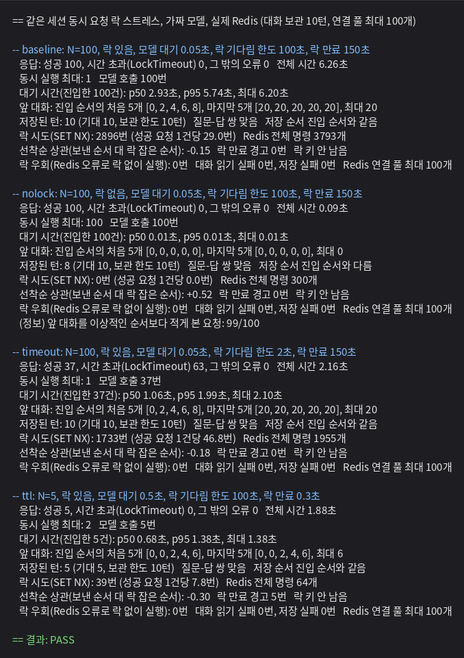
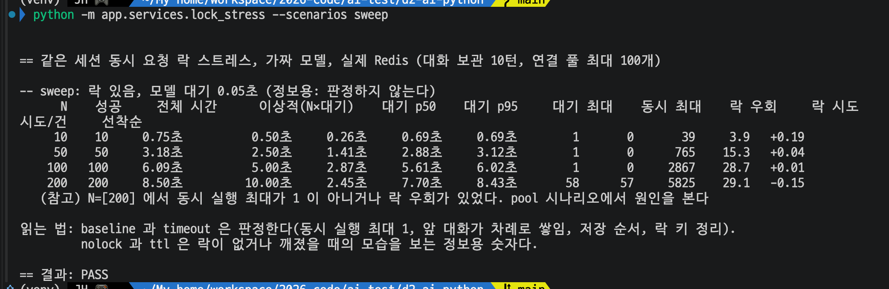
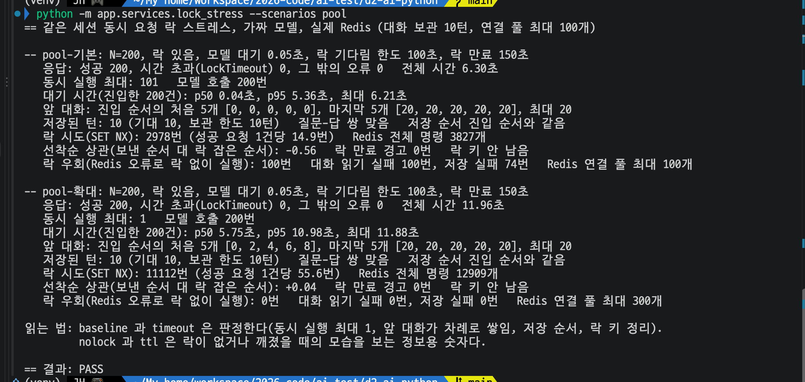

# Day 33 결과 — 분산 락 동시성 스트레스 테스트 (같은 세션 100개 동시 요청)

> 상태: 가이드 ①~⑥ 을 모두 실행해 기록했다(2026-10-18). ①~④ 는 출력 이미지와 원문을 함께 실었고, ⑤ ⑥ 은 캡처 이미지를 실었다.
> 가이드는 [DAY33_GUIDE.md](DAY33_GUIDE.md), 코드 설명은 [DAY33_CODE_GUIDE.md](DAY33_CODE_GUIDE.md). 앞선 결과는 [DAY32_RESULT.md](DAY32_RESULT.md).
> 포트: **6379 = Redis**. 이 시험은 Spring(8080), FastAPI 워커(8000), Kafka(9092), Qdrant(6333)를 쓰지 않았다.

**전체 목적:** 같은 세션 요청 100개를 한꺼번에 보내 Redis 락이 (1) 한 번에 하나씩만 실행시키는지, (2) 기다림 한도를 넘기면 어떻게 되는지, (3) 락이 만료되면 어떻게 깨지는지, (4) N 이 커질 때 Redis 부하가 어떻게 느는지, (5) 연결 풀이 모자랄 때 어떻게 되는지를 확인한다.


## 1. 환경

| 항목            | 내용                                                                                                                              |
| --------------- | --------------------------------------------------------------------------------------------------------------------------------- |
| 실행 위치       | 사용자 PC, 파이썬 가상환경(venv), `d2-ai-python` 폴더. `python -m app.experiments.lock_stress`                                       |
| Redis           | `redis1` 컨테이너(6379)                                                                                                           |
| 모델            | 가짜. 호출마다 0.05초 대기(④ 만 0.5초). 스레드 N개가 `Barrier` 로 같은 순간에 `run_agent` 를 호출                                  |
| 락 설정         | 기다림 한도 100초(③ 은 2초), 락 만료 150초(④ 는 0.3초), 재시도 간격 0.1초의 0.5~1.5배                                              |
| Redis 연결 풀   | 최대 100개 (redis-py 8.1.0 기본값. 출력 맨 위에 찍힌 값). ⑥ 의 확대 실험만 300개                                                  |
| 대화 보관       | 최근 10턴(`CONVERSATION_MAX_TURNS`)                                                                                               |


## 2. 실행한 것

| 번호 | 명령                                                      | 확인한 것                                          |
| ---- | --------------------------------------------------------- | -------------------------------------------------- |
| ①~④  | `python -m app.experiments.lock_stress`                      | baseline, nolock, timeout, ttl (3-1)               |
| ⑤    | `python -m app.experiments.lock_stress --scenarios sweep`    | N=10, 50, 100, 200 에 따른 변화 (3-2)               |
| ⑥    | `python -m app.experiments.lock_stress --scenarios pool`     | N=200 에서 연결 풀 100개 대 300개 (3-3)             |


## 3. 결과

### 3-1. ①~④ baseline, nolock, timeout, ttl

**목적:** 같은 세션 100개 동시 요청에서 락의 정상 동작, 락 없음, 기다림 한도 초과, 락 만료 초과를 비교한다.



출력 마지막 줄은 `== 결과: PASS`(① baseline 과 ③ timeout 만 판정, ② ④ 는 정보용)였다.

| 시나리오 | 응답 (성공 / 시간 초과) | 동시 실행 최대 | 전체 시간 | 앞 대화 (진입 순서) | 저장된 턴 (기대) | 락 시도 (건당) | 선착순 상관 |
| -------- | ----------------------- | -------------- | --------- | -------------------- | ---------------- | -------------- | ----------- |
| ① baseline (락 있음, N=100) | 100 / 0 | 1 | 6.26초 | 처음 `[0, 2, 4, 6, 8]`, 끝 `[20, 20, 20, 20, 20]` | 10 (10) | 2896 (29.0) | -0.15 |
| ② nolock (락 없음, N=100)   | 100 / 0 | **100** | 0.09초 | 처음 5개 모두 0, 끝 5개 모두 0 | **8 (10)** | 0 | +0.52 |
| ③ timeout (한도 2초, N=100) | 37 / 63 | 1 | 2.16초 | 처음 `[0, 2, 4, 6, 8]`, 끝 `[20, 20, 20, 20, 20]` | 10 (10) | 1733 (46.8) | -0.18 |
| ④ ttl (만료 0.3초, 일 0.5초, N=5) | 5 / 0 | **2** | 1.88초 | `[0, 0, 2, 4, 6]` | 5 (5) | 39 (7.8) | -0.30 |

| 항목                                                          | 기대값 (확인 전 예상)                                  | 실제                                                                                          |
| ------------------------------------------------------------- | ------------------------------------------------------ | --------------------------------------------------------------------------------------------- |
| ① 대기 시간 (진입한 100건)                                    | N 에 비례해 커짐                                       | p50 2.93초, p95 5.74초, 최대 6.20초                                                           |
| ① 락 우회, 대화 읽기/저장 실패, 락 키                          | 0번, 0번, 안 남음                                      | 0번, 0번 / 0번, 안 남음                                                                       |
| ② 이상적인 순서보다 앞 대화를 적게 본 요청                     | 100 중 99 근처                                         | 99/100. 저장 순서가 진입 순서와 다름                                                          |
| ③ 모델 호출                                                   | 성공한 수와 같음                                       | 37번(성공 37과 같음)                                                                          |
| ③ 락 키, 락 우회                                              | 안 남음, 0번                                           | 안 남음, 0번                                                                                   |
| ④ 락 만료 경고                                                | 5번                                                    | 5번                                                                                           |

<details>
<summary>①~④ 출력 원문</summary>

```
== 같은 세션 동시 요청 락 스트레스, 가짜 모델, 실제 Redis (대화 보관 10턴, 연결 풀 최대 100개)

-- baseline: N=100, 락 있음, 모델 대기 0.05초, 락 기다림 한도 100초, 락 만료 150초
   응답: 성공 100, 시간 초과(LockTimeout) 0, 그 밖의 오류 0   전체 시간 6.26초
   동시 실행 최대: 1   모델 호출 100번
   대기 시간(진입한 100건): p50 2.93초, p95 5.74초, 최대 6.20초
   앞 대화: 진입 순서의 처음 5개 [0, 2, 4, 6, 8], 마지막 5개 [20, 20, 20, 20, 20], 최대 20
   저장된 턴: 10 (기대 10, 보관 한도 10턴)   질문-답 쌍 맞음   저장 순서 진입 순서와 같음
   락 시도(SET NX): 2896번 (성공 요청 1건당 29.0번)   Redis 전체 명령 3793개
   선착순 상관(보낸 순서 대 락 잡은 순서): -0.15   락 만료 경고 0번   락 키 안 남음
   락 우회(Redis 오류로 락 없이 실행): 0번   대화 읽기 실패 0번, 저장 실패 0번   Redis 연결 풀 최대 100개

-- nolock: N=100, 락 없음, 모델 대기 0.05초, 락 기다림 한도 100초, 락 만료 150초
   응답: 성공 100, 시간 초과(LockTimeout) 0, 그 밖의 오류 0   전체 시간 0.09초
   동시 실행 최대: 100   모델 호출 100번
   대기 시간(진입한 100건): p50 0.01초, p95 0.01초, 최대 0.01초
   앞 대화: 진입 순서의 처음 5개 [0, 0, 0, 0, 0], 마지막 5개 [0, 0, 0, 0, 0], 최대 0
   저장된 턴: 8 (기대 10, 보관 한도 10턴)   질문-답 쌍 맞음   저장 순서 진입 순서와 다름
   락 시도(SET NX): 0번 (성공 요청 1건당 0.0번)   Redis 전체 명령 300개
   선착순 상관(보낸 순서 대 락 잡은 순서): +0.52   락 만료 경고 0번   락 키 안 남음
   락 우회(Redis 오류로 락 없이 실행): 0번   대화 읽기 실패 0번, 저장 실패 0번   Redis 연결 풀 최대 100개
   (정보) 앞 대화를 이상적인 순서보다 적게 본 요청: 99/100

-- timeout: N=100, 락 있음, 모델 대기 0.05초, 락 기다림 한도 2초, 락 만료 150초
   응답: 성공 37, 시간 초과(LockTimeout) 63, 그 밖의 오류 0   전체 시간 2.16초
   동시 실행 최대: 1   모델 호출 37번
   대기 시간(진입한 37건): p50 1.06초, p95 1.99초, 최대 2.10초
   앞 대화: 진입 순서의 처음 5개 [0, 2, 4, 6, 8], 마지막 5개 [20, 20, 20, 20, 20], 최대 20
   저장된 턴: 10 (기대 10, 보관 한도 10턴)   질문-답 쌍 맞음   저장 순서 진입 순서와 같음
   락 시도(SET NX): 1733번 (성공 요청 1건당 46.8번)   Redis 전체 명령 1955개
   선착순 상관(보낸 순서 대 락 잡은 순서): -0.18   락 만료 경고 0번   락 키 안 남음
   락 우회(Redis 오류로 락 없이 실행): 0번   대화 읽기 실패 0번, 저장 실패 0번   Redis 연결 풀 최대 100개

-- ttl: N=5, 락 있음, 모델 대기 0.5초, 락 기다림 한도 100초, 락 만료 0.3초
   응답: 성공 5, 시간 초과(LockTimeout) 0, 그 밖의 오류 0   전체 시간 1.88초
   동시 실행 최대: 2   모델 호출 5번
   대기 시간(진입한 5건): p50 0.68초, p95 1.38초, 최대 1.38초
   앞 대화: 진입 순서의 처음 5개 [0, 0, 2, 4, 6], 마지막 5개 [0, 0, 2, 4, 6], 최대 6
   저장된 턴: 5 (기대 5, 보관 한도 10턴)   질문-답 쌍 맞음   저장 순서 진입 순서와 같음
   락 시도(SET NX): 39번 (성공 요청 1건당 7.8번)   Redis 전체 명령 64개
   선착순 상관(보낸 순서 대 락 잡은 순서): -0.30   락 만료 경고 5번   락 키 안 남음
   락 우회(Redis 오류로 락 없이 실행): 0번   대화 읽기 실패 0번, 저장 실패 0번   Redis 연결 풀 최대 100개

== 결과: PASS
```

</details>

**해석:**

- **① 락이 정상이다.** 100개가 모두 성공했고 동시 실행 최대가 1 이며, 앞 대화가 0, 2, 4, ... 로 쌓이다가 보관 한도(20개 메시지)에서 멈췄다. 저장 순서는 락을 잡은 순서와 같았다.
- **② 락이 없으면 겹치고 유실된다.** 100개가 한꺼번에 모델 호출 구간에 들어갔고 99개는 앞 대화를 이상적인 순서보다 적게 봤다. 저장된 턴이 10이 아니라 8 이었다. 읽고-고치고-쓰는 사이에 다른 요청이 끼어 일부 턴이 덮어써진 것이다. 이 수치(8)는 실행마다 다를 수 있다.
- **③ 기다림 한도를 넘기면 깨끗하게 거절된다.** 한도 2초 안에 37개가 처리됐고 나머지 63개는 `LockTimeout` 으로 끝났다(성공 + 시간 초과 = 100). 시간 초과한 요청은 모델을 부르지 않았고(모델 호출 37번), 저장된 대화와 순서는 정상이며, 락 키가 남지 않았다.
- **④ 락 만료가 일보다 짧으면 락이 깨진다.** 락이 먼저 풀려 두 요청이 겹쳐 실행됐다(동시 최대 2). 앞 대화가 0 인 요청이 두 번 나왔고 5개 요청 모두 "락이 풀기 전에 만료됨" 경고를 냈다. 락 만료는 연장되지 않는다(Day 21 의 알려진 한계)는 것이 눈으로 확인됐다.
- **락 요청은 선착순이 아니다.** ①③ 의 상관이 -0.15, -0.18 이라 보낸 순서와 락 잡은 순서가 거의 무관하다. 폴링 방식이라 먼저 기다린 요청이 먼저 잡는다는 보장이 없다. 대기 시간 편차가 생긴다.

### 3-2. ⑤ N 에 따른 변화

**목적:** 같은 세션 요청 수 N 을 10, 50, 100, 200 으로 바꿀 때 전체 시간, 대기 시간, Redis 락 시도 횟수가 어떻게 달라지는지 본다.



| N   | 성공 | 전체 시간 | 이상적 (N×0.05초) | 대기 p50 | 대기 p95 | 대기 최대 | 동시 최대 | 락 우회 | 락 시도 | 시도/건 | 선착순 |
| --- | ---- | --------- | ----------------- | -------- | -------- | --------- | --------- | ------- | ------- | ------- | ------ |
| 10  | 10   | 0.75초    | 0.50초            | 0.26초   | 0.69초   | 0.69초    | 1         | 0       | 39      | 3.9     | +0.19  |
| 50  | 50   | 3.18초    | 2.50초            | 1.41초   | 2.88초   | 3.12초    | 1         | 0       | 765     | 15.3    | +0.04  |
| 100 | 100  | 6.09초    | 5.00초            | 2.87초   | 5.61초   | 6.02초    | 1         | 0       | 2867    | 28.7    | +0.01  |
| 200 | 200  | 8.50초    | 10.00초           | 2.45초   | 7.70초   | 8.43초    | **58**    | **57**  | 5825    | 29.1    | -0.15  |

출력 마지막에 "(참고) N=[200] 에서 동시 실행 최대가 1 이 아니거나 락 우회가 있었다" 가 찍혔고 마지막 줄은 `== 결과: PASS`(sweep 은 판정하지 않는다)였다.

| 항목                    | 기대값 (확인 전 예상)                                           | 실제                                                                                            |
| ----------------------- | --------------------------------------------------------------- | ----------------------------------------------------------------------------------------------- |
| 전체 시간               | N 에 비례                                                       | N=10~100 에서 이상적인 값보다 0.25~1.1초 길고 N 에 비례                                          |
| 락 시도                 | N 이 2배가 되면 3~4배                                           | 50→100 에서 3.75배, 10→50(5배)에서 19.6배                                                        |
| N=200                   | 연결 풀 부족으로 동시 최대 1 초과 또는 락 우회 가능              | 동시 최대 58, 락 우회 57                                                                         |

**해석:**

- **N=10~100 은 락이 정상이다.** 동시 실행 최대는 모두 1 이고 락 우회는 0 이다. 전체 시간은 N 에 비례한다.
- **락 시도 횟수는 N 의 제곱에 가깝게 는다.** 10→50 에서 19.6배(N 이 5배), 50→100 에서 3.75배(N 이 2배)다. 지수로 환산하면 각각 약 1.85, 1.91 이다. 기다리는 요청이 모두 0.1초마다 `SET NX` 를 반복하므로, 기다리는 요청 수와 기다리는 시간이 둘 다 N 에 비례한다.
- **N=200 의 숫자는 비교하면 안 된다.** 전체 시간 8.50초가 이상적인 값(10초)보다 짧은 것은 빨라진 것이 아니라 57개 요청이 락 없이 겹쳐 실행됐기 때문이다. 락 시도 5825번과 시도/건 29.1 도 우회한 요청이 시도를 건너뛴 값이다.

### 3-3. ⑥ 연결 풀이 모자랄 때

**목적:** N=200 에서 락이 깨지는 원인이 Redis 연결 풀 부족인지, 풀을 늘리면 사라지는지 본다.



| 항목                                   | pool-기본 (풀 100)  | pool-확대 (풀 300)  |
| -------------------------------------- | ------------------- | ------------------- |
| 응답 (성공 / 시간 초과 / 오류)         | 200 / 0 / 0         | 200 / 0 / 0         |
| 전체 시간                              | 6.30초              | 11.96초             |
| 동시 실행 최대                         | **101**             | 1                   |
| 락 우회 (Redis 오류로 락 없이 실행)    | **100번**           | 0번                 |
| 대화 읽기 실패 / 저장 실패             | **100번 / 74번**    | 0번 / 0번           |
| 앞 대화 (진입 순서)                    | 처음 5개 모두 0, 끝 `[20, 20, 20, 20, 20]` | 처음 `[0, 2, 4, 6, 8]`, 끝 `[20, 20, 20, 20, 20]` |
| 대기 시간 p50 / p95 / 최대             | 0.04초 / 5.36초 / 6.21초 | 5.75초 / 10.98초 / 11.88초 |
| 저장된 턴 (기대 10)                    | 10                  | 10                  |
| 락 시도 (건당)                         | 2978 (14.9)         | 11112 (55.6)        |
| Redis 전체 명령                        | 3827개              | 12909개             |
| 락 만료 경고, 락 키                    | 0번, 안 남음        | 0번, 안 남음        |

마지막 줄은 `== 결과: PASS`(확대한 풀의 결과만 판정)였다.

| 항목                             | 기대값 (확인 전 예상)                          | 실제                                                  |
| -------------------------------- | ---------------------------------------------- | ----------------------------------------------------- |
| pool-기본: 락 우회, 동시 최대    | 락 우회 0 초과, 동시 최대 1 초과               | 락 우회 100번, 동시 최대 101                          |
| pool-확대: 락 우회, 동시 최대    | 0, 1                                           | 0, 1                                                  |

**해석:**

- **원인은 연결 풀 부족이다.** 같은 N=200 이 풀 100개에서는 락 우회 100번과 동시 실행 최대 101 이었고, 풀을 300개로 늘리자 락 우회 0, 동시 최대 1, 앞 대화가 차례로 쌓이는 정상 결과가 됐다.
- **락이 깨지는 것만이 문제가 아니다.** 풀 부족은 대화 기록 읽기 100번 실패(앞 대화 없이 답함)와 저장 74번 실패(그 턴이 저장되지 않음)로도 이어졌다. 오류가 로그의 경고로만 남고 요청은 200 으로 성공해서, 응답만 봐서는 알아챌 수 없다. 이 시험에서는 `모든 요청 성공`이 `락이 지켜졌다`를 뜻하지 않았다.
- **풀을 늘리면 시간은 정상으로 돌아온다.** pool-확대의 전체 시간 11.96초는 N×0.05초(10초)보다 조금 길고 락 시도는 건당 55.6번이다. 락이 우회되지 않은 만큼 기다리는 시간과 폴링이 늘어난 값이다. ⑤ 의 N=200 이 짧았던 이유(우회)와 대비된다.
- Redis 가 처리한 명령은 pool-확대에서 12909개를 11.96초에 처리해 초당 약 1100개였다(① 은 3793개를 6.26초에 처리해 약 600개). 폴링 부하는 N 이 커질수록 커지지만 이 규모에서 Redis 가 힘들어하는 모습은 보지 못했다(Redis 쪽 지표는 따로 보지 않았다).


## 4. 해석

- N=100 까지 락은 요청을 정확히 한 번에 하나씩 실행시켰고, 순서와 대화 저장이 맞았다(① ⑤).
- 락이 없으면 100개가 모두 겹치고 저장된 대화가 유실됐다(② 에서 10턴 중 8턴).
- 기다림 한도를 넘긴 요청은 모델을 부르지 않고 거절됐다. 저장된 대화는 영향을 받지 않았고 락 키도 남지 않았다(③).
- 락 만료가 일보다 짧으면 락이 깨져 요청이 겹쳤다(④). 락 만료를 일 하는 시간보다 길게 잡아야 한다는 Day 21 의 주의가 맞다.
- 락 시도 횟수는 N 의 제곱에 가깝게 늘었다(⑤). 같은 세션에 요청이 100개 몰리면 락 때문에 Redis 명령이 건당 약 29번 늘었다.
- 연결 풀이 모자라면(N=200, 풀 100) 락이 우회되고 대화 읽기, 저장이 실패했지만 응답은 모두 성공이었다(⑤ ⑥). `fail_open=True` 의 대가가 구체적으로 드러났다.


## 5. 한계

- 모델은 0.05초 대기하는 가짜다. 실제 모델은 건당 수 초~수십 초라서 건당 20초라면 기다림 한도 100초 안에 끝나는 요청이 5개 안팎이라는 것은 계산이고, 실제 모델로 확인하지 않았다.
- Spring → Kafka → 워커 경로가 아니라 한 프로세스 안의 스레드 경쟁이다. 워커 프로세스를 여러 개 띄워 N=100 으로 경쟁시킨 것은 아니다(Day 22 의 http 방식은 N=2).
- 실제 워커에서 연결 풀 부족이 같은 조건으로 생기는지는 확인하지 않았다. 이 시험은 스레드 100~200개를 한 프로세스에 만들었다. 실제 워커는 `asyncio.to_thread` 를 쓰므로 한 프로세스의 동시 스레드가 훨씬 적다는 것은 Python 기본 스레드 풀 크기(CPU 수 + 4, 최대 32)에서 나온 추정이다.
- ② 의 저장된 턴 8 과 ⑥ 의 락 우회 100번, 저장 실패 74번은 한 번 실행한 값이다. 샌드박스에서 같은 시험을 반복했을 때 N=200 의 락 우회는 9번에서 97번까지 실행마다 달랐다. ⑤ 의 N=200(57번)과 ⑥ 의 pool-기본(100번)도 서로 다르다.
- 연결 풀 부족 대응(풀 크기를 환경변수로 받기, 풀 부족일 때 락을 우회하지 않고 기다리기)은 만들지 않았다. 코드는 바꾸지 않았다.
- 락 만료 연장 기능이 없다는 한계(④)는 그대로다.
- Redis 쪽 지표(연결 수, CPU)는 보지 않았다. 폴링 부하는 명령 수로만 봤다.
