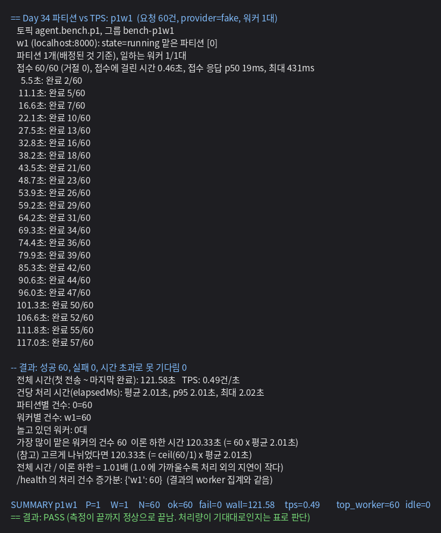
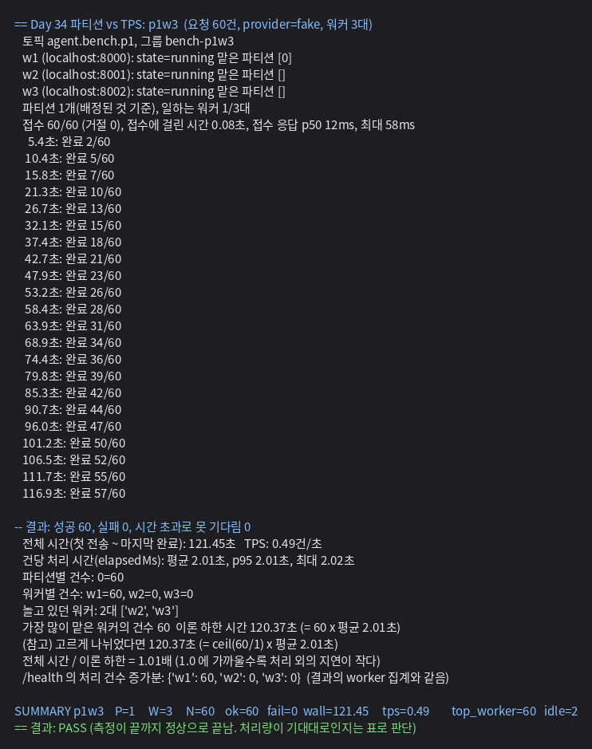
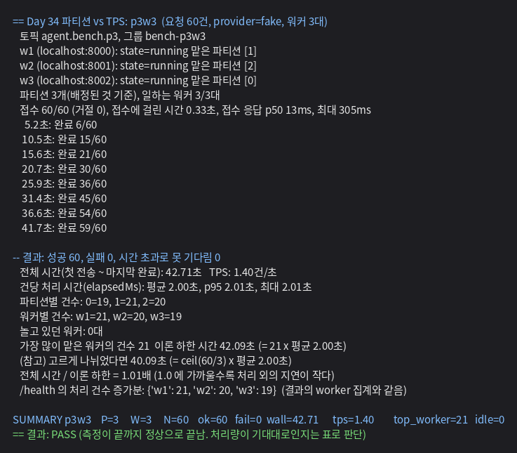
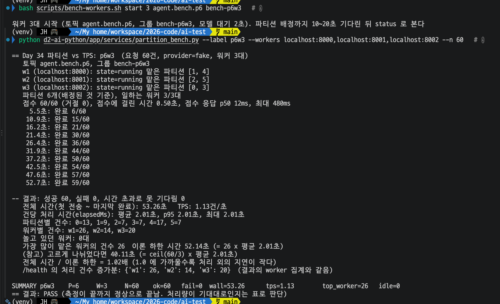
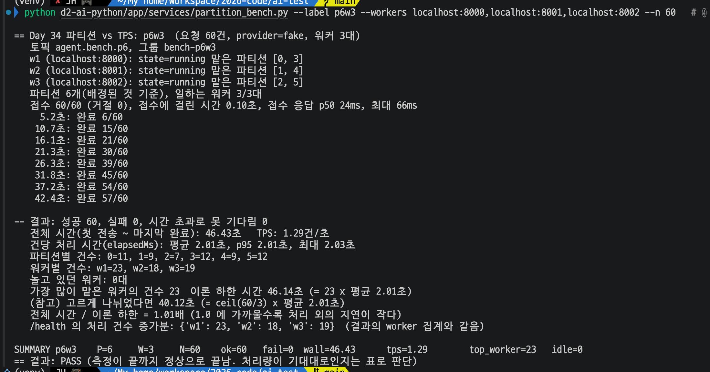
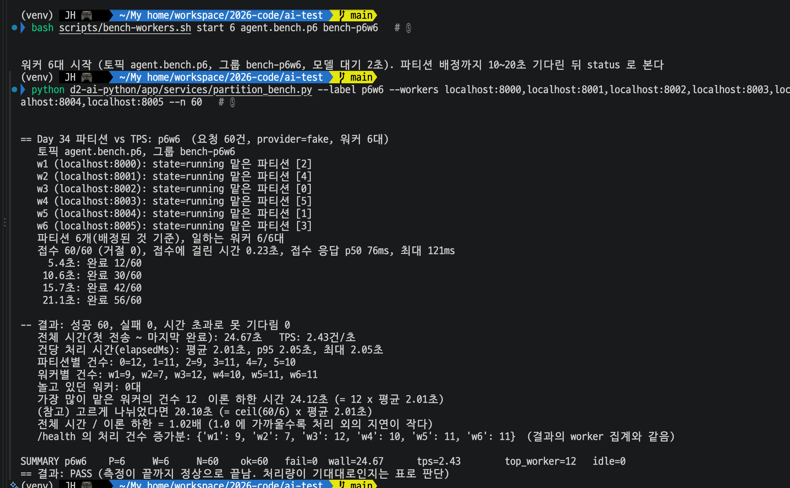
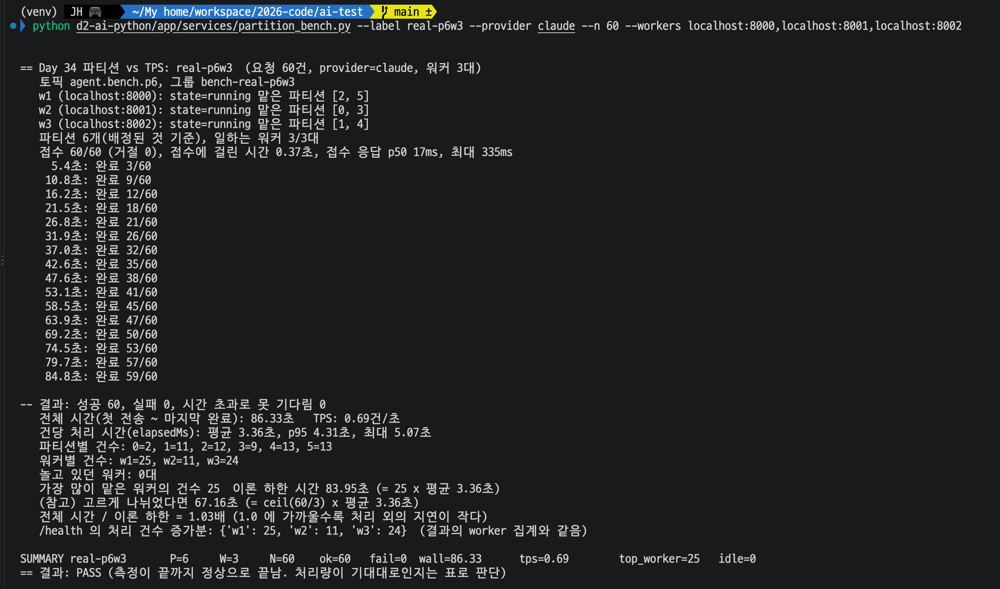
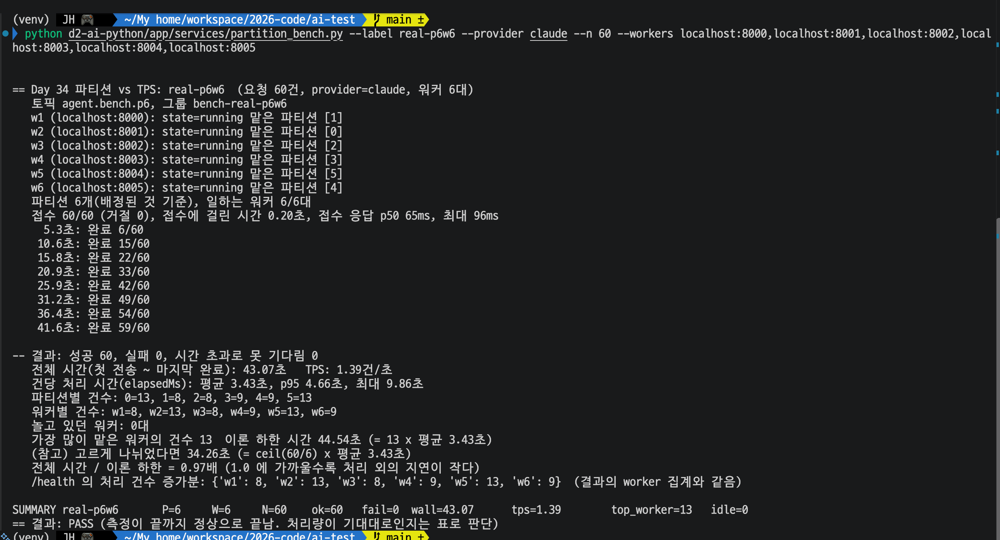

# Day 34.1 결과 — Kafka 파티션 수와 워커 수에 따른 처리량(TPS) 실험

> 가이드는 [DAY34_1_GUIDE.md](DAY34_1_GUIDE.md). 앞선 결과는 [DAY33_RESULT.md](DAY33_RESULT.md).
> 포트: **8080 = Spring WAS**, **8000 = FastAPI 워커**(워커 수만큼 8001, 8002 ...), 9092 = Kafka, 6379 = Redis. 이 실험은 Spring → Kafka → 워커 → Redis 결과 경로 전체를 거쳤다.

**전체 목적:** 같은 요청 60건을 파티션 수(P)와 워커 수(W)를 바꿔 가며 처리하고, 전부 끝날 때까지 걸린 시간으로 처리량(TPS)을 비교한다. "워커를 늘리면 빨라지는가, 파티션도 같이 늘려야 하는가"를 숫자로 본다.

**구성:** Spring → Kafka → FastAPI 워커 → Redis 경로는 실제로 구동하고, AI 모델은 실제 모델이 있다고 가정해 고정 2초를 기다렸다 답하는 가짜 모델로 대신한다. 가짜 모델은 검색 도구를 부르지 않아 Qdrant 와 Gemini 임베딩은 쓰지 않는다.

## 1. 환경

| 항목      | 내용                                                                                                                                   |
| --------- | -------------------------------------------------------------------------------------------------------------------------------------- |
| 실행 위치 | 사용자 PC, 프로젝트 루트 `ai-agent-serving-infra`, 터미널 2개(A: Spring, B: 워커와 측정). B 는 `d2-ai-python/venv` 를 켠 상태                         |
| Spring    | `./gradlew bootRun --args='--app.kafka.topics.requests=agent.bench.p1 --app.kafka.topics.requests-partitions=1'`                       |
| 워커      | `scripts/bench-workers.sh` 로 시작. 가짜 모델(`provider=fake`) 대기 2초, 흔들림 없음(`FAKE_LLM_JITTER=0`). 그룹은 실험마다 새로 만든다 |
| 측정      | `d2-ai-python/app/experiments/partition_bench.py`. 요청 60건을 동시에 보내고 모두 DONE 이 될 때까지 기다림                                |
| 토픽      | 실험마다 새 토픽(`agent.bench.p1`, `p3`, `p6`)                                                                                         |
| 실행 횟수 | 조합마다 한 번                                                                                                                         |

## 2. 실행한 것

| 번호 | P   | W   | 워커 시작                                                         | 측정                                                                                                                                                                          |
| ---- | --- | --- | ----------------------------------------------------------------- | ----------------------------------------------------------------------------------------------------------------------------------------------------------------------------- |
| ①    | 1   | 1   | `bash scripts/bench-workers.sh start 1 agent.bench.p1 bench-p1w1` | `python d2-ai-python/app/experiments/partition_bench.py --label p1w1 --workers localhost:8000 --n 60`                                                                            |
| ②    | 1   | 3   | `bash scripts/bench-workers.sh start 3 agent.bench.p1 bench-p1w3` | `python d2-ai-python/app/experiments/partition_bench.py --label p1w3 --workers localhost:8000,localhost:8001,localhost:8002 --n 60`                                              |
| ③    | 3   | 3   | `bash scripts/bench-workers.sh start 3 agent.bench.p3 bench-p3w3` | `python d2-ai-python/app/experiments/partition_bench.py --label p3w3 --workers localhost:8000,localhost:8001,localhost:8002 --n 60`                                              |
| ④    | 6   | 3   | `bash scripts/bench-workers.sh start 3 agent.bench.p6 bench-p6w3` | `python d2-ai-python/app/experiments/partition_bench.py --label p6w3 --workers localhost:8000,localhost:8001,localhost:8002 --n 60`                                              |
| ⑤    | 6   | 6   | `bash scripts/bench-workers.sh start 6 agent.bench.p6 bench-p6w6` | `python d2-ai-python/app/experiments/partition_bench.py --label p6w6 --workers localhost:8000,localhost:8001,localhost:8002,localhost:8003,localhost:8004,localhost:8005 --n 60` |

## 3. 결과

### 3-1. ① P1 W1 (기준값)

**목적:** 워커 한 대가 파티션 하나를 맡았을 때의 처리량을 기준값으로 잰다. ②~⑤ 는 이 값과 비교한다.

| 항목                                               | 기대값 (확인 전 예상) | 실제                          |
| -------------------------------------------------- | --------------------- | ----------------------------- |
| 접수                                               | 60/60                 | 60/60 (거절 0), 접수에 0.46초 |
| 성공 / 실패                                        | 60 / 0                | 60 / 0                        |
| 전체 시간 (첫 전송 ~ 마지막 완료)                  | 약 120초              | **121.58초**                  |
| TPS                                                | 약 0.5건/초           | **0.49건/초**                 |
| 건당 처리 시간                                     | 약 2초                | 평균 2.01초, 최대 2.02초      |
| 파티션별, 워커별 건수                              | 0번 60건, w1 60건     | 0번 60건, w1 60건             |
| 놀고 있던 워커                                     | 0대                   | 0대                           |
| 전체 시간 / 이론 하한(60 x 평균 2.01초 = 120.33초) | 1.0 근처              | 1.01배                        |
| `/health` 처리 건수 증가분                         | 결과 집계와 같음      | w1 60건 (같음)                |

**해석:**

- **워커 한 대는 건당 2초로 한 건씩 처리해 0.49건/초가 나왔다.** 60건이 모두 파티션 0 으로 갔고 처리 외의 지연(전송, 결과 조회, 커밋)은 이론 하한의 1% 안이었다. 이 값이 ②~⑤ 의 기준이다.
- 중간 진행은 5초마다 2~3건씩 늘어 선형이었다(5.5초에 2건, 117초에 57건).
- 이 실험에서 병목은 워커다. 접수는 60건에 0.46초로 끝났고 나머지 시간은 워커가 한 건씩 처리하는 데 썼다.

### 3-2. ② P1 W3 (파티션 1개에 워커 3대)

**목적:** 파티션이 1개일 때 워커를 3대로 늘려도 빨라지지 않는지 본다.

| 항목                            | 기대값 (확인 전 예상)    | 실제                          |
| ------------------------------- | ------------------------ | ----------------------------- |
| 파티션 배정                     | 한 대만 `[0]`, 둘은 `[]` | w1 `[0]`, w2 `[]`, w3 `[]`    |
| 접수                            | 60/60                    | 60/60 (거절 0), 접수에 0.08초 |
| 성공 / 실패                     | 60 / 0                   | 60 / 0                        |
| 전체 시간                       | 약 120초                 | **121.45초**                  |
| TPS                             | 약 0.5건/초              | **0.49건/초**                 |
| 워커별 건수                     | 한 대가 60건, 둘은 0건   | w1 60건, w2 0건, w3 0건       |
| 놀고 있던 워커                  | 2대                      | 2대 (w2, w3)                  |
| 전체 시간 / 이론 하한(120.37초) | 1.0 근처                 | 1.01배                        |

**해석:**

- **파티션이 1개면 워커를 3대로 늘려도 처리량이 그대로다.** ① 의 0.49건/초와 같은 0.49건/초(121.45초 대 121.58초)가 나왔다. 파티션 하나는 같은 그룹 안에서 한 워커만 읽으므로 w2, w3 은 파티션을 받지 못해 60건 중 한 건도 처리하지 못했다.
- 워커 3대가 떠 있고 `state=running` 이었지만 일한 것은 1대였다. 워커 수를 늘리기 전에 파티션 수부터 확인해야 한다는 Day 13 의 결론이 숫자로 확인됐다.
- ① 과 ② 의 차이는 0.13초로, 놀고 있는 워커가 처리 속도에 영향을 주지 않았다.

### 3-3. ③ P3 W3 (파티션과 워커가 같음)

**목적:** 파티션 수와 워커 수가 같을 때 워커 수만큼 빨라지는지 본다. 이 실험부터 Spring 을 `agent.bench.p3`(파티션 3개)로 다시 띄웠다.

| 항목                                         | 기대값 (확인 전 예상)   | 실제                          |
| -------------------------------------------- | ----------------------- | ----------------------------- |
| 파티션 배정                                  | 워커마다 파티션 하나    | w1 `[1]`, w2 `[2]`, w3 `[0]`  |
| 접수                                         | 60/60                   | 60/60 (거절 0), 접수에 0.33초 |
| 성공 / 실패                                  | 60 / 0                  | 60 / 0                        |
| 전체 시간                                    | 40~50초 (이상 40초)     | **42.71초**                   |
| TPS                                          | 1.2~1.5건/초 (이상 1.5) | **1.40건/초**                 |
| 파티션별 건수                                | 20 안팎 (20±5)          | 0번 19건, 1번 21건, 2번 20건  |
| 워커별 건수                                  | 20 안팎                 | w1 21건, w2 20건, w3 19건     |
| 놀고 있던 워커                               | 0대                     | 0대                           |
| 전체 시간 / 이론 하한(21 x 2.00초 = 42.09초) | 1.0 근처                | 1.01배                        |

**해석:**

- **파티션과 워커를 3개씩 두자 처리량이 ① 의 2.9배가 됐다.** TPS 가 0.49 에서 1.40 으로 늘었다(1.40 / 0.49 = 2.86배). 이상은 3배(1.5건/초)이고 실제는 그보다 약 7% 낮았다.
- **차이의 원인은 건수가 완전히 고르지 않은 것이다.** 60건이 19, 21, 20건으로 나뉘어 가장 많이 받은 w1(21건)이 마지막에 끝났다. 고르게 나뉘었다면 20건 x 2.00초 = 40.09초였고 실제는 42.71초였다. 이론 하한(21건 x 2.00초 = 42.09초)과는 1.01배라 이 차이를 건수 편차로 거의 다 설명할 수 있다.
- 예상(20±5)보다 훨씬 고르게(19~21) 나뉘었다. 이 값은 한 번의 실행 결과이고 다른 실행에서는 달라질 수 있다.
- 워커 3대가 모두 일했고 건수 합이 60이다. `/health` 의 처리 건수 증가분도 결과의 워커 집계와 같았다.

### 3-4. ④ P6 W3 (파티션이 워커보다 많음)

**목적:** 파티션을 6개로 늘려도 워커가 3대면 ③ 보다 빨라지지 않는지 본다. 이 실험부터 Spring 을 `agent.bench.p6`(파티션 6개)로 다시 띄웠다.

| 항목                                         | 기대값 (확인 전 예상)   | 실제                                       |
| -------------------------------------------- | ----------------------- | ------------------------------------------ |
| 파티션 배정                                  | 워커마다 파티션 2개     | w1 `[1, 4]`, w2 `[2, 5]`, w3 `[0, 3]`      |
| 접수                                         | 60/60                   | 60/60 (거절 0), 접수에 0.50초              |
| 성공 / 실패                                  | 60 / 0                  | 60 / 0                                     |
| 전체 시간                                    | 40~50초 (이상 40초)     | **53.26초**                                |
| TPS                                          | 1.2~1.5건/초 (이상 1.5) | **1.13건/초** (예상 범위의 아래)           |
| 파티션별 건수                                | 10 안팎                 | 0번 13, 1번 9, 2번 7, 3번 7, 4번 17, 5번 7 |
| 워커별 건수                                  | 20 안팎                 | w1 26, w2 14, w3 20                        |
| 놀고 있던 워커                               | 0대                     | 0대                                        |
| 전체 시간 / 이론 하한(26 x 2.01초 = 52.14초) | 1.0 근처                | 1.02배                                     |

**해석:**

- **파티션만 6개로 늘려서는 빨라지지 않았고 오히려 ③ 보다 느렸다.** TPS 가 ③ 의 1.40 에서 1.13 으로 낮아졌다(약 19% 감소). 일하는 워커는 ③ 과 같은 3대였다.
- **느려진 원인은 건수가 고르지 않게 나뉜 것이다.** 파티션 4번에 17건, 0번에 13건이 몰렸고 2, 3, 5번은 7건뿐이었다. 그 결과 w1 이 26건(파티션 1번 9건 + 4번 17건)을 받아 마지막에 끝났고, w2 는 14건만 처리하고 일찍 놀았다. 전체 시간은 w1 의 건수로 정해졌다(26건 x 2.01초 = 52.14초, 실제 53.26초는 이론 하한의 1.02배).
- 고르게 나뉘었다면 20건 x 2.01초 = 40.11초였다. 실제와의 차이 13초는 건수 편차 때문이다.
- ③ 은 19, 21, 20건으로 고르게 나뉘었고 ④ 는 파티션별 7~17건으로 크게 갈렸다. 한 번씩만 잰 결과라 "파티션이 많으면 항상 불균형하다"고 말할 수는 없다. 이번 60건의 해시 결과가 그렇게 나왔다는 것까지 확인했다.
- 예상(1.2~1.5건/초)의 하한보다 낮게 나왔다. 예상은 건수 편차를 3~6건으로 봤는데 실제 편차는 평균(20건)보다 6건 많은 26건이었다.

#### 재측정

첫 측정(1.13건/초)이 예상 범위의 하한보다 낮아, 건수 편차 때문인지 보려고 같은 조합을 한 번 더 잰다. `agent.bench.p6` 토픽과 `bench-p6w3`, `bench-p6w6` 그룹을 지우고 Spring 을 `p6`(파티션 6개)로 다시 띄운 뒤, 같은 명령으로 워커 3대를 시작해 측정했다.

| 항목                  | 첫 측정                               | 재측정                             |
| --------------------- | ------------------------------------- | ---------------------------------- |
| 파티션 배정           | w1 `[1,4]`, w2 `[2,5]`, w3 `[0,3]`    | w1 `[0,3]`, w2 `[1,4]`, w3 `[2,5]` |
| 전체 시간             | 53.26초                               | **46.43초**                        |
| TPS                   | 1.13건/초 (예상 범위 1.2~1.5 의 아래) | **1.29건/초** (예상 범위 안)       |
| 파티션별 건수         | 13, 9, 7, 7, 17, 7                    | 11, 9, 7, 12, 9, 12                |
| 워커별 건수           | w1 26, w2 14, w3 20                   | w1 23, w2 18, w3 19                |
| 놀고 있던 워커        | 0대                                   | 0대                                |
| 전체 시간 / 이론 하한 | 1.02배 (이론 하한 52.14초)            | 1.01배 (이론 하한 46.14초)         |

- **같은 조합에서 TPS 가 1.13 에서 1.29 로 달라졌다.** 두 번 모두 처리 외의 지연은 이론 하한의 1~2% 였고, 전체 시간은 가장 많이 받은 워커의 건수(26건, 23건)로 정해졌다. 즉 같은 조합이어도 60건이 나뉘는 모양에 따라 결과가 달라졌다.
- 재측정은 예상 범위(1.2~1.5) 안이다. 첫 측정이 범위 밖으로 나온 것은 건수가 크게 몰린 한 번의 결과였다는 설명과 맞는다.
- 두 번 모두 ③ 의 1.40건/초보다 낮았다(1.13, 1.29). 다만 ③ 은 한 번만 쟀으므로 ③ 과 ④ 의 차이가 파티션 수 때문이라고 확정하지는 않는다.

### 3-5. ⑤ P6 W6 (파티션과 워커를 같이 늘림)

**목적:** 파티션과 워커를 같이 6개로 늘리면 ③ 보다 빨라지는지 본다. Spring 은 ④ 에서 띄운 `agent.bench.p6` 그대로이고 워커만 6대로 바꿨다.

| 항목                                         | 기대값 (확인 전 예상)   | 실제                                                       |
| -------------------------------------------- | ----------------------- | ---------------------------------------------------------- |
| 파티션 배정                                  | 워커마다 파티션 하나    | w1 `[2]`, w2 `[4]`, w3 `[0]`, w4 `[5]`, w5 `[1]`, w6 `[3]` |
| 접수                                         | 60/60                   | 60/60 (거절 0), 접수에 0.23초                              |
| 성공 / 실패                                  | 60 / 0                  | 60 / 0                                                     |
| 전체 시간                                    | 25~30초 (이상 20초)     | **24.67초**                                                |
| TPS                                          | 2.0~2.5건/초 (이상 3.0) | **2.43건/초**                                              |
| 파티션별 건수                                | 10 안팎                 | 0번 12, 1번 11, 2번 9, 3번 11, 4번 7, 5번 10               |
| 워커별 건수                                  | 10 안팎                 | w1 9, w2 7, w3 12, w4 10, w5 11, w6 11                     |
| 놀고 있던 워커                               | 0대                     | 0대                                                        |
| 전체 시간 / 이론 하한(12 x 2.01초 = 24.12초) | 1.0 근처                | 1.02배                                                     |

**해석:**

- **파티션과 워커를 같이 6개로 늘리자 TPS 가 2.43건/초로 ① 의 약 5배가 됐다.** 6배(2.94건/초)의 약 83% 이고, 예상 범위(2.0~2.5) 안이다.
- 이상값(20.10초)보다 4.6초 느린 이유는 건수 편차다. 가장 많이 받은 w3 이 12건을 처리해 마지막에 끝났다(12건 x 2.01초 = 24.12초). 가장 적게 받은 w2 는 7건이었다.
- ④ 에서 같은 6개 파티션에 워커만 3대에서 6대로 늘리자 TPS 가 1.13 에서 2.43 으로 2.2배가 됐다. 파티션을 늘린 효과는 워커를 같이 늘려야 나타났다.

### 3-6. 종합 비교

| 번호     | P   | W   | 일하는 워커 | 전체 시간 | TPS  | ① 대비 | 이상 TPS 대비   | 가장 많이 받은 워커 | 놀고 있던 워커 |
| -------- | --- | --- | ----------- | --------- | ---- | ------ | --------------- | ------------------- | -------------- |
| ①        | 1   | 1   | 1           | 121.58초  | 0.49 | 1.0배  | 기준            | 60건                | 0대            |
| ②        | 1   | 3   | 1           | 121.45초  | 0.49 | 1.0배  | 33% (이상 1.47) | 60건                | 2대            |
| ③        | 3   | 3   | 3           | 42.71초   | 1.40 | 2.9배  | 95% (이상 1.47) | 21건                | 0대            |
| ④        | 6   | 3   | 3           | 53.26초   | 1.13 | 2.3배  | 77% (이상 1.47) | 26건                | 0대            |
| ④ 재측정 | 6   | 3   | 3           | 46.43초   | 1.29 | 2.6배  | 88% (이상 1.47) | 23건                | 0대            |
| ⑤        | 6   | 6   | 6           | 24.67초   | 2.43 | 5.0배  | 83% (이상 2.94) | 12건                | 0대            |

(이상 TPS 는 ① 의 0.49건/초 x 일하는 워커 수. 비율은 실제 TPS 를 이상 TPS 로 나눈 값이다.)

**무엇을 바꾸면 어떻게 달라졌나:**

| 비교  | 바뀐 것                        | TPS                              | 결과                             |
| ----- | ------------------------------ | -------------------------------- | -------------------------------- |
| ① → ② | 워커 1 → 3 (파티션 1 그대로)   | 0.49 → 0.49                      | 좋아지지 않음                    |
| ① → ③ | 파티션 1 → 3, 워커 1 → 3       | 0.49 → 1.40                      | 2.9배                            |
| ③ → ④ | 파티션만 3 → 6 (워커 3 그대로) | 1.40 → 1.13, 1.29 (재측정)       | 좋아지지 않음 (낮거나 같은 수준) |
| ④ → ⑤ | 워커만 3 → 6 (파티션 6 그대로) | 1.13 → 2.43 (재측정 1.29 → 2.43) | 약 1.9~2.2배                     |

한 번에 일하는 워커 수는 `min(파티션 수, 워커 수)` 이다. 파티션만 늘리거나 워커만 늘리면 둘 중 작은 쪽에 막히고, 둘을 같이 늘려야 일하는 워커 수만큼 처리량이 늘었다.

**종합 해석:**

- **처리량을 정하는 것은 `min(파티션 수, 워커 수)` 에 건수 편차를 더한 값이다.** ② 는 파티션 1개라 워커 3대여도 일한 것은 1대였고, ③ 은 3대, ⑤ 는 6대가 일해 TPS 가 각각 0.49, 1.40, 2.43 으로 늘었다.
- **워커가 모자라면 파티션을 늘려도 소용없다.** ④ 는 ③ 과 같은 3대가 일했고 TPS 가 ③ 보다 낮거나 같은 수준이었다(1.13, 1.29 대 1.40).
- **건수 편차가 TPS 를 크게 흔들었다.** 같은 ④ 를 두 번 재자 1.13 과 1.29 로 달랐고, 가장 많이 받은 워커가 26건과 23건이었다. ③ 은 19~21건으로 이상값의 95%, ④ 는 77%(첫 측정)와 88%(재측정), ⑤ 는 7~12건으로 83% 였다. 조합마다 한 번(④ 만 두 번)씩 측정했으므로 파티션 수 때문이라고 단정하지는 않고, 이번 60건의 해시 결과가 이렇게 나뉘었다고만 기록한다.
- 처리 외의 지연(전송, 결과 조회, 커밋)은 모든 실험에서 이론 하한의 1~2% 안이었다. 이 실험의 병목은 워커의 처리 시간(건당 2초)과 건수 분배였다.
- 실무에서 정하는 순서로 정리하면, 처리량을 올리려면 워커 수를 늘리고 파티션을 워커 수 이상으로 둔다. 파티션을 먼저 늘리는 것만으로는 처리량이 오르지 않는다.

### 3-7. ⑥⑦ 실제 모델(Claude)로 재측정 (Day 34.2 ⑤⑥)

**목적:** 처리량이 `min(파티션, 워커)` 로 정해지고 건수 편차가 전체 시간을 정한다는 가짜 모델(건당 2초)의 결론이 실제 모델(건당 3초대)에서도 같은지 본다. ⑥ 은 ④ 와, ⑦ 은 ⑤ 와 같은 조합(P6 W3, P6 W6)이다. 4개 실험을 모은 문서는 [DAY34_2_RESULT.md](DAY34_2_RESULT.md).

**실행:** 토픽 `agent.bench.p6`(파티션 6개, 새 그룹), 요청 60건, `--provider claude`. 워커는 `bench-workers.sh` 의 `real` 인자로 가짜 모델 설정 없이 띄웠다. Spring 은 `agent.bench.p6` 로 띄웠고 ⑥⑦ 사이에는 그대로 뒀다. 2026-10-19 에 각 한 번 측정했다.

    bash scripts/bench-workers.sh start 3 agent.bench.p6 bench-real-p6w3 real      # ⑥
    python d2-ai-python/app/experiments/partition_bench.py --label real-p6w3 --provider claude --n 60 --workers localhost:8000,localhost:8001,localhost:8002

    bash scripts/bench-workers.sh start 6 agent.bench.p6 bench-real-p6w6 real      # ⑦
    python d2-ai-python/app/experiments/partition_bench.py --label real-p6w6 --provider claude --n 60 --workers localhost:8000,localhost:8001,localhost:8002,localhost:8003,localhost:8004,localhost:8005

| 항목                                                  | 가짜 모델 P6 W3 (④)                           | 실제 모델 P6 W3 (⑥)                          | 가짜 모델 P6 W6 (⑤)                          | 실제 모델 P6 W6 (⑦)                                                        |
| ----------------------------------------------------- | --------------------------------------------- | -------------------------------------------- | -------------------------------------------- | -------------------------------------------------------------------------- |
| 파티션 배정                                           | w1 `[1,4]`, w2 `[2,5]`, w3 `[0,3]`            | w1 `[2,5]`, w2 `[0,3]`, w3 `[1,4]`           | 워커마다 하나                                | 워커마다 하나 (w1 `[1]`, w2 `[0]`, w3 `[2]`, w4 `[3]`, w5 `[5]`, w6 `[4]`) |
| 접수                                                  | 60/60 (0.50초)                                | 60/60 (거절 0), 접수에 0.37초                | 60/60 (0.23초)                               | 60/60 (거절 0), 접수에 0.20초                                              |
| 성공 / 실패                                           | 60 / 0                                        | 60 / 0                                       | 60 / 0                                       | 60 / 0                                                                     |
| 전체 시간                                             | 53.26초 (재측정 46.43초)                      | **86.33초**                                  | 24.67초                                      | **43.07초**                                                                |
| TPS                                                   | 1.13 (재측정 1.29)건/초                       | **0.69건/초**                                | 2.43건/초                                    | **1.39건/초**                                                              |
| 건당 처리 시간 (`elapsedMs`)                          | 평균 2.01초 (고정 2초)                        | 평균 3.36초, p(95) 4.31초, 최대 5.07초       | 평균 2.01초                                  | 평균 3.43초, p(95) 4.66초, 최대 9.86초                                     |
| 파티션별 건수                                         | 0번 13, 1번 9, 2번 7, 3번 7, 4번 17, 5번 7    | 0번 2, 1번 11, 2번 12, 3번 9, 4번 13, 5번 13 | 0번 12, 1번 11, 2번 9, 3번 11, 4번 7, 5번 10 | 0번 13, 1번 8, 2번 8, 3번 9, 4번 9, 5번 13                                 |
| 워커별 건수                                           | w1 26, w2 14, w3 20                           | w1 25, w2 11, w3 24                          | w1 9, w2 7, w3 12, w4 10, w5 11, w6 11       | w1 8, w2 13, w3 8, w4 9, w5 13, w6 9                                       |
| 놀고 있던 워커 (0건 처리)                             | 0대                                           | 0대                                          | 0대                                          | 0대                                                                        |
| 가장 많이 받은 워커                                   | 26건                                          | 25건                                         | 12건                                         | 13건                                                                       |
| 이론 하한 (가장 많이 받은 워커 건수 x 평균 건당 시간) | 52.14초                                       | 83.95초                                      | 24.12초                                      | 44.54초                                                                    |
| 전체 시간 / 이론 하한                                 | 1.02배                                        | 1.03배                                       | 1.02배                                       | 0.97배                                                                     |
| 이상 TPS 대비 (일하는 워커 수 ÷ 평균 건당 시간 기준)  | 77% (재측정 88%, 이상은 ① 의 0.49 x 3 = 1.47) | 78% (0.69 / 0.89)                            | 83% (이상 2.94)                              | 80% (1.39 / 1.75)                                                          |

**읽는 법**

- **워커를 3대에서 6대로 늘리자 TPS 가 0.69 에서 1.39 로 2.0배가 됐다.** 파티션은 6개로 같고 워커만 늘렸다. 가짜 모델 때의 2.2배(1.13 에서 2.43, 재측정 기준 1.9배)와 같은 수준이다. 파티션이 충분할 때 워커를 늘리면 처리량이 느는 것이 실제 모델에서도 맞았다.
- **일하는 워커 수가 `min(파티션, 워커)` 라는 결론도 같다.** 두 실험 모두 놀고 있던 워커(0건 처리)가 0대였고, 워커마다 `partitions` 가 배정돼 있었다.
- **건수 편차가 TPS 를 정하는 것도 같다.** ⑥ 은 w2 가 11건만 받아(w1 25건, w3 24건) 약 37초(11건 x 3.36초)에 끝나고 쉬었다. 전체 시간은 가장 많이 받은 워커(25건)로 정해졌고 이론 하한의 1.03배였다. 파티션 0번에는 2건만 갔다. 이상 TPS 대비 비율은 78%(⑥), 80%(⑦)로 가짜 모델 때(77~88%, 83%)와 비슷해, 편차 효과가 모델과 무관하게 나타난다.
- **실제 모델에서도 건당 처리 시간이 안정적이었다.** 평균 3.36초(⑥), 3.43초(⑦)로, Day 34.2 ② 에서 계산으로 추정한 3.3~3.6초와 맞는다. 가짜 모델의 2초보다 약 1.7배 길어서 같은 조합의 TPS 가 낮다(P6 W3 은 1.13 에서 0.69, P6 W6 은 2.43 에서 1.39).
- **동시 호출 3개와 6개에서도 실패가 0건이었다.** 이 규모에서는 Claude 호출 한도에 걸리지 않았다.
- ⑦ 은 전체 시간이 이론 하한보다 짧다(0.97배). 하한은 평균 건당 시간(3.43초)에 가장 많이 받은 워커의 건수를 곱한 값인데, 그 워커의 건들이 평균보다 빨랐다는 뜻으로 보인다(확인하지 않음).

**확인하지 않은 것**

- ⑦ 의 건당 최대 9.86초(평균의 약 2.9배)가 한 건의 지연인지 재시도 때문인지. 워커 로그를 보지 않았다.
- 각 조합을 한 번씩만 쟀다. 파티션 분배는 실행마다 달라진다(가짜 ④ 를 두 번 재면 1.13 과 1.29).
- 가짜 모델과 파티션별 건수가 같지 않아 TPS 를 숫자로 직접 비교하기는 어렵다. 비교는 이상 TPS 대비 비율이 더 공정하다.

## 4. 실행하며 발견해 고친 것

| 번호 | 증상                                                                                                    | 원인                                                                                                                                                                                                                    | 조치                                                                                                                                                                                                          |
| ---- | ------------------------------------------------------------------------------------------------------- | ----------------------------------------------------------------------------------------------------------------------------------------------------------------------------------------------------------------------- | ------------------------------------------------------------------------------------------------------------------------------------------------------------------------------------------------------------- |
| 1    | `bench-workers.sh start` 직후 측정하자 `FAIL: 워커 localhost:8000 의 /health 를 읽지 못했다 (http=0)`   | 가상환경이 안 켜진 터미널에서 시작했다. pyenv 기본 파이썬이 쓰여 워커가 `ModuleNotFoundError: No module named 'prometheus_fastapi_instrumentator'` 로 시작하자마자 죽었다(`scripts/k6/out/day34-worker-1.log`)          | 가상환경을 켠 터미널에서 다시 시작. 시작 스크립트가 4초 뒤 워커가 살아 있는지 확인해 죽었으면 `FAIL` 과 로그, 가상환경 안내를 출력하도록 고침                                                                 |
| 2    | 다시 시작하자 `이미 떠 있는 워커가 있다. 먼저 stop`                                                     | 1번에서 죽은 워커의 프로세스 번호가 `/tmp/day34-workers.pids` 에 남아 있었고 스크립트는 번호가 있으면 무조건 막았다                                                                                                     | `bench-workers.sh stop` 으로 비운 뒤 시작. 스크립트가 죽은 번호는 자동으로 정리하고 살아 있는 워커가 있을 때만 막도록 고침                                                                                    |
| 3    | 워커는 정상(로그에 `파티션 배정 [0]`)인데 측정이 `토픽 None, 그룹 None`, `배정된 파티션이 없다` 로 실패 | `partition_bench.py` 의 버그. 워커 `/health` 는 상태를 `kafka_consumer` 항목 아래에 담는데 바깥 단계에서 읽었다. 가짜 서버로 시험할 때 응답을 평평하게 만들어 놓쳤다                                                    | `kafka_consumer` 안을 읽도록 수정. 워커를 껐으면(`kafka_consumer` 가 null) 따로 `FAIL`                                                                                                                        |
| 4    | `bench-workers.sh stop` 뒤에도 `8000 아직 사용 중`. `lsof` 로 보면 워커 본체(python)가 살아 있었다      | `start` 가 워커 본체가 아니라 워커를 감싼 껍데기 프로세스의 번호를 `/tmp/day34-workers.pids` 에 기록했다(`cd ... && 변수=값 nohup uvicorn ... &` 를 한 줄로 묶어 `&` 를 붙인 탓). `stop` 은 껍데기만 끄고 본체는 남겼다 | `start` 가 `cd` 와 실행을 따로 쓰도록 고쳐 본체 번호를 기록. `stop` 은 기록된 번호로 못 끈 워커를 8000~8007 포트를 쓰는 python 프로세스를 찾아 끈다. 사용자가 `lsof` 로 확인한 프로세스를 직접 끄고 ② 를 진행 |
| 5    | ② 측정이 `워커 localhost:8001 의 /health 를 읽지 못했다 (http=0)`                                       | `start 3` 을 실행하지 않고 측정부터 했다. ① 의 워커 1대만 떠 있었다(로그가 `day34-worker-1.log` 하나뿐)                                                                                                                 | `stop` 후 `start 3 agent.bench.p1 bench-p1w3` 을 하고 `status` 로 3대를 확인한 뒤 측정                                                                                                                        |

## 5. 한계

- 모델은 `provider=fake`(2초 대기)다. 실제 모델은 호출마다 시간이 다르고 외부 한도(429)가 있다.
- 조합마다 한 번만 쟀다(④ 만 두 번). 해시로 파티션에 나뉘는 건수는 실행마다 달라지며, ④ 의 두 측정이 1.13 과 1.29 로 달랐다.
- Kafka 브로커는 1대이고 워커, Kafka, Spring, Redis 가 한 PC 에서 돈다.
- 워커 한 대가 한 건씩 처리하는 구조는 바꾸지 않았다. 워커 안에서 동시에 여러 건을 처리하면 결과가 달라질 수 있지만 이번에는 다루지 않았다.
- 파티션이 워커보다 많을 때 건수 편차가 커지는 경향은 표본이 적어 확정하지 않았다.
