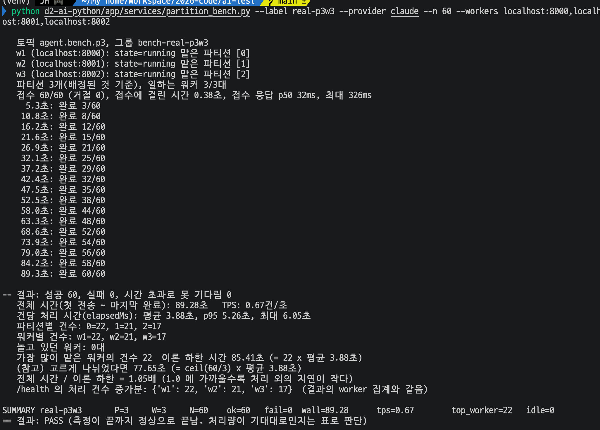
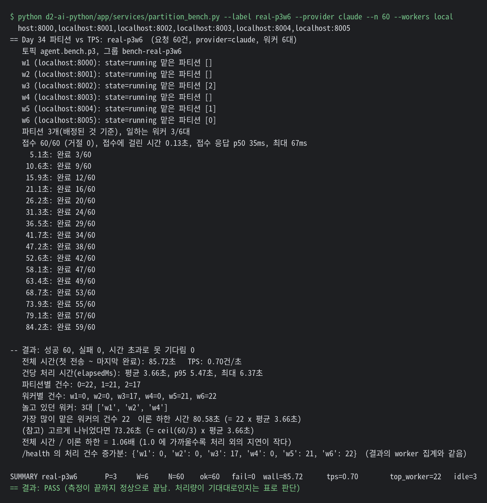
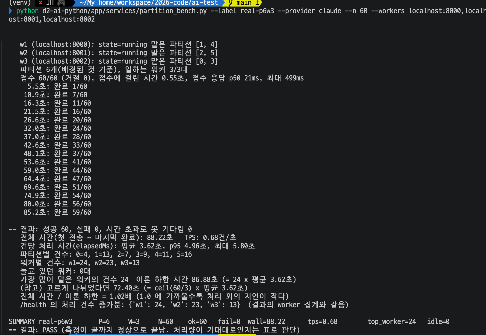
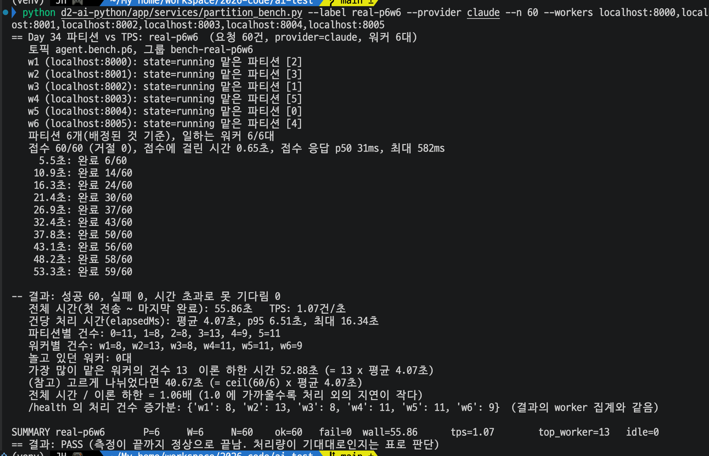

# Day 34.2 결과 — 실제 모델(Claude)로 동기·비동기 부하 테스트와, Kafka 파티션 수와 워커 수에 따른 처리량(TPS) 실험

> 가이드는 [DAY34_2_GUIDE.md](DAY34_2_GUIDE.md). 같은 내용은 각 Day 의 결과 문서에도 "실제 모델" 절로 들어 있다: 동기 [DAY26_RESULT.md](DAY26_RESULT.md) 3-7, 비동기 [DAY27_RESULT.md](DAY27_RESULT.md) 3-7, 파티션 [DAY34_1_RESULT.md](DAY34_1_RESULT.md) 3-7.

**전체 목적:** Day 26·27·34.1 의 결론이 가짜 모델(고정 2~5초)에서만 확인됐다. 같은 시험을 실제 Claude 로 소량만 돌려 결론이 유지되는지, 달라지는 점이 있는지 본다.

**구성:** 실제 운영 구성에 가장 가깝게 Spring → Kafka → FastAPI 워커 → Redis 를 구동하고, AI 모델로 실제 Claude 를 쓴다. 에이전트가 검색 도구로 Qdrant 와 Gemini 임베딩을 쓴다.

## 1. 환경

| 항목      | 값                                                                                                       |
| --------- | -------------------------------------------------------------------------------------------------------- |
| 모델      | 요청의 `provider: "claude"` (코드의 `get_model` 기준 `claude-haiku-5-5`)                                 |
| 워커      | 1대 (①②), 가짜 모델 설정(`FAKE_LLM_ENABLED`) 없이 띄움. 평소 토픽 `agent.requests`, 그룹 `agent-workers` |
| Spring    | 인자 없이 평소대로 (30초 timeout)                                                                        |
| 부하      | k6 `ramping.js`, 최대 VU 20, 올리기 30초, 유지 30초, 내리기 10초, 요청 사이 1초 쉼                       |
| 질문      | 환불, 교환, 배송, 주문 취소 FAQ 5개를 돌아가며 (검색 도구가 Gemini 임베딩을 부름)                        |
| 측정 횟수 | 각 실험 한 번                                                                                            |

## 2. 실행한 것

| 번호 | 원래 Day                            | 명령                                                                                                                                               | 결과 위치 |
| ---- | ----------------------------------- | -------------------------------------------------------------------------------------------------------------------------------------------------- | --------- |
| ①    | [Day 26](DAY26_RESULT.md) 동기      | `k6 run -e MODE=sync -e PROVIDER=claude -e MAX_VUS=20 -e POLL_MAX_SEC=60 scripts/k6/ramping.js`                                                    | 3-1       |
| ②    | [Day 27](DAY27_RESULT.md) 비동기    | `k6 run -e MODE=async -e PROVIDER=claude -e POLL=1 -e MAX_VUS=20 -e POLL_MAX_SEC=120 scripts/k6/ramping.js`                                        | 3-2       |
| ③    | [Day 34.1](DAY34_1_RESULT.md) P3 W3 | `bash scripts/bench-workers.sh start 3 agent.bench.p3 bench-real-p3w3 real` 후 `partition_bench.py --label real-p3w3 --provider claude --n 60 ...` | 3-4       |
| ④    | [Day 34.1](DAY34_1_RESULT.md) P3 W6 | `bash scripts/bench-workers.sh start 6 agent.bench.p3 bench-real-p3w6 real` 후 `partition_bench.py --label real-p3w6 --provider claude --n 60 ...` | 3-4       |
| ⑤    | [Day 34.1](DAY34_1_RESULT.md) P6 W3 | `bash scripts/bench-workers.sh start 3 agent.bench.p6 bench-real-p6w3 real` 후 `partition_bench.py --label real-p6w3 --provider claude --n 60 ...` | 3-3, 3-4  |
| ⑥    | [Day 34.1](DAY34_1_RESULT.md) P6 W6 | `bash scripts/bench-workers.sh start 6 agent.bench.p6 bench-real-p6w6 real` 후 `partition_bench.py --label real-p6w6 --provider claude --n 60 ...` | 3-3, 3-4  |

## 3. 결과

### 3-1. ① 동기, VU 20 (Day 26 짝)

**목적:** 가짜 모델 때 나온 동기 구조의 504 장애가 실제 모델의 응답 시간에서도 나는지 본다.

| 항목                              | 가짜 모델 ([Day 26 ④](DAY26_RESULT.md)) | 실제 모델 (Claude)         |
| --------------------------------- | --------------------------------------- | -------------------------- |
| `http_reqs`                       | 32                                      | 37                         |
| 200                               | 8건 (25%)                               | **16건 (43.24%)**          |
| 504                               | 22건                                    | 18건                       |
| 502                               | 2건                                     | 3건                        |
| `http_req_failed`                 | 75.00%                                  | 56.75% (21 / 37)           |
| `http_req_duration` p(95)         | 30초                                    | 30초                       |
| 성공 건 응답 시간 min / avg / max | 5.29초 / 16.62초 / 24.62초              | 3.21초 / 13.68초 / 25.08초 |
| 반복 (완료 / 중단)                | 30 / 18                                 | 36 / 16                    |

- 같은 점: 504 가 나고 p(95) 가 Spring 제한(30초)에 붙는다. 성공 건의 최대도 약 25초로 같다. 에러율이 50% 를 넘는다.
- 다른 점: 200 비율이 25% 에서 43.24% 로 올랐다. 성공 건 최소 시간이 5.29초에서 3.21초로 줄어 Claude 의 건당 처리 시간이 가짜 5초보다 짧은 쪽으로 보인다(직접 잰 값은 아님).
- 502 3건 중 하나는 1.83초에 끝났다(504 는 약 30초에서 끊기므로 502). 502, 504 는 Claude 쪽에서 난 것으로 확인했다(Gemini 임베딩 쪽이 아님).

### 3-2. ② 비동기, VU 20 (Day 27 짝)

**목적:** 가짜 모델 때 확인한 비동기 구조의 특징(접수는 빠르고 에러가 없으며 완료 시간만 늘어난다)이 실제 모델에서도 같은지 본다.

| 항목                     | 가짜 모델 ([Day 27 ②](DAY27_RESULT.md), 3번 측정의 범위) | 실제 모델 (Claude)        |
| ------------------------ | -------------------------------------------------------- | ------------------------- |
| `accepted`               | 100% (31~32건)                                           | **100% (39 / 39)**        |
| 접수 p(95)               | 21.63~26.43ms                                            | 34.67ms                   |
| `http_req_failed`        | 0%                                                       | **0% (0 / 1097)**         |
| `results_done`           | 12~14                                                    | **21**                    |
| `e2e_ms` avg             | 28.62~30.49초                                            | 24.85초                   |
| `e2e_ms` min / med / max | 6.07~14.09 / 26.1~33.19 / 52.41~57.23초                  | **4.14** / 22.07 / 49.3초 |
| 반복 (완료 / 중단)       | 12~14 / 18~19                                            | 21 / 18                   |

- 같은 점: 접수는 모두 202 이고 실패가 0 이다. 같은 부하에서 동기(①)는 504 와 502 가 21건 났지만 비동기는 접수가 막히지 않았다. 완료까지 시간만 길다.
- 다른 점: 완료 건수가 12~14건에서 21건으로 늘었다. 70~75초에 21건이면 건당 약 3.3~3.6초(계산값)다. `e2e_ms` 최솟값 4.14초는 대기 없이 처리된 한 건(결과 조회 1초 간격 포함)이라 실제 모델의 한 건 처리 시간은 3~4초대로 보인다.
- 시험 뒤 `agent-workers` 의 LAG 은 0 이 됐다. 시험 시간 안에 완료를 확인하지 못한 18건도 처리됐고, 가짜 모델 때와 같다.

### 3-3. ⑤⑥ 파티션, P6 W3 와 P6 W6 (Day 34.1 짝, 2026-10-19 측정)

**목적:** 처리량이 `min(파티션, 워커)` 로 정해지고 건수 편차가 전체 시간을 정한다는 결론이 실제 모델에서도 같은지, 워커를 3대에서 6대로 늘리면 처리량이 느는지 본다. 같은 표가 [DAY34_1_RESULT.md](DAY34_1_RESULT.md) 3-7 에도 있다.

- ⑤ P6W3

  

- ⑥ P6W6

  

| 항목                                                  | 가짜 모델 P6 W3 (Day 34.1 ④)                  | 실제 모델 P6 W3 (⑤)                          | 가짜 모델 P6 W6 (Day 34.1 ⑤)                 | 실제 모델 P6 W6 (⑥)                                                        |
| ----------------------------------------------------- | --------------------------------------------- | -------------------------------------------- | -------------------------------------------- | -------------------------------------------------------------------------- |
| 파티션 배정                                           | w1 `[1,4]`, w2 `[2,5]`, w3 `[0,3]`            | w1 `[2,5]`, w2 `[0,3]`, w3 `[1,4]`           | 워커마다 하나                                | 워커마다 하나 (w1 `[1]`, w2 `[0]`, w3 `[2]`, w4 `[3]`, w5 `[5]`, w6 `[4]`) |
| 접수                                                  | 60/60 (0.50초)                                | 60/60 (거절 0), 접수에 0.37초                | 60/60 (0.23초)                               | 60/60 (거절 0), 접수에 0.20초                                              |
| 성공 / 실패                                           | 60 / 0                                        | 60 / 0                                       | 60 / 0                                       | 60 / 0                                                                     |
| 전체 시간                                             | 53.26초 (재측정 46.43초)                      | **86.33초**                                  | 24.67초                                      | **43.07초**                                                                |
| TPS                                                   | 1.13 (재측정 1.29)건/초                       | **0.69건/초**                                | 2.43건/초                                    | **1.39건/초**                                                              |
| 건당 처리 시간 (`elapsedMs`)                          | 평균 2.01초 (고정 2초)                        | 평균 3.36초, p(95) 4.31초, 최대 5.07초       | 평균 2.01초                                  | 평균 3.43초, p(95) 4.66초, 최대 9.86초                                     |
| 파티션별 건수                                         | 0번 13, 1번 9, 2번 7, 3번 7, 4번 17, 5번 7    | 0번 2, 1번 11, 2번 12, 3번 9, 4번 13, 5번 13 | 0번 12, 1번 11, 2번 9, 3번 11, 4번 7, 5번 10 | 0번 13, 1번 8, 2번 8, 3번 9, 4번 9, 5번 13                                 |
| 워커별 건수                                           | w1 26, w2 14, w3 20                           | w1 25, w2 11, w3 24                          | w1 9, w2 7, w3 12, w4 10, w5 11, w6 11       | w1 8, w2 13, w3 8, w4 9, w5 13, w6 9                                       |
| 놀고 있던 워커 (0건 처리)                             | 0대                                           | 0대                                          | 0대                                          | 0대                                                                        |
| 가장 많이 받은 워커                                   | 26건                                          | 25건                                         | 12건                                         | 13건                                                                       |
| 이론 하한 (가장 많이 받은 워커 건수 x 평균 건당 시간) | 52.14초                                       | 83.95초                                      | 24.12초                                      | 44.54초                                                                    |
| 전체 시간 / 이론 하한                                 | 1.02배                                        | 1.03배                                       | 1.02배                                       | 0.97배                                                                     |
| 이상 TPS 대비 (일하는 워커 수 ÷ 평균 건당 시간 기준)  | 77% (재측정 88%, 이상은 ① 의 0.49 x 3 = 1.47) | 78% (0.69 / 0.89)                            | 83% (이상 2.94)                              | 80% (1.39 / 1.75)                                                          |

**읽는 법**

- **워커를 3대에서 6대로 늘리자 TPS 가 0.69 에서 1.39 로 2.0배가 됐다.** 파티션은 6개로 같고 워커만 늘렸다. 가짜 모델 때의 2.2배(1.13 에서 2.43, 재측정 기준 1.9배)와 같은 수준이다. 파티션이 충분할 때 워커를 늘리면 처리량이 느는 것이 실제 모델에서도 맞았다.
- **일하는 워커 수가 `min(파티션, 워커)` 라는 결론도 같다.** 두 실험 모두 놀고 있던 워커(0건 처리)가 0대였고, 워커마다 `partitions` 가 배정돼 있었다.
- **건수 편차가 TPS 를 정하는 것도 같다.** ⑤ 는 w2 가 11건만 받아(w1 25건, w3 24건) 약 37초(11건 x 3.36초)에 끝나고 쉬었다. 전체 시간은 가장 많이 받은 워커(25건)로 정해졌고 이론 하한의 1.03배였다. 파티션 0번에는 2건만 갔다. 이상 TPS 대비 비율은 78%(⑤), 80%(⑥)로 가짜 모델 때(77~88%, 83%)와 비슷해, 편차 효과가 모델과 무관하게 나타난다.
- **실제 모델에서도 건당 처리 시간이 안정적이었다.** 평균 3.36초(⑤), 3.43초(⑥)로, Day 34.2 ② 에서 계산으로 추정한 3.3~3.6초와 맞는다. 가짜 모델의 2초보다 약 1.7배 길어서 같은 조합의 TPS 가 낮다(P6 W3 은 1.13 에서 0.69, P6 W6 은 2.43 에서 1.39).
- **동시 호출 3개와 6개에서도 실패가 0건이었다.** 이 규모에서는 Claude 호출 한도에 걸리지 않았다.
- ⑥ 은 전체 시간이 이론 하한보다 짧다(0.97배). 하한은 평균 건당 시간(3.43초)에 가장 많이 받은 워커의 건수를 곱한 값인데, 그 워커의 건들이 평균보다 빨랐다는 뜻으로 보인다.

### 3-4. ③~⑥ 파티션 3개·6개, 워커 3대·6대 (2026-10-22 측정)

**목적:** 파티션 3개(③④)를 새로 재고 3-3 과 같은 실험(⑤⑥)을 다시 재서, 파티션 수와 워커 수 중 어느 쪽이 처리량을 정하는지 실제 모델로 본다. 3-3 과는 따로 잰 결과이며, 네 실험 모두 요청 60건이다.

- ③ P3W3

  

- ④ P3W6

  

- ⑤ P6W3

  

- ⑥ P6W6

  

| 항목                                                  | ③ P3 W3                      | ④ P3 W6                                     | ⑤ P6 W3                                     | ⑥ P6 W6                                                    |
| ----------------------------------------------------- | ---------------------------- | ------------------------------------------- | ------------------------------------------- | ---------------------------------------------------------- |
| 파티션 배정                                           | w1 `[0]`, w2 `[1]`, w3 `[2]` | w3 `[2]`, w5 `[1]`, w6 `[0]`, w1·w2·w4 `[]` | w1 `[1,4]`, w2 `[2,5]`, w3 `[0,3]`          | w1 `[2]`, w2 `[3]`, w3 `[1]`, w4 `[5]`, w5 `[0]`, w6 `[4]` |
| 일하는 워커                                           | 3/3대                        | 3/6대                                       | 3/3대                                       | 6/6대                                                      |
| 접수                                                  | 60/60 (거절 0), 0.38초       | 60/60 (거절 0), 0.13초                      | 60/60 (거절 0), 0.55초                      | 60/60 (거절 0), 0.65초                                     |
| 접수 응답 p50 / 최대                                  | 32ms / 326ms                 | 35ms / 67ms                                 | 21ms / 499ms                                | 31ms / 582ms                                               |
| 성공 / 실패                                           | 60 / 0                       | 60 / 0                                      | 60 / 0                                      | 60 / 0                                                     |
| 전체 시간                                             | **89.28초**                  | **85.72초**                                 | **88.22초**                                 | **55.86초**                                                |
| TPS                                                   | **0.67건/초**                | **0.70건/초**                               | **0.68건/초**                               | **1.07건/초**                                              |
| 건당 처리 시간 (`elapsedMs`) 평균 / p95 / 최대        | 3.88 / 5.26 / 6.05초         | 3.66 / 5.47 / 6.37초                        | 3.62 / 4.96 / 5.80초                        | 4.07 / 6.51 / 16.34초                                      |
| 파티션별 건수                                         | 0번 22, 1번 21, 2번 17       | 0번 22, 1번 21, 2번 17                      | 0번 4, 1번 13, 2번 7, 3번 9, 4번 11, 5번 16 | 0번 11, 1번 8, 2번 8, 3번 13, 4번 9, 5번 11                |
| 워커별 건수                                           | w1 22, w2 21, w3 17          | w1 0, w2 0, w3 17, w4 0, w5 21, w6 22       | w1 24, w2 23, w3 13                         | w1 8, w2 13, w3 8, w4 11, w5 11, w6 9                      |
| 놀고 있던 워커 (0건 처리)                             | 0대                          | 3대 (w1, w2, w4)                            | 0대                                         | 0대                                                        |
| 가장 많이 받은 워커                                   | 22건                         | 22건                                        | 24건                                        | 13건                                                       |
| 이론 하한 (가장 많이 받은 워커 건수 x 평균 건당 시간) | 85.41초                      | 80.58초                                     | 86.88초                                     | 52.88초                                                    |
| 전체 시간 / 이론 하한                                 | 1.05배                       | 1.06배                                      | 1.02배                                      | 1.06배                                                     |
| 고르게 나뉘었다면 (ceil(60 ÷ 일하는 워커) x 평균)     | 77.65초                      | 73.26초                                     | 72.40초                                     | 40.67초                                                    |
| 이상 TPS 대비 (일하는 워커 수 ÷ 평균 건당 시간 기준)  | 87% (0.67 / 0.77)            | 85% (0.70 / 0.82)                           | 82% (0.68 / 0.83)                           | 73% (1.07 / 1.47)                                          |

- 네 실험 모두 60건이 성공했고 실패는 0건이다. `/health` 의 처리 건수 증가분은 네 실험 모두 결과의 워커별 집계와 같았다.
- TPS 는 ③ 0.67, ④ 0.70, ⑤ 0.68건/초로 같은 수준이고, ⑥ 만 1.07건/초로 높다.
- ④ 는 워커 6대 중 3대가 파티션을 받지 못해(`[]`) 0건을 처리했다. 일하는 워커는 3대로 ③ 과 같다. 파티션별 건수도 0번 22, 1번 21, 2번 17 로 ③ 과 같다.
- 건당 처리 시간 평균은 3.62~4.07초다. ⑥ 은 건당 최대가 16.34초로 평균의 약 4배인 한 건이 있었다.
- 전체 시간은 네 실험 모두 이론 하한의 1.02~1.06배다. ⑥ 은 파티션별 건수가 8~13건으로 고르지 않아, 고르게 나뉜 경우(40.67초)보다 약 15초 길었다.
- 3-3(2026-10-19)과 비교하면 ⑤ 는 86.33초, 0.69건/초에서 88.22초, 0.68건/초로 거의 같고, ⑥ 은 43.07초, 1.39건/초에서 55.86초, 1.07건/초로 낮아졌다. ⑥ 의 가장 많이 받은 워커는 두 번 모두 13건이고, 건당 평균은 3.43초에서 4.07초였다.

**확인 전 예상과 결과** (예상은 [DAY34_2_GUIDE.md](DAY34_2_GUIDE.md) 5번, d 는 건당 처리 시간 평균)

| 번호 | 확인 전 예상                                                           | 결과                                                      | 판정                                                                      |
| ---- | ---------------------------------------------------------------------- | --------------------------------------------------------- | ------------------------------------------------------------------------- |
| ③    | 일하는 워커가 3대로 같아 ⑤ 와 비슷하다                                 | 89.28초, 0.67건/초 (⑤ 88.22초, 0.68건/초)                 | 맞았다                                                                    |
| ④    | 워커 6대 중 3대가 놀아 ③ 과 비슷하다                                   | 3대가 0건 처리, 85.72초, 0.70건/초 (③ 89.28초, 0.67건/초) | 맞았다                                                                    |
| ⑤    | 약 60/3 x d = 72.40초                                                  | 88.22초                                                   | 길었다. 건수가 고르지 않아 가장 많이 받은 워커(24건)가 시간을 정했다      |
| ⑥    | 약 60/6 x d = 40.67초. Claude 호출 한도 때문에 못 미칠 수 있다(미확인) | 55.86초. 실패 0건                                         | 길었다. 원인은 호출 한도가 아니라 건수 편차(가장 많이 받은 워커 13건)였다 |

**읽는 법**

- **처리량은 일하는 워커 수가 정했다.** 일하는 워커가 3대인 ③④⑤ 는 TPS 가 0.67~0.70건/초로 같고, 6대인 ⑥ 만 1.07건/초다. 파티션을 3개에서 6개로 늘려도(③ 에서 ⑤) 워커가 3대면 그대로였고, 워커를 3대에서 6대로 늘려도(③ 에서 ④) 파티션이 3개면 3대가 놀아 그대로였다. 일하는 워커 수가 `min(파티션, 워커)` 라는 Day 34.1 의 결론이 실제 모델에서도 같다.
- **늘리려면 파티션과 워커를 같이 늘려야 한다.** 둘 다 6으로 늘린 ⑥ 만 처리량이 올랐다. ⑤ 대비 약 1.6배로, 2배에 못 미쳤다.
- **⑥ 이 2배에 못 미친 이유는 건수 편차와 건당 시간이다.** 파티션별 건수가 8~13건으로 고르지 않아 고르게 나뉜 경우(40.67초)보다 약 15초 길었다. 또 건당 평균이 4.07초로 다른 세 실험(3.62~3.88초)보다 길었고, 16.34초 걸린 한 건이 있었다. 실패는 0건이라 Claude 호출 한도에 걸린 것은 아니다.
- **전체 시간은 가장 많이 받은 워커가 정했다.** 네 실험 모두 전체 시간이 이론 하한의 1.02~1.06배다. 처리 외의 지연(접수, Kafka 전달, 결과 저장)은 작다.
- **같은 조합이라도 실제 모델은 측정마다 TPS 가 달라진다.** ⑤ 는 3-3 과 거의 같았지만(0.69, 0.68건/초), ⑥ 은 1.39 에서 1.07건/초로 차이가 컸다. ⑥ 은 두 번 모두 가장 많이 받은 워커가 13건으로 편차는 같았고, 건당 평균이 3.43초에서 4.07초로 달랐다. 가짜 모델은 건당 시간이 2초로 고정이라 차이가 편차에서만 나왔지만, 실제 모델은 건당 시간 자체도 측정마다 달라진다.

### 3-5. 가짜 모델과 실제 모델 비교 (파티션·워커)

**목적:** 같은 파티션·워커 조합을 가짜 모델([DAY34_1_RESULT.md](DAY34_1_RESULT.md), 건당 2초 고정)과 실제 Claude(3-4, 2026-10-22 측정)로 쟀을 때 처리량이 어떻게 달라지는지 나란히 본다.

| 조합 (번호)    | 일하는 워커 | 가짜 모델 TPS            | 실제 모델 TPS | 실제 / 가짜 | 가짜 건당 평균 | 실제 건당 평균 | 실제 / 가짜 (건당) | 가장 많이 받은 워커 (가짜 / 실제) |
| -------------- | ----------- | ------------------------ | ------------- | ----------- | -------------- | -------------- | ------------------ | --------------------------------- |
| P3 W3 (③)      | 3           | 1.40                     | 0.67          | 0.48배      | 2.00초         | 3.88초         | 1.94배             | 21건 / 22건                       |
| P3 W6 (④)      | 3           | 측정 없음                | 0.70          | -           | -              | 3.66초         | -                  | - / 22건                          |
| P6 W3 (⑤)      | 3           | 1.13, 1.29 (두 번 측정)  | 0.68          | 0.60배, 0.53배 | 2.01초      | 3.62초         | 1.80배             | 26건, 23건 / 24건                 |
| P6 W6 (⑥)      | 6           | 2.43                     | 1.07          | 0.44배      | 2.01초         | 4.07초         | 2.02배             | 12건 / 13건                       |

**조합을 바꿨을 때 TPS 변화:**

| 바꾼 것                        | 가짜 모델                              | 실제 모델                                  |
| ------------------------------ | -------------------------------------- | ------------------------------------------ |
| 워커만 3 → 6 (파티션 3 그대로) | 측정 없음 (P1 에서 워커 1 → 3 은 0.49 → 0.49) | P3 W3 0.67 → P3 W6 0.70, 3대가 놂         |
| 파티션만 3 → 6 (워커 3 그대로) | 1.40 → 1.13, 1.29                      | 0.67 → 0.68                                |
| 워커만 3 → 6 (파티션 6 그대로) | 1.13 → 2.43 (1.29 → 2.43)              | 0.68 → 1.07 (2026-10-19 측정은 0.69 → 1.39) |

**읽는 법**

- **같은 조합의 TPS 는 실제 모델이 가짜 모델의 0.44~0.60배다.** 건당 평균 시간이 실제 모델에서 1.8~2.0배 길었고(2.0초 고정에서 3.6~4.1초), TPS 의 비율은 건당 시간 비율의 거의 역수다.
- **일하는 워커 수가 `min(파티션, 워커)` 라는 점은 두 모델이 같다.** 일하는 워커가 3대인 조합은 가짜 모델에서 1.13~1.40, 실제 모델에서 0.67~0.70 이고, 6대인 조합만 가짜 2.43, 실제 1.07 로 높다.
- **워커만 3 → 6 으로 늘렸을 때 TPS 가 오르는 폭은 둘 다 약 1.6~2.2배다.** 가짜 모델은 1.13 → 2.43(2.2배), 실제 모델은 0.68 → 1.07(1.6배), 2026-10-19 측정은 0.69 → 1.39(2.0배)다.
- **파티션만 3 → 6 으로 늘렸을 때는 가짜 모델이 낮아졌고 실제 모델은 같았다.** 가짜 모델은 1.40 에서 1.13, 1.29 로 낮아졌고, 실제 모델은 0.67 에서 0.68 로 같았다.
- **P3 W6 은 가짜 모델로 재지 않았다.** 가짜 모델에서 같은 모양은 P1 W3(파티션 1개, 워커 3대, 한 대만 일해 0.49)이다.

## 4. 해석

가짜 모델에서 낸 결론이 실제 Claude 에서도 모두 유지됐다.

- **동기 구조는 VU 20 만으로 504 가 나고 p(95) 가 Spring 제한(30초)에 붙는다(①).** 건당 시간이 줄어도(가짜 5초, 실제 약 3~4초) 대기열이 길어지면 같은 모양으로 무너진다.
- **비동기 구조는 접수가 항상 빠르고 에러가 없다(②).** 달라진 것은 완료 건수(12~14건에서 21건)로, 건당 시간이 가짜 5초보다 짧은 만큼 늘었다.
- **처리량은 일하는 워커 수 `min(파티션, 워커)` 가 정한다(③~⑥).** 일하는 워커가 3대인 ③④⑤ 는 파티션이 3개든 6개든, 워커가 3대든 6대든 0.67~0.70건/초로 같았다(2026-10-22). 파티션이 3개인데 워커를 6대 띄운 ④ 는 3대가 놀았다. 파티션과 워커를 둘 다 6으로 늘린 ⑥ 만 처리량이 올랐고, ⑤ 대비 2.0배(2026-10-19), 1.6배(2026-10-22)였다.
- **전체 시간은 가장 많이 받은 워커가 정한다.** 키(`requestId`, 무작위 UUID) 해시로 파티션이 정해져 건수가 고르지 않고, 두 날 모두 전체 시간이 이론 하한의 0.97~1.06배였다. 이상 TPS 대비 비율은 73~87% 로 가짜 모델 때(77~88%)와 비슷한 범위다.

실제 모델이라서 다르게 나온 점은 두 가지다.

- **건당 처리 시간이 평균 3.4~4.1초다.** 가짜 모델의 동기·비동기 5초보다 짧고, 파티션 실험의 2초보다 길다. 그래서 동기의 200 비율(25% 에서 43%)과 비동기의 완료 건수(12~14건에서 21건)는 늘었고, 파티션 실험의 TPS 는 낮아졌다(P3 W3 1.40 에서 0.67, P6 W6 2.43 에서 1.39·1.07건/초).
- **건당 처리 시간이 측정마다 달라져 같은 조합의 TPS 도 달라진다.** ⑥ P6 W6 은 가장 많이 받은 워커가 두 번 모두 13건이었는데, 건당 평균이 3.43초와 4.07초로 달라 TPS 가 1.39 와 1.07건/초로 갈렸다. 평균의 3~4배 걸린 한 건(9.86초, 16.34초)도 측정마다 나타났다. 가짜 모델은 건당 2초 고정이라 차이가 건수 편차에서만 나왔다.

구조의 차이(동기는 연결 안에서 기다리다 끊김, 비동기는 대기열에서 기다림, 처리량은 `min(파티션, 워커)` 와 건수 편차)는 그대로다. 동시 호출 3~6개에서 실패가 없었으므로(③~⑥ 60건씩 모두 성공, ② 실패 0) 이 규모에서는 Claude 호출 한도(429)가 변수로 나타나지 않았다.
