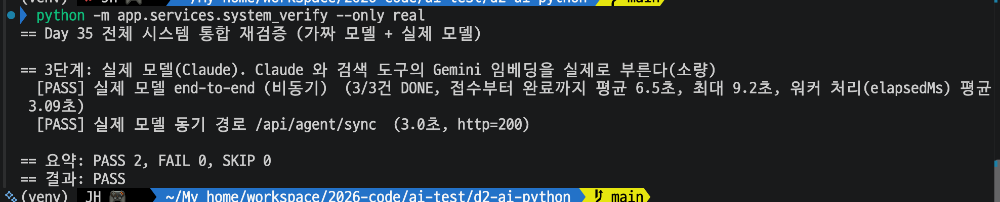
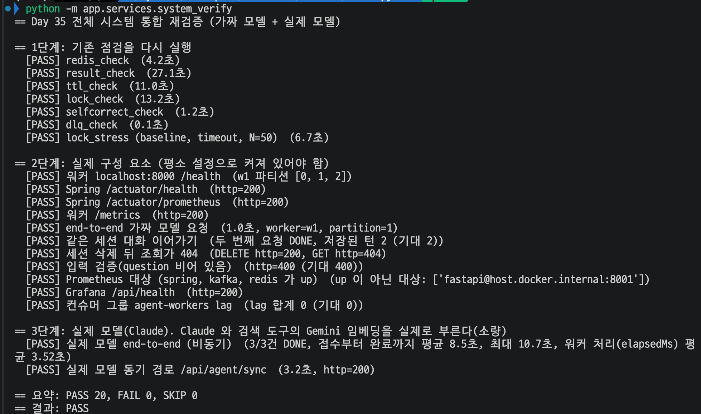

# Day 35 결과 — 전체 시스템 통합 재검증 (가짜 모델 + 실제 모델)

> 상태: **1, 2단계(가짜 모델) PASS 18, FAIL 0, SKIP 0, 3단계(실제 모델) PASS 2, FAIL 0, SKIP 0**(2026-10-19). Day 36 코드 변경 뒤 재확인은 5번(PASS 20, FAIL 0, SKIP 0, 2026-10-21).
> 가이드는 [DAY35_GUIDE.md](DAY35_GUIDE.md), 코드 흐름은 [DAY35_CODE_GUIDE.md](DAY35_CODE_GUIDE.md).

**전체 목적:** 그동안 만든 기능을 따로따로 확인했으므로, 한 번에 다시 돌려 서로 깨뜨린 곳이 없는지, 평소 설정의 실제 구성이 한 줄로 이어지는지 본다. 이번에는 가짜 모델 단계(1, 2)에 실제 모델(Claude) 단계(3)를 더했다.

## 1. 환경

| 항목      | 값                                                                                     |
| --------- | -------------------------------------------------------------------------------------- |
| 실행      | `python -m app.checks.system_verify` (1, 2단계), `python -m app.checks.system_verify --only real` (3단계) |
| 워커      | 1대, 평소 설정(토픽 `agent.requests`, 그룹 `agent-workers`)                            |
| Spring    | 인자 없이 평소대로                                                                     |
| 3단계     | 질문 3건(비동기, provider `claude`) + 동기 1건, 검색 도구가 Gemini 임베딩을 부름       |
| 측정 횟수 | 각 단계 한 번                                                                          |

## 2. 결과

### 2-1. 1, 2단계 (가짜 모델)

PASS 18, FAIL 0, SKIP 0. 처음 실행에서는 FAIL 3건이 나왔다.

| 처음 FAIL                          | 원인                                                                                                        | 조치                                              |
| ---------------------------------- | ----------------------------------------------------------------------------------------------------------- | ------------------------------------------------- |
| `dlq_check`                        | `No module named 'services'`, 실행 위치가 맞지 않았다                                                       | 스크립트가 앱 폴더에서 `-m checks.dlq_check` 로 실행하도록 고침 |
| end-to-end, 같은 세션 두 번 보내기 | 이전에 `--args=...agent.bench.p6...` 로 띄운 Spring 이 8080 에 남아 있어 요청이 다른 토픽으로 갔다(`agent.bench.p6` offset 합 122, 실제 보낸 120건 + 2) | 남은 Spring 을 끄고 인자 없이 다시 띄움 → PASS 18 |

### 2-2. 3단계 (실제 모델)

| 항목                                      | 결과                                                                   |
| ----------------------------------------- | ---------------------------------------------------------------------- |
| 실제 모델 end-to-end (비동기)             | PASS. 3/3건 DONE, 접수부터 완료까지 평균 6.5초, 최대 9.2초, 워커 처리(elapsedMs) 평균 3.09초 |
| 실제 모델 동기 경로 `/api/agent/sync`     | PASS. 3.0초, http=200                                                  |
| 요약                                      | PASS 2, FAIL 0, SKIP 0                                                 |

## 3. 가짜 모델과 실제 모델 비교

| 항목                         | 가짜 모델 (1, 2단계)                       | 실제 모델 (3단계)                                  |
| ---------------------------- | ------------------------------------------ | -------------------------------------------------- |
| 판정 항목                    | 18개                                       | 2개                                                |
| 비동기 접수 → DONE           | PASS                                       | PASS (3/3건)                                       |
| 결과에 worker, partition, offset | 남음                                   | 남음                                               |
| 답                           | `[fake]` 로 시작하는 고정 답               | 비어 있지 않고 `[fake]` 아님(통과 조건)            |
| 요청 하나 처리 시간          | 가짜 지연 2~5초                            | elapsedMs 평균 3.09초 (Day 34.2 의 평균 3.4초와 같은 수준) |
| 동기 경로                    | 가짜 모델로 200                            | 3.0초, 200 (Spring timeout 30초 안)                |
| 걸리는 시간                  | 1, 2단계 약 62초                           | 질문 4건 합쳐 짧음(동기 3.0초, 비동기 최대 9.2초)  |
| 외부 호출                    | 없음                                       | Claude, Gemini 임베딩 소량                         |

접수부터 완료까지(평균 6.5초, 최대 9.2초)가 워커 처리 시간(평균 3.09초)보다 긴 것은, 워커 1대가 질문 3건을 차례로 처리해서 뒤의 질문이 앞 질문의 처리를 기다렸기 때문으로 보인다. 처리 시간 3.09초씩 세 번이면 약 9.3초이고 최대값 9.2초와 맞는다.

## 4. 해석

- 가짜 모델로 확인한 흐름(접수 → Kafka → 워커 → Redis 결과, 세션 이어가기, 입력 검증, 지표, lag 0)은 실제 모델에서도 끊기지 않고 이어졌다. 비동기, 동기 모두 실제 Claude 답을 돌려줬다.
- 실제 모델의 처리 시간은 Day 34.2 에서 잰 평균 3.4초와 같은 범위(3.0~3.1초)라, 가짜 지연 2~5초 가정이 크게 틀리지 않았다.
- 1단계 점검 스크립트와 2단계 서버 점검의 FAIL 은 코드 버그가 아니라 실행 위치(`dlq_check`)와 이전 실험에서 남은 Spring 때문이었다. 스크립트 안에서 고칠 부분은 고쳤고, 남은 Spring 은 준비 절차(Spring 을 인자 없이 띄우기)로 막는다.
- 스크립트를 만들어 두었으니 나중에 재측정할 때는 ① 전체 실행(`python -m app.checks.system_verify`) 하나만 하면 된다. 1, 2, 3단계가 모두 실행된다.

## 5. Day 36 변경 뒤 재확인

**목적:** Day 35 이후 Day 36 에서 `agent_graph.py`, `fake_llm.py`, `metrics.py` 를 고쳤으므로, 그 뒤에도 전체가 한 줄로 이어지는지 `python -m app.checks.system_verify` 한 번으로 다시 확인한다(2026-10-21).

첫 실행은 워커(8000)를 켜지 않아 1단계 PASS 7, 2단계 FAIL 1(워커 `/health` http=0), 나머지 6개 SKIP 이었다. 원인은 코드가 아니라 워커 미기동이었고, Spring 과 워커(가짜 모델, 지연 1초)를 가이드 3절 6, 7번대로 띄운 뒤 다시 실행해 아래 결과가 나왔다.

| 단계                    | 2026-10-19 (Day 35)                                                     | 2026-10-21 (Day 36 변경 뒤)                                             |
| ----------------------- | ----------------------------------------------------------------------- | ----------------------------------------------------------------------- |
| 1단계 기존 점검 7개     | PASS 7                                                                  | PASS 7                                                                  |
| 2단계 실제 구성 요소    | PASS 11                                                                 | PASS 11 (워커 w1 파티션 [0, 1, 2], 대화 이어가기 저장 턴 2, lag 합계 0)  |
| 3단계 실제 모델 비동기  | 3/3건 DONE, 접수부터 완료까지 평균 6.5초, 최대 9.2초, 워커 처리 평균 3.09초 | 3/3건 DONE, 접수부터 완료까지 평균 8.5초, 최대 10.7초, 워커 처리 평균 3.52초 |
| 3단계 실제 모델 동기    | 3.0초, http=200                                                         | 3.2초, http=200                                                         |
| 요약                    | PASS 20, FAIL 0, SKIP 0                                                 | PASS 20, FAIL 0, SKIP 0                                                 |

**해석:** Day 36 에서 코드를 고친 뒤에도 항목 20개가 모두 통과했다. 3단계의 시간은 3건, 1건의 값이라 두 날짜의 차이(접수부터 완료까지 평균 6.5초와 8.5초)를 해석하지 않는다.
