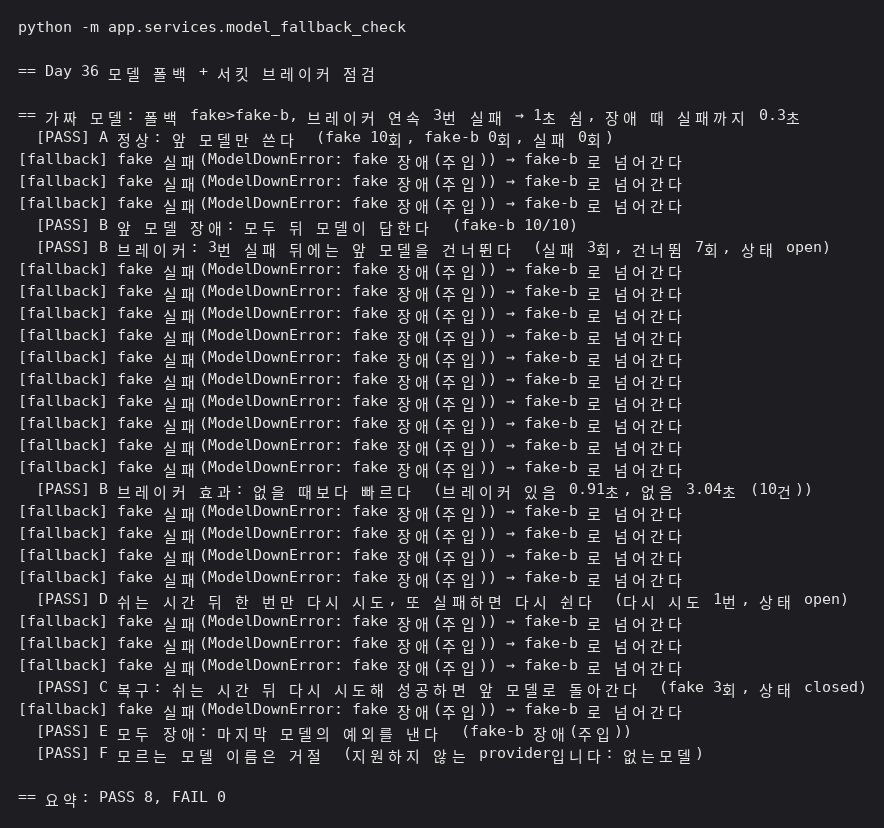
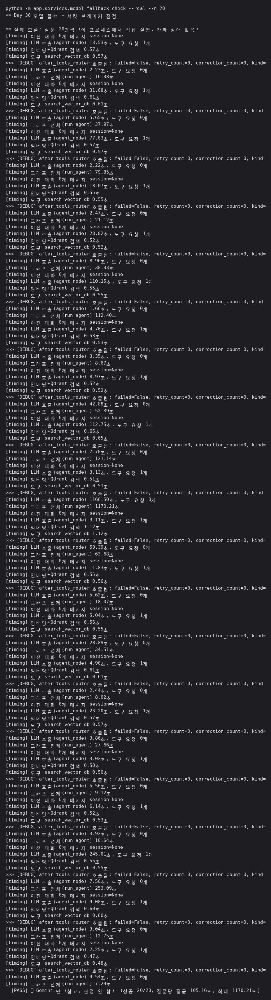
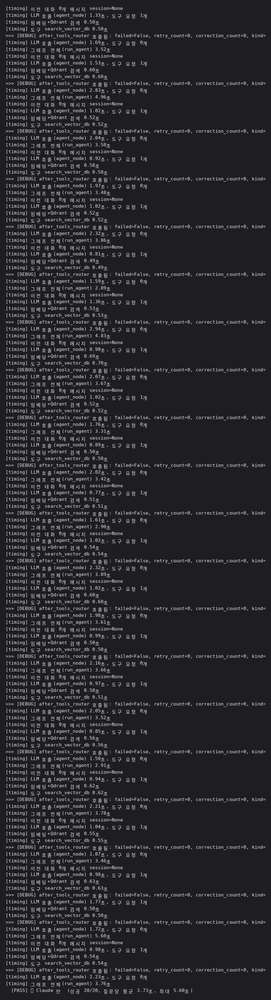
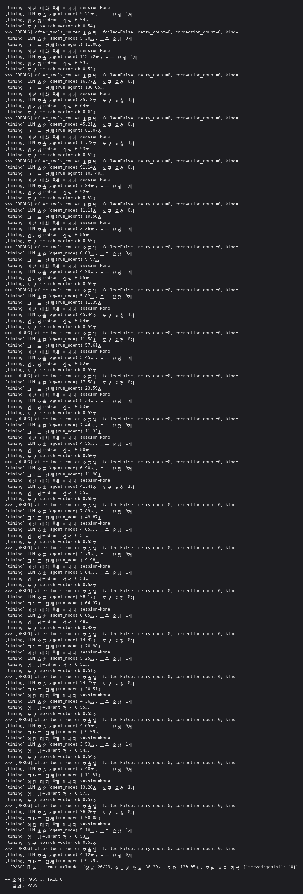

# Day 36 결과 — 모델 폴백(서킷 브레이커)

> 상태: **가짜 모델 점검 PASS 8, FAIL 0. 실제 모델(`--real --n 20`) PASS 3, FAIL 0이지만 Gemini 가 한 번도 실패하지 않아 폴백은 일어나지 않았다**(2026-10-21).
> 가이드는 [DAY36_GUIDE.md](DAY36_GUIDE.md), 코드 흐름은 [DAY36_CODE_GUIDE.md](DAY36_CODE_GUIDE.md).

**전체 목적:** 앞 모델이 실패하면 다음 모델로 넘어가고(폴백), 앞 모델이 연속으로 실패하면 일정 시간 부르지 않아(서킷 브레이커) 장애인 모델을 기다리느라 모든 요청이 느려지는 일을 막는다.

## 1. 환경

| 항목      | 값                                                                                               |
| --------- | ------------------------------------------------------------------------------------------------ |
| 실행      | 가짜 모델: `python -m app.checks.model_fallback_check`, 실제 모델: `python -m app.checks.model_fallback_check --real --n 20` (서버, Kafka, Redis 없이 한 프로세스 안에서) |
| 모델      | 가짜 모델: 두 개를 이은 `fake>fake-b` (가짜 지연 0초). 실제 모델: Gemini(`gemini-3.1-flash-lite`), Claude(`claude-haiku-5-5`)      |
| 브레이커  | 연속 3번 실패하면 1초 쉼                                                                         |
| 장애 주입 | 앞 모델(`fake`)을 부르기 전에 0.3초 기다린 뒤 실패시킴                                           |
| 실제 모델 부하 | 단계마다 질문 20건(5개를 4번씩), 한 건씩 차례로. ① Gemini 만, ② Claude 만, ③ `gemini>claude`. 가짜 장애는 쓰지 않음 |
| 그 밖에   | ③ 이 도는 동안 같은 키로 Gemini 질문 3건이 별도로 호출됐다(`--only` 동작 확인 중 실수) |
| 측정 횟수 | 각 항목 한 번                                                                                    |

## 2. 결과

| 항목 | 내용                                              | 결과                                                    |
| ---- | ------------------------------------------------- | ------------------------------------------------------- |
| A    | 정상이면 앞 모델만 쓴다                           | PASS. fake 10회, fake-b 0회, 실패 0회                   |
| B    | 앞 모델이 장애이면 뒤 모델이 답한다               | PASS. fake-b 10/10                                      |
| B    | 3번 실패 뒤에는 앞 모델을 건너뛴다                | PASS. 실패 3회, 건너뜀 7회, 상태 open                   |
| B    | 브레이커가 있으면 없을 때보다 빠르다 (10건)       | PASS. 있음 0.91초, 없음 3.04초                          |
| D    | 쉬는 시간 뒤 한 번만 다시 시도, 또 실패하면 다시 쉼 | PASS. 다시 시도 1번, 상태 open                          |
| C    | 쉬는 시간 뒤 다시 시도해 성공하면 앞 모델로 복귀  | PASS. fake 3회, 상태 closed                             |
| E    | 모든 모델이 장애이면 예외를 낸다                  | PASS. `fake-b 장애(주입)`                               |
| F    | 모르는 모델 이름은 거절                           | PASS. `지원하지 않는 provider입니다: 없는모델`          |

### 2-2. 실제 모델 (Gemini, Claude)

① Gemini 만 (참고, 판정 안 함)

② Claude 만

③ 폴백 `gemini>claude`

| 단계                 | 성공  | 질문당 평균 | 중앙값  | 최대      | 30초 이상 | 100초 이상 | 모델 호출 기록          |
| -------------------- | ----- | ----------- | ------- | --------- | --------- | ---------- | ----------------------- |
| ① Gemini 만 (참고)   | 20/20 | 105.16초    | 31.09초 | 1170.21초 | 10건      | 4건        | -                       |
| ② Claude 만          | 20/20 | 3.73초      | 3.59초  | 5.60초    | 0건       | 0건        | -                       |
| ③ 폴백 `gemini>claude` | 20/20 | 36.39초     | 20.24초 | 130.05초  | 8건       | 2건        | `served:gemini` 40      |

중앙값과 30초, 100초 이상 건수는 출력의 `그래프 전체(run_agent)` 값 20개로 계산했다.

## 3. 해석

- 앞 모델이 장애여도 요청은 실패하지 않고 뒤 모델이 모두 답했다(10/10).
- 브레이커가 없으면 10건 모두 앞 모델의 실패를 기다려 3.04초(0.3초 × 10)가 걸렸고, 있으면 처음 3건만 기다려 0.91초(0.3초 × 3)였다. 장애가 길수록, 실패까지 오래 걸릴수록 차이가 커진다. 실제 모델에서 실패까지의 시간은 이번에 재지 않았다.
- 브레이커는 쉬는 시간이 지나면 한 번만 시험 호출을 보내고, 성공하면 앞 모델로 돌아가고 실패하면 다시 쉬었다.
- 위 세 항목은 가짜 모델과 장애 주입으로 얻은 것이다.
- **실제 모델에서는 폴백이 일어나지 않았다.** ③ 에서 Gemini 호출 40번이 모두 성공했고(`served:gemini` 40, `error`, `skipped` 없음) 20건 모두 Gemini 가 답했다. 무료 한도 오류도 나오지 않았다. 그래서 실제 Gemini 에서 Claude 로 넘어가는 동작은 실제 모델로는 확인하지 못했다.
- **Gemini 는 실패하지 않았지만 느리고 들쭉날쭉했다.** 질문당 최대 1170.21초(모델 호출 한 번이 1166.50초)였고 100초가 넘은 질문이 ① 에서 4건, ③ 에서 2건이었다. 같은 Gemini 인데 ① 은 평균 105.16초, ③ 은 36.39초였고 중앙값은 31.09초와 20.24초였다. 평균 차이는 극단값 때문이다.
- **느린 것은 실패가 아니라서 지금의 폴백은 막지 못한다.** ③ 에서 130.05초 걸린 질문도 Claude 로 넘어가지 않고 Gemini 를 끝까지 기다렸다. 폴백이 막는 것은 모델이 오류를 낼 때이고 지연은 아니다. 지연까지 막으려면 앞 모델 호출에 시간 제한을 두는 방법이 있으나 이번에는 만들지 않았다.
- **Claude 는 안정적이었다.** 20건 모두 성공했고 평균 3.73초, 최대 5.60초였으며 30초를 넘은 질문이 없었다. Day 34.2 에서 잰 건당 평균 3.4초와 같은 범위다.
