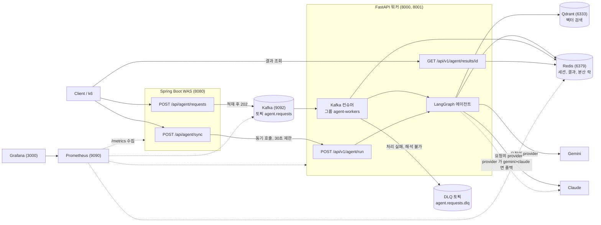
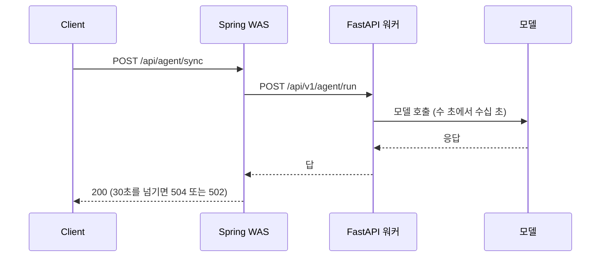
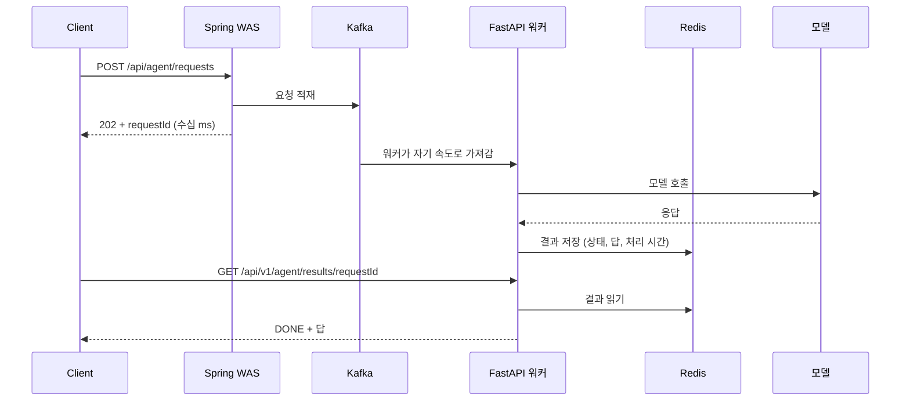
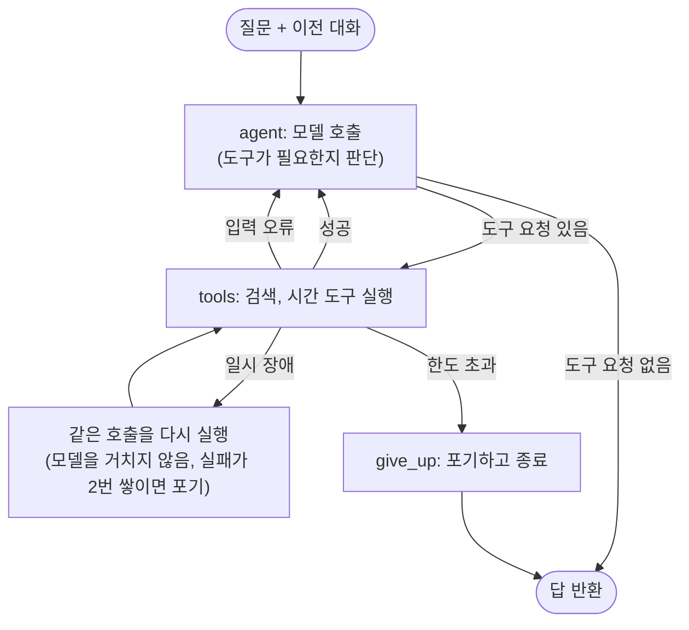

# Day 37 — 연구 보고서: 문제 정의와 시스템 아키텍처

> 상태: **작성 완료**(2026-10-21). 같은 내용이 프로젝트 루트 [README.md](../README.md) 의 1번, 2번에 들어 있다. Day 38 이후는 [DAY38_REPORT.md](DAY38_REPORT.md) 처럼 Day 별 문서에 먼저 쓰고 README 에도 옮긴다.

**전체 목적:** 최종 산출물인 연구 보고서(README)의 첫 두 절, "문제 정의"와 "시스템 아키텍처(Mermaid)"를 쓴다.

## 작업 기록

| 항목              | 내용                                                                                                                                  |
| ----------------- | ------------------------------------------------------------------------------------------------------------------------------------- |
| 만든 파일         | 프로젝트 루트 `README.md` (새 파일, 기존 README 는 없었다), 이 문서                                                                   |
| 안 건드린 파일    | `d2-ai-python/READEME.md`                                                                                                             |
| 숫자의 출처       | 1번의 값은 각 Day 결과 문서(Day 17, 26, 34.2)에서 가져왔고 표에 출처 링크를 달았다                                                    |
| 구성 요소와 경로  | 코드에서 확인: Spring `/api/agent/sync`, `/api/agent/requests`, 워커 `/api/v1/agent/run`, `/api/v1/agent/results/{id}`, 토픽 `agent.requests`, `agent.requests.dlq`, 그룹 `agent-workers`, Prometheus 대상 |
| Day 번호          | 계획 문서의 Day 번호와 대조해 맞췄다                                                                                                         |
| 다이어그램 확인   | Mermaid 4개를 모두 그려 봐서 문법 오류가 없음을 확인했다                                                                              |
| 확인하지 못한 것  | GitHub 에서 실제로 렌더링되는 모습(구성도는 가로로 넓다), 실제 모델에서 Day 36 폴백이 넘어가는 모습(Gemini 가 실패하지 않아 일어나지 않았다)                                  |

## 1. 문제 정의

### 1-1. AI 호출의 특성

| 특성                          | 이 프로젝트에서 잰 값                                                                 | 그대로 두면 생기는 일                         |
| ----------------------------- | ------------------------------------------------------------------------------------- | --------------------------------------------- |
| 한 번에 오래 걸린다           | Gemini 에이전트 한 건 22~29초(Day 17), Claude 한 건 평균 3.4초(Day 34.2)              | 요청 스레드를 오래 붙잡아 서버가 금방 포화된다 |
| 시간이 일정하지 않다          | 같은 Gemini 로 질문 20개를 보냈을 때 중앙값 31.09초, 최대 1170.21초(Day 36). Claude 는 3.73초 안팎으로 고른 편 | 처리 시간을 예측해 서버 크기를 정하기 어렵다   |
| 외부 API라 불안정하다         | 임베딩 호출 중 무료 한도 초과(429)가 실제로 났다(Day 12, 58초 쉬고 재시도해 성공)      | 실패가 사용자에게 그대로 드러난다             |
| 한 번에 한 건씩 처리한다(워커) | 워커 1대가 건당 약 5초(가짜 모델)면 초당 0.2건                                        | 요청이 몰리면 처리하지 못한 요청이 쌓인다     |

### 1-2. 동기 구조는 어떻게 무너지는가

요청이 들어오면 에이전트가 답을 만들 때까지 연결을 붙잡고 기다리는 구조(동기)로 같은 부하를 보냈다.

| 시험                               | 결과                                                                                  | 출처                                              |
| ---------------------------------- | ------------------------------------------------------------------------------------- | ------------------------------------------------- |
| 동기, VU 20, 가짜 모델 5초         | 요청 32건 중 200 8건, 504 22건, 502 2건(에러율 75%)                                   | [DAY26_RESULT.md](DAY26_RESULT.md)           |
| 동기, VU 20, 실제 Claude           | 요청 37건 중 200 16건, 504 18건, 502 3건(에러율 56.75%)                               | [DAY34_2_RESULT.md](DAY34_2_RESULT.md)       |
| 처리 중인 워커의 `/health`         | 동기 요청 하나가 처리되는 동안 `/health` 응답이 3.09초 막혔다                         | [DAY26_RESULT.md](DAY26_RESULT.md)           |

동기 요청 하나가 그 워커의 모든 요청을 멈추게 하고, 대기 시간이 Spring 의 30초 제한을 넘으면 504(또는 502)로 끝난다.

### 1-3. 이 보고서가 답하려는 질문

| 번호 | 질문                                                                                  | 확인한 방법                                      |
| ---- | ------------------------------------------------------------------------------------- | ------------------------------------------------ |
| 1    | 요청을 Kafka 에 넣고 바로 202 로 응답하는 비동기 구조는 같은 부하에서 에러 없이 버티는가 | 같은 조건의 동기, 비동기 부하 시험(k6)           |
| 2    | 비동기 접수 경로는 어디까지 버티는가                                                  | 접수 경로의 한계 탐색                            |
| 3    | 처리량은 무엇으로 정해지고 어떻게 늘리는가                                            | Kafka 파티션 수와 워커 수를 바꿔 처리량 측정     |
| 4    | 느리고 불안정한 AI 호출의 실패(일시 장애, 입력 오류, 모델 장애, 동시 요청)를 어떻게 방어하는가 | 재시도와 정정, DLQ, 분산 락, 모델 폴백           |

### 1-4. 시험 방식

부하 시험은 비용과 호출 한도 때문에 대부분 가짜 모델(고정 지연 2~5초)로 했고, 같은 결론이 실제 모델(Claude)에서도 유지되는지는 소량으로 따로 확인했다. 가짜 모델은 구조와 부하를 보기 위한 것이라 실제 모델의 응답 시간 분포는 반영하지 못한다. 한계는 6번에서 정리한다.

## 2. 시스템 아키텍처

### 2-1. 전체 구성

| 구성 요소                   | 역할                                                                                              | 만든 Day        |
| --------------------------- | ------------------------------------------------------------------------------------------------- | --------------- |
| Spring Boot WAS (8080)      | 요청을 받는 입구. 비동기는 Kafka 에 넣고 202, 동기는 FastAPI 를 호출해 답을 기다린다(30초 제한) | Day 14, 17, 26~27 |
| Kafka (9092)                | 요청을 쌓아 두고 워커가 처리 속도에 맞춰 가져가게 한다(throttling). 처리 실패 메시지는 DLQ 에 보관 | Day 13~18, 32   |
| FastAPI 워커 (8000, 8001)   | Kafka 에서 요청을 가져와 에이전트를 실행하고 결과를 저장. 동기 호출도 받는다                      | Day 2, 15~16    |
| LangGraph 에이전트          | 모델 호출, 도구 호출(검색, 시간), 실패 처리                                                       | Day 3, 6, 11, 31 |
| Redis (6379)                | 대화 세션, 결과(TTL), 같은 세션의 동시 요청을 막는 분산 락                                        | Day 19~24, 33   |
| Qdrant (6333)               | 문서 검색(RAG). HNSW 파라미터 튜닝                                                                | Day 7~12, 29    |
| Prometheus, Grafana         | 지표 수집과 시각화                                                                                | Day 30          |
| k6                          | 부하 시험                                                                                         | Day 25~28       |

provider 는 요청마다 정한다. `gemini`, `claude`처럼 하나를 쓰면 그 모델만 부르고, `gemini>claude`처럼 `>`로 이으면 앞 모델이 실패할 때 다음 모델로 넘어간다(Day 36). 검색 도구의 임베딩은 어느 경우에도 Gemini 를 쓴다.

### 2-2. 동기와 비동기의 요청 흐름

**동기:** 답이 나올 때까지 연결을 붙잡는다.

**비동기:** 접수와 처리를 나눈다.

두 구조의 차이는 기다림이 어디에 있는가다. 동기는 기다림이 HTTP 연결에 있어서 시간이 길어지면 연결이 끊긴다. 비동기는 기다림이 Kafka 대기열로 옮겨가서 접수는 항상 빠르고, 처리가 밀린 요청은 유실되지 않고 뒤에서 이어서 처리된다. 대기 시간 자체가 줄어드는 것은 아니다.

### 2-3. 에이전트 내부 흐름

| 실패 종류          | 처리                                                                                     | Day    |
| ------------------ | ---------------------------------------------------------------------------------------- | ------ |
| 도구의 일시 장애   | 그래프가 같은 호출을 다시 실행한다. 한도를 넘으면 포기한다                               | Day 6, 31 |
| 도구의 입력 오류   | 오류 안내를 모델에게 돌려줘서 모델이 입력을 고쳐 다시 부르게 한다(Self-Correction)       | Day 31 |
| 처리할 수 없는 메시지 | 버리지 않고 DLQ 토픽에 원본과 실패 정보를 붙여 보관한다. 확인과 재처리 도구가 있다       | Day 32 |
| 같은 세션의 동시 요청 | Redis 분산 락으로 한 번에 한 건만 처리한다                                              | Day 21~22, 33 |
| 모델 장애          | provider 에 `>`로 이은 다음 모델로 넘어가고, 연속 실패하면 그 모델을 일정 시간 건너뛴다(서킷 브레이커) | Day 36 |
