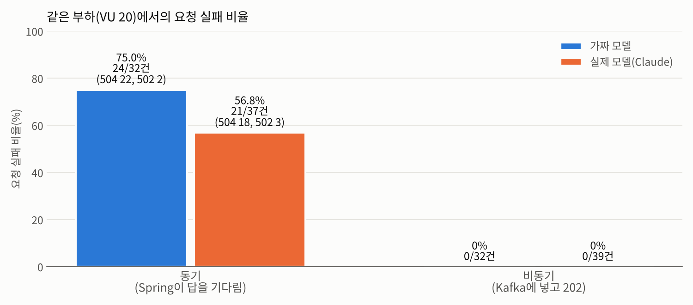
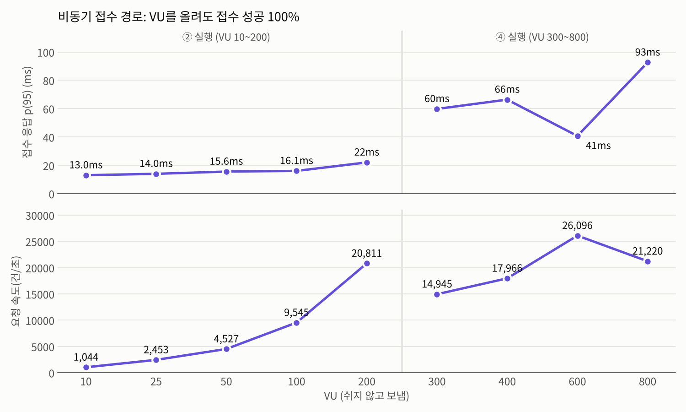
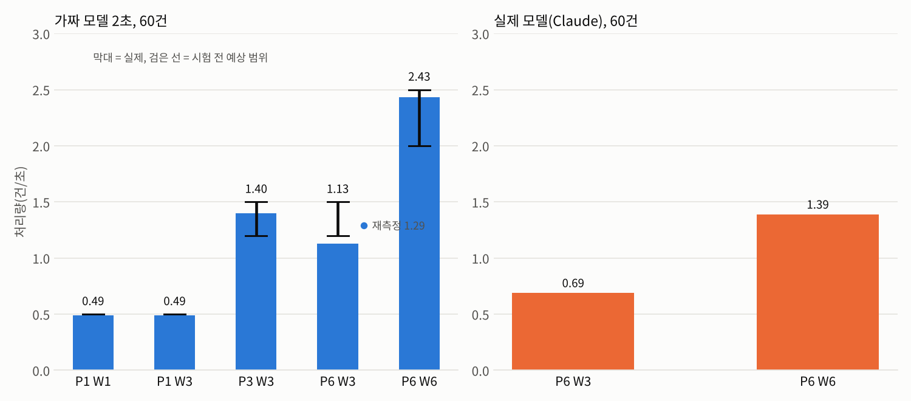
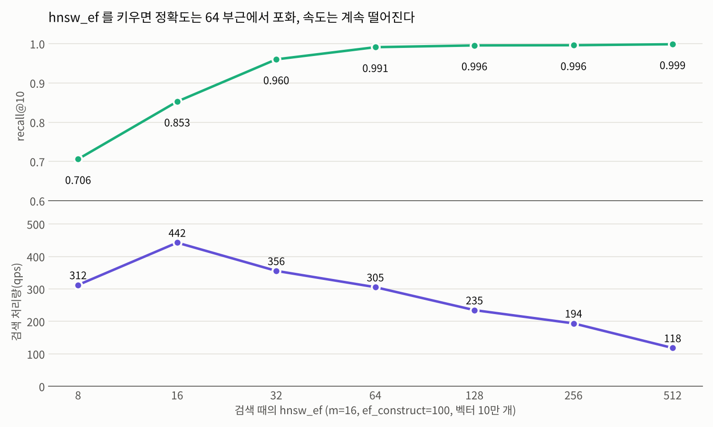
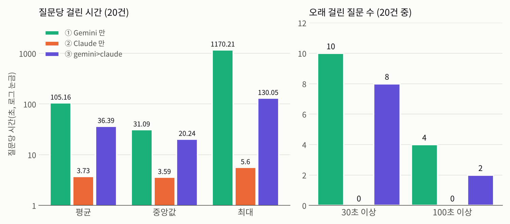

# Day 38 — 연구 보고서: 실험 설계, 가설, 비교표와 그래프

> 상태: **작성 완료**(2026-10-21). 같은 내용이 프로젝트 루트 [README.md](../README.md) 의 3번, 4번에 들어 있다. 앞 문서: [DAY37_REPORT.md](DAY37_REPORT.md).

**전체 목적:** 연구 보고서의 3번(실험 설계)과 4번(가설과 결과)을 쓴다. 새로 잰 값은 없고, 이미 기록한 Day 별 결과 문서의 값만 옮겼다. 그래프도 그 값으로 그렸다.

## 작업 기록

| 항목             | 내용                                                                                                                                                                                  |
| ---------------- | ------------------------------------------------------------------------------------------------------------------------------------------------------------------------------------- |
| 만든 파일        | 이 문서, `docs/images/day38/` 그래프 4개, `README.md` 에 3번, 4번 추가. Day 36 실제 모델 결과가 나온 뒤 4-6(D3)을 추가                                                                                                                |
| 값의 출처        | 시험 전 예상은 각 Day 의 `GUIDE.md`, 실제 값은 `RESULT.md`(Day 22, 26, 27, 28, 29, 33, 34, 34.2). 표의 값은 출처 문서와 맞춰 보았다                                                    |
| 그래프           | 4개(동기와 비동기 실패 비율, 접수 경로 한계, 파티션과 워커별 처리량, `hnsw_ef` 별 recall 과 qps). 가짜 모델은 파랑, 실제 모델은 주황. 두 단위가 다른 값은 한 그래프에 겹치지 않고 위아래로 나눴다 |
| 틀린 예상        | H1 의 502, H4, H5 의 정체, H10 을 판정에 그대로 적었다                                                                                                                               |
| 확인하지 못한 것 | 실제 모델에서 폴백이 일어나는 모습(Gemini 가 실패하지 않아 일어나지 않았다)                                                                                                                                                    |

## 3. 실험 설계

### 3-1. 공통 조건

| 항목          | 내용                                                                                                                                                   |
| ------------- | ------------------------------------------------------------------------------------------------------------------------------------------------------ |
| 실행 환경     | 개인 PC 한 대. Kafka, Redis, Qdrant, Prometheus, Grafana 는 docker compose, Spring(8080)과 FastAPI 워커(8000, 8001)는 직접 실행, 부하는 k6              |
| 모델          | 부하 시험은 가짜 모델(고정 지연 2초 또는 5초, 지연 흔들림 ±20%). 같은 결론이 실제 모델(Claude)에서도 유지되는지는 소량으로 따로 확인(Day 34.2)           |
| 부하 모양     | k6 `ramping`. VU 20 은 30초 올리고 30초 유지하고 10초 내림, 요청 사이 1초 쉼. 접수 경로 한계 시험은 계단식으로 올리고 쉬지 않고 보냄                    |
| 동기 구조     | Spring `/api/agent/sync` 가 FastAPI `/api/v1/agent/run` 을 호출해 답이 올 때까지 대기(Spring 제한 30초)                                                |
| 비동기 구조   | Spring `/api/agent/requests` 가 Kafka(`agent.requests`)에 넣고 202, 워커가 처리해 Redis 에 결과 저장, 결과 조회 API 로 확인                              |
| 판정 기준     | 접수 응답 p(95) 2초 미만, 성공 99% 초과(접수 경로 한계 시험). 그 밖의 시험은 시험 전에 적어 둔 예상과 비교                                              |
| 측정 횟수     | 대부분 한 번씩 쟀다. 두 번 이상 쟀거나 반복한 것은 Day 27 ②(3회), Day 34.1 P6 W3(2회), Day 22 락(라운드 10번)이다                                         |

### 3-2. 실험 목록

| 번호 | 알고 싶은 것                                    | 바꾼 것                                  | 잰 것                                                              | 모델                          | Day            |
| ---- | ----------------------------------------------- | ---------------------------------------- | ------------------------------------------------------------------ | ----------------------------- | -------------- |
| E1   | 같은 부하에서 동기와 비동기 중 어느 쪽이 버티는가 | 구조(동기, 비동기). VU 20, 워커 1대 고정 | 200, 504, 502 건수, 에러율, 접수 p(95), 완료 건수, 완료까지 시간   | 가짜 5초, 실제 Claude         | 26, 27, 34.2   |
| E2   | 비동기 접수 경로는 어디까지 버티는가            | VU 10 에서 800(1000)까지 단계적으로      | 접수 p(95), 접수 성공률, 요청 속도, CPU                            | 가짜(접수는 모델과 무관)      | 25, 28         |
| E3   | 워커를 늘리면 완료 건수가 느는가                | 워커 1대, 2대                            | 완료 건수, 접수 p(95)                                              | 가짜 5초                      | 27             |
| E4   | 처리량은 파티션 수와 워커 수 중 무엇으로 정해지는가 | 파티션(P) 1, 3, 6 × 워커(W) 1, 3, 6, 60건 | 처리량(TPS), 전체 시간, 이론 하한, 놀고 있던 워커                  | 가짜 2초, 실제 Claude(P6 W3, P6 W6) | 34, 34.2 |
| E5   | 같은 세션의 동시 요청을 락이 막아 주는가        | 락 유무, 동시 요청 수 N(4~200), 연결 풀   | 대화 유실, 앞 대화 반영률, 시간, 락 시도 횟수, 락 우회              | 가짜                          | 22, 33         |
| E6   | 벡터 검색 설정(HNSW)이 정확도와 속도에 미치는 영향 | `hnsw_ef`, `m`, `ef_construct`          | recall@10, p50, p95, qps, 인덱스 만드는 시간, 디스크                | 합성 벡터 10만 개(모델 없음)  | 29             |

방어 기능은 가설이 아니라 동작 확인으로 다뤘다.

| 번호 | 확인한 것                                                                    | 방법                                            | Day  |
| ---- | ---------------------------------------------------------------------------- | ----------------------------------------------- | ---- |
| D1   | 도구 실패를 일시 장애(같은 호출 재실행)와 입력 오류(모델이 정정)로 나눠 처리   | 가짜 모델로 시나리오 7개, 워커 경유 전체 경로, 실제 모델 | 31   |
| D2   | 처리 실패, 해석 불가 메시지를 DLQ 에 보관하고 워커가 멈추지 않음              | 실패 요청과 깨진 메시지를 직접 넣어 확인        | 32   |
| D3   | 앞 모델이 실패하면 다음 모델로 넘어가고, 연속 실패하면 일정 시간 건너뜀      | 가짜 모델 점검 8개(통과), 실제 모델은 단계마다 20건(폴백은 일어나지 않음) | 36   |
| D4   | 이 모든 것이 합쳐진 전체 시스템이 한 줄로 이어짐                             | 통합 재검증 스크립트(1, 2단계 가짜, 3단계 실제)   | 35   |

## 4. 가설과 결과

가설은 각 실험 전에 가이드에 "확인 전 예상"으로 적어 둔 값이다. 결과는 실제로 잰 값이다.

### 4-1. 가설 대 결과

| 번호 | 시험 전 예상                                                                                              | 실제                                                                                           | 판정                                                   |
| ---- | --------------------------------------------------------------------------------------------------------- | ---------------------------------------------------------------------------------------------- | ------------------------------------------------------ |
| H1   | 동기 VU 20: 200 은 십여 건, 504 다수, 502 는 0, 접수 50% 미만, p(95) 30초 부근 (E1, Day 26)              | 200 8건, 504 22건, 502 2건, p(95) 30.01초                                                      | 방향은 맞음. 502 가 0 일 것이라는 예상은 틀림(2건)     |
| H2   | 비동기 VU 20: 접수 100%, 접수 p(95) 수십 ms 이하, 5xx 0 (E1, Day 27)                                      | 접수 32/32, p(95) 24.79ms, 5xx 0 (재측정 21.63~26.43ms)                                         | 맞음                                                   |
| H3   | 비동기여도 완료 건수는 늘지 않고 약 14건, 완료까지 5~70초 (E1, Day 27)                                    | 완료 12~14건, 완료까지 평균 30.38초, 최대 57.23초                                              | 맞음. 기다림이 HTTP 연결에서 Kafka 대기열로 옮겨갔다   |
| H4   | 워커 2대면 파티션이 2:1 로 나뉘어 처리량은 약 1.5배 (E3, Day 27)                                          | 완료 26건(1대는 12~14건). 약 2배                                                               | 틀림(예상보다 좋았다)                                  |
| H5   | 접수 경로는 VU 1000(초당 약 1,000건)까지 한계가 없다. 계단 300 이후는 VU 에 비례해 3만~8만 건/초 (E2, Day 28) | VU 1000 접수 p(95) 20.1ms. 쉬지 않고 보낼 때 VU 600 에서 2.61만 건/초가 최고, VU 800 은 2.12만으로 줄고 p(95) 92.62ms. 모든 계단 접수 성공 100% | 한계 없음은 맞음. VU 에 비례해 늘 것이라는 예상은 틀림(VU 600 부터 정체) |
| H6   | 처리량은 일하는 워커 수(`min(P, W)`)로 정해진다 (E4, Day 34.1). P1W1 0.5, P1W3 0.5, P3W3 1.2~1.5, P6W3 1.2~1.5, P6W6 2.0~2.5 | 0.49, 0.49, 1.40, 1.13(재측정 1.29), 2.43                                                      | 맞음. P6W3 첫 측정만 범위 아래(1.13)                   |
| H7   | 가짜 모델의 결론이 실제 모델에서도 유지된다 (Day 34.2)                                                    | 동기 504 18건, 502 3건. 비동기 접수 100%. P6W3 0.69, P6W6 1.39(2.0배)                          | 맞음. 건당 처리 시간은 평균 3.4초로 더 짧고 안정적이었다 |
| H8   | `hnsw_ef` 가 커질수록 recall 이 오르다 포화한다 (E6, Day 29)                                              | 8 에서 0.706, 64 에서 0.991, 이후 0.996~0.999                                                  | 맞음                                                   |
| H9   | `m` 이 클수록 recall 이 높고 인덱스 시간이 길다 (E6)                                                      | m 8 에서 16 으로 recall 크게 오름(`hnsw_ef` 64: 0.939 에서 0.9945). 인덱스 시간 m 8 에서 64 까지 8.6초에서 15.2초 | 맞음                                                   |
| H10  | `ef_construct` 가 클수록 recall 이 높다 (E6)                                                              | recall 은 오르지 않음(오차 범위). 인덱스 시간만 8.2초에서 31.0초                               | 틀림                                                   |
| H11  | 같은 세션 요청 N 개일 때 락 시도 횟수는 N 의 제곱에 가깝게 늘고, 연결 풀 100 이 모자라면 락이 우회된다 (E5, Day 33) | N=100 에서 락 때문에 Redis 명령이 건당 약 29번 늘었다. N=200 에서 풀 100 이면 락이 우회됐고 응답은 모두 성공이었다 | 맞음                                                   |

H1~H11 은 같은 방식(시험 전에 적고, 시험 뒤에 맞춰 본 것)으로 정리했다. 틀린 예상(H1 의 502, H4, H5 의 정체, H10)은 숨기지 않고 그대로 남긴다.

### 4-2. E1. 동기와 비동기

| 항목                    | 동기 (가짜) | 동기 (실제) | 비동기 (가짜) | 비동기 (실제) |
| ----------------------- | ----------- | ----------- | ------------- | ------------- |
| 요청 수                 | 32          | 37          | 32            | 39            |
| 성공(200 또는 202)      | 8           | 16          | 32            | 39            |
| 504                     | 22          | 18          | 0             | 0             |
| 502                     | 2           | 3           | 0             | 0             |
| 접수 응답 p(95)         | 30.01초(동기는 완료까지) | 해당 없음 | 24.79ms | 34.67ms |
| 완료 건수               | 8           | 16          | 14            | 21            |

동기는 연결을 붙잡고 기다리다 30초를 넘기면 504 로 끝나고, 비동기는 접수가 항상 빨라 에러가 없다. 완료 건수는 크게 다르지 않다(가짜 모델: 동기 8건, 비동기 12~14건). 비동기가 처리를 더 빨리 끝내는 것이 아니라, 기다림을 연결에서 대기열로 옮겨 요청이 버려지지 않게 한다.

### 4-3. E2. 접수 경로의 한계

모든 계단에서 접수 성공은 100%였고 기준(p(95) 2초 미만, 성공 99% 초과)을 넘지 않았다. 다만 VU 600 의 2.61만 건/초 이후에는 요청 속도가 늘지 않았고 접수 p(95)가 올랐다. 이 PC 에서 접수 경로의 처리량이 이 부근에서 정체한다는 뜻이며, 이 PC 의 코어 수를 확인하지 않아 자원이 포화됐다고는 말할 수 없다. 접수된 요청은 처리하지 못한 만큼 Kafka 에 쌓인다(Day 28 ① 뒤 LAG 153,247건).

### 4-4. E4. 파티션과 워커

일하는 워커 수는 `min(파티션, 워커)` 이다. P1 에서 워커를 1대에서 3대로 늘려도 처리량은 같았고(0.49), P6 에 워커를 3대에서 6대로 늘리자 1.13 에서 2.43 으로 2.2배가 됐다. 파티션만 6개로 늘린 P6 W3 는 P3 W3(1.40)보다 오히려 낮았다(1.13, 재측정 1.29). 이 차이가 파티션 수 때문이라고 확정하지는 않는다. 같은 조합에서도 60건이 파티션에 고르지 않게 나뉘어 가장 많이 받은 워커가 전체 시간을 정했다. 실제 모델에서도 워커를 3대에서 6대로 늘리자 처리량이 2.0배(0.69 에서 1.39)가 됐다.

### 4-5. E6. HNSW 검색 설정

정확도를 가장 크게 좌우한 것은 검색 때의 `hnsw_ef` 였고, 64 부근에서 recall 이 0.99 에 닿은 뒤로는 거의 오르지 않으면서 처리량은 계속 떨어졌다. 인덱스 설정에서는 `m` 이 8 일 때만 부족했고, `ef_construct` 는 시간만 늘렸다. 이 프로젝트의 기본값은 `m`=16, `ef_construct`=100, `hnsw_ef`=64 로 정했다.

### 4-6. D3. 모델 폴백

| 시험                          | 결과                                                                                                  |
| ----------------------------- | ----------------------------------------------------------------------------------------------------- |
| 가짜 모델 `fake>fake-b`       | 앞 모델 장애 시 뒤 모델이 10/10 답함, 3번 실패 뒤 건너뜀(실패 3, 건너뜀 7), 10건 처리 0.91초(브레이커 없을 때 3.04초), 복구와 재시도 동작, 8개 모두 PASS |
| 실제 ① Gemini 만 (20건)       | 20/20 성공, 질문당 평균 105.16초, 중앙값 31.09초, 최대 1170.21초                                       |
| 실제 ② Claude 만 (20건)       | 20/20 성공, 질문당 평균 3.73초, 최대 5.60초                                                            |
| 실제 ③ `gemini>claude` (20건) | 20/20 성공, 질문당 평균 36.39초, 최대 130.05초. Gemini 호출 40번이 모두 성공해 폴백은 일어나지 않음(`served:gemini` 40) |

실제 모델에서는 Gemini 가 오류를 내지 않아 Claude 로 넘어가는 동작을 확인하지 못했다. 넘어가는 동작과 브레이커는 가짜 모델에서만 확인했다. Gemini 는 실패하는 대신 느렸고(질문당 최대 1170.21초, 100초 이상이 ① 에서 4건, ③ 에서 2건), 지금의 폴백은 오류만 다루므로 이 지연은 막지 못한다. Claude 는 20건 모두 평균 3.73초로 안정적이었다.
