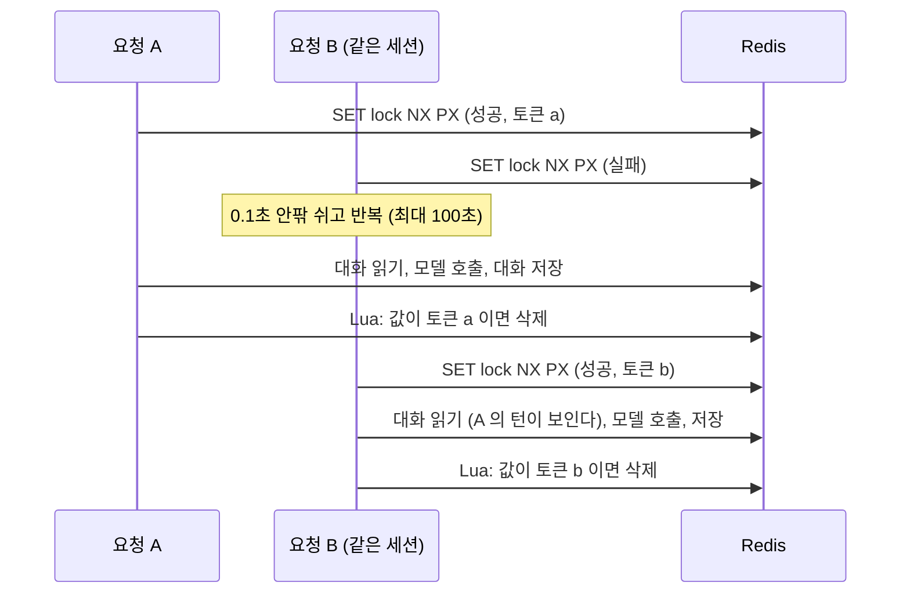
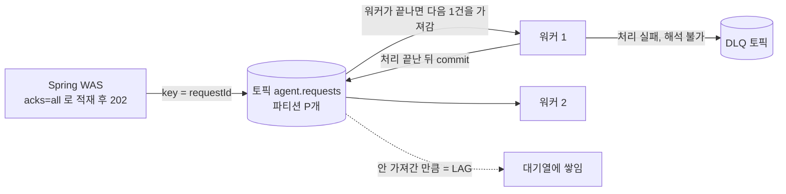

# Day 39 — 연구 보고서: Technical Deep Dive

> 상태: **작성 완료**(2026-10-21). 같은 내용이 프로젝트 루트 [README.md](../README.md) 의 5번에 들어 있다. 앞 문서: [DAY38_REPORT.md](DAY38_REPORT.md).

**전체 목적:** 4번의 결과를 만든 세 가지 설계, Redis 분산 락, Kafka 의 처리 속도 제어, HNSW 검색 설정을 왜 그렇게 만들었고 어떤 근거로 정했는지 쓴다. 새로 잰 값은 없다.

## 작업 기록

| 항목             | 내용                                                                                                                                                                         |
| ---------------- | ---------------------------------------------------------------------------------------------------------------------------------------------------------------------------- |
| 만든 파일        | 이 문서, `README.md` 에 5번 추가. 그래프는 Day 38 의 `hnsw-ef.png` 를 다시 썼다                                                                                               |
| 코드에서 확인    | `redis_lock.py`(SET NX PX, Lua 해제, 만료 150초, 대기 100초, 재시도 0.1초, `fail_open`), `kafka_worker.py`(한 건씩 처리, 수동 commit, DLQ), `agent_handler.py`(120초 제한), `AgentRequestProducer.java`(key = requestId, acks=all, 5초) |
| 값의 출처        | Day 21, 22, 33(락), 18, 27, 28, 32, 34(Kafka), 29(HNSW)의 `RESULT.md`. `m`, `ef_construct` 표는 Day 29 결과 표에서 다시 옮겼다                                              |
| 일반 정의        | HNSW 설정 세 개의 "뜻" 열은 이 프로젝트에서 잰 것이 아니라 일반적인 정의다                                                                                                    |
| 확인하지 못한 것 | Kafka 의 `max.poll.interval` 등 소비자 설정이 긴 처리에 미치는 영향은 살펴보지 않았다. 실제 문서 규모(4개)에서의 HNSW 효과는 없다                                              |

## 5. Technical Deep Dive

앞의 4번이 "무엇을 재서 어떤 결과가 나왔는가"였다면, 여기서는 그 결과를 만든 세 가지 설계(Redis 분산 락, Kafka 처리 속도 제어, HNSW 검색 설정)를 왜 그렇게 만들었고 어떤 근거로 정했는지 쓴다.

### 5-1. Redis 분산 락: 같은 세션의 동시 요청

**문제.** 같은 `sessionId` 로 요청이 동시에 오면 워커 둘이 같은 대화를 읽고, 각자 모델을 부른 뒤 저장하면서 서로의 턴을 덮어쓴다. 유실만이 아니라, 뒤 요청이 앞 요청의 답을 모른 채 답하는 일이 더 흔하다(Day 21, 22).

**방식.** 세션마다 락을 걸어 "대화 읽기, 모델 호출, 저장"을 한 번에 한 요청만 하게 한다. 직접 만들었다(`redis_lock.py`).

| 동작   | 구현                                                                                                                        | 이유                                                                                     |
| ------ | --------------------------------------------------------------------------------------------------------------------------- | ---------------------------------------------------------------------------------------- |
| 잡기   | `SET agent:lock:conversation:{sessionId} {토큰} NX PX {만료}`. 토큰은 락마다 새로 만든 무작위 값                              | `NX` 는 키가 없을 때만 저장되므로 저장에 성공한 쪽이 락을 잡은 것이다                    |
| 기다리기 | 못 잡으면 0.1초 안팎(0.5~1.5배로 흔듦)으로 쉬고 다시 시도, 최대 100초. 넘으면 `LockTimeout`                                  | 여러 워커가 같은 순간에 몰리지 않게 하고, 전체 처리 제한(120초) 안에서 끝나게 한다       |
| 만료   | 150초(`REDIS_LOCK_TTL_SEC`)                                                                                                  | 락을 쥔 워커가 죽어도 키가 영원히 남지 않는다. 에이전트 한 건 최대 120초보다 길게 잡았다 |
| 풀기   | Lua 스크립트로 "값이 내 토큰이면 삭제"를 한 번에 실행                                                                        | 내 락이 만료된 뒤 다른 워커가 새로 잡았는데 늦게 끝난 내가 지우면 남의 락을 지우게 된다  |
| Redis 오류 | `run_agent` 는 `fail_open=True`. Redis 오류로 락을 못 잡으면 락 없이 계속한다                                              | 대화 이어가기도 Redis 라서 어차피 같이 안 된다는 판단                                    |

**근거.**

| 시험                      | 락 없음                                                                      | 락 있음                                               | Day  |
| ------------------------- | ---------------------------------------------------------------------------- | ----------------------------------------------------- | ---- |
| 스레드 20개, 같은 세션    | 저장된 턴 4개                                                                | 20개                                                  | 21   |
| 모델이 받은 이전 대화 수  | 0, 0, 0, 0                                                                   | 0, 2, 4, 6                                            | 21   |
| 같은 순간에 끝나는 요청 N=4, 6, 8 (10라운드) | 10라운드 모두 유실, 남은 턴 평균 1.20, 1.40, 2.10                  | 유실 0, 반영률 1.00                                   | 22   |
| 같은 세션 100개           | 100개가 모두 겹침, 저장된 대화 유실(10턴 중 8턴)                             | 한 번에 하나씩 실행, 순서와 저장이 맞음               | 33   |
| 다른 세션의 요청          | -                                                                            | 락이 세션별이라 늦춰지지 않음(한 건 시간 0.41초 그대로) | 22   |

**대가와 한계.**

- 같은 세션 N건은 차례로 처리되므로 시간이 약 N배가 된다(Day 22). 모델 한 건이 수 초에서 수십 초면 그만큼 기다린다.
- 기다리는 요청이 모두 폴링하므로 락 시도는 N 의 제곱에 가깝게 늘었다. N=100 에서 락 때문에 Redis 명령이 건당 약 29번 늘었다(Day 33). 선착순도 보장하지 않는다.
- 일이 락 만료(150초)보다 오래 걸리면 락이 풀려 요청이 겹친다. 만료 연장 기능은 없다(Day 33 ④).
- N=200 에서 Redis 연결 풀(기본 100)이 모자라면 락이 우회되고 대화 읽기, 저장이 실패하는데 응답은 성공으로 나간다. `fail_open=True` 의 대가이며, 풀을 300 으로 늘리면 정상이었다. 이 부분은 코드를 고치지 않았고, 고칠지는 결정하지 않았다(Day 33).
- Redis 서버 한 대 기준이다. 복제나 장애 조치 환경의 안전성(Redlock 논쟁)은 다루지 않았다.

### 5-2. Kafka: 요청을 받는 속도와 처리 속도를 떼어 놓기

**문제.** 에이전트 한 건은 수 초에서 수십 초 걸리고, 요청은 그보다 훨씬 빠르게 몰려온다. 받는 즉시 처리하면 동기 구조처럼 연결이 쌓여 504 가 난다(4-2).

**방식.** 요청은 Kafka 에 넣기만 하고 바로 202 를 돌려준다. 워커는 자기 속도로 가져가 처리한다. 속도를 제어하는 것은 별도의 제한 장치가 아니라 가져가는 방식(pull)이다.

| 설계                                 | 구현                                                                                                                      | 효과                                                                                              |
| ------------------------------------ | ------------------------------------------------------------------------------------------------------------------------- | ------------------------------------------------------------------------------------------------- |
| 접수는 Kafka 에 넣고 202             | 브로커가 저장했다고 응답할 때까지(`acks=all`) 짧게 기다린 뒤 반환. 5초 안에 못 넣으면 503                                 | 202 가 "Kafka 에 들어갔다"는 뜻이 된다. 접수는 수 ms 로 끝난다                                    |
| 워커는 한 번에 한 건                 | `async for record in consumer:` 안에서 한 건 처리가 끝나야 다음을 가져온다                                                | 처리 속도보다 빠르게 들어온 요청은 브로커에 쌓인다(LAG). 워커가 터지지 않는다                     |
| 처리가 끝난 뒤 commit(수동)          | 성공, 실패로 건너뜀, 해석 불가 모두 끝난 뒤 commit. 처리 중에 죽으면 같은 메시지를 다시 받는다                            | 요청이 유실되지 않는다. 대신 같은 요청이 두 번 처리될 수 있다(처리 중 리밸런싱으로 파티션을 잃으면 commit 이 거절된다) |
| 한 건의 시간 제한                    | 에이전트 호출에 120초 제한. 넘으면 실패로 기록하고 다음 메시지로                                                          | 한 건 때문에 뒤의 메시지가 모두 막히지 않는다                                                     |
| 실패한 메시지 보관                   | 건너뛴 메시지는 DLQ 토픽(`agent.requests.dlq`)에 원본과 실패 정보와 함께 보관한 뒤 commit. 보관에 실패하면 commit 하지 않는다 | 손실보다 재처리를 택한다                                                                          |
| 같은 요청은 같은 파티션              | 메시지 key = `requestId`                                                                                                  | 파티션이 여러 개일 때 요청이 해시로 흩어진다. 고르게 나뉘지는 않는다(아래)                        |

**근거.**

- 접수 경로는 쉬지 않고 보내도 모든 계단에서 접수 성공 100% 였다(4-3). 접수가 처리 속도와 떨어져 있다는 직접 증거다.
- 처리하지 못한 요청은 유실되지 않고 대기열에 남았다. VU 20 시험 직후 Kafka 에 15건이 남았다가 약 2분 뒤 0 이 됐다(Day 27). 동기 구조에서는 같은 요청이 504 로 버려졌다.
- 접수 속도가 처리 속도보다 훨씬 빨라 대기열이 크게 쌓인다. 접수 경로 한계 시험 뒤 LAG 는 153,247건(① 뒤)이었고 ② 로 1,915,854건이 더 접수됐다(Day 28). 워커 1대는 건당 약 5초(가짜 모델)라 초당 0.2건이다.
- 처리량은 일하는 워커 수(`min(파티션, 워커)`)로 정해진다. 파티션 1개에 워커 3대를 둬도 0.49건/초 그대로였고, 파티션 6개에 워커를 3대에서 6대로 늘리자 2.2배가 됐다(4-4).
- 요청 id 의 해시는 파티션을 고르게 나누지 못한다. 같은 P6 W3 조합이 두 번 재서 1.13, 1.29건/초로 달랐고, 전체 시간은 가장 많이 받은 워커의 건수로 정해졌다(Day 34.1).

**한계.**

- 접수 경로가 Kafka 에 넣기만 하므로 처리가 얼마나 밀렸는지는 응답으로 알 수 없다. 클라이언트는 결과 조회 API 로 완료를 확인한다.
- 같은 요청이 두 번 처리될 수 있다(at-least-once). 결과는 `requestId` 로 저장되므로 덮어쓰인다. 모델 호출이 두 번 나가는 비용은 막지 않는다.
- 처리 순서는 파티션 안에서만 지켜진다. 이 프로젝트는 요청마다 독립이라 전체 순서는 필요로 하지 않는다.

### 5-3. HNSW: 벡터 검색 설정을 정한 근거

**문제.** 질문을 벡터로 바꿔 가장 가까운 문서를 찾을 때 모든 벡터와 비교하면 문서가 많아질수록 느려진다. Qdrant 는 근사 검색(HNSW 그래프)을 쓰고, 이때 정확도와 속도가 설정 세 개로 갈린다. 이 값을 기본값 그대로 두지 않고 측정해서 정했다(Day 29).

| 설정          | 언제 쓰이는가   | 뜻(일반적인 정의)                                       | 올리면                                    |
| ------------- | --------------- | ------------------------------------------------------- | ----------------------------------------- |
| `m`           | 인덱스를 만들 때 | 각 노드가 가지는 연결의 수                              | 정확도 상승, 인덱스와 검색이 무거워짐     |
| `ef_construct` | 인덱스를 만들 때 | 연결을 고를 때 살펴보는 후보의 수                       | 인덱스 품질 상승(기대), 만드는 시간 증가  |
| `hnsw_ef`     | 검색할 때       | 검색 중 살펴보는 후보의 수                              | 정확도 상승, 검색이 느려짐                |

**실험.** 합성 벡터 10만 개(768차원, 코사인), 질의 200건, 상위 10개. 정답은 전수 비교(`exact=True`)의 상위 10개이고, recall@10 은 그것과 겹치는 비율이다. 설정을 하나씩 바꿔 가며 recall@10, 지연, 인덱스 만드는 시간, 디스크를 쟀다.

| `m` | recall@10 (`hnsw_ef`=64) | qps (`hnsw_ef`=64) | 인덱스 만드는 시간 | 디스크 |
| --- | ------------------------ | ------------------ | ------------------ | ------ |
| 8   | 0.9390                   | 343.2              | 8.6초              | 352MB  |
| 16  | 0.9945                   | 306.4              | 13.8초             | 363MB  |
| 32  | 0.9955                   | 259.0              | 14.3초             | 368MB  |
| 64  | 0.9965                   | 207.4              | 15.2초             | 374MB  |

| `ef_construct` | recall@10 (`hnsw_ef`=64) | 인덱스 만드는 시간 |
| -------------- | ------------------------ | ------------------ |
| 50             | 0.9920                   | 8.2초              |
| 100            | 0.9935                   | 11.7초             |
| 200            | 0.9915                   | 20.3초             |
| 400            | 0.9905                   | 31.0초             |

**결정.** `m`=16, `ef_construct`=100, `hnsw_ef`=64. 이때 recall@10 이 약 0.99 이고 qps 는 약 290~310 이었다. 더 높은 정확도가 필요하면 인덱스를 다시 만들지 않고 검색 때의 `hnsw_ef` 만 키우면 된다(128 에서 약 0.997, 지연은 p50 기준 1.1~1.4배).

**근거가 말해 주는 것과 아닌 것.**

- 이 데이터에서 정확도를 가장 크게 좌우한 것은 검색 때의 `hnsw_ef` 였다. 8 에서 0.706, 64 에서 0.991 이고 그 뒤로는 거의 오르지 않으면서 처리량만 떨어졌다.
- `m` 은 8 일 때만 부족했고 16 부터는 차이가 작았다. `m` 이 클수록 인덱스는 늦게 만들어지고 검색은 느렸다.
- `ef_construct` 는 올려도 recall 이 오르지 않았고(오차 범위) 시간만 늘었다. 시험 전 예상(클수록 높다)과 달랐다.
- 숫자는 합성 벡터 10만 개의 한 번 측정이다. 같은 설정의 qps 도 표마다 다르게 나와(예: `ef_construct` 가 검색 속도와 무관한데도 표마다 qps 가 다름) 지연과 qps 의 작은 차이는 해석하지 않았다. 같은 설정(m=16, ef_construct=100)으로 인덱스를 세 번 만들었을 때 `hnsw_ef`=64 의 recall 도 0.9910, 0.9945, 0.9935 로 ±0.004 정도 흔들렸다(그래서 4-1 의 H8 과 H9 의 값이 다르다).
- 이 프로젝트의 실제 문서는 4개(청크 15~18개)라 이 컬렉션에서는 검색 설정이 결과를 바꾸지 못한다. 위 결정은 문서가 많아졌을 때를 위한 값이다. 검색 코드(`qdrant_search.py`)에는 `hnsw_ef`=64 를, 컬렉션 생성 코드(`qdrant_setup.py`)에는 `m`=16, `ef_construct`=100 을 적었다. 이미 만든 컬렉션은 그대로이고 새로 만들 때부터 적용된다.
