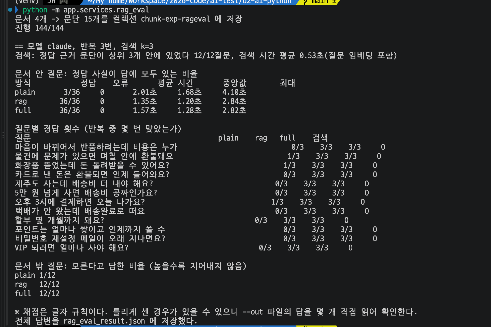

# Day 41.1 결과 — RAG 유무 정량 비교 (Claude)

> 상태: **실행 완료**(2026-10-21). 문서 안 질문 12개 x 3번에서 plain 3/36, rag 36/36, full 36/36. 문서 밖 질문에서 plain 은 12번 중 6번 이 쇼핑몰에 없는 정책을 사실처럼 답했다.
> 가이드는 [DAY41_1_GUIDE.md](DAY41_1_GUIDE.md), 일부 비교는 [DAY10_GUIDE.md](DAY10_GUIDE.md)(질문 1개).

**전체 목적:** RAG(검색한 문단을 프롬프트에 붙이기)를 쓰면 답이 얼마나 정확해지고 시간이 얼마나 느는지, 검색 없이 문서 전체를 붙이는 방식과 비교해 숫자로 확인한다. Day 10 에서는 질문 1개를 눈으로 봤다.


## 1. 환경

| 항목              | 값                                                                                                                |
| ----------------- | ----------------------------------------------------------------------------------------------------------------- |
| 실행              | `python -m app.experiments.rag_eval` (프로젝트 루트 `d2-ai-python`), 2026-10-21                                       |
| 답을 쓰는 모델    | Claude Haiku(`claude-haiku-5-5`). Gemini 채팅 모델은 쓰지 않았다                                                   |
| 질문을 숫자로 바꾸는 모델 | Gemini `gemini-embedding-001`(768차원). 질문 16개와 문단 15개                                                |
| 문서              | 가상 쇼핑몰 안내문 4개를 문단 단위로 잘라 15문단(컬렉션 `chunk-exp-rageval`). `documents-12` 는 쓰지 않았다           |
| 질문              | 문서 안 12개(`EVAL_QUESTIONS`), 문서 밖 4개. 질문마다 3번 반복해 방식당 문서 안 36번, 문서 밖 12번                   |
| 검색              | 상위 3문단(`k`=3), 질문당 한 번만 검색하고 반복에서는 같은 문단을 사용                                               |
| 호출 횟수         | Claude 144번(16질문 x 3방식 x 3번), 임베딩 약 31번                                                                 |
| 측정 횟수         | 한 번 실행                                                                                                         |
| 원본 답변         | [rag_eval_result.json](data/day41_1_rag_eval_result.json) (144개 답 전체, 질문별 검색 결과와 시간)                  |


## 2. 결과

### 2-1. 문서 안 질문 12개



정답은 답에 정답 값이 모두 들어 있는 경우다(글자 규칙).

| 방식  | 정답            | 모델 호출 시간 평균 | 중앙값 | 최대  | 답 평균 길이 |
| ----- | --------------- | ------------------- | ------ | ----- | ------------ |
| plain | 3 / 36 (8%)     | 2.01초              | 1.68초 | 4.10초 | 142자        |
| rag   | 36 / 36 (100%)  | 1.35초              | 1.20초 | 2.84초 | 94자         |
| full  | 36 / 36 (100%)  | 1.57초              | 1.28초 | 2.82초 | 102자        |

검색은 12개 질문 모두 정답 근거 문단을 상위 3개 안에 가져왔다(12/12). 검색 시간은 질문 임베딩을 포함해 평균 0.53초이고, 위 모델 호출 시간에는 들어 있지 않다. 오류로 끝난 호출은 0건이다.

| 질문                                   | plain | rag | full | 검색 |
| -------------------------------------- | ----- | --- | ---- | ---- |
| 마음이 바뀌어서 반품하려는데 비용은 누가 내요? | 0/3   | 3/3 | 3/3  | O    |
| 물건에 문제가 있으면 며칠 안에 환불돼요?       | 1/3   | 3/3 | 3/3  | O    |
| 화장품 뜯었는데 돈 돌려받을 수 있어요?         | 1/3   | 3/3 | 3/3  | O    |
| 카드로 낸 돈은 환불되면 언제 들어와요?         | 0/3   | 3/3 | 3/3  | O    |
| 제주도 사는데 배송비 더 내야 해요?             | 0/3   | 3/3 | 3/3  | O    |
| 5만 원 넘게 사면 배송비 공짜인가요? 제주도도요? | 0/3   | 3/3 | 3/3  | O    |
| 오후 3시에 결제하면 오늘 나가요?               | 1/3   | 3/3 | 3/3  | O    |
| 택배가 안 왔는데 배송완료로 떠요               | 0/3   | 3/3 | 3/3  | O    |
| 할부 몇 개월까지 돼요?                         | 0/3   | 3/3 | 3/3  | O    |
| 포인트는 얼마나 쌓이고 언제까지 쓸 수 있어요?  | 0/3   | 3/3 | 3/3  | O    |
| 비밀번호 재설정 메일이 오래 지나면요?          | 0/3   | 3/3 | 3/3  | O    |
| VIP 되려면 얼마나 사야 해요?                   | 0/3   | 3/3 | 3/3  | O    |

### 2-2. plain 이 틀린 답

plain 이 맞게 센 3번은 모두 "일반적으로 ~"라고 말한 추측이 문서와 겹친 것이다(상품 하자 환불 30일, 개봉한 화장품 환불 어려움, 오후 2시 이전 결제 당일 출고). 틀린 33번을 직접 읽어 나누면 다음과 같다.

| 구분                                     | 번 수 | 예                                                                                                                         |
| ---------------------------------------- | ----- | -------------------------------------------------------------------------------------------------------------------------- |
| 틀린 값을 단정                           | 8     | 카드 환불 기간을 3번 모두 "영업일 3~7일"(문서는 3~5일). 재설정 링크를 3번 모두 "대개 24시간 이내"(문서는 30분). 오후 3시 결제를 2번 "당일 출고 가능"(문서는 2시 이전만) |
| 값 없이 일반론이나 확인 안내로 넘어감     | 25    | 교환 배송비는 "일반적으로 고객 부담"만 말하고 금액이 없다. 할부, 포인트, VIP 기준은 9번 모두 "확인이 어렵다, 고객센터에 문의"                       |

rag 와 full 의 답은 36번 모두 문서의 값을 그대로 썼다. 예를 들어 교환 배송비를 묻는 질문에 "왕복 배송비 5,000원은 고객님이 부담"이라고 답했다.

### 2-3. 문서 밖 질문 4개

문서에 없는 내용이라 "모른다/없다"고 답하는 것이 맞다.

| 방식  | 자동 채점 | 직접 읽고 나눈 결과                                                 |
| ----- | --------- | ------------------------------------------------------------------- |
| plain | 1 / 12    | 모른다고 명시 4, 일반론으로 회피 2, 이 쇼핑몰에 없는 사실을 답함 6   |
| rag   | 12 / 12   | 12번 모두 "문서에 해당 내용이 없습니다"                              |
| full  | 12 / 12   | 12번 모두 "문서에 해당 내용이 없습니다"                              |

| 질문                   | plain 의 3번 답                                                                                              |
| ---------------------- | ------------------------------------------------------------------------------------------------------------ |
| 고객센터 전화번호가 뭐예요? | 모른다고 명시 3 ("정보를 가지고 있지 않습니다")                                                              |
| 반품할 때 어느 택배사가 오나요? | 모른다고 명시 1, 일반론으로 회피 2 ("쇼핑몰마다 다르다")                                                  |
| 해외로도 배송해 주나요?     | 3번 모두 "저희 쇼핑몰은 국내 배송만 지원"이라고 답함. 문서에는 해외 배송 내용이 없다                         |
| 매장에 직접 가서 받아갈 수 있어요? | 3번 모두 "네, 매장에서 수령하실 수 있습니다"라고 답함. 문서에는 매장 수령 내용이 없다                    |

자동 채점이 plain 을 1/12 로 센 것은 "정보를 가지고 있지 않습니다", "확인할 수 없습니다"가 스크립트의 "모른다" 규칙에 없었기 때문이다. 스크립트는 고치지 않았고, 이 절의 직접 분류가 기준이다.


## 3. 확인 전 예상과 결과

| 번호 | 확인 전 예상                                                                    | 예상한 이유 | 실제                                                                                                 | 판정                                                       |
| ---- | ------------------------------------------------------------------------------- | ---------------------------------------- | ---------------------------------------------------------------------------------------------------- | ---------------------------------------------------------- |
| P1   | plain 은 문서 안 질문에서 정답이 적다(대략 3분의 1 이하)                        | 가상 쇼핑몰의 값(배송비, 기한 등)은 모델이 알 수 없다. 다만 화장품 개봉 환불 불가 같은 상식과 겹치는 질문은 맞힐 수 있다고 봤다 | 3 / 36 (8%). 맞은 3번은 일반 상식과 겹친 추측                                                         | 맞음. 예상보다 더 적었다                                    |
| P2   | rag 는 대부분 맞는다(대략 90% 이상), 틀리면 검색이 놓친 질문에 몰린다            | 검색이 정답 문단을 가져오면 문서의 값을 그대로 쓰면 된다. Day 12 에서 같은 문서의 문단 청킹 검색이 12/12 였다 | 36 / 36, 검색 12/12                                                                                  | 맞음                                                       |
| P3   | full 도 rag 와 비슷하게 맞는다                                                  | 문서가 15문단뿐이라 전부 붙여도 맥락이 넘치지 않는다고 봤다 | 36 / 36                                                                                              | 맞음                                                       |
| P4   | 문서 밖 질문에서 rag, full 은 모른다고 답한다(plain 은 예상하지 않음)            | 프롬프트에 "문서에 없으면 없다고 답하라"는 규칙이 있어서 rag 와 full 은 따른다고 봤다. plain 은 문서도 규칙도 없어 어떻게 답할지 예상하지 않았다 | rag, full 12/12. plain 은 6/12 에서 없는 사실을 답함                                                  | 맞음                                                       |
| P5   | 시간은 plain < rag < full 이고 rag 는 plain 보다 검색만큼 더 걸린다              | 모델에 보내는 글이 길수록 오래 걸린다고만 생각했다. plain 은 질문만 보내 가장 짧고, rag 는 문단 3개와 검색 시간이 더해지고, full 은 문서 전체가 붙는다고 봤다 | 모델 호출 시간 평균 plain 2.01초 > full 1.57초 > rag 1.35초(중앙값 1.68, 1.28, 1.20초). rag 는 검색 0.53초를 더하면 평균 1.88초, 중앙값 기준 약 1.7초          | 일부 틀림. rag < full 은 맞았지만 plain 이 가장 빠르지 않았고, 검색을 더한 rag 와 plain 은 거의 같았다                                  |

\*참조: P5 의 "모델에 보내는 글" 예시 (질문 "제주도 사는데 배송비 더 내야 해요?"를 보낼 때. 이해를 돕는 예시이며 실제 프롬프트 문구와는 다르다)

plain (질문만)

```
제주도 사는데 배송비 더 내야 해요?
```

rag (질문 + 검색한 문단 3개)

```
[문서]
제주도와 도서산간 지역은 추가 배송비 3,000원이 부과됩니다.
5만 원 이상 구매 시 기본 배송비는 무료입니다.
(관련 문단 3개)

질문: 제주도 사는데 배송비 더 내야 해요?
```

full (질문 + 문서 전체)

```
[문서]
배송 안내 전체 ... 반품 안내 전체 ... 결제 안내 전체 ... 회원 안내 전체 ... (15문단)

질문: 제주도 사는데 배송비 더 내야 해요?
```


## 4. 해석

- 이 쇼핑몰만의 값(교환 배송비 5,000원, 재설정 링크 30분, 적립 1%와 1년 등)은 RAG 없이는 맞히지 못했다. plain 은 8%였고 맞은 것도 추측이 겹친 것이며, 8번은 틀린 값을 사실처럼 말했다.
- 문서가 15문단뿐인 이 규모에서는 검색으로 3문단을 고른 rag 와 문서 전체를 붙인 full 의 정확도가 같았다(둘 다 36/36). 검색이 정답 문단을 놓치지 않았기 때문이다(12/12). 문서가 이보다 훨씬 많을 때의 차이는 이 실험으로 알 수 없다.
- 문서 밖 질문에서는 plain 이 "해외 배송은 불가", "매장 수령 가능"처럼 이 쇼핑몰에 없는 정책을 사실처럼 답했다(12번 중 6번). rag 와 full 은 12번 모두 문서에 없다고 답했다. 실제 서비스에서는 정확도 차이보다 이 차이가 더 문제가 될 수 있다.
- 시간은 입력 길이보다 답 길이와 호출당 고정 비용(약 1초)에 좌우됐다. 문서 밖 질문에서 rag 와 full 은 비슷하게 짧게 답했는데(23자, 16자), 입력이 문단 3개 대 15개로 달라도 시간은 1.18초로 같았다. plain 은 문서가 없어 답이 길었고(142자 대 rag 94자) 오래 걸린 호출 몇 번이 평균을 끌어올렸다(중앙값은 1.68초). 같은 질문끼리 비교하면 rag 의 모델 호출이 plain 보다 짧은 질문이 12개 중 11개였지만, 검색 0.53초를 더하면 둘은 거의 같다. 한 번 실행이고 길이는 글자 수로 쟀으므로(토큰 수가 아니다) 이 비율을 다른 규모에 그대로 쓸 수는 없다.

**결론:** 문서에 있는 내용을 정확히 답하게 하려면 RAG(또는 문서 붙이기)가 필요하다. 속도는 비슷하고, rag 가 full 보다 낫다는 것은 문서가 더 많아지면 더 뚜렷이 나타나 보일 것이다.

**한계**

- 문서 4개(15문단)의 가상 쇼핑몰이다. 문서를 늘리면 full 이 질문마다 보내는 토큰이 늘어 비용이 커지므로 작게 잡았다. 문서가 수천 개일 때의 검색 실패, full 의 입력 한도는 다루지 않았다.
- 문서 안 질문 12개, 문서 밖 질문 4개, 모델 하나(Claude Haiku)의 한 번 실행이다.
- 정답 판정은 글자 규칙이다. 문서 안 질문 36번 중 plain 의 3번은 추측이 겹친 것이라 엄격하게 보면 더 적다. 문서 밖 질문의 "모른다" 판정은 자동 채점이 부정확해 직접 읽고 나눈 값을 썼다.
- 검색 시간은 질문당 한 번 잰 값(질문 임베딩과 Qdrant 검색의 합)이고, Claude 호출 1회 기준이다. 에이전트가 도구로 검색하는 실제 흐름(모델 호출 2번)과는 다르다.
